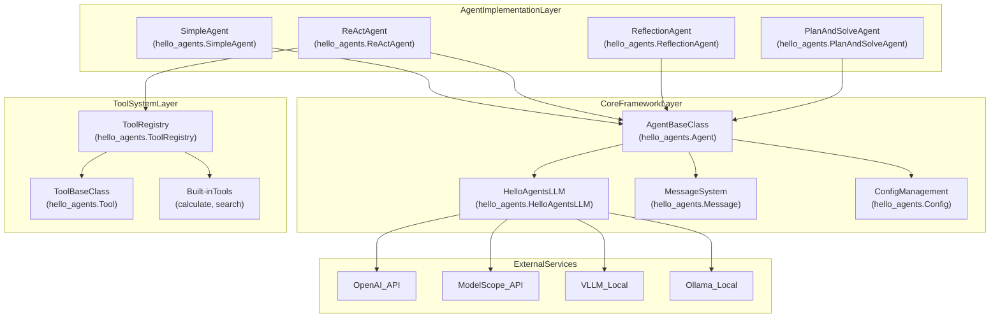
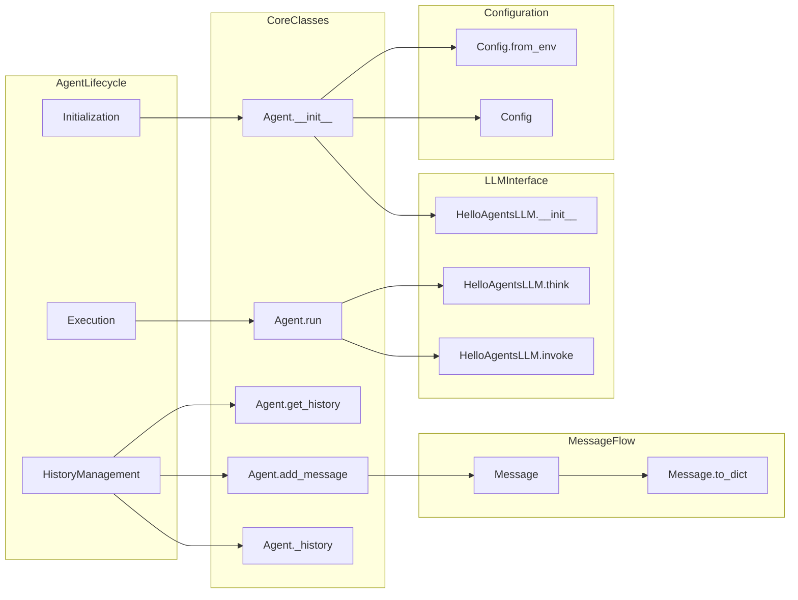
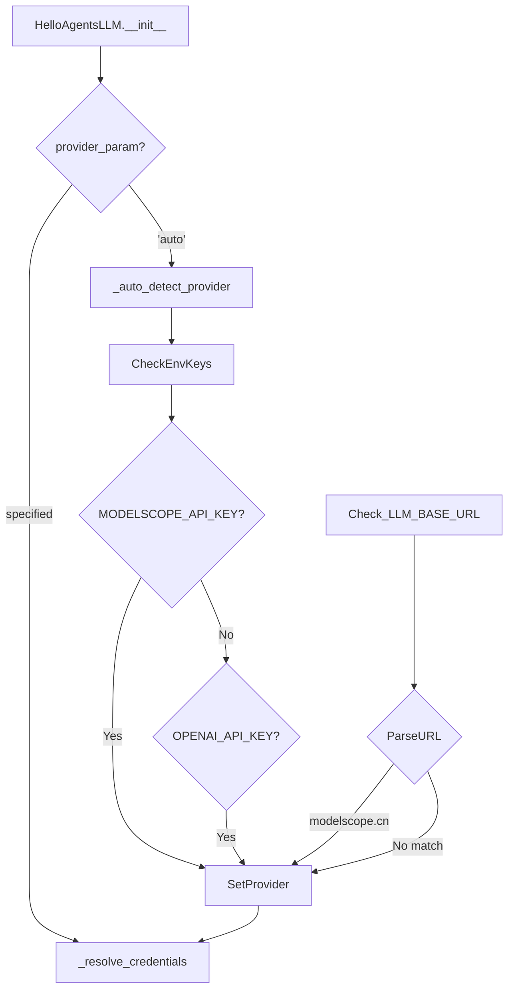
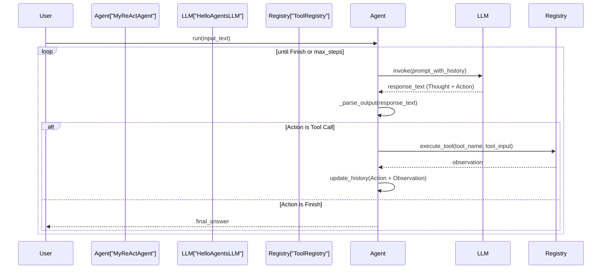

<!-- source: DeepWiki mcp.deepwiki.com · repo datawhalechina/hello-agents · page 7.1 Framework Architecture Overview · fetched 2026-10-29 -->

# Framework Architecture Overview

<details>
<summary>Relevant source files</summary>

The following files were used as context for generating this wiki page:

- [code/chapter7/my_main.py](code/chapter7/my_main.py)
- [code/chapter7/my_react_agent.py](code/chapter7/my_react_agent.py)
- [code/chapter7/test_react_agent.py](code/chapter7/test_react_agent.py)
- [docs/chapter7/Chapter7-Building-Your-Agent-Framework.md](docs/chapter7/Chapter7-Building-Your-Agent-Framework.md)

</details>


## Purpose and Scope

This document describes the architectural design and core components of the HelloAgents framework, a lightweight, teaching-oriented agent development framework built on OpenAI-compatible APIs. The architecture is designed to balance simplicity with extensibility, enabling developers to understand agent mechanics while supporting progressive feature adoption.

This page covers the framework's layered structure, core abstractions, and extension patterns. For specific agent paradigm implementations, see [Agent Base Classes](7.2). For LLM provider integration details, see [LLM Client Integration](7.3). For tool management patterns, see [Tool Registry System](7.4).

**Sources:** [docs/chapter7/Chapter7-Building-Your-Agent-Framework.md:1-92]()

---

## Design Philosophy

HelloAgents is architected around four core principles that distinguish it from existing frameworks:

### Lightweight and Teaching-Friendly
The framework separates code by chapter, enabling developers to understand the complete working mechanism within a reasonable timeframe. Dependencies are minimized to the OpenAI SDK and basic libraries, avoiding heavy dependency chains that obscure the learning process. [docs/chapter7/Chapter7-Building-Your-Agent-Framework.md:44-47]()

### OpenAI API Standard
Rather than creating custom abstractions, HelloAgents builds directly on the industry-standard OpenAI API interface. This ensures compatibility when migrating to other frameworks and reduces conceptual overhead for developers already familiar with OpenAI patterns. [docs/chapter7/Chapter7-Building-Your-Agent-Framework.md:48-51]()

### Progressive Learning Path
The framework provides versioned releases corresponding to each chapter, allowing learners to study incremental feature additions without conceptual jumps. [docs/chapter7/Chapter7-Building-Your-Agent-Framework.md:52-55]()

### Unified Tool Abstraction
**Key Innovation:** All advanced capabilities (Memory, RAG, RL, MCP protocols) are abstracted as tools. This eliminates unnecessary abstraction layers present in frameworks that treat these as separate systems, returning to the intuitive core logic of "agents calling tools." [docs/chapter7/Chapter7-Building-Your-Agent-Framework.md:56-58]()

**Sources:** [docs/chapter7/Chapter7-Building-Your-Agent-Framework.md:38-58]()

---

## Layered Architecture

HelloAgents follows a three-tier layered architecture with clear separation of concerns:

Title: HelloAgents System Architecture


**Layer Responsibilities:**

| Layer | Purpose | Key Components |
|-------|---------|----------------|
| **Agent Implementation** | Concrete agent patterns with specific reasoning strategies | `SimpleAgent`, `ReActAgent`, `ReflectionAgent`, `PlanAndSolveAgent` |
| **Core Framework** | Abstract interfaces and shared infrastructure | `Agent`, `HelloAgentsLLM`, `Message`, `Config` |
| **Tool System** | Plugin architecture for external capabilities | `ToolRegistry`, `Tool`, `calculate`, `search` |

**Sources:** [docs/chapter7/Chapter7-Building-Your-Agent-Framework.md:63-92](), [code/chapter7/test_react_agent.py:3-4]()

---

## Core Component Mapping

This diagram maps high-level concepts to specific code entities and their lifecycle methods:

Title: Agent Execution and Lifecycle Mapping


**Key Class Relationships:**

| Class | Source File | Responsibility |
|-------|----------|----------------|
| `Agent` | `hello_agents` | Abstract base class defining agent interface and history. |
| `HelloAgentsLLM` | `hello_agents` | Unified LLM client with provider auto-detection. [code/chapter7/test_react_agent.py:13]() |
| `Message` | `hello_agents` | Structured message format with role constraints. [code/chapter7/my_react_agent.py:31]() |
| `Config` | `hello_agents` | Environment-based configuration management. [code/chapter7/my_react_agent.py:31]() |
| `ToolRegistry` | `hello_agents` | Plugin system for tool discovery and execution. [code/chapter7/test_react_agent.py:16]() |

**Sources:** [code/chapter7/test_react_agent.py:1-43](), [code/chapter7/my_react_agent.py:31-53]()

---

## Provider Detection System

HelloAgents implements a provider detection mechanism that enables zero-configuration usage by analyzing environment variables and URL patterns.

Title: HelloAgentsLLM Provider Resolution Logic


### Credential Resolution
After provider detection, `_resolve_credentials()` maps the provider to appropriate defaults. For example, `MyLLM` demonstrates extending this to support ModelScope specifically by setting the base URL to `https://api-inference.modelscope.cn/v1/`. [code/chapter7/my_main.py:9](), [code/chapter7/my_llm.py:1-25]()

**Sources:** [code/chapter7/my_main.py:1-15](), [code/chapter7/my_llm.py:1-41]()

---

## Extension Patterns

HelloAgents supports extension through inheritance, allowing users to customize LLM clients and Agent logic.

### Extending LLM Provider Support
To add a custom provider or override behavior, inherit from `HelloAgentsLLM`.

```python
# From code/chapter7/my_llm.py
class MyLLM(HelloAgentsLLM):
    def __init__(self, provider="auto", **kwargs):
        # Custom initialization for specific providers
        if provider == "modelscope":
            self.provider = "modelscope"
            # ... custom setup ...
        else:
            super().__init__(provider=provider, **kwargs)
```
**Sources:** [code/chapter7/my_llm.py:12-32]()

### Extending Agent Patterns
To implement custom agent logic, inherit from a paradigm base class like `ReActAgent`.

```python
# From code/chapter7/my_react_agent.py
class MyReActAgent(ReActAgent):
    def __init__(self, name, llm, tool_registry, ...):
        super().__init__(name, llm, ...)
        self.tool_registry = tool_registry
        self.max_steps = max_steps

    def run(self, input_text: str, **kwargs) -> str:
        # Custom Thought-Action-Observation loop implementation
        # ...
```
**Sources:** [code/chapter7/my_react_agent.py:33-100]()

---

## Component Interaction Flow

This diagram shows how components interact during a typical `ReActAgent` execution loop.

Title: ReAct Agent Execution Sequence


**Execution Steps:**
1. **Prompt Construction**: The agent combines the system prompt, tool descriptions from `tool_registry.get_tools_description()`, and `current_history`. [code/chapter7/my_react_agent.py:67-73]()
2. **LLM Inference**: The agent calls `self.llm.invoke()` with the constructed prompt. [code/chapter7/my_react_agent.py:77]()
3. **Parsing**: The agent parses the response into `thought` and `action`. [code/chapter7/my_react_agent.py:80]()
4. **Tool Execution**: If an action is identified, the agent calls `self.tool_registry.execute_tool()`. [code/chapter7/my_react_agent.py:92]()
5. **History Management**: The action and resulting observation are appended to `current_history` for the next iteration. [code/chapter7/my_react_agent.py:93-94]()

**Sources:** [code/chapter7/my_react_agent.py:55-100](), [code/chapter7/test_react_agent.py:38-55]()

---

