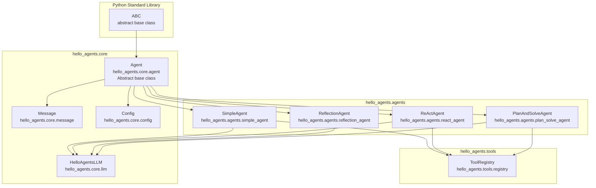
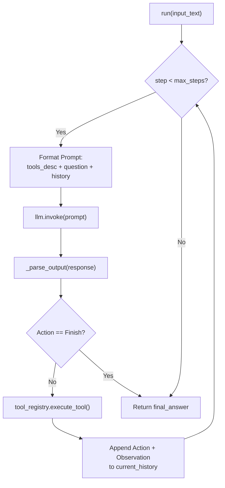
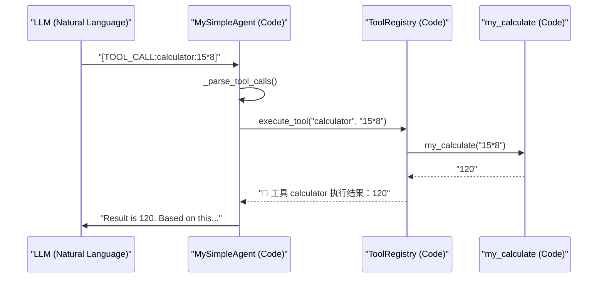

<!-- source: DeepWiki mcp.deepwiki.com · repo datawhalechina/hello-agents · page 7.2 Agent Base Classes · fetched 2026-10-29 -->

# Agent Base Classes

Relevant source files

The following files were used as context for generating this wiki page:

- [code/chapter7/.env.example](code/chapter7/.env.example)
- [code/chapter7/my_advanced_search.py](code/chapter7/my_advanced_search.py)
- [code/chapter7/my_calculator_tool.py](code/chapter7/my_calculator_tool.py)
- [code/chapter7/my_llm.py](code/chapter7/my_llm.py)
- [code/chapter7/my_main.py](code/chapter7/my_main.py)
- [code/chapter7/my_react_agent.py](code/chapter7/my_react_agent.py)
- [code/chapter7/my_simple_agent.py](code/chapter7/my_simple_agent.py)
- [code/chapter7/test_advanced_search.py](code/chapter7/test_advanced_search.py)
- [code/chapter7/test_my_calculator.py](code/chapter7/test_my_calculator.py)
- [code/chapter7/test_plan_solve_agent.py](code/chapter7/test_plan_solve_agent.py)
- [code/chapter7/test_react_agent.py](code/chapter7/test_react_agent.py)
- [code/chapter7/test_simple_agent.py](code/chapter7/test_simple_agent.py)
- [docs/chapter7/Chapter7-Building-Your-Agent-Framework.md](docs/chapter7/Chapter7-Building-Your-Agent-Framework.md)

This page documents the core agent implementations in the HelloAgents framework: `SimpleAgent`, `ReActAgent`, `ReflectionAgent`, and `PlanAndSolveAgent`. Each agent class represents a different reasoning paradigm, providing developers with specialized tools for different types of tasks.

## Purpose and Scope

The HelloAgents framework provides four base agent classes that implement distinct reasoning and execution patterns:

- **SimpleAgent**: Basic conversational agent with optional tool support and multi-turn capabilities.
- **ReActAgent**: Iterative reasoning and acting through a Thought-Action-Observation loop.
- **ReflectionAgent**: Self-critique and iterative refinement of outputs using an internal critic.
- **PlanAndSolveAgent**: Two-phase approach separating strategic planning from step-by-step execution.

All agent classes inherit from the abstract `Agent` base class and integrate with the framework's `HelloAgentsLLM` client and `ToolRegistry` system.

## Agent Class Hierarchy

The following diagram shows the inheritance structure and core dependencies of the agent implementations:

**Sources**: [docs/chapter7/Chapter7-Building-Your-Agent-Framework.md:65-89](), [code/chapter7/my_simple_agent.py:3-24](), [code/chapter7/my_react_agent.py:31-53]()

## SimpleAgent

`SimpleAgent` is a lightweight conversational agent. While it lacks complex internal loops, it supports tool calling via a standardized prompt-based protocol.

**Key Implementation Details**:
- **Tool Calling**: Uses a `[TOOL_CALL:tool_name:parameters]` format defined in the system prompt [code/chapter7/my_simple_agent.py:73-77]().
- **Iteration**: Supports multi-turn tool execution within a single `run()` call, up to a defined `max_tool_iterations` [code/chapter7/my_simple_agent.py:81-113]().
- **Parameter Parsing**: Features an intelligent parameter parser that handles `key=value` pairs or positional inputs [code/chapter7/my_simple_agent.py:168-194]().

**Sources**: [code/chapter7/my_simple_agent.py:6-128](), [code/chapter7/test_simple_agent.py:15-55]()

## ReActAgent

`ReActAgent` implements the Reason-Act paradigm. It forces the LLM to generate a "Thought" before an "Action", creating a transparent reasoning trace.

**Execution Flow**:
The `run()` method maintains a `current_history` list separate from the global conversation history to track the steps of the current task [code/chapter7/my_react_agent.py:57-68]().

**Sources**: [code/chapter7/my_react_agent.py:55-100](), [code/chapter7/test_react_agent.py:38-88]()

## ReflectionAgent

`ReflectionAgent` focuses on self-correction. It is particularly effective for code generation or creative writing where the first output may contain errors.

**Phase Logic**:
1. **Generation**: Produces the initial response.
2. **Reflection**: A "critic" prompt analyzes the response for flaws or missing requirements.
3. **Refinement**: A "refiner" prompt uses the feedback to generate an improved version.

**Sources**: [docs/chapter4/Chapter4-Building-Classic-Agent-Paradigms.md:477-600]()

## PlanAndSolveAgent

`PlanAndSolveAgent` addresses complex, multi-step problems by decomposing them into a static plan before execution begins.

**Key Components**:
- **Planning Phase**: The LLM is prompted to output a numbered list of steps required to solve the user's request.
- **Execution Phase**: The agent iterates through the list, executing each step sequentially. The context of previous steps is passed forward to maintain coherence.

**Sources**: [docs/chapter4/Chapter4-Building-Classic-Agent-Paradigms.md:600-750]()

## Tool Integration Patterns

Agents interact with tools via the `ToolRegistry`. This allows agents to be decoupled from the specific implementation of tools like calculators or search engines.

| Component | Code Entity | Role |
|-----------|-------------|------|
| **Registry** | `ToolRegistry` | Manages tool discovery and execution [code/chapter7/test_react_agent.py:16-41]() |
| **Function Tool** | `register_function` | Wraps standard Python functions as tools [code/chapter7/my_calculator_tool.py:56-60]() |
| **Class Tool** | `register_tool` | Registers complex tool classes (e.g., `CalculatorTool`) [code/chapter7/test_simple_agent.py:26-28]() |

### Data Flow: Agent to Tool
The following diagram maps the Natural Language intent to Code Execution:

**Sources**: [code/chapter7/my_simple_agent.py:130-166](), [code/chapter7/my_calculator_tool.py:7-31](), [code/chapter7/test_my_calculator.py:30-61]()

## Comparison Summary

| Agent Type | Best For | Complexity | Key File |
|------------|----------|------------|----------|
| **SimpleAgent** | General Q&A, Basic Tools | Low | `my_simple_agent.py` |
| **ReActAgent** | Dynamic, Multi-step Search | Medium | `my_react_agent.py` |
| **ReflectionAgent** | High-quality Code/Writing | Medium | `reflection_agent.py` |
| **PlanAndSolveAgent** | Complex Math/Planning | High | `plan_solve_agent.py` |

**Sources**: [docs/chapter7/Chapter7-Building-Your-Agent-Framework.md:112-149](), [code/chapter7/my_react_agent.py:33-53]()

---

