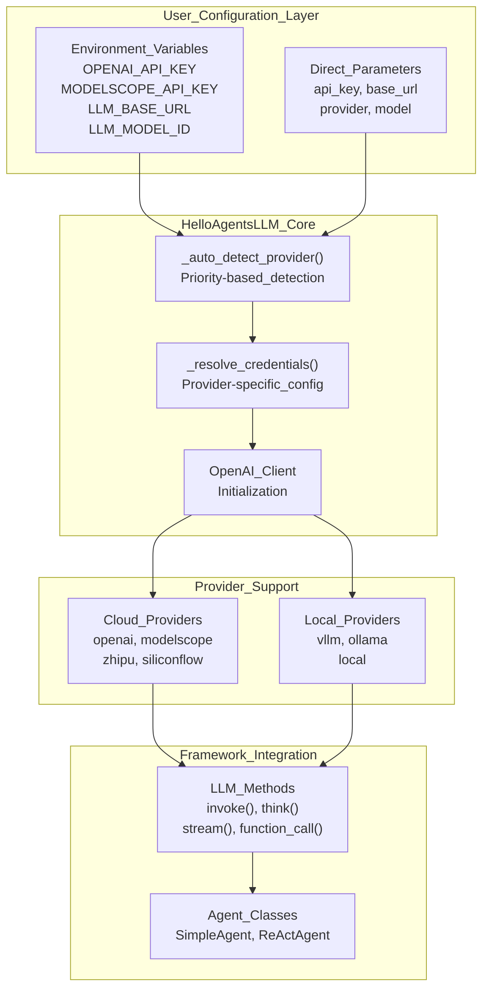
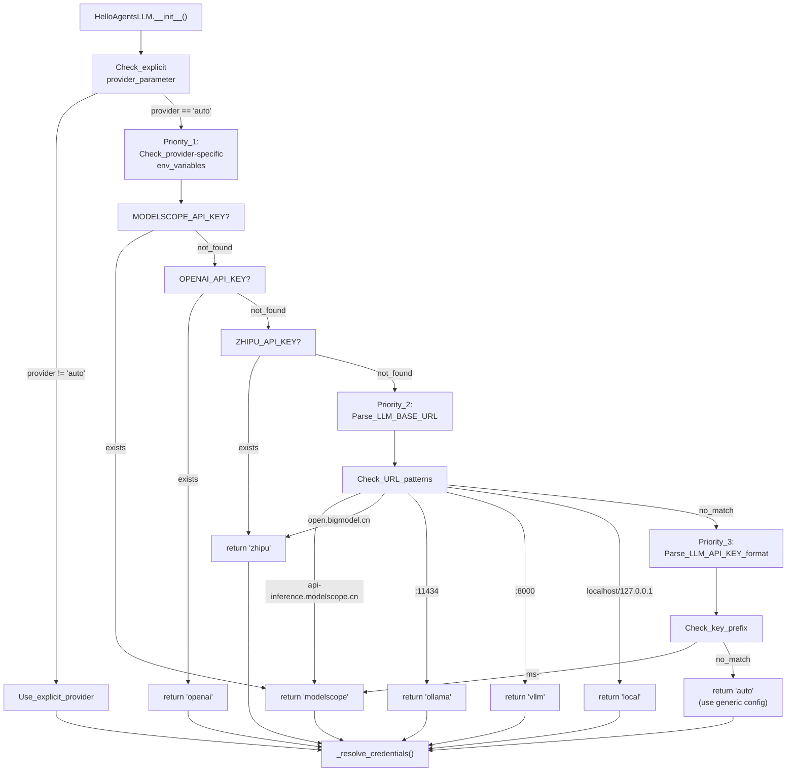
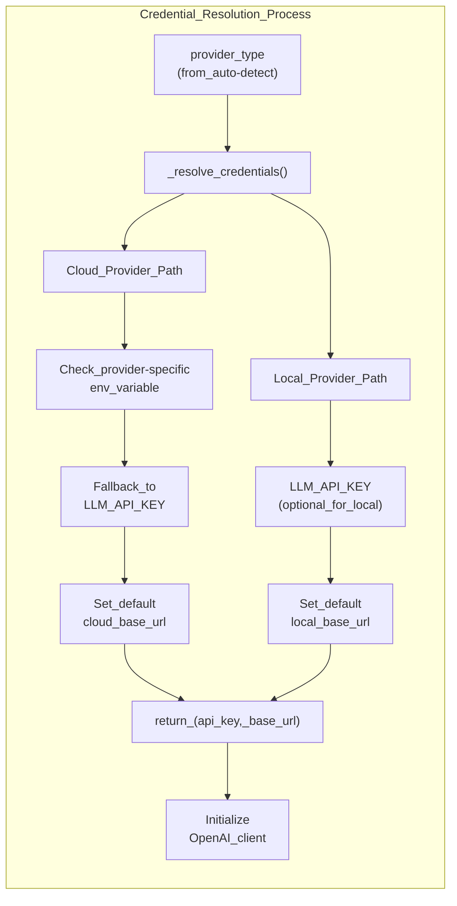
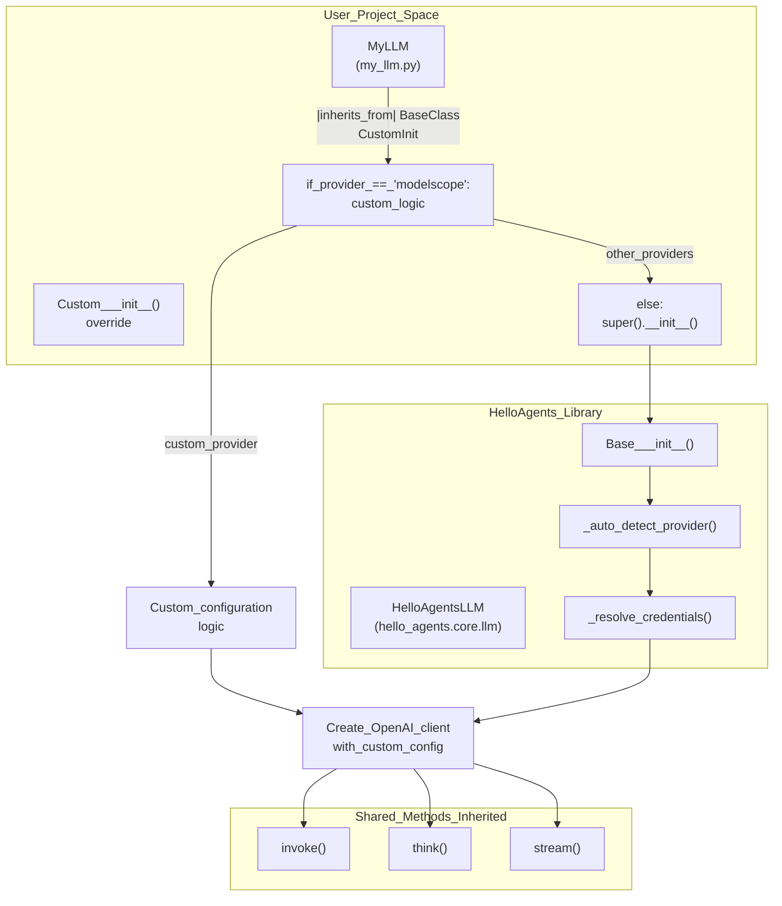

<!-- source: DeepWiki mcp.deepwiki.com · repo datawhalechina/hello-agents · page 7.3 LLM Client Integration · fetched 2026-10-29 -->

# LLM Client Integration

<details>
<summary>Relevant source files</summary>

The following files were used as context for generating this wiki page:

- [code/chapter7/my_main.py](code/chapter7/my_main.py)
- [code/chapter7/my_react_agent.py](code/chapter7/my_react_agent.py)
- [code/chapter7/test_react_agent.py](code/chapter7/test_react_agent.py)
- [docs/chapter7/Chapter7-Building-Your-Agent-Framework.md](docs/chapter7/Chapter7-Building-Your-Agent-Framework.md)

</details>


## Purpose and Scope

This document describes the `HelloAgentsLLM` class, which provides a unified client interface for interacting with multiple Large Language Model providers. The client abstracts provider-specific configurations and implements automatic detection logic to simplify LLM integration across cloud services (OpenAI, ModelScope, Zhipu AI, etc.) and local deployment solutions (VLLM, Ollama). [docs/chapter7/Chapter7-Building-Your-Agent-Framework.md:40-58]()

For information about agent implementations that use this LLM client, see [Agent Base Classes](7.2). For tool integration patterns, see [Tool Registry System](7.4).

---

## Architecture Overview

The `HelloAgentsLLM` class serves as the central abstraction layer between HelloAgents framework components and LLM providers. It provides a standardized interface while handling provider-specific credential resolution, URL configuration, and client initialization. [docs/chapter7/Chapter7-Building-Your-Agent-Framework.md:153-165]()

### Core Design Principles

**Diagram: HelloAgentsLLM Architecture and Component Flow**



The client implements a three-stage initialization process:
1. **Provider Detection**: Automatically infer provider type from environment variables or explicit parameters. [docs/chapter7/Chapter7-Building-Your-Agent-Framework.md:350-355]()
2. **Credential Resolution**: Map provider-specific environment variables to standardized configuration. [docs/chapter7/Chapter7-Building-Your-Agent-Framework.md:401-405]()
3. **Client Initialization**: Create OpenAI-compatible client instance with resolved credentials. [docs/chapter7/Chapter7-Building-Your-Agent-Framework.md:447-454]()

Sources: [docs/chapter7/Chapter7-Building-Your-Agent-Framework.md:153-454]()

---

## Provider Auto-Detection

The `_auto_detect_provider` method implements a priority-based detection algorithm to identify the LLM service provider without requiring explicit user configuration. [docs/chapter7/Chapter7-Building-Your-Agent-Framework.md:350-360]()

### Detection Priority Flow

**Diagram: Provider Auto-Detection Algorithm Flow**



### Implementation Details

The detection logic follows three priority levels:

**Priority 1: Provider-Specific Environment Variables** (Highest)
The framework checks for keys like `MODELSCOPE_API_KEY`, `OPENAI_API_KEY`, or `ZHIPU_API_KEY`. [docs/chapter7/Chapter7-Building-Your-Agent-Framework.md:362-375]()

**Priority 2: Base URL Domain/Port Analysis**
It parses the `LLM_BASE_URL` for specific domains (e.g., `api-inference.modelscope.cn`) or ports (e.g., `11434` for Ollama, `8000` for VLLM). [docs/chapter7/Chapter7-Building-Your-Agent-Framework.md:377-392]()

**Priority 3: API Key Format Inspection** (Auxiliary)
As a fallback, it inspects the API key prefix (e.g., `ms-` for ModelScope). [docs/chapter7/Chapter7-Building-Your-Agent-Framework.md:394-399]()

Sources: [docs/chapter7/Chapter7-Building-Your-Agent-Framework.md:350-399]()

---

## Credential Resolution

The `_resolve_credentials` method maps provider types to their corresponding environment variables and default endpoints. [docs/chapter7/Chapter7-Building-Your-Agent-Framework.md:401-410]()

### Provider Configuration Mapping

| Provider | Environment Variables | Default Base URL | Default Port |
|----------|----------------------|------------------|--------------|
| `openai` | `OPENAI_API_KEY`, `LLM_API_KEY` | `https://api.openai.com/v1` | 443 |
| `modelscope` | `MODELSCOPE_API_KEY`, `LLM_API_KEY` | `https://api-inference.modelscope.cn/v1/` | 443 |
| `zhipu` | `ZHIPU_API_KEY`, `LLM_API_KEY` | `https://open.bigmodel.cn/api/paas/v4/` | 443 |
| `ollama` | `LLM_API_KEY` (optional) | `http://localhost:11434/v1` | 11434 |
| `vllm` | `LLM_API_KEY` (optional) | `http://localhost:8000/v1` | 8000 |

**Table: Provider-Specific Configuration Mappings** [docs/chapter7/Chapter7-Building-Your-Agent-Framework.md:412-446]()

### Credential Resolution Logic

**Diagram: Credential Resolution and Client Initialization**



Sources: [docs/chapter7/Chapter7-Building-Your-Agent-Framework.md:401-446]()

---

## Extension Patterns

The framework supports custom provider integration through inheritance. This allows users to add support for new providers or modify existing logic without changing the core library. [docs/chapter7/Chapter7-Building-Your-Agent-Framework.md:167-175]()

### Custom Provider Implementation

**Diagram: Custom Provider Extension Pattern**



### Implementation Example

The extension pattern is demonstrated in `MyLLM`: [code/chapter7/my_llm.py:8-41]()

1. **Class Definition**: `class MyLLM(HelloAgentsLLM):` [code/chapter7/my_llm.py:8]()
2. **Custom Initialization**: Overriding `__init__` to handle specific providers like `modelscope` while delegating others to `super().__init__`. [code/chapter7/my_llm.py:11-28]()
3. **Usage**: Initializing the custom class and calling inherited methods like `think()`. [code/chapter7/my_main.py:9-15]()

Sources: [docs/chapter7/Chapter7-Building-Your-Agent-Framework.md:167-268](), [code/chapter7/my_llm.py:1-41](), [code/chapter7/my_main.py:1-22]()

---

## Core Methods Reference

The `HelloAgentsLLM` class provides a set of core methods for LLM interaction, used by agents like `MyReActAgent`. [code/chapter7/my_react_agent.py:77]()

### Method Signatures

*   **`invoke(messages, **kwargs)`**: Synchronous call to the LLM. Used in the `MyReActAgent.run` loop to get reasoning and actions. [code/chapter7/my_react_agent.py:77]()
*   **`think(messages, **kwargs)`**: Streaming call to the LLM. Used for real-time output in applications. [code/chapter7/my_main.py:15]()
*   **`function_call(messages, tools, **kwargs)`**: Specialized call for structured tool invocation (OpenAI-style tool use). [docs/chapter7/Chapter7-Building-Your-Agent-Framework.md:145-149]()

### Agent Integration

Agents integrate with the LLM client by holding a reference to a `HelloAgentsLLM` instance: [code/chapter7/my_react_agent.py:41-49]()

```python
# From MyReActAgent.__init__
self.llm = llm  # Instance of HelloAgentsLLM or MyLLM
```

During the execution loop (`run` method), the agent constructs prompts and calls the LLM: [code/chapter7/my_react_agent.py:75-77]()

```python
# From MyReActAgent.run
messages = [{"role": "user", "content": prompt}]
response_text = self.llm.invoke(messages, **kwargs)
```

Sources: [code/chapter7/my_react_agent.py:33-100](), [docs/chapter7/Chapter7-Building-Your-Agent-Framework.md:112-149]()

---

## Configuration Management

### Environment Variable Hierarchy

The framework implements a hierarchical configuration system:

1.  **Direct Constructor Parameters**: Highest priority (e.g., `HelloAgentsLLM(api_key='...')`). [docs/chapter7/Chapter7-Building-Your-Agent-Framework.md:419-425]()
2.  **Provider-Specific Env Vars**: (e.g., `MODELSCOPE_API_KEY`). [docs/chapter7/Chapter7-Building-Your-Agent-Framework.md:362-375]()
3.  **Generic Env Vars**: (e.g., `LLM_API_KEY`). [docs/chapter7/Chapter7-Building-Your-Agent-Framework.md:405-410]()
4.  **Framework Defaults**: Fallback base URLs for known providers. [docs/chapter7/Chapter7-Building-Your-Agent-Framework.md:412-446]()

### Local Deployment Integration

The framework natively supports local inference engines:

*   **VLLM**: Detected via port `8000`. [docs/chapter7/Chapter7-Building-Your-Agent-Framework.md:385-390]()
*   **Ollama**: Detected via port `11434`. [docs/chapter7/Chapter7-Building-Your-Agent-Framework.md:380-384]()

Sources: [docs/chapter7/Chapter7-Building-Your-Agent-Framework.md:270-348](), [code/chapter7/.env.example:1-32]()

---

