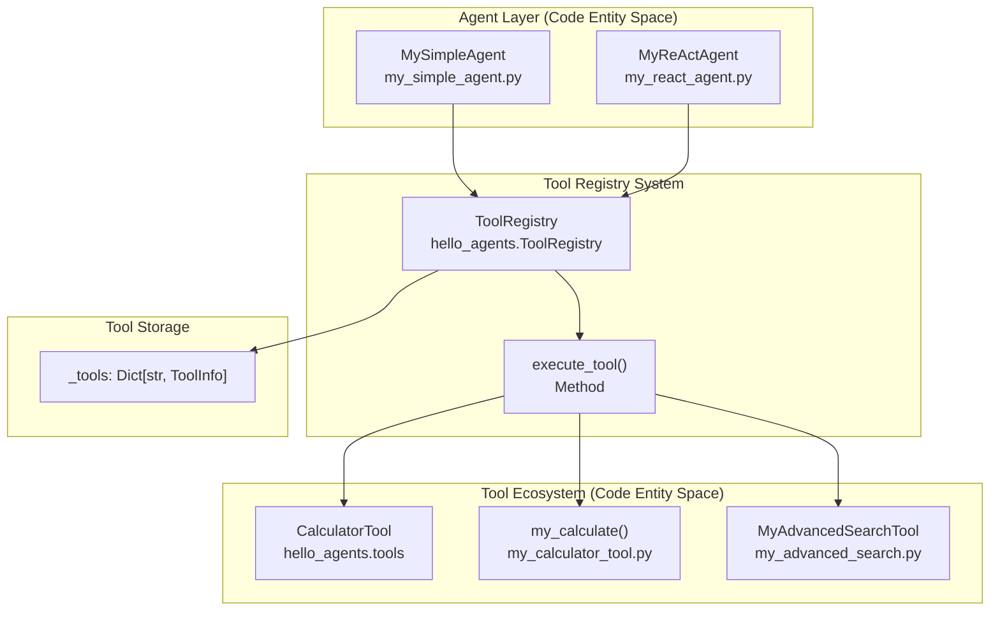
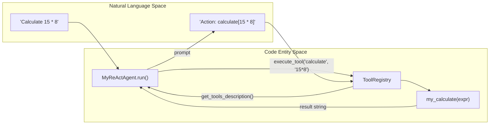
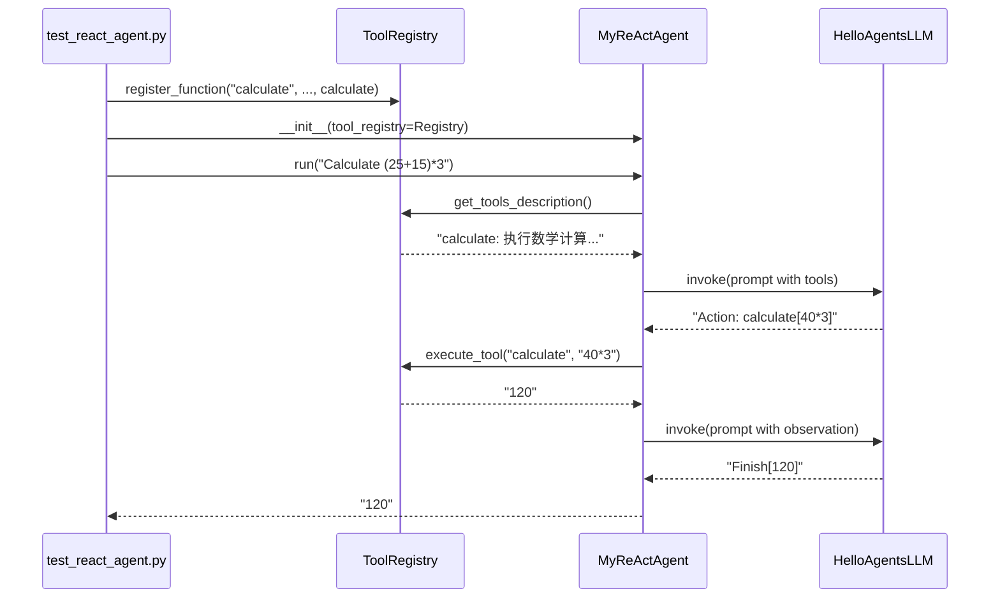

<!-- source: DeepWiki mcp.deepwiki.com · repo datawhalechina/hello-agents · page 7.4 Tool Registry System · fetched 2026-10-29 -->

# Tool Registry System

<details>
<summary>Relevant source files</summary>

The following files were used as context for generating this wiki page:

- [code/chapter7/.env.example](code/chapter7/.env.example)
- [code/chapter7/my_advanced_search.py](code/chapter7/my_advanced_search.py)
- [code/chapter7/my_calculator_tool.py](code/chapter7/my_calculator_tool.py)
- [code/chapter7/my_llm.py](code/chapter7/my_llm.py)
- [code/chapter7/my_main.py](code/chapter7/my_main.py)
- [code/chapter7/my_react_agent.py](code/chapter7/my_react_agent.py)
- [code/chapter7/my_simple_agent.py](code/chapter7/my_simple_agent.py)
- [code/chapter7/test_advanced_search.py](code/chapter7/test_advanced_search.py)
- [code/chapter7/test_my_calculator.py](code/chapter7/test_my_calculator.py)
- [code/chapter7/test_plan_solve_agent.py](code/chapter7/test_plan_solve_agent.py)
- [code/chapter7/test_react_agent.py](code/chapter7/test_react_agent.py)
- [code/chapter7/test_simple_agent.py](code/chapter7/test_simple_agent.py)
- [docs/chapter7/Chapter7-Building-Your-Agent-Framework.md](docs/chapter7/Chapter7-Building-Your-Agent-Framework.md)

</details>


The Tool Registry System is the centralized mechanism for managing, discovering, and executing tools within the HelloAgents framework. It provides a plugin architecture that allows agents to dynamically access and invoke external capabilities such as mathematical computation, web search, file operations, and custom domain-specific functions. This system implements the framework's core design philosophy: "Everything is a Tool" [docs/chapter7/Chapter7-Building-Your-Agent-Framework.md:56-57]().

---

## Core Architecture

The Tool Registry System acts as a bridge between the agent's reasoning logic and executable code entities. It manages the lifecycle of tools from registration to execution.

### Architecture Overview



**Tool Registry Architecture: From Agent to Execution**

Sources: [code/chapter7/my_react_agent.py:33-53](), [code/chapter7/my_simple_agent.py:12-24](), [code/chapter7/test_react_agent.py:16-43]()

---

## ToolRegistry Class

The `ToolRegistry` class is the service locator that maintains a centralized catalog of available tools. It provides methods for registration, discovery, and execution orchestration.

### Key Methods

| Method | Purpose | Source |
|--------|---------|--------|
| `register_function` | Registers a standard Python function as a tool with a name and description. | [code/chapter7/test_react_agent.py:24-32]() |
| `register_tool` | Registers a tool instance (like `CalculatorTool`). | [code/chapter7/test_simple_agent.py:28-28]() |
| `get_tools_description` | Generates a formatted string of all tools for the LLM prompt. | [code/chapter7/my_react_agent.py:67-67]() |
| `execute_tool` | Dispatches the tool call to the underlying function or class method. | [code/chapter7/my_react_agent.py:92-92]() |

### Data Flow: Registration to Execution



**Bridge: Natural Language Intent to Code Execution**

Sources: [code/chapter7/my_react_agent.py:55-95](), [code/chapter7/my_calculator_tool.py:7-31]()

---

## Tool Registration Patterns

The Tool Registry supports multiple registration patterns to accommodate different code structures.

### Function-Based Registration
Suitable for stateless logic. A standalone function is wrapped with metadata.

```python
# From my_calculator_tool.py
def my_calculate(expression: str) -> str:
    # ... logic ...
    return str(result)

registry = ToolRegistry()
registry.register_function(
    name="my_calculator",
    description="Supports +,-,*,/ and sqrt",
    func=my_calculate
)
```
Sources: [code/chapter7/my_calculator_tool.py:7-60]()

### Class-Based Registration
Used for stateful tools requiring initialization (e.g., API clients).

```python
# From my_advanced_search.py
class MyAdvancedSearchTool:
    def __init__(self):
        self.tavily_client = TavilyClient(...) # State

    def search(self, query: str) -> str:
        # ... logic ...
        return result

search_tool = MyAdvancedSearchTool()
registry.register_function(
    name="advanced_search",
    description="Multi-source search",
    func=search_tool.search # Registering the bound method
)
```
Sources: [code/chapter7/my_advanced_search.py:6-130]()

---

## Tool Execution Mechanism

When an agent invokes `execute_tool(tool_name, tool_input)`, the registry performs the following steps:

1.  **Lookup**: Checks if `tool_name` exists in the internal registry [code/chapter7/my_simple_agent.py:158-160]().
2.  **Parameter Handling**: For `SimpleAgent`, parameters may be parsed from strings into dictionaries [code/chapter7/my_simple_agent.py:168-194]().
3.  **Invocation**: Calls the registered callable with the provided input.
4.  **Error Handling**: Catches exceptions during tool execution and returns them as strings to the agent so the LLM can "see" the error [code/chapter7/my_simple_agent.py:165-166]().

### ReAct Loop Integration
In a `ReActAgent`, the tool execution is the "Action" phase of the Thought-Action-Observation loop:

```python
# From my_react_agent.py
# 5. 执行工具调用
if action:
    tool_name, tool_input = self._parse_action(action)
    observation = self.tool_registry.execute_tool(tool_name, tool_input)
    self.current_history.append(f"Action: {action}")
    self.current_history.append(f"Observation: {observation}")
```
Sources: [code/chapter7/my_react_agent.py:90-94]()

---

## Built-in vs. Custom Tools

The framework distinguishes between standard tools and user-defined extensions.

| Type | Examples | Registration Method |
|------|----------|---------------------|
| **Built-in** | `CalculatorTool`, `RAGTool` | `registry.register_tool(tool_instance)` |
| **Custom Function** | `my_calculate` | `registry.register_function(name, desc, func)` |
| **Custom Class** | `MyAdvancedSearchTool` | `registry.register_function(name, desc, instance.method)` |

Sources: [code/chapter7/test_simple_agent.py:26-28](), [code/chapter7/test_react_agent.py:22-35](), [code/chapter7/my_advanced_search.py:118-131]()

---

## Advanced: Parameter Parsing

For agents that don't use structured tool-calling (like basic `SimpleAgent` implementations), the system provides utility logic to parse string parameters into structured data:

```python
# From my_simple_agent.py
def _parse_tool_parameters(self, tool_name: str, parameters: str) -> dict:
    # Handles key=value pairs or positional inputs
    if '=' in parameters:
        # action=search,query=Python -> {'action': 'search', 'query': 'Python'}
        # ... logic ...
    else:
        # search:Python -> {'query': 'Python'}
        # ... logic ...
```
Sources: [code/chapter7/my_simple_agent.py:168-194]()

---

## Integration Example: ReAct Agent

The following diagram shows how `ToolRegistry` is initialized and used within a `MyReActAgent` test workflow.



Sources: [code/chapter7/test_react_agent.py:9-58](), [code/chapter7/my_react_agent.py:55-100]()

---

