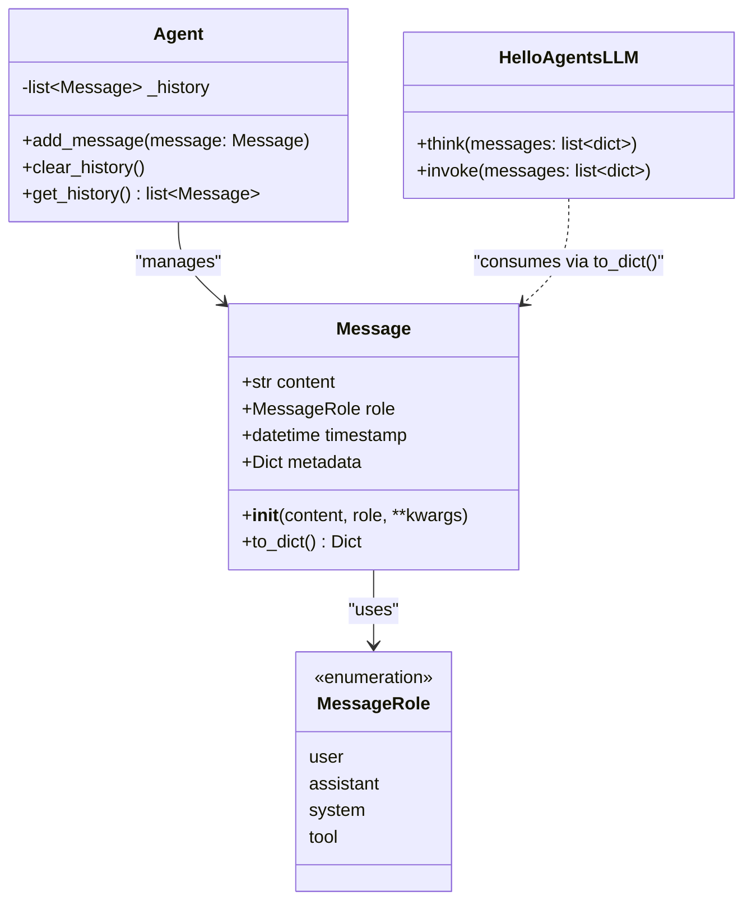
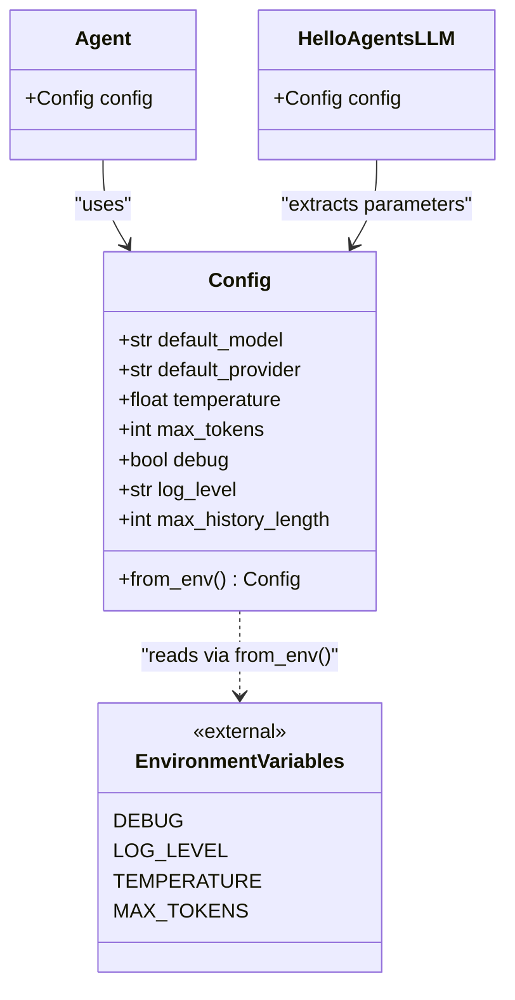
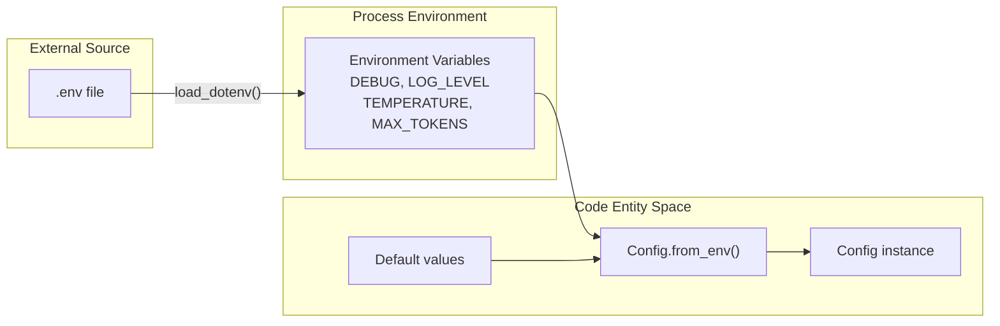
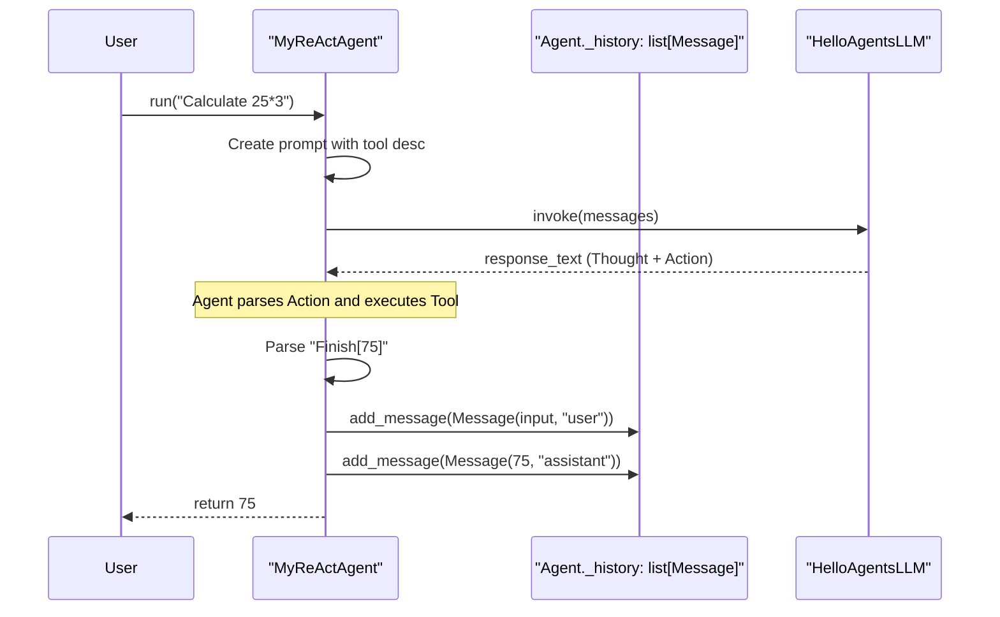

<!-- source: DeepWiki mcp.deepwiki.com · repo datawhalechina/hello-agents · page 7.5 Message and Configuration Management · fetched 2026-10-29 -->

# Message and Configuration Management

<details>
<summary>Relevant source files</summary>

The following files were used as context for generating this wiki page:

- [code/chapter7/my_main.py](code/chapter7/my_main.py)
- [code/chapter7/my_react_agent.py](code/chapter7/my_react_agent.py)
- [code/chapter7/test_react_agent.py](code/chapter7/test_react_agent.py)
- [docs/chapter7/Chapter7-Building-Your-Agent-Framework.md](docs/chapter7/Chapter7-Building-Your-Agent-Framework.md)

</details>


This document covers the foundational data structures and configuration systems in the HelloAgents framework. These components provide standardized message handling for conversation history and centralized configuration management for framework behavior via environment variables.

For information about the Agent base classes that use these systems, see [Agent Base Classes](). For details on LLM client integration that consumes these configurations, see [LLM Client Integration]().

## Purpose and Scope

The HelloAgents framework requires two critical infrastructure components to function effectively:

1.  **Message System**: A standardized format for representing conversation turns between users, agents, and tools, ensuring compatibility with OpenAI API specifications while supporting framework-specific metadata.
2.  **Configuration System**: A centralized mechanism for managing framework parameters, supporting both hardcoded defaults and environment variable overrides.

These components are implemented in `hello_agents/core/message.py` and `hello_agents/core/config.py` respectively, forming the data layer that all agent implementations depend upon.

Sources: [docs/chapter7/Chapter7-Building-Your-Agent-Framework.md:466-474](), [docs/chapter7/Chapter7-Building-Your-Agent-Framework.md:509-515]()

## Message System Architecture

### Message Class Design

The `Message` class provides a structured representation of conversation turns using Pydantic's `BaseModel` for automatic validation and serialization.

**Diagram: Message Class Structure and Relationships**



Sources: [docs/chapter7/Chapter7-Building-Your-Agent-Framework.md:476-507](), [docs/chapter7/Chapter7-Building-Your-Agent-Framework.md:584-594]()

The `Message` class enforces type safety through the `MessageRole` literal type, restricting valid roles to exactly four values that align with the OpenAI API specification:

| Role | Purpose | Typical Content |
| :--- | :--- | :--- |
| `user` | Human input | Questions, instructions, feedback |
| `assistant` | Agent response | Answers, reasoning traces, tool calls |
| `system` | Framework directives | Prompts, role definitions, constraints |
| `tool` | Tool execution results | Observations, computed values, API responses |

Sources: [docs/chapter7/Chapter7-Building-Your-Agent-Framework.md:476-482]()

### Message Implementation Details

The `Message` class implementation demonstrates several key design patterns:

*   **Type-Safe Role Enforcement**: Uses Python's `typing.Literal` to create a compile-time restriction on valid role values, preventing typos and invalid role assignments. [docs/chapter7/Chapter7-Building-Your-Agent-Framework.md:477]()
*   **Automatic Timestamp Assignment**: The constructor automatically assigns the current timestamp if not explicitly provided, ensuring temporal context for logging. [docs/chapter7/Chapter7-Building-Your-Agent-Framework.md:491]()
*   **Extensible Metadata Storage**: The `metadata` field provides a flexible dictionary for storing additional information like token counts or embedding vectors. [docs/chapter7/Chapter7-Building-Your-Agent-Framework.md:485]()

### OpenAI API Compatibility

The `to_dict()` method provides the critical bridge between HelloAgents' internal representation and external LLM APIs. It intentionally excludes `timestamp` and `metadata` fields, returning only the minimal structure required by the OpenAI API.

```python
def to_dict(self) -> Dict[str, Any]:
    """Convert to dictionary format (OpenAI API format)"""
    return {
        "role": self.role,
        "content": self.content
    }
```

Sources: [docs/chapter7/Chapter7-Building-Your-Agent-Framework.md:495-500](), [docs/chapter7/Chapter7-Building-Your-Agent-Framework.md:506]()

## Configuration Management System

### Config Class Design

The `Config` class centralizes all framework parameters using Pydantic's `BaseModel` for validation and default value management.

**Diagram: Configuration System Architecture**



Sources: [docs/chapter7/Chapter7-Building-Your-Agent-Framework.md:509-547]()

### Configuration Categories

The `Config` class organizes parameters into logical groups:

1.  **LLM Parameters**: `default_model` (e.g., "gpt-3.5-turbo"), `default_provider` (e.g., "openai"), `temperature`, and `max_tokens`. [docs/chapter7/Chapter7-Building-Your-Agent-Framework.md:522-525]()
2.  **System Parameters**: `debug` (boolean) and `log_level` (e.g., "INFO", "DEBUG"). [docs/chapter7/Chapter7-Building-Your-Agent-Framework.md:527-529]()
3.  **Agent Parameters**: `max_history_length`, which controls conversation history management to prevent unbounded memory growth. [docs/chapter7/Chapter7-Building-Your-Agent-Framework.md:532]()

### Environment Variable Loading

The `from_env()` class method implements the "convention over configuration" pattern by loading values from the environment (often populated via a `.env` file).

**Diagram: Environment Variable Resolution Flow**



Sources: [docs/chapter7/Chapter7-Building-Your-Agent-Framework.md:534-542](), [code/chapter7/my_main.py:2-6]()

## Message and History Flow

In complex agents like `MyReActAgent`, message management involves both the standard `Agent` history and internal execution traces.

**Diagram: Message Lifecycle in MyReActAgent**



Sources: [code/chapter7/my_react_agent.py:55-87](), [docs/chapter7/Chapter7-Building-Your-Agent-Framework.md:584-594]()

### Key Management Methods

The `Agent` base class provides the following methods for history control:

*   `add_message(message: Message)`: Appends a new message to the internal `_history` list. [docs/chapter7/Chapter7-Building-Your-Agent-Framework.md:584-586]()
*   `get_history()`: Returns a **copy** of the history list to prevent external modification. [docs/chapter7/Chapter7-Building-Your-Agent-Framework.md:592-594]()
*   `clear_history()`: Resets the history list to empty. [docs/chapter7/Chapter7-Building-Your-Agent-Framework.md:588-590]()

## Usage Examples

### Manual Configuration and Message Handling

```python
from hello_agents import Message, Config, HelloAgentsLLM

# Custom Configuration
config = Config(temperature=0.1, debug=True)

# Create Message
msg = Message(content="What is the capital of France?", role="user")

# Convert for LLM consumption
llm_input = [msg.to_dict()]
llm = HelloAgentsLLM(config=config)
response = llm.invoke(llm_input)
```

Sources: [docs/chapter7/Chapter7-Building-Your-Agent-Framework.md:466-547]()

### Environment-based Setup

In a typical application, `load_dotenv()` is called at the entry point to populate the environment from a `.env` file, which `Config.from_env()` then consumes.

```python
from dotenv import load_dotenv
from hello_agents import Config, HelloAgentsLLM

load_dotenv() # Loads from .env
config = Config.from_env()
llm = HelloAgentsLLM(config=config)
```

Sources: [code/chapter7/my_main.py:2-9](), [docs/chapter7/Chapter7-Building-Your-Agent-Framework.md:534-542]()

---

