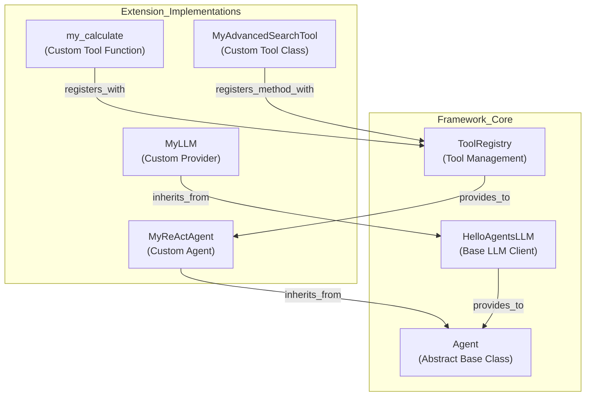
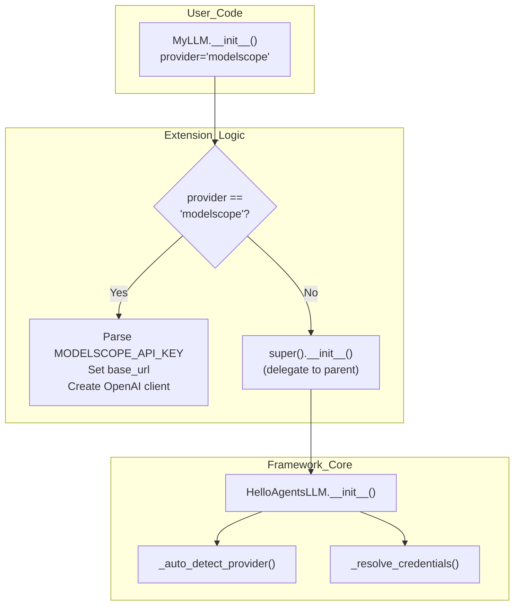
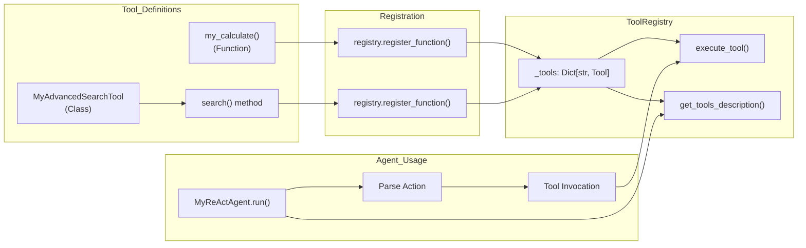
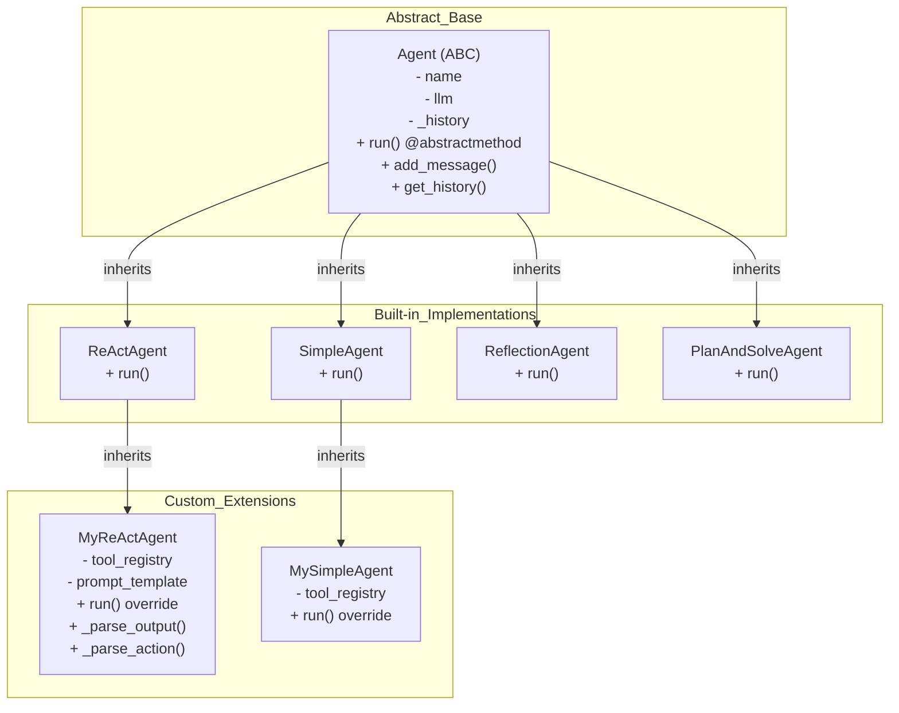
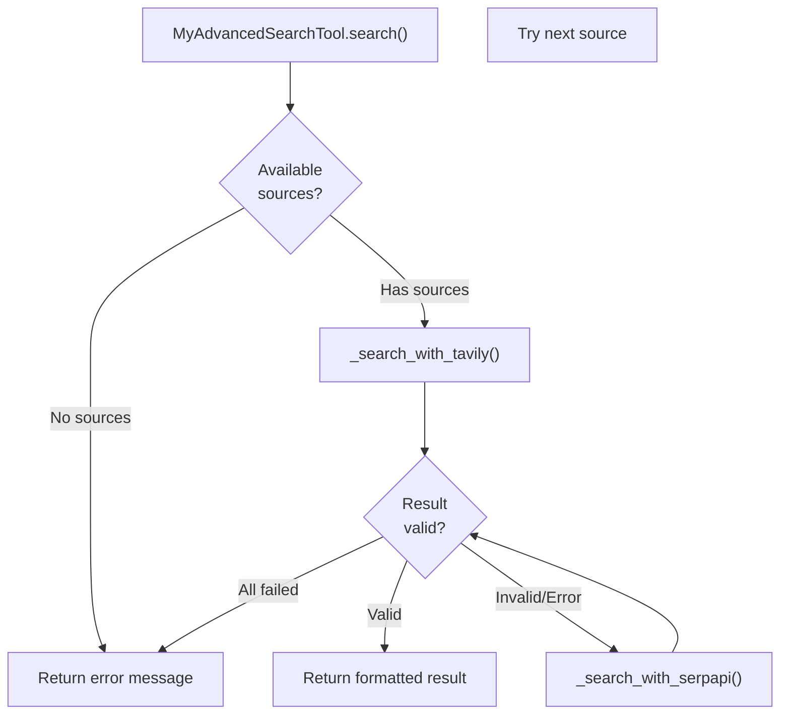

<!-- source: DeepWiki mcp.deepwiki.com · repo datawhalechina/hello-agents · page 7.6 Extension Patterns · fetched 2026-10-29 -->

# Extension Patterns

<details>
<summary>Relevant source files</summary>

The following files were used as context for generating this wiki page:

- [code/chapter7/.env.example](code/chapter7/.env.example)
- [code/chapter7/my_advanced_search.py](code/chapter7/my_advanced_search.py)
- [code/chapter7/my_calculator_tool.py](code/chapter7/my_calculator_tool.py)
- [code/chapter7/my_llm.py](code/chapter7/my_llm.py)
- [code/chapter7/my_main.py](code/chapter7/my_main.py)
- [code/chapter7/my_react_agent.py](code/chapter7/my_react_agent.py)
- [code/chapter7/my_simple_agent.py](code/chapter7/my_simple_agent.py)
- [code/chapter7/test_advanced_search.py](code/chapter7/test_advanced_search.py)
- [code/chapter7/test_my_calculator.py](code/chapter7/test_my_calculator.py)
- [code/chapter7/test_plan_solve_agent.py](code/chapter7/test_plan_solve_agent.py)
- [code/chapter7/test_react_agent.py](code/chapter7/test_react_agent.py)
- [code/chapter7/test_simple_agent.py](code/chapter7/test_simple_agent.py)
- [docs/chapter7/Chapter7-Building-Your-Agent-Framework.md](docs/chapter7/Chapter7-Building-Your-Agent-Framework.md)

</details>


## Purpose and Scope

This page documents the extension mechanisms provided by the HelloAgents framework, enabling developers to add new functionality without modifying the framework's source code. Extension patterns covered include LLM provider integration, custom tool creation, and custom agent implementations.

For information about the base framework architecture and built-in components, see [Framework Architecture Overview](#7.1). For details on the tool registry system that enables tool extensions, see [Tool Registry System](#7.4). For information about using existing agent classes, see [Agent Base Classes](#7.2).

## Extension Philosophy

The HelloAgents framework follows three core design principles for extensibility:

1. **Inheritance over Modification** - Extend functionality by inheriting base classes rather than modifying source code [docs/chapter7/Chapter7-Building-Your-Agent-Framework.md:162-268]().
2. **Registration over Hardcoding** - Add new tools and components through registry mechanisms rather than hardcoding dependencies [code/chapter7/my_advanced_search.py:118-131]().
3. **Convention over Configuration** - Use standardized interfaces and naming patterns to minimize boilerplate [docs/chapter7/Chapter7-Building-Your-Agent-Framework.md:48-51]().

Sources: [docs/chapter7/Chapter7-Building-Your-Agent-Framework.md:38-58](), [code/chapter7/my_advanced_search.py:118-131]()

## Core Extension Points

The framework provides three primary extension points, each designed to support specific customization needs:

Title: Extension Points in HelloAgents Framework


| Extension Point | Base Class/Component | Extension Method | Use Case |
|----------------|---------------------|------------------|----------|
| LLM Provider | `HelloAgentsLLM` [code/chapter7/my_llm.py:7-41]() | Inheritance + Override | Add support for new LLM services |
| Custom Tools | `ToolRegistry` [code/chapter7/my_calculator_tool.py:51-62]() | Function/Class Registration | Add domain-specific capabilities |
| Custom Agents | `Agent` or specific agent classes [code/chapter7/my_react_agent.py:33-100]() | Inheritance + Override `run()` | Implement custom reasoning patterns |

Sources: [docs/chapter7/Chapter7-Building-Your-Agent-Framework.md:162-268](), [code/chapter7/my_llm.py:1-41](), [code/chapter7/my_react_agent.py:1-100]()

## LLM Provider Extension Pattern

### Extension Architecture

The `HelloAgentsLLM` class provides automatic provider detection and credential resolution. To add a new provider, inherit the class and override the `__init__` method to intercept specific provider values.

Title: LLM Provider Extension Flow


### Implementation Pattern

The following pattern demonstrates adding ModelScope support by inheriting `HelloAgentsLLM`:

**Step 1: Create Custom Class and Import Base**
[code/chapter7/my_llm.py:1-7]()

**Step 2: Override `__init__` with Provider-Specific Logic**
The override checks for the target provider and handles credential resolution:
[code/chapter7/my_llm.py:8-40]()

Key implementation details:
- **Line 17**: Check if `provider == "modelscope"` to intercept this specific case [code/chapter7/my_llm.py:17-17]().
- **Lines 22-27**: Parse environment variable `MODELSCOPE_API_KEY` and set default `base_url` [code/chapter7/my_llm.py:22-27]().
- **Line 36**: Create OpenAI client with custom credentials [code/chapter7/my_llm.py:36-36]().
- **Line 40**: Delegate all other providers to parent class via `super().__init__()` [code/chapter7/my_llm.py:40-40]().

**Step 3: Use Custom LLM Class**
Configuration in `.env` [code/chapter7/.env.example:13-19]():
```bash
MODELSCOPE_API_KEY="your-modelscope-api-key"
```

Usage in application code:
[code/chapter7/my_main.py:1-22]()

Sources: [docs/chapter7/Chapter7-Building-Your-Agent-Framework.md:350-399](), [code/chapter7/my_llm.py:1-41](), [code/chapter7/my_main.py:1-22]()

## Custom Tool Extension Pattern

### Tool Registration Architecture

The `ToolRegistry` class provides two registration methods: function-based and class-based. Both integrate seamlessly with the framework's tool execution pipeline.

Title: Tool Registration and Execution Flow


### Function-Based Tool Pattern

The simplest extension pattern uses pure functions:

**Implementation:**
[code/chapter7/my_calculator_tool.py:7-31]()

**Registration:**
[code/chapter7/my_calculator_tool.py:51-62]()

**Key Components:**
- **Lines 7-11**: Function signature with type hints and docstring [code/chapter7/my_calculator_tool.py:7-11]().
- **Lines 13-24**: Define supported operators and functions using `ast` module [code/chapter7/my_calculator_tool.py:13-24]().
- **Lines 26-31**: Safe expression evaluation with error handling [code/chapter7/my_calculator_tool.py:26-31]().
- **Lines 56-60**: Register function with `name`, `description`, and `func` parameters [code/chapter7/my_calculator_tool.py:56-60]().

Sources: [code/chapter7/my_calculator_tool.py:1-62](), [code/chapter7/test_my_calculator.py:1-61]()

### Class-Based Tool Pattern

For tools requiring state management or complex initialization, use class-based tools:

**Implementation:**
[code/chapter7/my_advanced_search.py:6-116]()

**Architecture Details:**
- **Lines 12-16**: Class initialization with state (`search_sources` list) [code/chapter7/my_advanced_search.py:12-16]().
- **Lines 18-42**: `_setup_search_sources()` dynamically configures available APIs [code/chapter7/my_advanced_search.py:18-42]().
- **Lines 44-80**: Main `search()` method with fallback logic across multiple sources [code/chapter7/my_advanced_search.py:44-80]().
- **Lines 82-116**: Private methods `_search_with_tavily()` and `_search_with_serpapi()` for specific implementations [code/chapter7/my_advanced_search.py:82-116]().

**Registration:**
[code/chapter7/my_advanced_search.py:118-131]()

The pattern creates a tool instance, then registers its method as a callable [code/chapter7/my_advanced_search.py:126-130]().

### Tool Execution Pattern

When an agent invokes a tool, the registry executes this flow:

1. **Agent calls** `tool_registry.execute_tool(tool_name, tool_input)` [code/chapter7/my_react_agent.py:92-92]().
2. **Registry looks up** tool in `_tools` dictionary.
3. **Registry invokes** stored function/method with input.
4. **Result returns** to agent as observation [code/chapter7/my_react_agent.py:94-94]().

Sources: [code/chapter7/my_advanced_search.py:1-131](), [code/chapter7/my_react_agent.py:55-100](), [code/chapter7/test_advanced_search.py:1-53]()

## Custom Agent Extension Pattern

### Agent Inheritance Hierarchy

Title: Agent Class Hierarchy


### Custom Agent Implementation

**Step 1: Define Custom Class with Inheritance**
[code/chapter7/my_react_agent.py:29-53]()

**Key Elements:**
- **Line 33**: Inherit from `ReActAgent` (or any agent base class) [code/chapter7/my_react_agent.py:33-33]().
- **Lines 41-42**: Add custom attributes (`tool_registry`, `max_steps`) [code/chapter7/my_react_agent.py:41-42]().
- **Line 52**: Store custom or default prompt template [code/chapter7/my_react_agent.py:52-52]().

**Step 2: Override `run()` Method**
The `run()` method implements the agent's reasoning loop:
[code/chapter7/my_react_agent.py:55-100]()

**Execution Flow:**
1. **Lines 57-58**: Initialize loop state [code/chapter7/my_react_agent.py:57-58]().
2. **Lines 62-64**: Iterate up to `max_steps` [code/chapter7/my_react_agent.py:62-64]().
3. **Lines 66-73**: Build prompt using template with tool descriptions and history [code/chapter7/my_react_agent.py:66-73]().
4. **Lines 75-77**: Call LLM via `llm.invoke()` [code/chapter7/my_react_agent.py:75-77]().
5. **Lines 79-80**: Parse LLM output into thought and action [code/chapter7/my_react_agent.py:79-80]().
6. **Lines 83-87**: Check for finish condition [code/chapter7/my_react_agent.py:83-87]().
7. **Lines 90-94**: Execute tool and record observation [code/chapter7/my_react_agent.py:90-94]().

### Custom Simple Agent with Tools
Developers can also extend `SimpleAgent` to add manual tool calling logic:
[code/chapter7/my_simple_agent.py:6-55]()

Sources: [code/chapter7/my_react_agent.py:1-100](), [code/chapter7/my_simple_agent.py:1-128](), [code/chapter7/test_react_agent.py:90-147]()

## Advanced Extension Patterns

### Multi-Source Tool Integration

The advanced search tool demonstrates integrating multiple external services with intelligent fallback:

Title: Multi-Source Search Tool Flow


**Implementation:**
[code/chapter7/my_advanced_search.py:44-80]()

**Design Patterns:**
- **Dynamic Source Detection** (lines 18-42): Check environment variables to determine available APIs [code/chapter7/my_advanced_search.py:18-42]().
- **Graceful Degradation** (lines 64-78): Try each source sequentially, continue on failure [code/chapter7/my_advanced_search.py:64-78]().
- **Unified Interface** (lines 44-46): Single `search()` method abstracts multiple backends [code/chapter7/my_advanced_search.py:44-46]().

### Tool Composition and Chaining

Tools can be composed to create higher-level functionality. The test file demonstrates this pattern:
[code/chapter7/test_my_calculator.py:30-61]()

**Pattern Elements:**
1. **Lines 35-38**: Create registry and register calculator tool [code/chapter7/test_my_calculator.py:35-38]().
2. **Lines 47-49**: Execute tool to get intermediate result [code/chapter7/test_my_calculator.py:47-49]().
3. **Lines 51-57**: Compose tool output with LLM for natural language response [code/chapter7/test_my_calculator.py:51-57]().

Sources: [code/chapter7/my_advanced_search.py:1-131](), [code/chapter7/test_my_calculator.py:30-61]()

## Extension Best Practices

### Design Principles

| Principle | Implementation | Benefit |
|-----------|---------------|---------|
| **Single Responsibility** | Each tool performs one task [code/chapter7/my_calculator_tool.py:7-8]() | Easier testing and reusability |
| **Fail-Safe Defaults** | Provide error messages [code/chapter7/my_advanced_search.py:50-59]() | Graceful degradation |
| **Environment Configuration** | Use `.env` for API keys [code/chapter7/.env.example:1-32]() | Security and portability |
| **Type Hints** | Annotate function signatures [code/chapter7/my_simple_agent.py:12-20]() | IDE support and documentation |
| **Docstrings** | Document behavior [code/chapter7/my_calculator_tool.py:8-8]() | Auto-generated tool descriptions |

### Testing Pattern

Each extension should include a dedicated test file:
[code/chapter7/test_react_agent.py:9-89]()

**Test Structure:**
- **Lines 19-35**: Tool registration and setup [code/chapter7/test_react_agent.py:19-35]().
- **Lines 49-57**: Individual test cases with assertions [code/chapter7/test_react_agent.py:49-57]().
- **Lines 79-86**: Validation of agent state and tool registry [code/chapter7/test_react_agent.py:79-86]().

Sources: [code/chapter7/my_calculator_tool.py:7-31](), [code/chapter7/my_advanced_search.py:44-60](), [code/chapter7/test_react_agent.py:9-89]()

---

