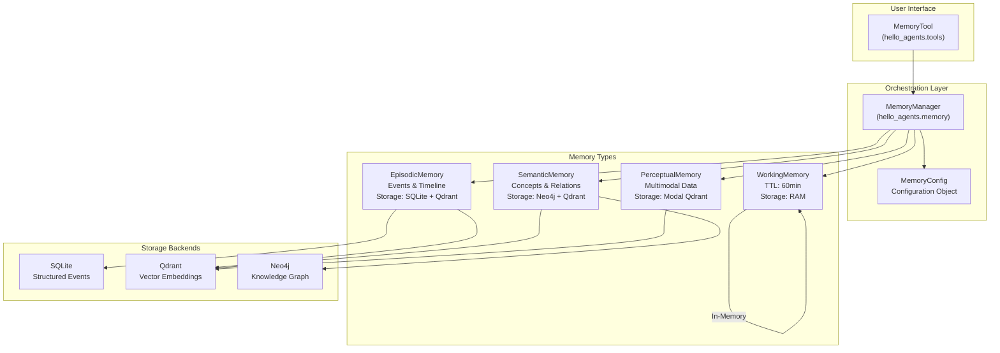
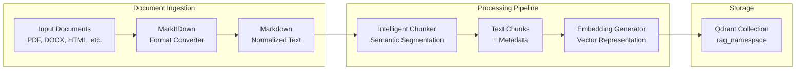

<!-- source: DeepWiki mcp.deepwiki.com · repo datawhalechina/hello-agents · page 8 Advanced Agent Capabilities · fetched 2026-10-29 -->

# Advanced Agent Capabilities

Relevant source files

The following files were used as context for generating this wiki page:

- [Co-creation-projects/README.md](Co-creation-projects/README.md)
- [code/chapter8/01_MemoryTool_Basic_Operations.py](code/chapter8/01_MemoryTool_Basic_Operations.py)
- [code/chapter8/02_MemoryTool_Architecture.py](code/chapter8/02_MemoryTool_Architecture.py)
- [code/chapter8/03_WorkingMemory_Implementation.py](code/chapter8/03_WorkingMemory_Implementation.py)
- [code/chapter8/04_RAGTool_MarkItDown_Pipeline.py](code/chapter8/04_RAGTool_MarkItDown_Pipeline.py)
- [code/chapter8/05_RAGTool_Advanced_Search.py](code/chapter8/05_RAGTool_Advanced_Search.py)
- [code/chapter8/06_Memory_Consolidation_Demo.py](code/chapter8/06_Memory_Consolidation_Demo.py)
- [code/chapter8/07_RAGTool_Intelligent_QA.py](code/chapter8/07_RAGTool_Intelligent_QA.py)
- [code/chapter8/08_Agent_Tool_Integration.py](code/chapter8/08_Agent_Tool_Integration.py)
- [code/chapter8/09_Memory_Types_Deep_Dive.py](code/chapter8/09_Memory_Types_Deep_Dive.py)
- [code/chapter8/10_RAG_Pipeline_Complete.py](code/chapter8/10_RAG_Pipeline_Complete.py)
- [code/chapter8/11_Q&A_Assistant.py](code/chapter8/11_Q&A_Assistant.py)
- [docs/chapter10/Chapter10-Agent-Communication-Protocols.md](docs/chapter10/Chapter10-Agent-Communication-Protocols.md)
- [docs/chapter11/Chapter11-Agentic-RL.md](docs/chapter11/Chapter11-Agentic-RL.md)
- [docs/chapter12/Chapter12-Agent-Performance-Evaluation.md](docs/chapter12/Chapter12-Agent-Performance-Evaluation.md)
- [docs/chapter13/Chapter13-Intelligent-Travel-Assistant.md](docs/chapter13/Chapter13-Intelligent-Travel-Assistant.md)
- [docs/chapter14/Chapter14-Automated-Deep-Research-Agent.md](docs/chapter14/Chapter14-Automated-Deep-Research-Agent.md)
- [docs/chapter9/Chapter9-Context-Engineering.md](docs/chapter9/Chapter9-Context-Engineering.md)
- [docs/images/16-figures/16-1.png](docs/images/16-figures/16-1.png)
- [docs/images/16-figures/16-2.png](docs/images/16-figures/16-2.png)
- [docs/images/16-figures/16-4.png](docs/images/16-figures/16-4.png)
- [fix_bold_format.py](fix_bold_format.py)

## Purpose and Scope

This page documents the advanced capabilities that extend basic agents in the HelloAgents framework. These features enable agents to maintain long-term memory, retrieve knowledge from documents, manage context efficiently, communicate with other agents, improve through reinforcement learning, and be systematically evaluated.

The advanced capabilities covered here include:
- **Memory and Retrieval Systems** (section 8.1): Four-type memory architecture and RAG pipelines.
- **RAG Pipeline and Document Processing** (section 8.2): MarkItDown conversion and advanced search strategies.
- **Tool Integration Patterns** (section 8.3): Collaborative workflows between `MemoryTool` and `RAGTool`.
- **Context Engineering** (section 8.4): GSSC pipeline for optimizing LLM context.
- **NoteTool and TerminalTool** (section 8.5): Long-horizon task management and sandboxed execution.
- **Agent Communication Protocols** (section 8.6): MCP, A2A, and ANP for agent interoperability.
- **Agentic RL Training Pipeline** (section 8.7): SFT to GRPO for improving agent performance.
- **Performance Evaluation Methods** (section 8.8): BFCL, GAIA, and custom quality metrics.

---

## 8.1 Memory and Retrieval Systems

### Architecture Overview

The memory system in HelloAgents implements a hierarchical architecture with `MemoryTool` as the user-facing interface and `MemoryManager` orchestrating four specialized memory types. This design models human cognitive processes: working memory for immediate tasks, episodic memory for experiences, semantic memory for concepts, and perceptual memory for multimodal data.

Sources: [code/chapter8/02_MemoryTool_Architecture.py:15-107](), [code/chapter8/01_MemoryTool_Basic_Operations.py:14-28]()

### MemoryTool Interface

`MemoryTool` provides a unified `run()` method accepting dictionaries with an `action` key. Supported actions include:

| Action | Purpose | Required Parameters | Memory Type |
|--------|---------|---------------------|-------------|
| `add` | Store new memory | `content`, `memory_type`, `importance` | All |
| `search` | Query memories | `query`, optional `memory_type`, `limit` | All |
| `summary` | Get memory overview | `limit` (optional) | All |
| `stats` | System statistics | None | N/A |
| `update` | Modify existing memory | `memory_id`, fields to update | All |
| `remove` | Delete specific memory | `memory_id` | All |
| `forget` | Remove low-importance memories | `strategy`, `threshold` | All |
| `consolidate` | Transfer memories between types | `from_type`, `to_type`, `importance_threshold` | Working→Others |
| `clear_all` | Reset system | `confirm` | All |

Sources: [code/chapter8/01_MemoryTool_Basic_Operations.py:30-154](), [code/chapter8/09_Memory_Types_Deep_Dive.py:23-49]()

### Four Memory Types

#### Working Memory
`WorkingMemory` implements a capacity-limited (default 50 items), time-limited (default 60 minutes TTL) RAM-based store for immediate task context. It uses a hybrid retrieval strategy combining semantic search and recency scoring.
Sources: [code/chapter8/09_Memory_Types_Deep_Dive.py:51-133]()

#### Episodic Memory
`EpisodicMemory` stores event sequences with rich contextual metadata using SQLite for structured data and Qdrant for semantic search. Each memory includes timestamp, `session_id`, and arbitrary metadata fields.
Sources: [code/chapter8/09_Memory_Types_Deep_Dive.py:134-242]()

#### Semantic Memory
`SemanticMemory` builds a knowledge graph using Neo4j for entity-relationship modeling and Qdrant for concept embeddings. It supports concept hierarchies and entity linking.
Sources: [code/chapter8/09_Memory_Types_Deep_Dive.py:244-375]()

#### Perceptual Memory
`PerceptualMemory` handles multimodal data (text, image, audio, video) with modality-specific Qdrant collections.
Sources: [code/chapter8/09_Memory_Types_Deep_Dive.py:377-499]()

For more details on implementation and usage, see [Memory and Retrieval Systems](#8.1).

---

## 8.2 RAG Pipeline and Document Processing

`RAGTool` implements a complete Retrieval-Augmented Generation pipeline with document ingestion, intelligent chunking, and advanced retrieval strategies.

### RAGTool Architecture

Sources: [code/chapter8/04_RAGTool_MarkItDown_Pipeline.py:1-180](), [code/chapter8/11_Q&A_Assistant.py:23-98]()

### Advanced Search Strategies
Beyond basic vector similarity, `RAGTool` supports:
- **MQE (Multi-Query Expansion)**: LLM generates alternative phrasings to improve recall.
- **HyDE (Hypothetical Document Embedding)**: Generates a hypothetical answer to embed and search against.

Sources: [code/chapter8/05_RAGTool_Advanced_Search.py:1-385](), [code/chapter8/11_Q&A_Assistant.py:100-144]()

For detailed pipeline configuration, see [RAG Pipeline and Document Processing](#8.2).

---

## 8.3 Tool Integration Patterns

`MemoryTool` and `RAGTool` work together to provide both personal history context and general domain knowledge.

**Collaborative Workflow Example**:
1. **Scenario**: Agent learns a new concept.
2. **Action 1**: `RAGTool` adds the detailed documentation to the knowledge base.
3. **Action 2**: `MemoryTool` records the learning event (episodic memory) with high importance.
4. **Result**: Future queries retrieve both the source documentation and the record of when/why the agent learned it.

Sources: [code/chapter8/08_Agent_Tool_Integration.py:165-257]()

For practical examples of tool orchestration, see [Tool Integration Patterns](#8.3).

---

## 8.4 Context Engineering

`ContextBuilder` implements the GSSC (Gather-Select-Structure-Compress) pipeline to optimize LLM input within token budget constraints.

- **Gather**: Collects info from System Prompts, Memory, RAG, and Conversation History.
- **Select**: Scores packets based on relevance and recency.
- **Structure**: Populates a standardized information template.
- **Compress**: Uses LLM to summarize verbose sections if the token limit is exceeded.

Sources: [docs/chapter9/Chapter9-Context-Engineering.md:13-17](), [docs/chapter9/Chapter9-Context-Engineering.md:122-210]()

For optimization strategies, see [Context Engineering](#8.4).

---

## 8.5 NoteTool and TerminalTool

- **NoteTool**: Supports persistent memory management via structured notes (Action, Blocker, Conclusion, etc.) for long-horizon tasks.
- **TerminalTool**: Provides sandboxed shell command execution for file system operations and just-in-time context retrieval.

Sources: [docs/chapter9/Chapter9-Context-Engineering.md:11-17]()

For sandboxing and note management details, see [NoteTool and TerminalTool](#8.5).

---

## 8.6 Agent Communication Protocols

Standardized protocols form the infrastructure layer for agent communication:
- **MCP (Model Context Protocol)**: Standardizes communication between agents and external tools/resources.
- **A2A (Agent-to-Agent)**: Peer-to-peer collaboration and task delegation.
- **ANP (Agent Network Protocol)**: Service discovery and routing for large-scale agent networks.

Sources: [docs/chapter10/Chapter10-Agent-Communication-Protocols.md:1-125]()

For protocol specifications, see [Agent Communication Protocols](#8.6).

---

## 8.7 Agentic RL Training Pipeline

Agents can be trained to improve reasoning and tool-use capabilities through a multi-stage pipeline:
1. **SFT (Supervised Fine-Tuning)**: Learning task formats and instruction following.
2. **Reward Modeling (RM)**: Training a model to score outputs based on human preferences.
3. **GRPO (Group Relative Policy Optimization)**: Reinforcement learning that optimizes policy based on relative rewards within sampled groups.

Sources: [docs/chapter11/Chapter11-Agentic-RL.md:1-80]()

For training configurations, see [Agentic RL Training Pipeline](#8.7).

---

## 8.8 Performance Evaluation Methods

Evaluation is performed across three primary scenarios:
- **BFCL (Berkeley Function Calling Leaderboard)**: Measures tool invocation accuracy using AST matching.
- **GAIA (General AI Assistants)**: Evaluates comprehensive problem-solving in real-world tasks using Quasi Exact Match (QEM).
- **Data Generation Quality**: Uses LLM Judges and Win Rates to evaluate synthetic data quality.

Sources: [docs/chapter12/Chapter12-Agent-Performance-Evaluation.md:1-107]()

For detailed metrics and benchmarks, see [Performance Evaluation Methods](#8.8).

---

