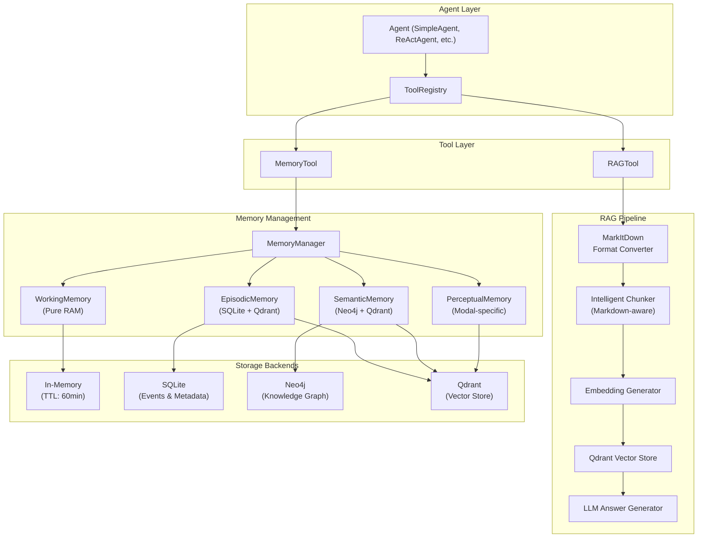
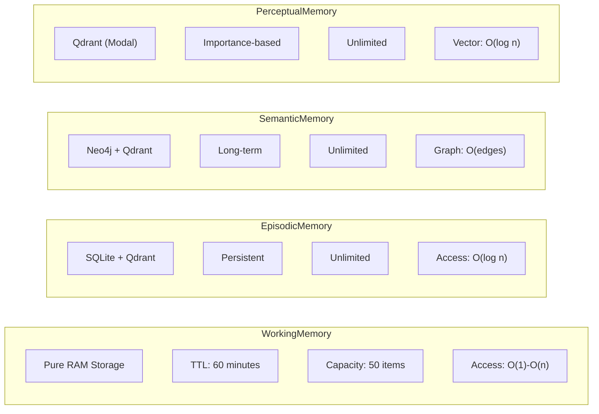
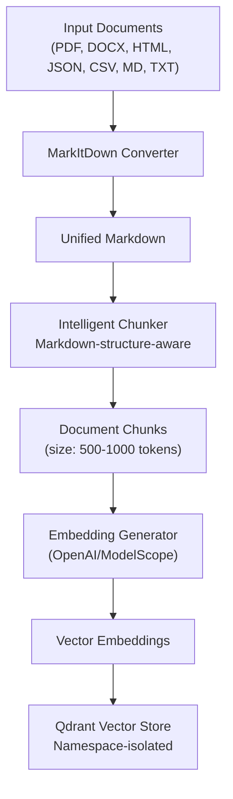

<!-- source: DeepWiki mcp.deepwiki.com · repo datawhalechina/hello-agents · page 8.1 Memory and Retrieval Systems · fetched 2026-10-29 -->

# Memory and Retrieval Systems

Relevant source files

The following files were used as context for generating this wiki page:

- [code/chapter8/01_MemoryTool_Basic_Operations.py](code/chapter8/01_MemoryTool_Basic_Operations.py)
- [code/chapter8/02_MemoryTool_Architecture.py](code/chapter8/02_MemoryTool_Architecture.py)
- [code/chapter8/03_WorkingMemory_Implementation.py](code/chapter8/03_WorkingMemory_Implementation.py)
- [code/chapter8/04_RAGTool_MarkItDown_Pipeline.py](code/chapter8/04_RAGTool_MarkItDown_Pipeline.py)
- [code/chapter8/05_RAGTool_Advanced_Search.py](code/chapter8/05_RAGTool_Advanced_Search.py)
- [code/chapter8/06_Memory_Consolidation_Demo.py](code/chapter8/06_Memory_Consolidation_Demo.py)
- [code/chapter8/07_RAGTool_Intelligent_QA.py](code/chapter8/07_RAGTool_Intelligent_QA.py)
- [code/chapter8/08_Agent_Tool_Integration.py](code/chapter8/08_Agent_Tool_Integration.py)
- [code/chapter8/09_Memory_Types_Deep_Dive.py](code/chapter8/09_Memory_Types_Deep_Dive.py)
- [code/chapter8/10_RAG_Pipeline_Complete.py](code/chapter8/10_RAG_Pipeline_Complete.py)
- [code/chapter8/11_Q&A_Assistant.py](code/chapter8/11_Q&A_Assistant.py)

This page documents the memory and retrieval systems in HelloAgents, which provide agents with persistent memory capabilities and intelligent document-based knowledge retrieval. The memory system implements four types of memory inspired by cognitive psychology (working, episodic, semantic, perceptual), while the RAG (Retrieval-Augmented Generation) system enables agents to answer questions based on document knowledge bases.

For information about using these tools within agent workflows, see [Tool Integration Patterns](#8.3). For context engineering that optimizes how memory and RAG outputs are used in LLM prompts, see [Context Engineering](#8.4).

---

## System Overview

The memory and retrieval systems consist of two primary components:

1. **MemoryTool** - Manages four types of memory with different storage backends and lifecycle characteristics [code/chapter8/02_MemoryTool_Architecture.py:15-103]().
2. **RAGTool** - Processes documents through a MarkItDown pipeline and provides intelligent question-answering [code/chapter8/10_RAG_Pipeline_Complete.py:22-40]().

### System Architecture and Data Flow

**Sources:** [code/chapter8/02_MemoryTool_Architecture.py:1-248](), [code/chapter8/08_Agent_Tool_Integration.py:1-468]()

---

## MemoryTool Architecture

The `MemoryTool` provides a unified interface for memory operations through a two-layer architecture: the tool layer handles user interaction, while the `MemoryManager` coordinates the four specialized memory types [code/chapter8/02_MemoryTool_Architecture.py:15-103]().

### Core Components

| Component | Purpose | Implementation |
|-----------|---------|----------------|
| `MemoryTool` | Unified API for all memory operations | [code/chapter8/01_MemoryTool_Basic_Operations.py:20-23]() |
| `MemoryManager` | Coordinates memory types, handles consolidation | [code/chapter8/02_MemoryTool_Architecture.py:30-31]() |
| `MemoryConfig` | Configuration for capacity, TTL, storage paths | [code/chapter8/02_MemoryTool_Architecture.py:13-13]() |
| `MemoryItem` | Data structure for memory entries | [code/chapter8/03_WorkingMemory_Implementation.py:12-12]() |

### Unified Interface Pattern

The `MemoryTool.run()` method provides a single entry point for all memory operations, supporting a standardized action-based parameter dictionary [code/chapter8/01_MemoryTool_Basic_Operations.py:36-76]().

**Supported Actions:**

| Action | Purpose | Key Parameters |
|--------|---------|----------------|
| `add` | Store new memory | `content`, `memory_type`, `importance`, `**metadata` |
| `search` | Retrieve relevant memories | `query`, `memory_type`, `limit`, `min_importance` |
| `summary` | Get memory overview | `limit`, `memory_type` |
| `stats` | System statistics | - |
| `update` | Modify existing memory | `memory_id`, updated fields |
| `remove` | Delete specific memory | `memory_id` |
| `forget` | Bulk deletion | `strategy`, `threshold` |
| `consolidate` | Transfer memories | `from_type`, `to_type`, `importance_threshold` |
| `clear_all` | Reset memory system | `confirm=True` |

**Sources:** [code/chapter8/01_MemoryTool_Basic_Operations.py:1-199](), [code/chapter8/02_MemoryTool_Architecture.py:15-103]()

---

## Four Memory Types

### Architectural Comparison

**Sources:** [code/chapter8/09_Memory_Types_Deep_Dive.py:1-880](), [code/chapter8/02_MemoryTool_Architecture.py:69-143]()

### Working Memory

**Purpose:** Temporary, high-speed storage for current session information [code/chapter8/09_Memory_Types_Deep_Dive.py:53-60]().

**Key Characteristics:**
- Pure in-memory storage (no persistence) [code/chapter8/03_WorkingMemory_Implementation.py:220-223]().
- TTL mechanism: 60-minute default expiration [code/chapter8/03_WorkingMemory_Implementation.py:32-33]().
- Capacity limited: 50 items default [code/chapter8/03_WorkingMemory_Implementation.py:31-31]().
- Mixed retrieval: TF-IDF vectorization + keyword matching + time decay [code/chapter8/03_WorkingMemory_Implementation.py:68-73]().

**Time Decay Formula:**
`final_score = semantic_similarity × (1 - age_factor × 0.3) × importance` [code/chapter8/03_WorkingMemory_Implementation.py:72-72]().

**Sources:** [code/chapter8/03_WorkingMemory_Implementation.py:1-304](), [code/chapter8/09_Memory_Types_Deep_Dive.py:50-132]()

### Episodic Memory

**Purpose:** Store complete events and experiences with rich temporal and contextual metadata [code/chapter8/09_Memory_Types_Deep_Dive.py:136-143]().

**Key Characteristics:**
- Hybrid storage: SQLite (structured data) + Qdrant (semantic search) [code/chapter8/02_MemoryTool_Architecture.py:85-85]().
- Persistent across sessions.
- Time-series aware with sequence tracking [code/chapter8/09_Memory_Types_Deep_Dive.py:186-197]().

**Sources:** [code/chapter8/09_Memory_Types_Deep_Dive.py:134-277](), [code/chapter8/01_MemoryTool_Basic_Operations.py:45-54]()

### Semantic Memory

**Purpose:** Store conceptual knowledge, entities, and relationships in a structured knowledge graph [code/chapter8/09_Memory_Types_Deep_Dive.py:278-285]().

**Key Characteristics:**
- Hybrid storage: Neo4j (graph) + Qdrant (semantic embeddings) [code/chapter8/02_MemoryTool_Architecture.py:91-91]().
- Concept-centric organization [code/chapter8/09_Memory_Types_Deep_Dive.py:328-340]().
- Supports reasoning and inference.

**Sources:** [code/chapter8/09_Memory_Types_Deep_Dive.py:278-431](), [code/chapter8/01_MemoryTool_Basic_Operations.py:56-65]()

### Perceptual Memory

**Purpose:** Handle multimodal sensory data (text, images, audio) with cross-modal retrieval [code/chapter8/09_Memory_Types_Deep_Dive.py:433-440]().

**Key Characteristics:**
- Modality-specific embeddings in Qdrant [code/chapter8/02_MemoryTool_Architecture.py:97-97]().
- Metadata Fields: `genre`, `emotion`, `language` for text; `scene_type`, `objects` for images [code/chapter8/09_Memory_Types_Deep_Dive.py:460-478]().

**Sources:** [code/chapter8/09_Memory_Types_Deep_Dive.py:433-573]()

---

## Memory Consolidation

Memory consolidation transfers important memories from short-term (working) to long-term storage (episodic or semantic) [code/chapter8/06_Memory_Consolidation_Demo.py:136-142]().

**Key Consolidation Parameters:**
- **Importance Threshold:** Only memories above a certain score are moved (e.g., 0.7) [code/chapter8/06_Memory_Consolidation_Demo.py:117-130]().
- **Importance Boost:** Consolidated memories often receive a score multiplier (e.g., 1.1x) [code/chapter8/06_Memory_Consolidation_Demo.py:129-129]().
- **Metadata Traceability:** Adds `consolidated_from`, `consolidated_at`, and `original_id` [code/chapter8/06_Memory_Consolidation_Demo.py:184-188]().

**Sources:** [code/chapter8/06_Memory_Consolidation_Demo.py:1-385](), [code/chapter8/09_Memory_Types_Deep_Dive.py:659-677]()

---

## RAGTool and Document Processing

The `RAGTool` implements a Retrieval-Augmented Generation pipeline using `MarkItDown` for unified document ingestion [code/chapter8/04_RAGTool_MarkItDown_Pipeline.py:143-148]().

### Document Processing Flow

**Sources:** [code/chapter8/04_RAGTool_MarkItDown_Pipeline.py:1-408](), [code/chapter8/10_RAG_Pipeline_Complete.py:1-850]()

### Intelligent Chunking and Retrieval

The system uses Markdown-aware chunking to preserve semantic boundaries [code/chapter8/04_RAGTool_MarkItDown_Pipeline.py:179-184](). Advanced retrieval strategies include:

1. **Multi-Query Expansion (MQE):** LLM generates semantic equivalents of the query to improve recall [code/chapter8/05_RAGTool_Advanced_Search.py:212-217]().
2. **Hypothetical Document Embeddings (HyDE):** LLM generates a hypothetical answer to use as a query vector [code/chapter8/05_RAGTool_Advanced_Search.py:255-260]().

**Sources:** [code/chapter8/05_RAGTool_Advanced_Search.py:1-446](), [code/chapter8/07_RAGTool_Intelligent_QA.py:251-290]()

---

## Practical Implementation: PDF Learning Assistant

The `PDFLearningAssistant` demonstrates the synergy between `MemoryTool` and `RAGTool` [code/chapter8/11_Q&A_Assistant.py:23-26]().

1. **Document Loading:** PDF is processed by `RAGTool` and recorded in `EpisodicMemory` [code/chapter8/11_Q&A_Assistant.py:65-87]().
2. **Question Answering:** `RAGTool` provides document context while `MemoryTool` logs the interaction [code/chapter8/11_Q&A_Assistant.py:122-140]().
3. **Report Generation:** Summarizes learning activity using memory statistics and RAG metadata [code/chapter8/11_Q&A_Assistant.py:206-228]().

**Sources:** [code/chapter8/11_Q&A_Assistant.py:1-449](), [code/chapter8/08_Agent_Tool_Integration.py:165-256]()

---

