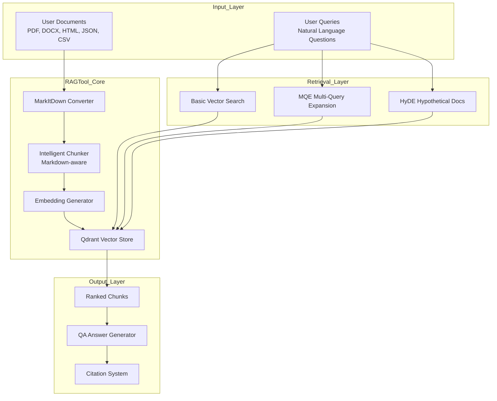
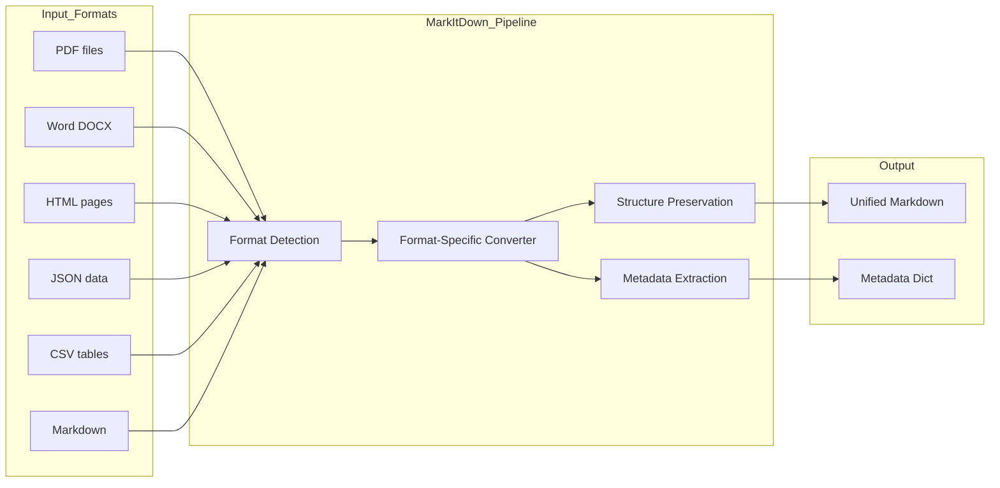
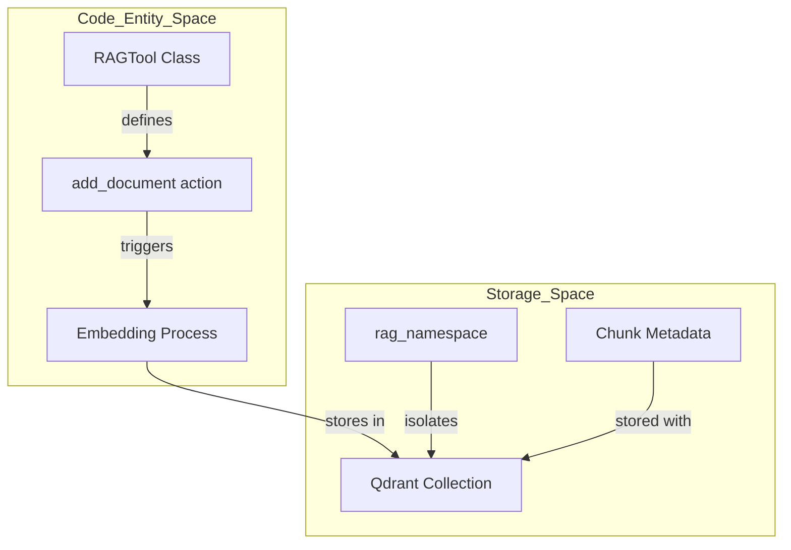
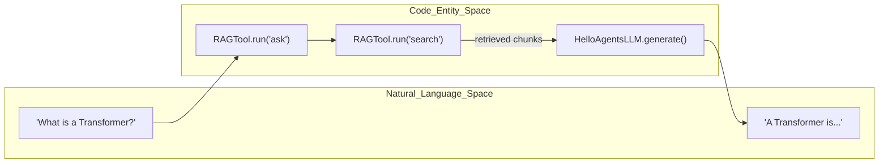

<!-- source: DeepWiki mcp.deepwiki.com · repo datawhalechina/hello-agents · page 8.2 RAG Pipeline and Document Processing · fetched 2026-10-29 -->

# RAG Pipeline and Document Processing

Relevant source files

The following files were used as context for generating this wiki page:

- [code/chapter8/01_MemoryTool_Basic_Operations.py](code/chapter8/01_MemoryTool_Basic_Operations.py)
- [code/chapter8/02_MemoryTool_Architecture.py](code/chapter8/02_MemoryTool_Architecture.py)
- [code/chapter8/03_WorkingMemory_Implementation.py](code/chapter8/03_WorkingMemory_Implementation.py)
- [code/chapter8/04_RAGTool_MarkItDown_Pipeline.py](code/chapter8/04_RAGTool_MarkItDown_Pipeline.py)
- [code/chapter8/05_RAGTool_Advanced_Search.py](code/chapter8/05_RAGTool_Advanced_Search.py)
- [code/chapter8/06_Memory_Consolidation_Demo.py](code/chapter8/06_Memory_Consolidation_Demo.py)
- [code/chapter8/07_RAGTool_Intelligent_QA.py](code/chapter8/07_RAGTool_Intelligent_QA.py)
- [code/chapter8/08_Agent_Tool_Integration.py](code/chapter8/08_Agent_Tool_Integration.py)
- [code/chapter8/09_Memory_Types_Deep_Dive.py](code/chapter8/09_Memory_Types_Deep_Dive.py)
- [code/chapter8/10_RAG_Pipeline_Complete.py](code/chapter8/10_RAG_Pipeline_Complete.py)
- [code/chapter8/11_Q&A_Assistant.py](code/chapter8/11_Q&A_Assistant.py)

## Purpose and Scope

This page documents the RAG (Retrieval-Augmented Generation) pipeline and document processing system in HelloAgents. It covers the complete workflow from document ingestion through intelligent question answering, including:

- Document format conversion via `MarkItDown` [code/chapter8/04_RAGTool_MarkItDown_Pipeline.py:4-6]().
- Intelligent chunking strategies for semantic segmentation [code/chapter8/04_RAGTool_MarkItDown_Pipeline.py:175-184]().
- Vector embedding and storage in `Qdrant` [code/chapter8/02_MemoryTool_Architecture.py:85-87]().
- Advanced retrieval techniques (MQE, HyDE) [code/chapter8/05_RAGTool_Advanced_Search.py:4-6]().
- Context construction and answer generation with citations [code/chapter8/07_RAGTool_Intelligent_QA.py:4-6]().

## System Architecture

### High-Level Component Overview

The RAG system is implemented through the `RAGTool` class, providing a unified interface for document processing and intelligent retrieval.

Title: RAG Pipeline Data Flow

**Sources**: [code/chapter8/10_RAG_Pipeline_Complete.py:28-41](), [code/chapter8/04_RAGTool_MarkItDown_Pipeline.py:15-23]()

### RAGTool Interface and Operations

The `RAGTool` class exposes a unified `run()` method supporting multiple operations [code/chapter8/08_Agent_Tool_Integration.py:160-163]().

| Action | Parameters | Description | Return Type |
|--------|------------|-------------|-------------|
| `add_document` | `file_path`, `chunk_size`, `chunk_overlap` | Process file and add to knowledge base | Status message |
| `add_text` | `text`, `document_id`, metadata | Add text content directly | Status message |
| `search` | `query`, `limit`, `enable_advanced_search` | Vector similarity search | Ranked text chunks |
| `ask` | `question`, `limit`, `enable_advanced_search` | Generate contextual answer | Answer with sources |
| `stats` | none | Knowledge base statistics | Metrics dictionary |

**Sources**: [code/chapter8/11_Q&A_Assistant.py:65-71](), [code/chapter8/11_Q&A_Assistant.py:123-130](), [code/chapter8/08_Agent_Tool_Integration.py:148-158]()

## Document Processing Pipeline

### Stage 1: Format Conversion with MarkItDown

`MarkItDown` converts heterogeneous document formats into unified Markdown representation while preserving structure [code/chapter8/04_RAGTool_MarkItDown_Pipeline.py:143-147]().

Title: MarkItDown Conversion Process

**Sources**: [code/chapter8/04_RAGTool_MarkItDown_Pipeline.py:138-147](), [code/chapter8/10_RAG_Pipeline_Complete.py:47-51]()

### Stage 2: Intelligent Chunking

The chunking system segments documents into semantically coherent pieces optimized for retrieval while respecting Markdown structure [code/chapter8/04_RAGTool_MarkItDown_Pipeline.py:179-184]().

**Chunking Parameters** [code/chapter8/11_Q&A_Assistant.py:69-70]():
- `chunk_size`: Target tokens per chunk (e.g., 1000).
- `chunk_overlap`: Overlapping tokens between chunks (e.g., 200).

**Sources**: [code/chapter8/04_RAGTool_MarkItDown_Pipeline.py:249-254](), [code/chapter8/11_Q&A_Assistant.py:66-71]()

### Stage 3: Embedding and Vector Storage

Text chunks are converted to dense vector representations and stored in a vector database [code/chapter8/04_RAGTool_MarkItDown_Pipeline.py:165-165]().

Title: Vector Storage Entity Mapping

**Sources**: [code/chapter8/04_RAGTool_MarkItDown_Pipeline.py:19-22](), [code/chapter8/10_RAG_Pipeline_Complete.py:29-32]()

## Advanced Retrieval Strategies

### MQE: Multi-Query Expansion

MQE improves recall by generating multiple semantically equivalent query variations using an LLM [code/chapter8/05_RAGTool_Advanced_Search.py:212-216]().

- **Principle**: LLM generates 3-5 equivalent queries.
- **Execution**: Parallel execution of queries against the vector store.
- **Aggregation**: Results are merged and deduplicated.

**Sources**: [code/chapter8/05_RAGTool_Advanced_Search.py:208-216](), [code/chapter8/05_RAGTool_Advanced_Search.py:238-241]()

### HyDE: Hypothetical Document Embedding

HyDE generates a hypothetical answer and uses it for document-to-document matching [code/chapter8/05_RAGTool_Advanced_Search.py:255-259]().

- **Principle**: LLM generates a "fake" answer document.
- **Retrieval**: The hypothetical document's vector is used to find real similar documents.

**Sources**: [code/chapter8/05_RAGTool_Advanced_Search.py:250-259](), [code/chapter8/05_RAGTool_Advanced_Search.py:273-276]()

## Intelligent QA System

### Context Construction and Answering

The `ask` action in `RAGTool` performs the complete RAG loop [code/chapter8/07_RAGTool_Intelligent_QA.py:257-262]():

1. **Retrieve**: Search relevant chunks using `search` (optionally with MQE/HyDE) [code/chapter8/07_RAGTool_Intelligent_QA.py:272-275]().
2. **Assemble**: Construct a context prompt from retrieved text.
3. **Generate**: Use `HelloAgentsLLM` to generate the final answer based on the context [code/chapter8/07_RAGTool_Intelligent_QA.py:281-286]().

Title: Intelligent QA Code Flow

**Sources**: [code/chapter8/07_RAGTool_Intelligent_QA.py:242-245](), [code/chapter8/07_RAGTool_Intelligent_QA.py:281-286](), [code/chapter8/11_Q&A_Assistant.py:123-130]()

### Performance Optimization

| Strategy | Benefit | Code Reference |
|----------|---------|----------------|
| **Batch Processing** | Reduces overhead for multiple documents | [code/chapter8/10_RAG_Pipeline_Complete.py:214-256]() |
| **Advanced Search Selection** | Balance between latency and recall | [code/chapter8/05_RAGTool_Advanced_Search.py:225-248]() |
| **Namespace Isolation** | Logical separation of knowledge bases | [code/chapter8/08_Agent_Tool_Integration.py:32-35]() |

**Sources**: [code/chapter8/10_RAG_Pipeline_Complete.py:214-256](), [code/chapter8/05_RAGTool_Advanced_Search.py:225-248](), [code/chapter8/08_Agent_Tool_Integration.py:32-35]()

---

