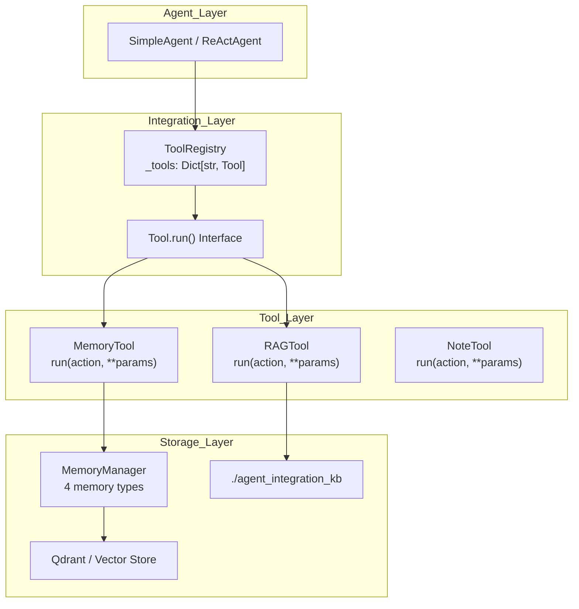
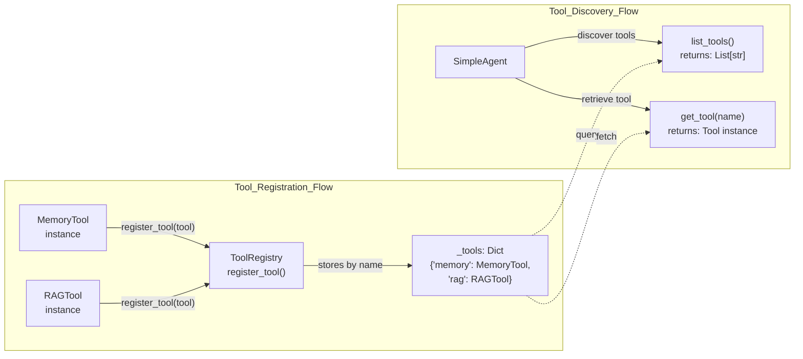
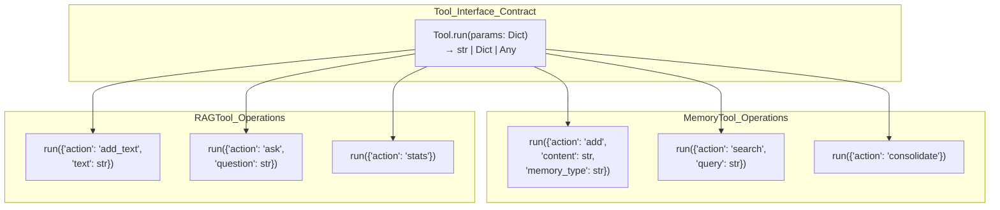
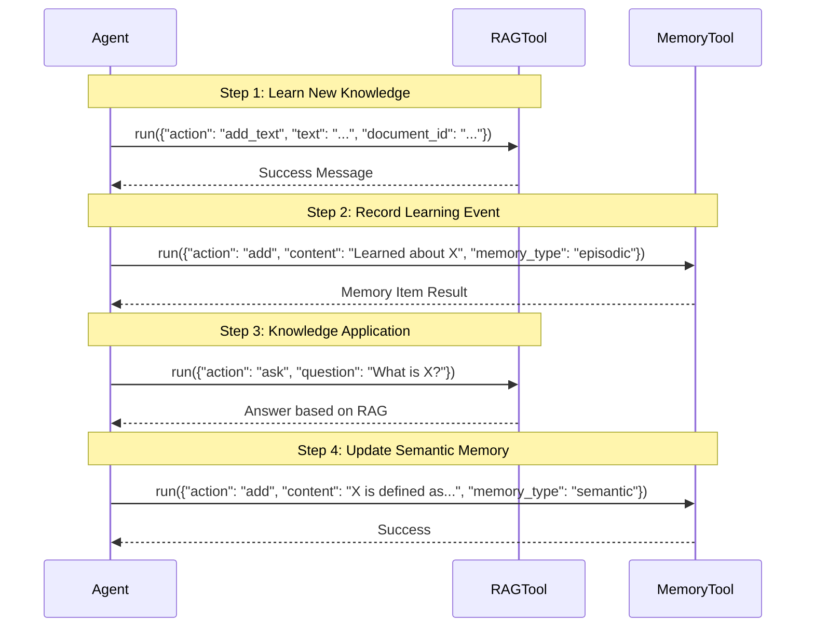
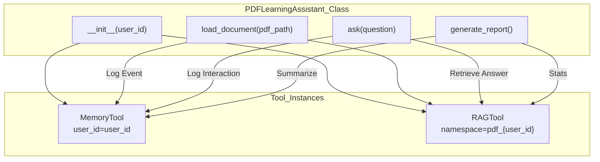

<!-- source: DeepWiki mcp.deepwiki.com · repo datawhalechina/hello-agents · page 8.3 Tool Integration Patterns · fetched 2026-10-29 -->

# Tool Integration Patterns

<details>
<summary>Relevant source files</summary>

The following files were used as context for generating this wiki page:

- [code/chapter8/01_MemoryTool_Basic_Operations.py](code/chapter8/01_MemoryTool_Basic_Operations.py)
- [code/chapter8/02_MemoryTool_Architecture.py](code/chapter8/02_MemoryTool_Architecture.py)
- [code/chapter8/03_WorkingMemory_Implementation.py](code/chapter8/03_WorkingMemory_Implementation.py)
- [code/chapter8/04_RAGTool_MarkItDown_Pipeline.py](code/chapter8/04_RAGTool_MarkItDown_Pipeline.py)
- [code/chapter8/05_RAGTool_Advanced_Search.py](code/chapter8/05_RAGTool_Advanced_Search.py)
- [code/chapter8/06_Memory_Consolidation_Demo.py](code/chapter8/06_Memory_Consolidation_Demo.py)
- [code/chapter8/07_RAGTool_Intelligent_QA.py](code/chapter8/07_RAGTool_Intelligent_QA.py)
- [code/chapter8/08_Agent_Tool_Integration.py](code/chapter8/08_Agent_Tool_Integration.py)
- [code/chapter8/09_Memory_Types_Deep_Dive.py](code/chapter8/09_Memory_Types_Deep_Dive.py)
- [code/chapter8/10_RAG_Pipeline_Complete.py](code/chapter8/10_RAG_Pipeline_Complete.py)
- [code/chapter8/11_Q&A_Assistant.py](code/chapter8/11_Q&A_Assistant.py)

</details>


## Purpose and Scope

This document explains the design patterns and implementation strategies for integrating multiple tools within the HelloAgents framework, with a focus on how `MemoryTool` and `RAGTool` work together to enable sophisticated agent capabilities. Tool integration patterns define how independent tools collaborate through standardized interfaces to solve complex tasks.

For detailed information about individual tool implementations, see:
- Memory system architecture and four memory types: [8.1]()
- RAG pipeline and document processing: [8.2]()
- Context engineering with tool outputs: [8.4]()

**Scope**: This page covers the architectural patterns, interface designs, and orchestration mechanisms that enable tools to work together seamlessly. It does not cover individual tool internals or agent-specific paradigms (see [5]() for agent patterns).

---

## Architecture Overview

The HelloAgents framework uses a plugin-based architecture where tools are independent modules that integrate through a common registry and interface pattern.

### Tool Integration Architecture



**Sources**: [code/chapter8/08_Agent_Tool_Integration.py:11-57](), [code/chapter8/02_MemoryTool_Architecture.py:15-68]()

---

## Core Integration Patterns

### Pattern 1: Tool Registry Pattern

The `ToolRegistry` pattern provides centralized tool management with dynamic registration and discovery capabilities. This allows an `Agent` to access multiple tools through a single entry point.

#### Registry Implementation



**Key Implementation Details**:

| Aspect | Implementation | Code Reference |
|--------|---------------|----------------|
| Registration | `ToolRegistry.register_tool(tool)` | [code/chapter8/08_Agent_Tool_Integration.py:53-54]() |
| Storage | `_tools: Dict[str, Tool]` dictionary | [code/chapter8/08_Agent_Tool_Integration.py:79]() |
| Discovery | `list_tools()` returns available tool names | [code/chapter8/08_Agent_Tool_Integration.py:94-95]() |
| Retrieval | `get_tool(name)` returns tool instance | [code/chapter8/08_Agent_Tool_Integration.py:98-99]() |

**Sources**: [code/chapter8/08_Agent_Tool_Integration.py:50-103](), [code/chapter8/02_MemoryTool_Architecture.py:47-69]()

---

### Pattern 2: Unified Interface Pattern

All tools implement a standardized `run(params)` method. This `execute` pattern ensures that an `Agent` can interact with `MemoryTool`, `RAGTool`, or any `CustomTool` using an identical syntax, typically passing an `action` string and keyword arguments.

#### Unified Interface Contract



**Common Parameters Across Tools**:

| Parameter | Type | Purpose | Tools Supporting |
|-----------|------|---------|-----------------|
| `action` | `str` | Operation to perform | All tools |
| `query` | `str` | Search query | `MemoryTool`, `RAGTool` |
| `limit` | `int` | Result count limit | `MemoryTool`, `RAGTool` |
| `importance` | `float` | Importance score (0-1) | `MemoryTool` |
| `content` | `str` | Content to store | `MemoryTool` |
| `question` | `str` | Question for QA | `RAGTool` |

**Sources**: [code/chapter8/08_Agent_Tool_Integration.py:105-163](), [code/chapter8/01_MemoryTool_Basic_Operations.py:30-154]()

---

### Pattern 3: Collaborative Workflow Pattern

The collaborative workflow pattern enables tools to work together by sharing data. A common scenario is using `RAGTool` for external knowledge retrieval and `MemoryTool` for tracking the agent's internal learning state.

#### Collaborative Workflow Architecture



**Workflow Implementation Example**:
The `PDFLearningAssistant` class demonstrates a complete collaborative workflow:
1. **Document Ingestion**: `RAGTool` processes a PDF via `add_document` [code/chapter8/11_Q&A_Assistant.py:66-71]().
2. **Event Logging**: `MemoryTool` records the load event in `episodic` memory [code/chapter8/11_Q&A_Assistant.py:80-87]().
3. **Interactive Q&A**: `RAGTool` generates answers while `MemoryTool` logs the interaction [code/chapter8/11_Q&A_Assistant.py:123-140]().

**Sources**: [code/chapter8/08_Agent_Tool_Integration.py:165-256](), [code/chapter8/11_Q&A_Assistant.py:50-144]()

---

## Tool Communication Mechanisms

### Data Flow and Synthesis

Tools communicate indirectly through the Agent. The Agent retrieves information from one tool (e.g., `RAGTool` knowledge) and stores the resulting state or synthesis in another (e.g., `MemoryTool`).

| Scenario | Tool 1 (Source) | Tool 2 (Destination) | Purpose |
|----------|----------------|----------------------|---------|
| **Study** | `RAGTool.add_text` | `MemoryTool.add(episodic)` | Track learning history |
| **Review** | `MemoryTool.search` | `RAGTool.search` | Combine personal history with raw knowledge |
| **Analysis** | `MemoryTool.stats` | `RAGTool.stats` | Unified learning report generation |

**Implementation of Parallel Retrieval**:
```python
# Simultaneous query to both tools for comprehensive context
memory_search = self.memory_tool.run({"action": "search", "query": "design patterns"})
rag_search = self.rag_tool.run({"action": "search", "query": "design patterns"})
```

**Sources**: [code/chapter8/08_Agent_Tool_Integration.py:211-235](), [code/chapter8/11_Q&A_Assistant.py:197-228]()

---

## Agent Orchestration Patterns

Agents orchestrate tool usage through decision-making logic. In the `PDFLearningAssistant`, orchestration is managed via dedicated methods that wrap tool calls into logical business processes.

### Q&A Assistant Orchestration



**Sources**: [code/chapter8/11_Q&A_Assistant.py:23-240](), [code/chapter8/08_Agent_Tool_Integration.py:14-63]()

---

## Performance Considerations

Integrating multiple tools introduces latency. HelloAgents optimizes this through specialized memory types and retrieval strategies.

### Performance Characteristics

| Component | Latency | Storage | Optimization |
|-----------|---------|---------|--------------|
| `WorkingMemory` | Low | RAM | TTL (Time-To-Live) and Capacity Limits [code/chapter8/09_Memory_Types_Deep_Dive.py:56-60]() |
| `EpisodicMemory` | Medium | SQLite/Vector | Persistent sequence numbers [code/chapter8/09_Memory_Types_Deep_Dive.py:139-143]() |
| `RAGTool` | High | Vector DB | Advanced Search (MQE/HyDE) [code/chapter8/05_RAGTool_Advanced_Search.py:209-260]() |

### Optimization Strategy: Memory Consolidation
To maintain performance, the framework implements a `consolidate` action. This moves important memories from fast, volatile `working` memory to persistent `episodic` memory based on an `importance_threshold`.

**Example**:
```python
# Consolidate working memory to episodic memory for long-term retention
self.memory_tool.run({
    "action": "consolidate",
    "from_type": "working",
    "to_type": "episodic",
    "importance_threshold": 0.7
})
```

**Sources**: [code/chapter8/06_Memory_Consolidation_Demo.py:131-178](), [code/chapter8/03_WorkingMemory_Implementation.py:25-34]()

---

## Best Practices

1. **Isolation**: Use `user_id` in `MemoryTool` [code/chapter8/11_Q&A_Assistant.py:26-37]() and `rag_namespace` in `RAGTool` [code/chapter8/10_RAG_Pipeline_Complete.py:29-32]() to isolate data between different users or sessions.
2. **Importance Scoring**: Always assign an `importance` score to memories [code/chapter8/01_MemoryTool_Basic_Operations.py:36-76]() to enable effective consolidation and forgetting strategies.
3. **Advanced Retrieval**: Enable `enable_advanced_search` (MQE/HyDE) in `RAGTool` for complex queries to improve answer quality [code/chapter8/11_Q&A_Assistant.py:123-130]().
4. **Structured Metadata**: When adding memories or documents, include metadata like `session_id`, `topic`, or `event_type` to improve future retrieval filtering [code/chapter8/09_Memory_Types_Deep_Dive.py:186-197]().

**Sources**: [code/chapter8/08_Agent_Tool_Integration.py:443-461](), [code/chapter8/11_Q&A_Assistant.py:23-144]()

---

