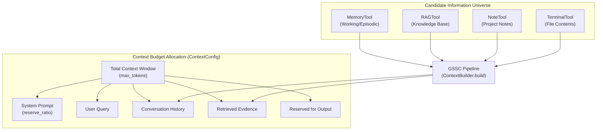
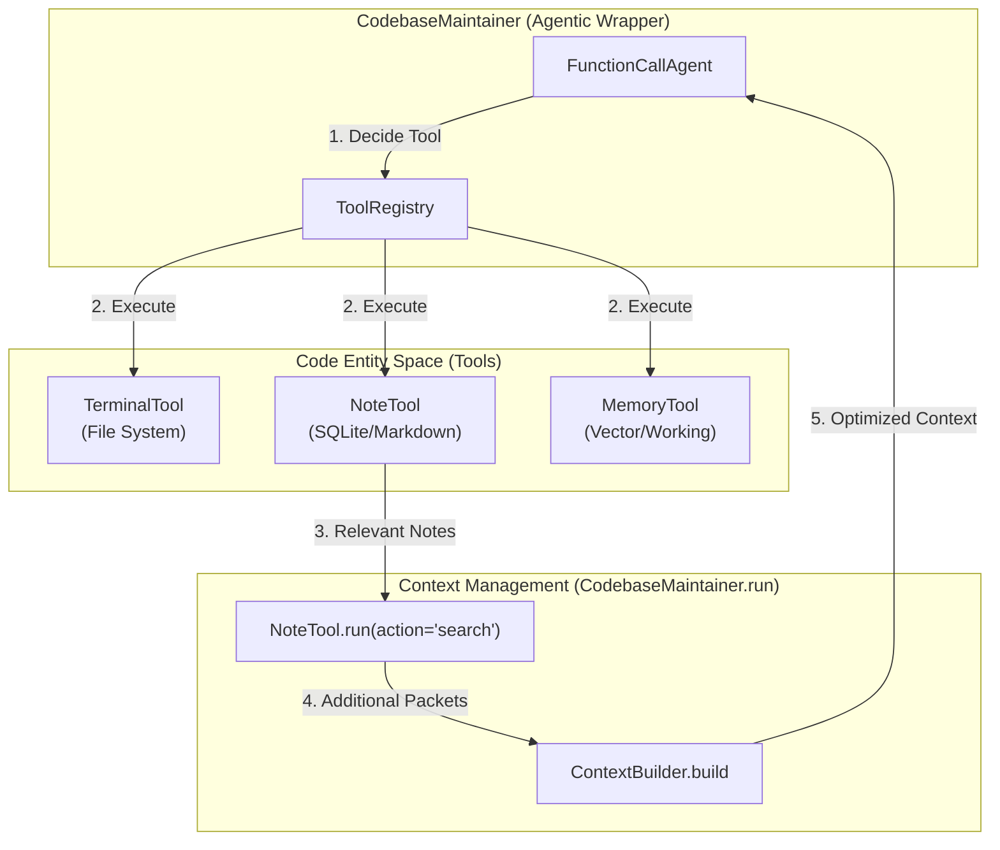

<!-- source: DeepWiki mcp.deepwiki.com · repo datawhalechina/hello-agents · page 8.4 Context Engineering · fetched 2026-10-29 -->

# Context Engineering

<details>
<summary>Relevant source files</summary>

The following files were used as context for generating this wiki page:

- [code/chapter9/01_context_builder_basic.py](code/chapter9/01_context_builder_basic.py)
- [code/chapter9/02_context_builder_with_agent.py](code/chapter9/02_context_builder_with_agent.py)
- [code/chapter9/03_note_tool_operations.py](code/chapter9/03_note_tool_operations.py)
- [code/chapter9/04_note_tool_integration.py](code/chapter9/04_note_tool_integration.py)
- [code/chapter9/05_terminal_tool_examples.py](code/chapter9/05_terminal_tool_examples.py)
- [code/chapter9/06_three_day_workflow.py](code/chapter9/06_three_day_workflow.py)
- [code/chapter9/README.md](code/chapter9/README.md)
- [code/chapter9/codebase/__init__.py](code/chapter9/codebase/__init__.py)
- [code/chapter9/codebase/api_client.py](code/chapter9/codebase/api_client.py)
- [code/chapter9/codebase/data_processor.py](code/chapter9/codebase/data_processor.py)
- [code/chapter9/codebase/models.py](code/chapter9/codebase/models.py)
- [code/chapter9/codebase_maintainer.py](code/chapter9/codebase_maintainer.py)
- [docs/chapter9/Chapter9-Context-Engineering.md](docs/chapter9/Chapter9-Context-Engineering.md)

</details>


Context engineering is the systematic approach to optimizing the information sent to LLMs within their token budget constraints. Unlike prompt engineering (which focuses on instruction writing), context engineering manages the **entire context state**—system instructions, conversation history, tool results, retrieved documents, and memory—to maximize inference quality while staying within token limits.

This document covers the `ContextBuilder` implementation in HelloAgents, which provides a production-ready GSSC (Gather-Select-Structure-Compress) pipeline for context management. For long-term memory storage, see [Memory and Retrieval Systems](#8.1). For RAG integration, see [RAG Pipeline and Document Processing](#8.2).

---

## Purpose and Scope

Context engineering solves the fundamental constraint in LLM-based agents: **limited attention budgets**. As context length increases, models exhibit "context rot"—degraded ability to recall information from within the window, particularly from the middle positions ("lost-in-the-middle" effect).

This document covers:

- The `ContextBuilder` class and GSSC pipeline implementation [docs/chapter9/Chapter9-Context-Engineering.md:13-17]()
- `ContextConfig` and `ContextPacket` data structures [code/chapter9/01_context_builder_basic.py:30-41]()
- Token budget allocation and relevance-based selection [docs/chapter9/Chapter9-Context-Engineering.md:182-209]()
- Integration with `MemoryTool`, `RAGTool`, `NoteTool`, and `TerminalTool` [code/chapter9/codebase_maintainer.py:51-68]()
- Long-horizon task patterns: compaction, structured note-taking, and agentic search [code/chapter9/06_three_day_workflow.py:39-130]()

**Sources:** [docs/chapter9/Chapter9-Context-Engineering.md:1-120](), [code/chapter9/01_context_builder_basic.py:1-41]()

---

## Why Context Engineering Matters

### Context Rot and Attention Degradation

Research shows that LLMs exhibit **context rot**: as context length increases, the model's ability to accurately recall information decreases. This manifests as:

- **Lost-in-the-middle effect**: Information in the middle of long contexts is often ignored.
- **Attention budget**: Each token consumes part of the model's "attention budget," requiring careful selection of high signal density tokens. [docs/chapter9/Chapter9-Context-Engineering.md:44-54]()

**Context as Limited Resource:**



**Sources:** [docs/chapter9/Chapter9-Context-Engineering.md:44-119](), [code/chapter9/01_context_builder_basic.py:30-41]()

### The GSSC Pipeline

HelloAgents implements context engineering through the **GSSC pipeline**:

1. **Gather**: Collect candidate information from multiple sources (History, Memory, RAG, Notes).
2. **Select**: Score and filter by relevance and recency.
3. **Structure**: Organize into fixed template sections (Role, Task, Evidence, Context).
4. **Compress**: Apply fallback truncation if over the `max_tokens` limit.

**Sources:** [docs/chapter9/Chapter9-Context-Engineering.md:121-143](), [code/chapter9/01_context_builder_basic.py:70-74]()

---

## Core Data Structures

### ContextPacket

`ContextPacket` is the fundamental unit of candidate information. While defined in the core framework, its usage is demonstrated in high-level integrations. [code/chapter9/04_note_tool_integration.py:136-186]()

**Key attributes:**
- `content`: The actual text to include.
- `timestamp`: Used for recency scoring.
- `token_count`: Estimated token usage.
- `relevance_score`: Importance relative to the user query.
- `metadata`: Type classification (e.g., `"note"`, `"memory"`, `"system_instruction"`).

**Sources:** [docs/chapter9/Chapter9-Context-Engineering.md:145-177](), [code/chapter9/04_note_tool_integration.py:174-184]()

### ContextConfig

`ContextConfig` encapsulates the parameters for the `ContextBuilder`. [code/chapter9/01_context_builder_basic.py:30-35]()

| Parameter | Purpose |
|-----------|---------|
| `max_tokens` | Maximum context window size (e.g., 3000 or 4000). |
| `reserve_ratio` | Fraction of tokens reserved for system instructions. |
| `min_relevance` | Minimum threshold for including historical information. |
| `enable_compression` | Whether to apply truncation when limits are exceeded. |

**Sources:** [code/chapter9/01_context_builder_basic.py:30-35](), [code/chapter9/02_context_builder_with_agent.py:33]()

---

## Implementation Components

### ContextBuilder

The `ContextBuilder` class (`hello_agents/context/builder.py`) is the central orchestrator of the GSSC pipeline. [docs/chapter9/Chapter9-Context-Engineering.md:13]()

- **Initialization**: Accepts a `ContextConfig` and optional tool instances like `MemoryTool` or `RAGTool`. [code/chapter9/01_context_builder_basic.py:37-41]()
- **Build Method**: The main entry point `build()` takes the `user_query`, `conversation_history`, and `system_instructions` to produce a single structured string. [code/chapter9/01_context_builder_basic.py:70-74]()

**Sources:** [code/chapter9/01_context_builder_basic.py:37-74](), [docs/chapter9/Chapter9-Context-Engineering.md:13]()

### NoteTool Integration

The `NoteTool` (`hello_agents/tools/builtin/note_tool.py`) provides structured persistence. Agents use it to record "blockers," "actions," and "conclusions" that survive across session restarts. [code/chapter9/03_note_tool_operations.py:34-68](), [code/chapter9/06_three_day_workflow.py:151-203]()

**Note Operations:**
- `create`: Saves findings with tags and types. [code/chapter9/03_note_tool_operations.py:36-46]()
- `search`: Retrieves notes based on keyword relevance for injection into context. [code/chapter9/03_note_tool_operations.py:95-101]()
- `summary`: Provides a macro view of all project notes. [code/chapter9/03_note_tool_operations.py:113-117]()

**Sources:** [code/chapter9/03_note_tool_operations.py:1-135](), [code/chapter9/04_note_tool_integration.py:48-60]()

### TerminalTool Integration

The `TerminalTool` (`hello_agents/tools/builtin/terminal_tool.py`) enables "Agentic Search" or Just-In-Time (JIT) context retrieval. Instead of pre-loading a whole codebase, the agent explores it using shell commands. [code/chapter9/05_terminal_tool_examples.py:1-13]()

- **Discovery**: `ls`, `find` to locate files. [code/chapter9/05_terminal_tool_examples.py:27-40]()
- **Analysis**: `grep`, `wc`, `awk` to extract specific lines or statistics. [code/chapter9/05_terminal_tool_examples.py:105-117]()
- **Retrieval**: `cat`, `head`, `tail` to read specific file segments into the current context window. [code/chapter9/05_terminal_tool_examples.py:42-45]()

**Sources:** [code/chapter9/05_terminal_tool_examples.py:1-163](), [docs/chapter9/Chapter9-Context-Engineering.md:15]()

---

## Agentic Context Management

HelloAgents emphasizes "Agentic" workflows where the agent autonomously decides which tools to use to manage its own context.

### CodebaseMaintainer Architecture

The `CodebaseMaintainer` class is a high-level agentic implementation that integrates all context engineering components. [code/chapter9/codebase_maintainer.py:25-35]()



**Sources:** [code/chapter9/codebase_maintainer.py:37-85](), [code/chapter9/codebase_maintainer.py:121-141]()

### Multi-Day Workflow Pattern

Context engineering allows agents to maintain continuity over long periods by utilizing structured notes as "external working memory." [code/chapter9/06_three_day_workflow.py:1-10]()

1. **Day 1 (Exploration)**: Agent uses `TerminalTool` to map project structure and `NoteTool` to record the initial architecture. [code/chapter9/06_three_day_workflow.py:39-65]()
2. **Day 2 (Analysis)**: Agent uses `grep` to find TODOs and records specific quality issues as `blocker` notes. [code/chapter9/06_three_day_workflow.py:68-95]()
3. **Day 3 (Planning)**: Agent retrieves `blocker` notes from previous days via `ContextBuilder` to generate a refactoring plan. [code/chapter9/06_three_day_workflow.py:98-128]()
4. **Week Later (Review)**: A new session instance retrieves the `task_state` notes to summarize progress. [code/chapter9/06_three_day_workflow.py:131-149]()

**Sources:** [code/chapter9/06_three_day_workflow.py:1-203](), [code/chapter9/codebase_maintainer.py:153-177]()

---

## Practical Implementation Examples

### Basic Context Construction
The simplest use case involves passing conversation history and system instructions to the builder. [code/chapter9/01_context_builder_basic.py:70-74]()

```python
builder = ContextBuilder(config=ContextConfig(max_tokens=3000))
context_str = builder.build(
    user_query="How to optimize Pandas memory?",
    conversation_history=history,
    system_instructions="You are a data expert."
)
```

### Context-Aware Agent Loop
Integrating the builder into an agent's `run` method ensures every LLM call is optimized. [code/chapter9/02_context_builder_with_agent.py:38-71]()

```python
def run(self, user_input: str) -> str:
    # 1. Build optimized context
    optimized_context = self.context_builder.build(
        user_query=user_input,
        conversation_history=self.conversation_history,
        system_instructions=self.system_prompt
    )
    # 2. Call LLM with structured context
    messages = [
        {"role": "system", "content": optimized_context},
        {"role": "user", "content": user_input}
    ]
    response = self.llm.invoke(messages)
    return response
```

**Sources:** [code/chapter9/01_context_builder_basic.py:70-80](), [code/chapter9/02_context_builder_with_agent.py:38-71]()

---

## Summary of Best Practices

1. **Prioritize Relevance**: Use `min_relevance` in `ContextConfig` to drop noise from the context window. [code/chapter9/01_context_builder_basic.py:33]()
2. **Structured Retrieval**: Use `NoteTool` for high-value conclusions rather than relying on raw conversation history. [code/chapter9/04_note_tool_integration.py:188-205]()
3. **Just-In-Time Access**: Use `TerminalTool` to read file segments on demand, avoiding the "Lost-in-the-middle" effect of massive pre-loaded contexts. [code/chapter9/05_terminal_tool_examples.py:42-45]()
4. **Token Budgeting**: Always reserve a ratio of the context for the model's output to prevent mid-sentence truncation. [code/chapter9/01_context_builder_basic.py:32]()

**Sources:** [docs/chapter9/Chapter9-Context-Engineering.md:44-54](), [code/chapter9/01_context_builder_basic.py:30-35](), [code/chapter9/04_note_tool_integration.py:188-205]()

---

