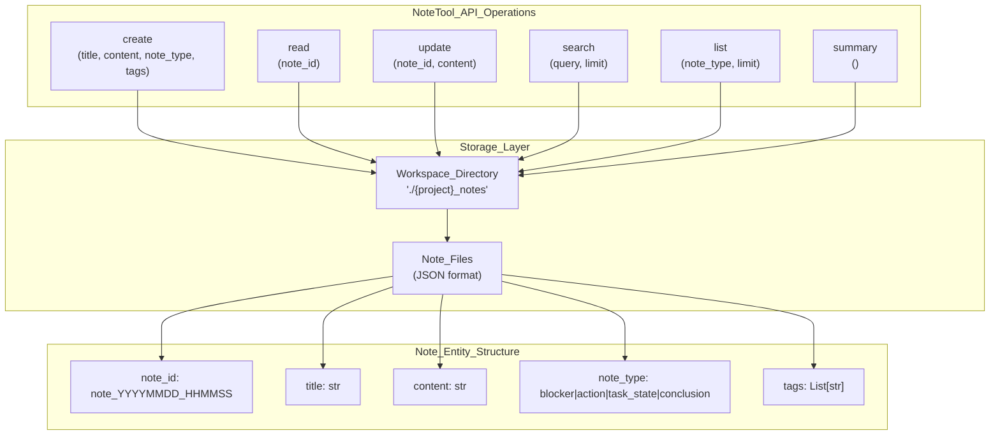
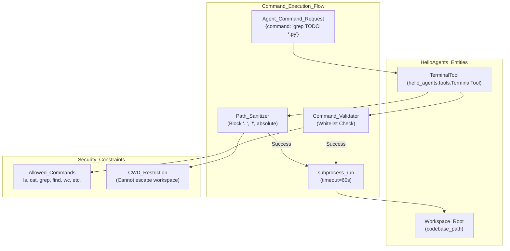
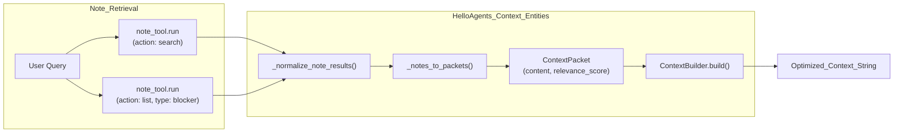

<!-- source: DeepWiki mcp.deepwiki.com · repo datawhalechina/hello-agents · page 8.5 NoteTool and TerminalTool · fetched 2026-10-29 -->

# NoteTool and TerminalTool

Relevant source files

The following files were used as context for generating this wiki page:

- [code/chapter9/01_context_builder_basic.py](code/chapter9/01_context_builder_basic.py)
- [code/chapter9/02_context_builder_with_agent.py](code/chapter9/02_context_builder_with_agent.py)
- [code/chapter9/03_note_tool_operations.py](code/chapter9/03_note_tool_operations.py)
- [code/chapter9/04_note_tool_integration.py](code/chapter9/04_note_tool_integration.py)
- [code/chapter9/05_terminal_tool_examples.py](code/chapter9/05_terminal_tool_examples.py)
- [code/chapter9/06_three_day_workflow.py](code/chapter9/06_three_day_workflow.py)
- [code/chapter9/README.md](code/chapter9/README.md)
- [code/chapter9/codebase/__init__.py](code/chapter9/codebase/__init__.py)
- [code/chapter9/codebase/api_client.py](code/chapter9/codebase/api_client.py)
- [code/chapter9/codebase/data_processor.py](code/chapter9/codebase/data_processor.py)
- [code/chapter9/codebase/models.py](code/chapter9/codebase/models.py)
- [code/chapter9/codebase_maintainer.py](code/chapter9/codebase_maintainer.py)
- [docs/chapter9/Chapter9-Context-Engineering.md](docs/chapter9/Chapter9-Context-Engineering.md)

## Purpose and Scope

This document covers two specialized tools designed for long-horizon agent tasks in the Hello-Agents framework: **NoteTool** and **TerminalTool**. These tools address key challenges in context engineering by providing persistent memory and just-in-time information retrieval capabilities.

- **NoteTool**: Structured note-taking system that maintains persistent state across agent sessions, supporting categorized notes (blockers, actions, task states, conclusions) with search and retrieval capabilities.
- **TerminalTool**: Sandboxed shell command executor that enables agents to explore file systems and execute safe commands within workspace boundaries.

Together, these tools implement the "structured note-taking" and "just-in-time context" patterns discussed in context engineering. They are core components of the `CodebaseMaintainer` architecture, which enables agents to manage complex software projects over multiple days.

**Sources:** [docs/chapter9/Chapter9-Context-Engineering.md:11-17](), [code/chapter9/README.md:108-114]()

---

## NoteTool Architecture

### Overview and Design Philosophy

`NoteTool` provides a file-based persistent storage system for structured notes. Unlike ephemeral conversation history or working memory, notes persist indefinitely and maintain structured metadata for long-term task tracking.

**Key Design Principles:**
- **Session Independence**: Notes survive beyond individual agent sessions, enabling multi-day workflows [code/chapter9/06_three_day_workflow.py:181-202]().
- **Type-Based Organization**: Specific note types (e.g., `blocker`, `action`) guide retrieval priority [code/chapter9/04_note_tool_integration.py:191-198]().
- **Search-Friendly Metadata**: Tags and content enable keyword search via the `search` action [code/chapter9/03_note_tool_operations.py:94-101]().
- **Human-Readable Storage**: Notes are stored in a workspace directory (e.g., `./project_notes`) for easy inspection [code/chapter9/03_note_tool_operations.py:32-32]().

**Sources:** [code/chapter9/03_note_tool_operations.py:1-12](), [code/chapter9/04_note_tool_integration.py:1-8]()

### Core Operations

**Diagram: NoteTool Operation Flow and Data Model**

**Sources:** [code/chapter9/03_note_tool_operations.py:31-118](), [code/chapter9/04_note_tool_integration.py:136-186]()

### Note Types and Retrieval Priority

| Note Type | Purpose | Retrieval Priority | Example Use Case |
|-----------|---------|-------------------|------------------|
| `blocker` | Critical issues blocking progress | **Highest (0.9)** | Dependency conflicts, build failures |
| `action` | Action items and next steps | High (0.8) | Planned refactorings, implementation tasks |
| `task_state` | Current state of ongoing tasks | Medium-High (0.75) | Progress tracking, milestone status |
| `conclusion` | Analysis results and decisions | Medium (0.7) | Design decisions, performance analysis |

The priority values are used by `ContextBuilder` when converting notes to `ContextPacket` objects to ensure the most critical information is preserved within the token limit.

**Sources:** [code/chapter9/codebase_maintainer.py:261-272](), [code/chapter9/04_note_tool_integration.py:191-198]()

---

## TerminalTool Architecture

### Security-First Command Execution

`TerminalTool` provides sandboxed shell command execution with workspace isolation and command whitelisting. It enables agents to perform just-in-time file system exploration without compromising host security.

**Diagram: TerminalTool Security Architecture**

**Sources:** [code/chapter9/05_terminal_tool_examples.py:120-142](), [code/chapter9/codebase_maintainer.py:56-56]()

### Allowed Command Categories

The tool restricts execution to a safe subset of shell commands to prevent destructive actions:

**File Exploration:**
- `ls`, `cat`, `head`, `tail` - Viewing directory contents and files [code/chapter9/05_terminal_tool_examples.py:29-45]().
- `find`, `grep` - Searching for files and patterns [code/chapter9/05_terminal_tool_examples.py:39-111]().

**Data Analysis:**
- `wc -l` - Counting lines in code or data files [code/chapter9/05_terminal_tool_examples.py:63-106]().
- `cut`, `sort`, `uniq` - Processing CSV or log data [code/chapter9/05_terminal_tool_examples.py:68-88]().
- `awk` - Advanced log parsing [code/chapter9/05_terminal_tool_examples.py:87-87]().

**Blocked Commands:**
- Destructive operations: `rm`, `mv` [code/chapter9/05_terminal_tool_examples.py:130-130]().
- Root access: `sudo` [code/chapter9/README.md:283-283]().
- Directory escape: `cd ../../../etc` [code/chapter9/05_terminal_tool_examples.py:140-140]().

**Sources:** [code/chapter9/05_terminal_tool_examples.py:120-142](), [code/chapter9/README.md:277-285]()

---

## Integration with ContextBuilder

### Note-to-ContextPacket Pipeline

The `CodebaseMaintainer` demonstrates how `NoteTool` integrates with `ContextBuilder` to provide long-term context.

**Diagram: NoteTool Integration with ContextBuilder**

**Sources:** [code/chapter9/codebase_maintainer.py:121-131](), [code/chapter9/codebase_maintainer.py:193-291]()

### ContextPacket Mapping Logic

The integration logic maps note types to relevance scores to ensure critical information survives token compression:
- `blocker`: 0.9 (Highest priority) [code/chapter9/codebase_maintainer.py:263-263]().
- `action`: 0.8 [code/chapter9/codebase_maintainer.py:264-264]().
- `task_state`: 0.75 [code/chapter9/codebase_maintainer.py:265-265]().
- `conclusion`: 0.7 [code/chapter9/codebase_maintainer.py:266-266]().

Notes are formatted into structured strings: `[笔记:Title] 类型: note_type \n\n Content` before being wrapped in a `ContextPacket`.

**Sources:** [code/chapter9/codebase_maintainer.py:254-291](), [code/chapter9/04_note_tool_integration.py:136-186]()

---

## CodebaseMaintainer: Full Integration Example

### Architecture Overview

`CodebaseMaintainer` is a "long-horizon" agent that orchestrates multiple tools to maintain a codebase over time.

**Key Components:**
- **Agent**: `FunctionCallAgent` capable of autonomous tool selection [code/chapter9/codebase_maintainer.py:77-84]().
- **Tools**: `MemoryTool`, `NoteTool`, and `TerminalTool` registered in a `ToolRegistry` [code/chapter9/codebase_maintainer.py:71-74]().
- **Context**: `ContextBuilder` managing a 4000-token window with 15% reserve ratio [code/chapter9/codebase_maintainer.py:59-68]().

**Sources:** [code/chapter9/codebase_maintainer.py:25-101]()

### Execution Workflow

1. **Context Construction**: On each `run()`, the system retrieves relevant notes and builds an optimized context string using `ContextBuilder` [code/chapter9/codebase_maintainer.py:121-131]().
2. **Autonomous Reasoning**: The agent's `system_prompt` is updated with the new context. The agent then decides which tools to call (e.g., `terminal_tool` to check a file, then `note_tool` to record a bug) [code/chapter9/codebase_maintainer.py:133-140]().
3. **State Tracking**: Tool usage is tracked, and conversation history is updated for the next turn [code/chapter9/codebase_maintainer.py:142-146]().

**Sources:** [code/chapter9/codebase_maintainer.py:103-151](), [code/chapter9/06_three_day_workflow.py:204-243]()

---

## Three-Day Workflow Demonstration

The framework supports multi-session continuity through persistent notes.

| Phase | Agent Actions | Tool Synergy |
|-----------|------------------|------------------|
| **Day 1: Exploration** | Explore project structure, identify modules [code/chapter9/06_three_day_workflow.py:39-66](). | `TerminalTool` (ls/find) -> `NoteTool` (create overview) |
| **Day 2: Analysis** | Analyze code quality, find TODOs [code/chapter9/06_three_day_workflow.py:68-96](). | `TerminalTool` (grep TODO) -> `NoteTool` (create blockers) |
| **Day 3: Planning** | Review notes, create refactoring plan [code/chapter9/06_three_day_workflow.py:98-129](). | `NoteTool` (search blockers) -> `NoteTool` (create task_state) |
| **Week Later** | Retrieve historical notes to check progress [code/chapter9/06_three_day_workflow.py:131-149](). | `NoteTool` (summary/list) -> `ContextBuilder` (inject into LLM) |

**Sources:** [code/chapter9/06_three_day_workflow.py:1-150](), [code/chapter9/codebase_maintainer.py:348-395]()

---

