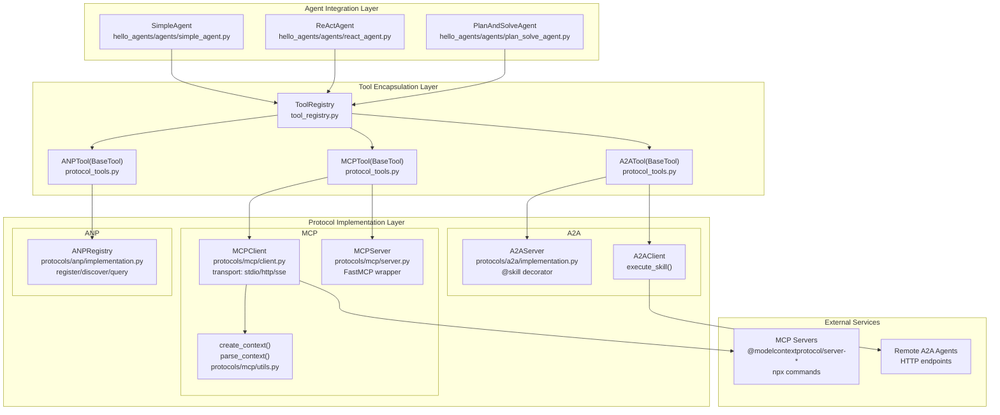
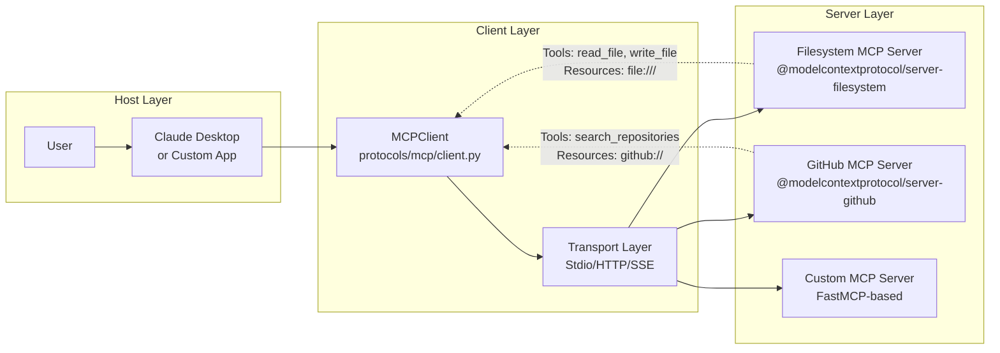
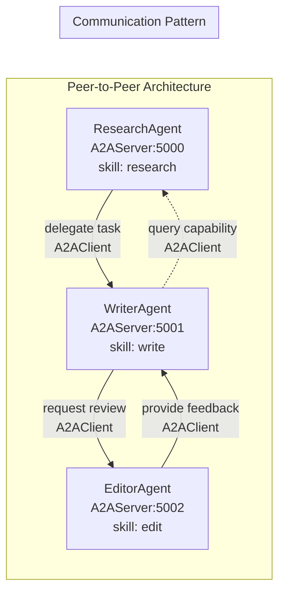
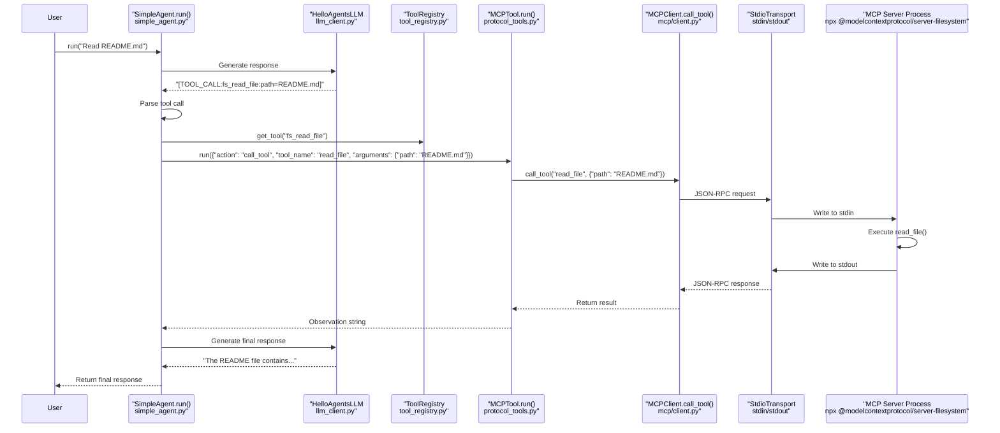
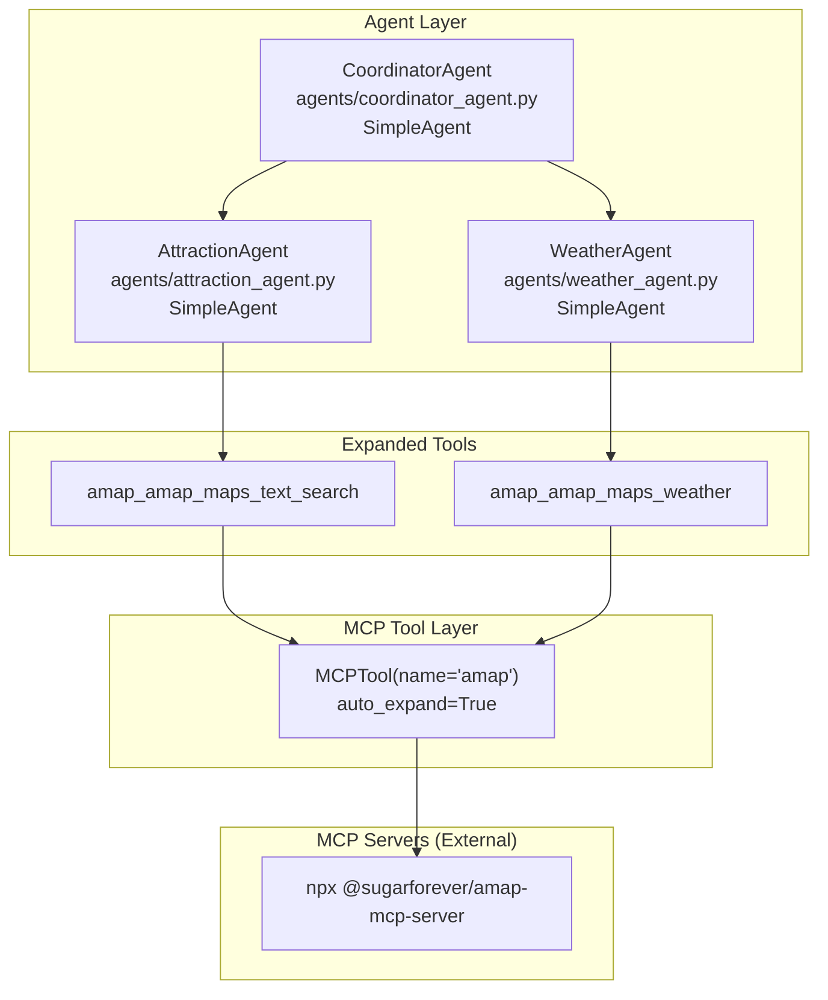

<!-- source: DeepWiki mcp.deepwiki.com · repo datawhalechina/hello-agents · page 8.6 Agent Communication Protocols · fetched 2026-10-29 -->

# Agent Communication Protocols

<details>
<summary>Relevant source files</summary>

The following files were used as context for generating this wiki page:

- [Co-creation-projects/README.md](Co-creation-projects/README.md)
- [docs/chapter10/Chapter10-Agent-Communication-Protocols.md](docs/chapter10/Chapter10-Agent-Communication-Protocols.md)
- [docs/chapter11/Chapter11-Agentic-RL.md](docs/chapter11/Chapter11-Agentic-RL.md)
- [docs/chapter12/Chapter12-Agent-Performance-Evaluation.md](docs/chapter12/Chapter12-Agent-Performance-Evaluation.md)
- [docs/chapter13/Chapter13-Intelligent-Travel-Assistant.md](docs/chapter13/Chapter13-Intelligent-Travel-Assistant.md)
- [docs/chapter14/Chapter14-Automated-Deep-Research-Agent.md](docs/chapter14/Chapter14-Automated-Deep-Research-Agent.md)
- [docs/images/16-figures/16-1.png](docs/images/16-figures/16-1.png)
- [docs/images/16-figures/16-2.png](docs/images/16-figures/16-2.png)
- [docs/images/16-figures/16-4.png](docs/images/16-figures/16-4.png)
- [fix_bold_format.py](fix_bold_format.py)

</details>


## Purpose and Scope

This document explains the three communication protocols integrated into the HelloAgents framework: **MCP (Model Context Protocol)** for standardized agent-tool interaction, **A2A (Agent-to-Agent Protocol)** for peer-to-peer agent collaboration, and **ANP (Agent Network Protocol)** for service discovery in agent networks. These protocols form the infrastructure layer that enables agents to access external resources and coordinate with each other.

For agent design patterns like ReAct and Plan-and-Solve, see [5.1](), [5.2](). For multi-agent system examples, see [9](). For tool integration without protocols, see [7.4]().

---

## The Need for Communication Protocols

Traditional agent implementations face three fundamental limitations:

*   **Tool Integration Dilemma**: Each external service (GitHub API, database, file system) requires writing a specialized `Tool` class. This creates code duplication and incompatibility between tools from different developers.
*   **Capability Expansion Bottleneck**: Agents are limited to predefined tool sets and cannot dynamically discover new services at runtime.
*   **Lack of Collaboration Mechanisms**: Complex tasks requiring multiple specialized agents (researcher + writer + editor) can only be coordinated through manual orchestration.

Communication protocols solve these problems by providing standardized interface specifications that enable:
- **Unified access** to diverse external services.
- **Interoperability** between tools from different sources.
- **Dynamic discovery** of services at runtime.
- **Peer-to-peer collaboration** between agents.

Sources: [docs/chapter10/Chapter10-Agent-Communication-Protocols.md:1-90]()

---

## Protocol Comparison Matrix

The three protocols address different communication scenarios:

| Aspect | MCP | A2A | ANP |
| :--- | :--- | :--- | :--- |
| **Purpose** | Agent ↔ Tool communication | Agent ↔ Agent communication | Agent network discovery |
| **Architecture** | Client-Server | Peer-to-Peer | Distributed registry |
| **Primary Use** | Access external resources | Task delegation & collaboration | Service discovery |
| **Communication** | RPC-style function calls | Message-based dialogue | Service registration/lookup |
| **Maturity** | Production-ready (Anthropic) | Early stage (Google) | Conceptual (community) |
| **Ecosystem** | Rich (50+ servers) | Limited | Minimal |

**Selection Guidelines**:
- Use **MCP** when agents need to access files, databases, APIs, or any external tools.
- Use **A2A** when multiple agents collaborate on tasks with delegation and negotiation.
- Use **ANP** when building large-scale agent ecosystems requiring service discovery.

Sources: [docs/chapter10/Chapter10-Agent-Communication-Protocols.md:82-134]()

---

## HelloAgents Protocol Architecture

**Three-Layer Architecture Diagram**



**Three-Layer Design**:

1.  **Protocol Implementation Layer** (`hello_agents/protocols/`):
    *   **MCP**: `MCPClient` class supports transport types (Stdio, HTTP, SSE) via FastMCP. `MCPServer` wraps FastMCP for custom servers. `utils.py` provides context manipulation helpers.
    *   **A2A**: `A2AServer` class uses `@skill` decorator to register agent capabilities. `A2AClient` executes remote skills via `execute_skill(skill_name, query)`.
    *   **ANP**: `ANPRegistry` provides `register_service()`, `discover_services()`, and `query_service()` for service discovery.
2.  **Tool Encapsulation Layer** (`hello_agents/tools/builtin/protocol_tools.py`):
    *   Each protocol wrapped as `BaseTool` subclass implementing `run(action_dict) -> str`.
    *   `MCPTool`: `action` values include `list_tools`, `call_tool`, `list_resources`, `read_resource`.
    *   `A2ATool`: `action` values include `execute_skill`, `get_capabilities`.
    *   `ANPTool`: `action` values include `register_service`, `discover_services`, `query_service`.
    *   `auto_expand=True` (default for `MCPTool`) creates individual tool wrappers for each server tool.
3.  **Agent Integration Layer**:
    *   All agents inherit from `BaseAgent` which uses `ToolRegistry.get_tool(name)`.
    *   Agents parse tool call markers (e.g., `[TOOL_CALL:tool_name:params]`) from LLM output.
    *   No protocol-specific logic needed in agent code.

Sources: [docs/chapter10/Chapter10-Agent-Communication-Protocols.md:136-181](), [docs/chapter10/Chapter10-Agent-Communication-Protocols.md:154-212]()

---

## MCP Protocol: Agent-Tool Communication

### Architecture Overview



MCP adopts a three-layer architecture where:
- **Host**: User-facing application (Claude Desktop, custom agents).
- **Client**: Protocol communication layer (`MCPClient` in HelloAgents).
- **Server**: Service providers exposing tools, resources, and prompts.

Sources: [docs/chapter10/Chapter10-Agent-Communication-Protocols.md:215-255]()

### Core Capabilities

MCP provides three types of capabilities:

| Capability | Description | Example |
| :--- | :--- | :--- |
| **Tools** | Functions agents can invoke | `read_file(path)`, `search_repositories(query)` |
| **Resources** | Data sources agents can read | `file:///path/to/doc`, `github://org/repo` |
| **Prompts** | Pre-configured templates | Code review template, research template |

**Tool Discovery and Selection**: When `MCPClient` connects to a server, it calls `list_tools()` to discover available tools. These tool descriptions are injected into the LLM's system prompt, enabling the model to autonomously decide which tool to use based on user queries.

Sources: [docs/chapter10/Chapter10-Agent-Communication-Protocols.md:256-293]()

### Using MCP in HelloAgents

**MCP Client Async API** [hello_agents/protocols/mcp/client.py]():

```python
import asyncio
from hello_agents.protocols import MCPClient

async def use_mcp_async():
    # Initialize with server command (Stdio transport)
    client = MCPClient([
        "npx", "-y", 
        "@modelcontextprotocol/server-filesystem", 
        "."
    ])
    
    async with client:
        # 1. List available tools
        tools = await client.list_tools()
        
        # 2. Call tool with parameters
        result = await client.call_tool("read_file", {
            "path": "README.md"
        })
        
        # 3. Read resource
        content = await client.read_resource("file:///path/to/resource")

asyncio.run(use_mcp_async())
```

**MCPTool Wrapper for Agents** [hello_agents/tools/builtin/protocol_tools.py]():

`MCPTool` encapsulates `MCPClient` as a `BaseTool`, enabling agent integration:

```python
from hello_agents import SimpleAgent, HelloAgentsLLM
from hello_agents.tools import MCPTool

agent = SimpleAgent(name="Assistant", llm=HelloAgentsLLM())

# Method 1: Connect to community MCP server
fs_tool = MCPTool(
    name="fs",
    server_command=["npx", "-y", "@modelcontextprotocol/server-filesystem", "."],
    auto_expand=True  # Default: create individual tools
)
agent.add_tool(fs_tool)

# Agent usage - LLM autonomously selects tools
response = agent.run("Read the README.md file and summarize it")
```

Sources: [docs/chapter10/Chapter10-Agent-Communication-Protocols.md:402-507](), [docs/chapter10/Chapter10-Agent-Communication-Protocols.md:773-904]()

---

## A2A Protocol: Agent-Agent Communication

### Design Philosophy



A2A enables peer-to-peer communication between agents without a central coordinator. Key features:

*   **Task**: Abstract unit of work with lifecycle states (created → negotiated → delegated → in-progress → completed/failed).
*   **Artifact**: Output produced by task execution (documents, data, analysis results).
*   **Peer-to-Peer**: Each agent acts as both server (provides skills) and client (requests skills).

Sources: [docs/chapter10/Chapter10-Agent-Communication-Protocols.md:1108-1145]()

### Implementation in HelloAgents

**Creating A2A Server** [hello_agents/protocols/a2a/implementation.py]():

```python
from hello_agents.protocols.a2a import A2AServer

calculator = A2AServer(
    name="calculator-agent",
    capabilities={"math": ["addition"]}
)

@calculator.skill("add")
def add_numbers(query: str) -> str:
    # Logic to add numbers
    return "Result: 15"

calculator.run(host="localhost", port=5000)
```

**Creating A2A Client**:

```python
from hello_agents.protocols.a2a import A2AClient

client = A2AClient("http://localhost:5000")
response = client.execute_skill("add", "calculate 10 + 5")
```

Sources: [docs/chapter10/Chapter10-Agent-Communication-Protocols.md:1146-1348]()

---

## ANP Protocol: Service Discovery

ANP provides infrastructure for large-scale agent networks through:

*   **Service Registration**: Agents register their capabilities and endpoints in a registry.
*   **Service Discovery**: Agents query the registry to find services matching specific criteria.

**Service Registration Example** [hello_agents/protocols/anp/implementation.py]():

```python
from hello_agents.tools import ANPTool

anp = ANPTool()
anp.run({
    "action": "register_service",
    "service_id": "calculator-01",
    "service_type": "math",
    "endpoint": "http://localhost:5000",
    "capabilities": ["add"]
})
```

Sources: [docs/chapter10/Chapter10-Agent-Communication-Protocols.md:1349-1491]()

---

## Protocol Data Flow

**MCP Tool Call Sequence Diagram**



Sources: [docs/chapter10/Chapter10-Agent-Communication-Protocols.md:136-181](), [docs/chapter10/Chapter10-Agent-Communication-Protocols.md:773-844](), [docs/chapter13/Chapter13-Intelligent-Travel-Assistant.md:690-770]()

---

## Multi-Agent Protocol Example: Travel Planning System

**System Architecture with Code Entities**



**Implementation Pattern** [docs/chapter13/Chapter13-Intelligent-Travel-Assistant.md:440-842]():

1.  **Shared MCP Instances**: Multiple agents share the same `MCPTool` instance.
2.  **Tool Auto-Expansion**: `MCPTool` registers multiple tools (e.g., `amap_amap_maps_text_search`).
3.  **Coordinator Pattern**: `CoordinatorAgent` delegates specialized tasks to domain-specific agents.

Sources: [docs/chapter13/Chapter13-Intelligent-Travel-Assistant.md:440-842]()

---

