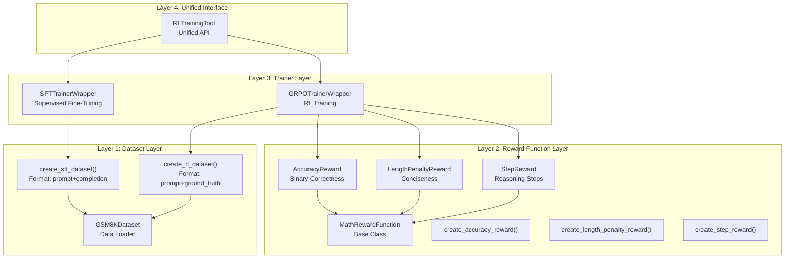
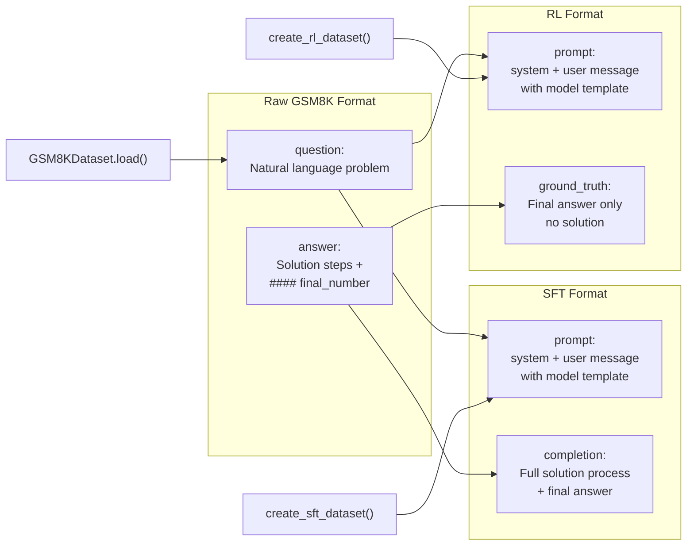
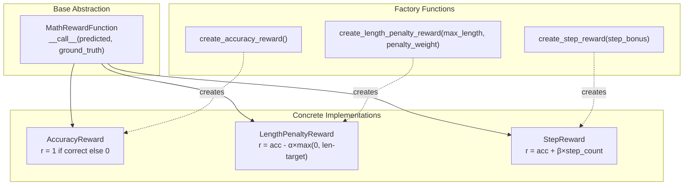
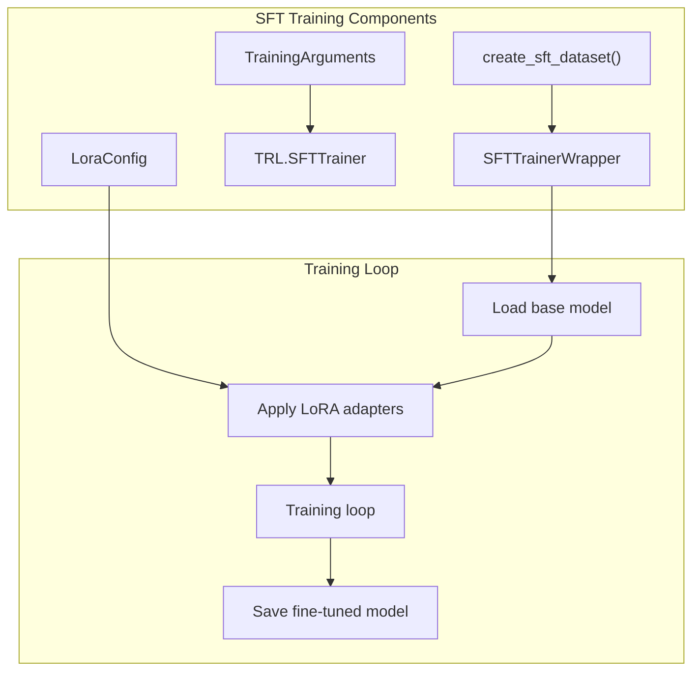
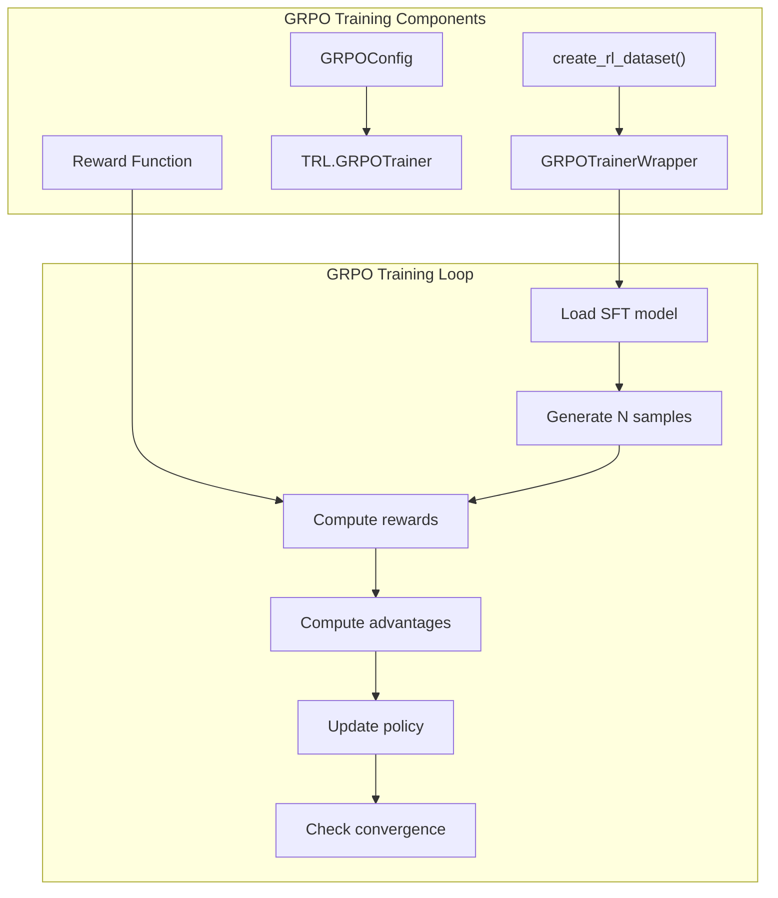
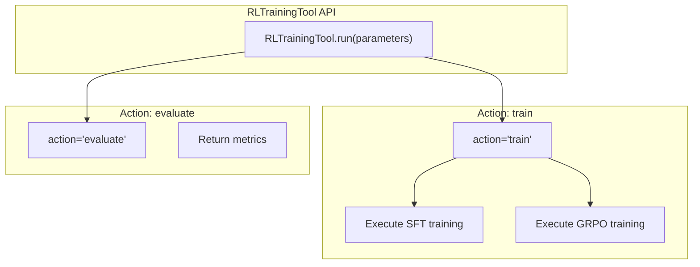
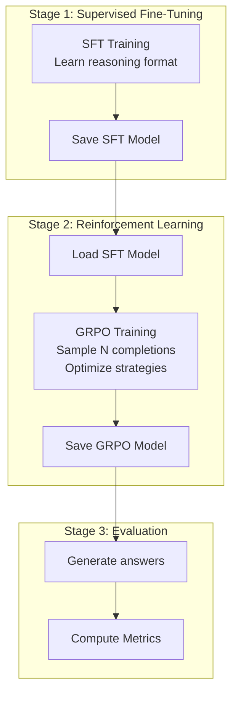

<!-- source: DeepWiki mcp.deepwiki.com · repo datawhalechina/hello-agents · page 8.7 Agentic RL Training Pipeline · fetched 2026-10-29 -->

# Agentic RL Training Pipeline

Relevant source files

The following files were used as context for generating this wiki page:

- [Co-creation-projects/README.md](Co-creation-projects/README.md)
- [docs/chapter10/Chapter10-Agent-Communication-Protocols.md](docs/chapter10/Chapter10-Agent-Communication-Protocols.md)
- [docs/chapter11/Chapter11-Agentic-RL.md](docs/chapter11/Chapter11-Agentic-RL.md)
- [docs/chapter12/Chapter12-Agent-Performance-Evaluation.md](docs/chapter12/Chapter12-Agent-Performance-Evaluation.md)
- [docs/chapter13/Chapter13-Intelligent-Travel-Assistant.md](docs/chapter13/Chapter13-Intelligent-Travel-Assistant.md)
- [docs/chapter14/Chapter14-Automated-Deep-Research-Agent.md](docs/chapter14/Chapter14-Automated-Deep-Research-Agent.md)
- [docs/images/16-figures/16-1.png](docs/images/16-figures/16-1.png)
- [docs/images/16-figures/16-2.png](docs/images/16-figures/16-2.png)
- [docs/images/16-figures/16-4.png](docs/images/16-figures/16-4.png)
- [fix_bold_format.py](fix_bold_format.py)

## Purpose and Scope

This document describes the technical architecture and implementation of the reinforcement learning training pipeline in HelloAgents, focusing on the complete workflow from supervised fine-tuning (SFT) through Group Relative Policy Optimization (GRPO). The pipeline enables agents to learn advanced capabilities such as multi-step reasoning, tool usage, and self-improvement through reinforcement learning on mathematical reasoning tasks using the GSM8K dataset.

For the theoretical foundations of Agentic RL and its distinction from traditional RLHF, see the foundational concepts in Chapter 11 [docs/chapter11/Chapter11-Agentic-RL.md:1-32](). For evaluation methods used to assess trained models, see [docs/chapter12/Chapter12-Agent-Performance-Evaluation.md:1-112]().

## Four-Layer Architecture

The Agentic RL training pipeline adopts a modular four-layer architecture that separates data management, reward computation, training logic, and user interface concerns. This design enables flexible experimentation with different datasets, reward functions, and training algorithms while maintaining a consistent API.

**Architecture Design Principles:**

The **Dataset Layer** handles raw data loading and format conversion. `GSM8KDataset` loads the mathematical reasoning dataset, while `create_sft_dataset()` and `create_rl_dataset()` transform raw question-answer pairs into formats suitable for supervised learning and reinforcement learning respectively [docs/chapter11/Chapter11-Agentic-RL.md:246-344]().

The **Reward Function Layer** defines what constitutes "good behavior" for the agent. `MathRewardFunction` provides the base abstraction, with three concrete implementations: `AccuracyReward` for binary correctness, `LengthPenaltyReward` for penalizing verbose outputs, and `StepReward` for encouraging explicit reasoning steps [docs/chapter11/Chapter11-Agentic-RL.md:346-498]().

The **Trainer Layer** implements training algorithms. `SFTTrainerWrapper` handles supervised fine-tuning using prompt-completion pairs, teaching the model basic reasoning formats. `GRPOTrainerWrapper` implements reinforcement learning, optimizing the model's policy to maximize cumulative rewards through multiple sampling and gradient updates [docs/chapter11/Chapter11-Agentic-RL.md:179-241]().

The **Unified Interface Layer** provides a single entry point through `RLTrainingTool`, which supports four operations via an `action` parameter: `"train"` for model training, `"load_dataset"` for data inspection, `"create_reward"` for reward configuration, and `"evaluate"` for model assessment.

**Sources:** [docs/chapter11/Chapter11-Agentic-RL.md:149-164]()

## Dataset Layer Implementation

### GSM8K Dataset Structure

The GSM8K dataset contains thousands of elementary-level mathematical word problems. Each sample consists of a natural language question and a step-by-step solution [docs/chapter11/Chapter11-Agentic-RL.md:13-32]().

**Format Conversion Details:**

The **SFT format** prepares data for supervised fine-tuning. The `prompt` field contains the user's question wrapped in the model's dialogue template. The `completion` field includes the full reasoning process, teaching the model how to structure its outputs [docs/chapter11/Chapter11-Agentic-RL.md:57-63]().

The **RL format** prepares data for reinforcement learning. The `prompt` is identical to SFT format, but the `ground_truth` field contains only the final numerical answer. During RL training, the model must generate the complete reasoning process autonomously, and the reward is computed by comparing the model's final answer against `ground_truth` [docs/chapter11/Chapter11-Agentic-RL.md:22-32]().

**Sources:** [docs/chapter11/Chapter11-Agentic-RL.md:246-308]()

### Dataset Loading API

The `GSM8KDataset` class provides programmatic access to the dataset through the `load()` method, while factory functions handle format-specific transformations.

**Sources:** [docs/chapter11/Chapter11-Agentic-RL.md:310-344]()

## Reward Function Layer

### Reward Function Design Philosophy

Reward functions define the optimization objective for reinforcement learning by assigning numerical scores to agent behaviors. Good reward functions provide clear success criteria and stable gradient signals [docs/chapter11/Chapter11-Agentic-RL.md:65-72]().

**Sources:** [docs/chapter11/Chapter11-Agentic-RL.md:346-372]()

### AccuracyReward

`AccuracyReward` implements binary classification of answer correctness. The implementation handles answer extraction through parsing the final number in the output and comparing it to the ground truth [docs/chapter11/Chapter11-Agentic-RL.md:373-418]().

### LengthPenaltyReward

`LengthPenaltyReward` encourages concise outputs by penalizing excessive length. The penalty applies only to correct answers, preventing the model from gaming the reward by producing short incorrect outputs [docs/chapter11/Chapter11-Agentic-RL.md:419-459]().

### StepReward

`StepReward` encourages interpretable reasoning by rewarding explicit step markers, promoting explainable AI outputs [docs/chapter11/Chapter11-Agentic-RL.md:460-498]().

## Trainer Layer Implementation

### SFT Training Pipeline

`SFTTrainerWrapper` implements supervised fine-tuning using the TRL library's `SFTTrainer`. The training process optimizes the standard causal language modeling objective to make the model learn task formats [docs/chapter11/Chapter11-Agentic-RL.md:57-63]().

**Sources:** [docs/chapter11/Chapter11-Agentic-RL.md:179-241]()

### GRPO Training Pipeline

`GRPOTrainerWrapper` implements Group Relative Policy Optimization. The objective function balances reward maximization with a KL divergence constraint to prevent reward hacking [docs/chapter11/Chapter11-Agentic-RL.md:73-82]().

**Sources:** [docs/chapter11/Chapter11-Agentic-RL.md:179-241]()

## Unified Interface: RLTrainingTool

`RLTrainingTool` provides a single entry point for all training operations through an action-based API, supporting `train`, `load_dataset`, `create_reward`, and `evaluate` actions [docs/chapter11/Chapter11-Agentic-RL.md:164-241]().

## Complete Training Flow

The end-to-end training pipeline follows a two-stage process: supervised fine-tuning followed by reinforcement learning optimization [docs/chapter11/Chapter11-Agentic-RL.md:36-82]().

**Sources:** [docs/chapter11/Chapter11-Agentic-RL.md:179-241]()

## Model Evaluation

Evaluation assesses trained model performance on held-out test data using accuracy and average reward metrics. Systematic evaluation is required to quantify real improvements and ensure reliability [docs/chapter12/Chapter12-Agent-Performance-Evaluation.md:3-52]().

**Expected performance:**
Performance typically scales from a base accuracy of 5-10% up to 55-65% after full dataset GRPO training [docs/chapter11/Chapter11-Agentic-RL.md:218-241]().

**Sources:** [docs/chapter11/Chapter11-Agentic-RL.md:218-241](), [docs/chapter12/Chapter12-Agent-Performance-Evaluation.md:1-52]()

---

