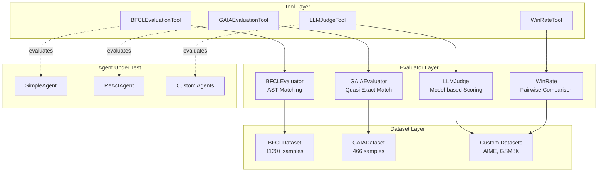
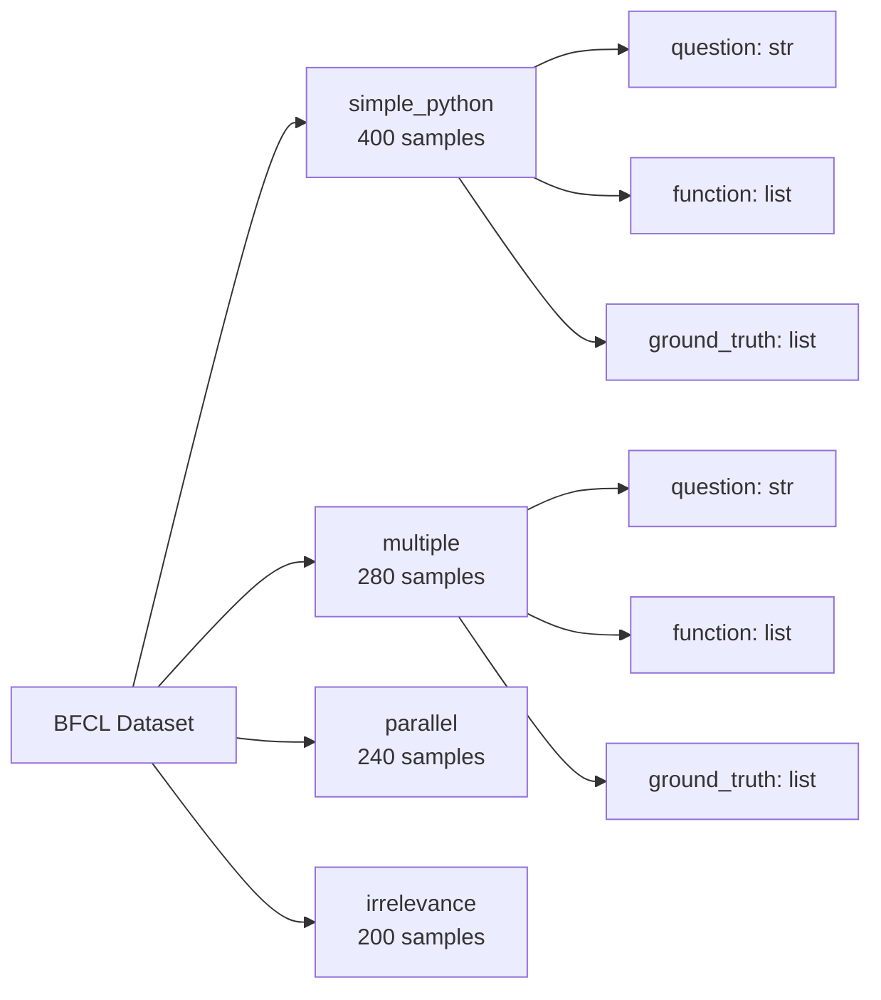
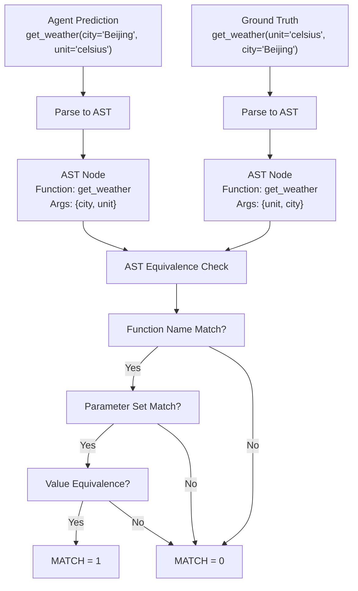
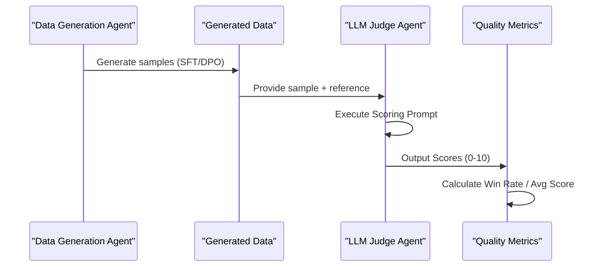

<!-- source: DeepWiki mcp.deepwiki.com · repo datawhalechina/hello-agents · page 8.8 Performance Evaluation Methods · fetched 2026-10-29 -->

# Performance Evaluation Methods

Relevant source files

The following files were used as context for generating this wiki page:

- [Co-creation-projects/README.md](Co-creation-projects/README.md)
- [docs/chapter10/Chapter10-Agent-Communication-Protocols.md](docs/chapter10/Chapter10-Agent-Communication-Protocols.md)
- [docs/chapter11/Chapter11-Agentic-RL.md](docs/chapter11/Chapter11-Agentic-RL.md)
- [docs/chapter12/Chapter12-Agent-Performance-Evaluation.md](docs/chapter12/Chapter12-Agent-Performance-Evaluation.md)
- [docs/chapter13/Chapter13-Intelligent-Travel-Assistant.md](docs/chapter13/Chapter13-Intelligent-Travel-Assistant.md)
- [docs/chapter14/Chapter14-Automated-Deep-Research-Agent.md](docs/chapter14/Chapter14-Automated-Deep-Research-Agent.md)
- [docs/images/16-figures/16-1.png](docs/images/16-figures/16-1.png)
- [docs/images/16-figures/16-2.png](docs/images/16-figures/16-2.png)
- [docs/images/16-figures/16-4.png](docs/images/16-figures/16-4.png)
- [fix_bold_format.py](fix_bold_format.py)

This page covers the performance evaluation system in HelloAgents, including evaluation benchmarks (BFCL, GAIA), evaluation metrics, matching algorithms (AST matching, Quasi Exact Match), and systematic agent assessment techniques. This evaluation infrastructure enables objective measurement of agent capabilities across different dimensions such as tool calling accuracy, reasoning quality, and task completion rates.

For information about training agents to improve performance, see [8.7 Agentic RL Training Pipeline](). For information about agent memory and context management that affects performance, see [8.1 Memory and Retrieval Systems]() and [8.4 Context Engineering]().

## Purpose of Agent Evaluation

Agent evaluation addresses three fundamental questions: whether agents possess expected capabilities, how they perform on different tasks, and how they compare to other agents. Without systematic evaluation, agent development becomes subjective and difficult to optimize [docs/chapter12/Chapter12-Agent-Performance-Evaluation.md:3-8]().

Traditional software testing approaches are insufficient for agent systems due to three key challenges:
1.  **Output Uncertainty**: The same question may have multiple valid answers, making binary pass/fail testing inadequate [docs/chapter12/Chapter12-Agent-Performance-Evaluation.md:50-50]().
2.  **Diversity of Evaluation Criteria**: Different tasks require different evaluation methods—tool invocation needs function signature validation while Q&A tasks need semantic similarity assessment [docs/chapter12/Chapter12-Agent-Performance-Evaluation.md:50-50]().
3.  **High Evaluation Cost**: Each evaluation requires numerous API calls, potentially costing hundreds of dollars for comprehensive testing [docs/chapter12/Chapter12-Agent-Performance-Evaluation.md:50-50]().

The HelloAgents evaluation system provides standardized methods to quantify agent performance, objectively compare design solutions, identify weaknesses in specific scenarios, and prove reliability to stakeholders [docs/chapter12/Chapter12-Agent-Performance-Evaluation.md:46-49]().

Sources: [docs/chapter12/Chapter12-Agent-Performance-Evaluation.md:1-53]()

## Evaluation System Architecture

The HelloAgents evaluation system implements a modular architecture with three layers: dataset loaders, evaluators with matching algorithms, and tool wrappers for agent integration.

### Evaluation Data Flow

**Module Organization**:
*   **Dataset Layer**: Loads test data and ground truth from benchmark sources [docs/chapter12/Chapter12-Agent-Performance-Evaluation.md:108-108]().
*   **Evaluator Layer**: Executes evaluation logic and matching algorithms [docs/chapter12/Chapter12-Agent-Performance-Evaluation.md:108-108]().
*   **Metrics Layer**: Computes accuracy, F1 scores, and domain-specific metrics [docs/chapter12/Chapter12-Agent-Performance-Evaluation.md:82-90]().
*   **Tool Layer**: Wraps evaluators as callable tools for agent integration [docs/chapter12/Chapter12-Agent-Performance-Evaluation.md:108-108]().

Sources: [docs/chapter12/Chapter12-Agent-Performance-Evaluation.md:108-160]()

## BFCL: Tool Calling Evaluation

The Berkeley Function Calling Leaderboard (BFCL) benchmark evaluates agent tool invocation capabilities across four categories: simple single-function calls, multiple sequential calls, parallel multi-function calls, and irrelevance detection (determining when NOT to call functions) [docs/chapter12/Chapter12-Agent-Performance-Evaluation.md:62-62]().

### BFCL Dataset Structure

The BFCL dataset contains 1120+ test samples with standardized JSON format [docs/chapter12/Chapter12-Agent-Performance-Evaluation.md:62-62]().

Each sample contains three fields: `question` (natural language request), `function` (available schemas), and `ground_truth` (expected calls) [docs/chapter12/Chapter12-Agent-Performance-Evaluation.md:62-62]().

Sources: [docs/chapter12/Chapter12-Agent-Performance-Evaluation.md:62-65](), [docs/chapter12/Chapter12-Agent-Performance-Evaluation.md:95-98]()

### AST Matching Algorithm

BFCL uses Abstract Syntax Tree (AST) matching rather than string comparison, enabling intelligent comparison of semantically equivalent function calls [docs/chapter12/Chapter12-Agent-Performance-Evaluation.md:62-62]().

Two AST nodes are equivalent if function names match, parameter sets match regardless of order, and parameter values are semantically equivalent [docs/chapter12/Chapter12-Agent-Performance-Evaluation.md:62-62]().

Sources: [docs/chapter12/Chapter12-Agent-Performance-Evaluation.md:62-65]()

## GAIA: General AI Assistant Evaluation

The GAIA (General AI Assistants) benchmark evaluates comprehensive agent capabilities in real-world tasks requiring multi-step reasoning, tool use, file processing, and web browsing [docs/chapter12/Chapter12-Agent-Performance-Evaluation.md:70-70]().

### GAIA Dataset Characteristics

GAIA contains 466 manually curated problems divided into Level 1, 2, and 3 difficulty [docs/chapter12/Chapter12-Agent-Performance-Evaluation.md:70-70](). It uses the **Quasi Exact Match** algorithm for evaluation, which handles variations in numeric precision and string formatting [docs/chapter12/Chapter12-Agent-Performance-Evaluation.md:70-70]().

| Difficulty | Focus |
| :--- | :--- |
| **Level 1** | Basic tool use and single-step reasoning |
| **Level 2** | Complex tool chains and multi-step reasoning |
| **Level 3** | Long-horizon tasks with file/web interaction |

Sources: [docs/chapter12/Chapter12-Agent-Performance-Evaluation.md:70-73](), [docs/chapter12/Chapter12-Agent-Performance-Evaluation.md:99-102]()

## Data Generation Quality Evaluation

This module evaluates the quality of data generated by agents (e.g., for training or testing purposes) using multiple methods [docs/chapter12/Chapter12-Agent-Performance-Evaluation.md:103-107]().

### Evaluation Methods
1.  **LLM Judge**: Using a superior model (e.g., GPT-4) to score generated data [docs/chapter12/Chapter12-Agent-Performance-Evaluation.md:106-106]().
2.  **Win Rate**: Pairwise comparison between different generation strategies [docs/chapter12/Chapter12-Agent-Performance-Evaluation.md:106-106]().
3.  **Manual Verification**: Human-in-the-loop validation for final quality assurance [docs/chapter12/Chapter12-Agent-Performance-Evaluation.md:106-106]().

### Data Generation Pipeline

Sources: [docs/chapter12/Chapter12-Agent-Performance-Evaluation.md:103-107]()

## Evaluation Metrics Summary

The HelloAgents framework tracks several key metrics across benchmarks:

| Category | Metric | Description |
| :--- | :--- | :--- |
| **Accuracy** | Exact Match / F1 | Measures answer correctness [docs/chapter12/Chapter12-Agent-Performance-Evaluation.md:86-86](). |
| **Efficiency** | Response Time / Tokens | Measures computational resource usage [docs/chapter12/Chapter12-Agent-Performance-Evaluation.md:87-87](). |
| **Robustness** | Error Rate / Recovery | Measures fault tolerance in tool calls [docs/chapter12/Chapter12-Agent-Performance-Evaluation.md:88-88](). |
| **Collaboration** | Comm. Efficiency | Measures multi-agent interaction quality [docs/chapter12/Chapter12-Agent-Performance-Evaluation.md:89-89](). |

Sources: [docs/chapter12/Chapter12-Agent-Performance-Evaluation.md:82-90]()

---

