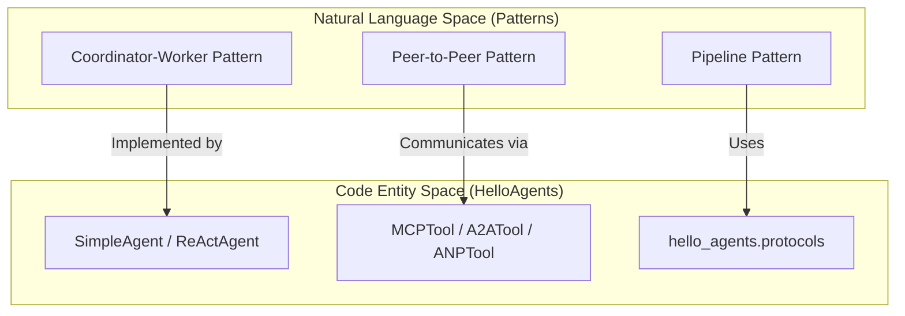
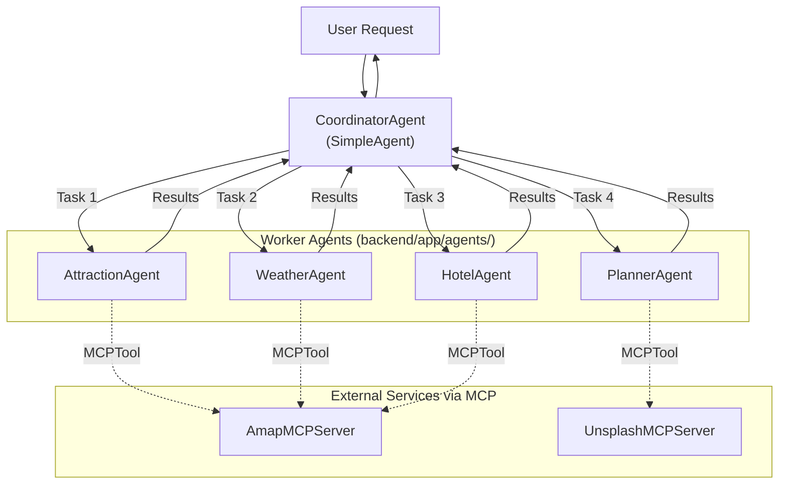
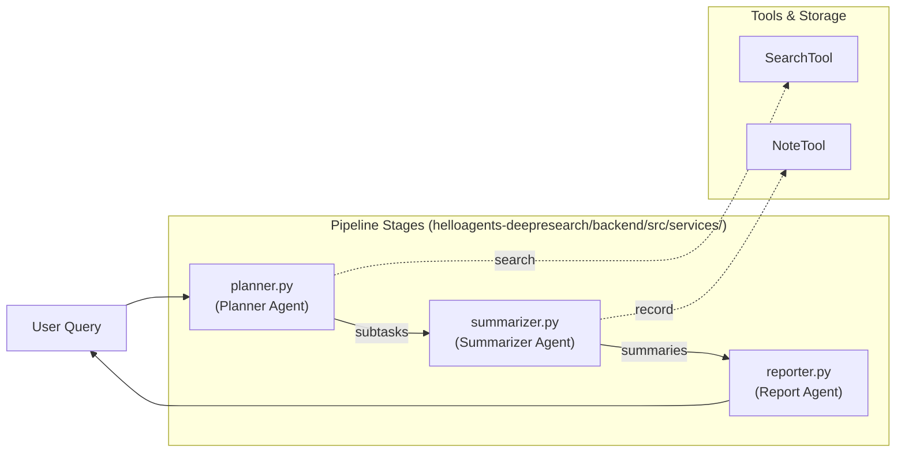
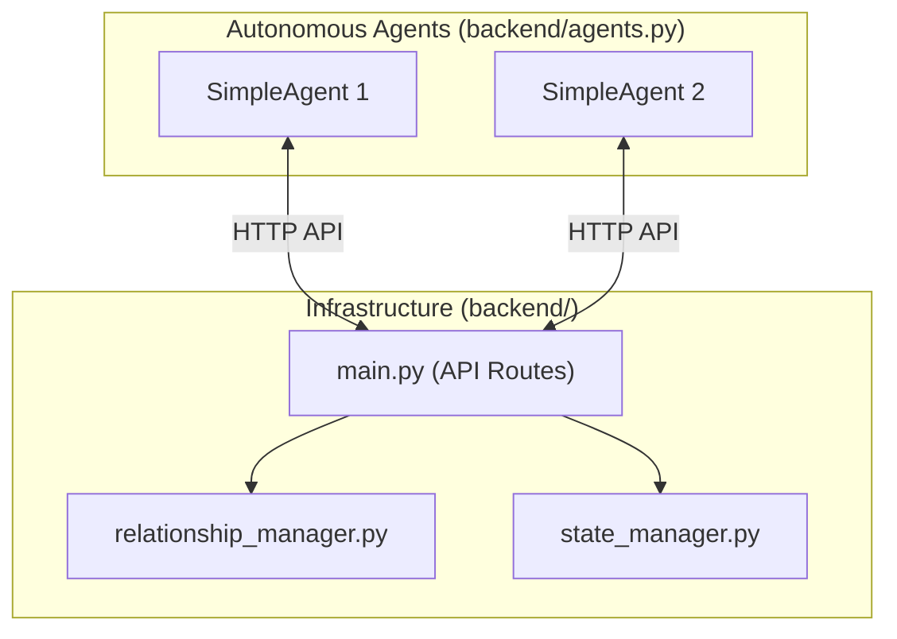

<!-- source: DeepWiki mcp.deepwiki.com · repo datawhalechina/hello-agents · page 9 Multi-Agent System Architectures · fetched 2026-10-29 -->

# Multi-Agent System Architectures

Relevant source files

The following files were used as context for generating this wiki page:

- [Co-creation-projects/README.md](Co-creation-projects/README.md)
- [code/chapter15/Helloagents-AI-Town/SETUP_GUIDE.md](code/chapter15/Helloagents-AI-Town/SETUP_GUIDE.md)
- [docs/chapter10/Chapter10-Agent-Communication-Protocols.md](docs/chapter10/Chapter10-Agent-Communication-Protocols.md)
- [docs/chapter11/Chapter11-Agentic-RL.md](docs/chapter11/Chapter11-Agentic-RL.md)
- [docs/chapter12/Chapter12-Agent-Performance-Evaluation.md](docs/chapter12/Chapter12-Agent-Performance-Evaluation.md)
- [docs/chapter13/Chapter13-Intelligent-Travel-Assistant.md](docs/chapter13/Chapter13-Intelligent-Travel-Assistant.md)
- [docs/chapter14/Chapter14-Automated-Deep-Research-Agent.md](docs/chapter14/Chapter14-Automated-Deep-Research-Agent.md)
- [docs/chapter15/Chapter15-Building-Cyber-Town.md](docs/chapter15/Chapter15-Building-Cyber-Town.md)
- [docs/images/16-figures/16-1.png](docs/images/16-figures/16-1.png)
- [docs/images/16-figures/16-2.png](docs/images/16-figures/16-2.png)
- [docs/images/16-figures/16-4.png](docs/images/16-figures/16-4.png)
- [fix_bold_format.py](fix_bold_format.py)

This page describes common architectural patterns for coordinating multiple agents in the HelloAgents framework. When a single agent is insufficient for complex tasks, multi-agent systems enable specialized agents to collaborate, each focusing on specific subtasks. We cover three fundamental patterns: **coordinator-worker**, **pipeline**, and **peer-to-peer**, along with the communication protocols that enable agent interaction.

For implementation details of specific multi-agent applications, see:
- [Intelligent Travel Assistant](#9.1) — Multi-agent collaboration with coordinator-worker pattern using MCP for external service integration
- [Automated Deep Research Agent](#9.2) — Pipeline pattern with search-analysis-synthesis agents for autonomous investigation
- [Cyber Town Simulation](#9.3) — Peer-to-peer A2A communication for simulating social dynamics with emergent behavior

For the underlying communication mechanisms, see [Agent Communication Protocols](#8.6).

## Multi-Agent System Patterns Overview

Multi-agent systems (MAS) decompose complex problems into specialized subtasks handled by coordinated agents. The HelloAgents framework supports three primary architectural patterns, each suited to different problem characteristics.

### System Architecture Visualization
This diagram bridges high-level patterns to the specific code entities used in the HelloAgents framework.

**Pattern Comparison**

| Pattern | Communication Flow | Use Cases | Advantages | Disadvantages |
|---------|-------------------|-----------|------------|---------------|
| **Coordinator-Worker** | Centralized (hub-and-spoke) | Task decomposition with clear subtasks | Clear control flow, easy to debug | Single point of failure, coordinator bottleneck |
| **Pipeline** | Sequential (linear chain) | Multi-stage processing workflows | Predictable flow, easy to optimize stages | Inflexible, hard to handle errors mid-stream |
| **Peer-to-Peer** | Decentralized (mesh) | Emergent behaviors, simulation | Robust, scalable, flexible | Complex coordination, harder to debug |

Sources: [docs/chapter10/Chapter10-Agent-Communication-Protocols.md:1-213](), [docs/chapter13/Chapter13-Intelligent-Travel-Assistant.md:1-90]()

## Coordinator-Worker Pattern

The coordinator-worker pattern employs a central **coordinator agent** that delegates specialized subtasks to **worker agents**. The coordinator receives user requests, decomposes them into subtasks, dispatches work to appropriate specialists, and synthesizes final results.

### Intelligent Travel Assistant Architecture
This diagram maps the travel assistant system to specific agent classes and tools.

**Architecture Characteristics**

- **Centralized Control**: Coordinator maintains task state and orchestrates worker execution.
- **Specialization**: Each worker agent focuses on a narrow domain (attractions, weather, hotels) [docs/chapter13/Chapter13-Intelligent-Travel-Assistant.md:42-44]().
- **Tool Integration**: Workers access external services via `MCPTool` for standardized API interaction [docs/chapter10/Chapter10-Agent-Communication-Protocols.md:65-78]().
- **Result Aggregation**: Coordinator synthesizes worker outputs into cohesive responses [docs/chapter13/Chapter13-Intelligent-Travel-Assistant.md:46-46]().

**Implementation in HelloAgents**

The Travel Assistant implements this pattern using specialized agents located in `helloagents-trip-planner/backend/app/agents/` [docs/chapter13/Chapter13-Intelligent-Travel-Assistant.md:49-57](). Communication happens through the back-end layer using the `FastAPI` framework [docs/chapter13/Chapter13-Intelligent-Travel-Assistant.md:40-40]().

Sources: [docs/chapter13/Chapter13-Intelligent-Travel-Assistant.md:17-90](), [docs/chapter10/Chapter10-Agent-Communication-Protocols.md:1-100]()

## Pipeline Pattern

The pipeline pattern chains agents in a sequential workflow where each agent's output becomes the next agent's input. Unlike coordinator-worker, there is no central orchestrator—agents form a processing chain.

**Architecture Characteristics**

- **Sequential Flow**: Each stage completes before the next begins.
- **Data Transformation**: Agents progressively refine information (raw → analyzed → synthesized).
- **Stage Specialization**: Different services handle planning, summarization, and reporting [docs/chapter14/Chapter14-Automated-Deep-Research-Agent:78-80]().
- **State Passing**: Results flow through explicit data structures, often streamed via SSE (Server-Sent Events) [docs/chapter14/Chapter14-Automated-Deep-Research-Agent:63-63]().

**Implementation in HelloAgents**

The Deep Research Agent (see [Automated Deep Research Agent](#9.2)) exemplifies this pattern. It uses a `TODO Planner` to decompose topics, a `Task Summarizer` for mining materials, and a `Report Writer` for final synthesis [docs/chapter14/Chapter14-Automated-Deep-Research-Agent:43-43]().

Sources: [docs/chapter14/Chapter14-Automated-Deep-Research-Agent.md:28-64](), [docs/chapter10/Chapter10-Agent-Communication-Protocols.md:100-150]()

## Peer-to-Peer Pattern

The peer-to-peer (P2P) pattern enables decentralized agent interaction where agents communicate directly via the **A2A (Agent-to-Agent) Protocol**. Unlike coordinator-worker, no central authority exists—agents autonomously discover and interact with peers.

**Architecture Characteristics**

- **Decentralized**: Agents make independent decisions based on personality and memory [docs/chapter15/Chapter15-Building-Cyber-Town.md:5-11]().
- **Dynamic Interaction**: Communication is handled via HTTP API requests between the game engine and the back-end [docs/chapter15/Chapter15-Building-Cyber-Town.md:45-45]().
- **Emergent Behavior**: NPC attitudes and relationships evolve over time through the `RelationshipManager` [docs/chapter15/Chapter15-Building-Cyber-Town.md:74-74]().

**Implementation in HelloAgents**

The Cyber Town simulation (see [Cyber Town Simulation](#9.3)) implements this pattern using the `Godot` game engine for the front-end and `FastAPI` for the back-end [docs/chapter15/Chapter15-Building-Cyber-Town.md:36-36](). Each NPC is a `SimpleAgent` instance with independent memory and state [docs/chapter15/Chapter15-Building-Cyber-Town.md:36-36]().

Sources: [docs/chapter15/Chapter15-Building-Cyber-Town.md:1-81](), [docs/chapter10/Chapter10-Agent-Communication-Protocols.md:97-150]()

## Communication Protocols for Multi-Agent Systems

Multi-agent systems in HelloAgents rely on three communication protocols:

| Protocol | Purpose | Example Use Case |
|----------|---------|------------------|
| **MCP** | Standardized tool/API access [docs/chapter10/Chapter10-Agent-Communication-Protocols.md:88-88]() | Connecting to GitHub or Database servers [docs/chapter10/Chapter10-Agent-Communication-Protocols.md:71-72]() |
| **A2A** | Peer-to-peer messaging [docs/chapter10/Chapter10-Agent-Communication-Protocols.md:99-99]() | Dialogue and negotiation between agents [docs/chapter10/Chapter10-Agent-Communication-Protocols.md:99-99]() |
| **ANP** | Large-scale network discovery [docs/chapter10/Chapter10-Agent-Communication-Protocols.md:5-5]() | Building complex agent network infrastructures [docs/chapter10/Chapter10-Agent-Communication-Protocols.md:5-5]() |

Sources: [docs/chapter10/Chapter10-Agent-Communication-Protocols.md:1-100]()

---

