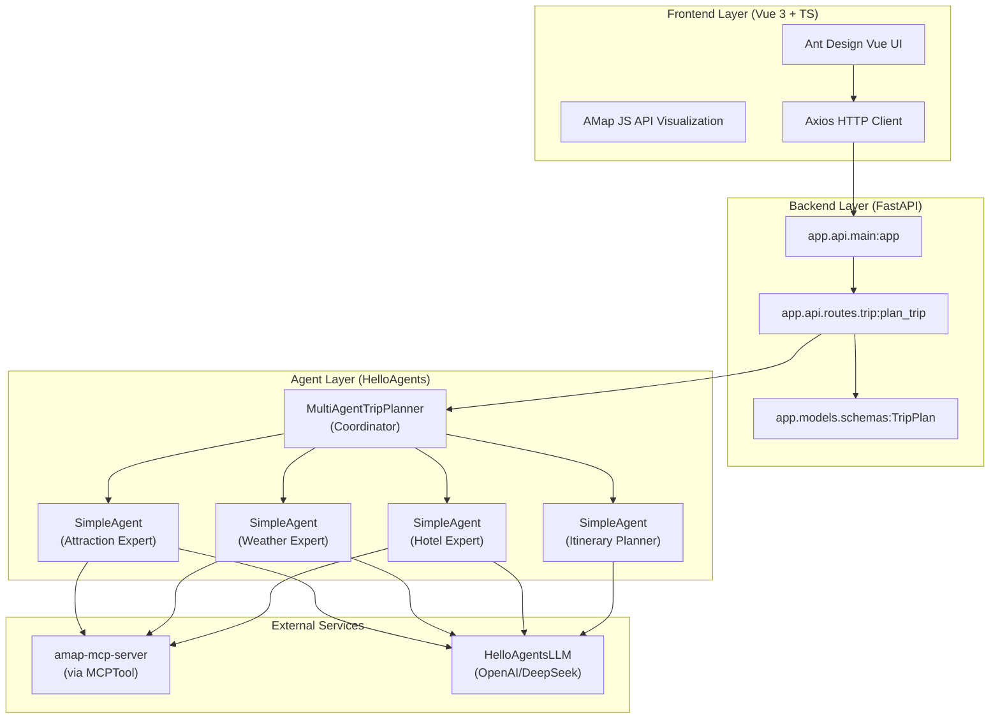
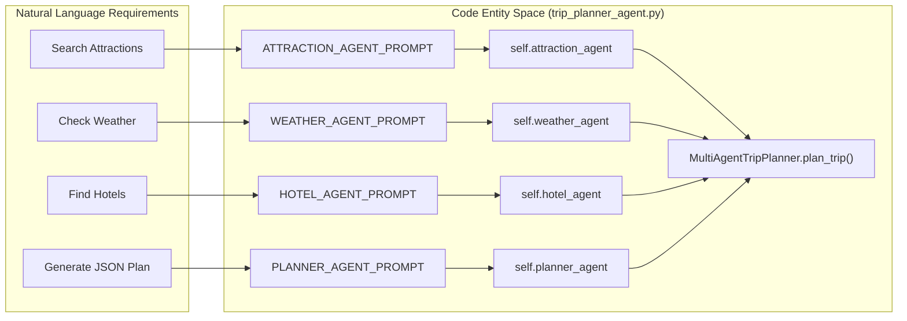
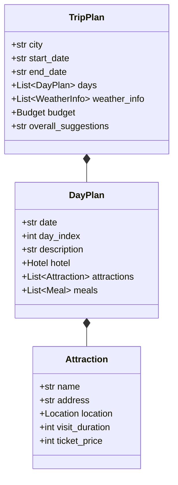

<!-- source: DeepWiki mcp.deepwiki.com · repo datawhalechina/hello-agents · page 9.1 Intelligent Travel Assistant · fetched 2026-10-29 -->

# Intelligent Travel Assistant

<details>
<summary>Relevant source files</summary>

The following files were used as context for generating this wiki page:

- [Co-creation-projects/README.md](Co-creation-projects/README.md)
- [code/chapter13/helloagents-trip-planner/README.md](code/chapter13/helloagents-trip-planner/README.md)
- [code/chapter13/helloagents-trip-planner/backend/.env.example](code/chapter13/helloagents-trip-planner/backend/.env.example)
- [code/chapter13/helloagents-trip-planner/backend/.gitignore](code/chapter13/helloagents-trip-planner/backend/.gitignore)
- [code/chapter13/helloagents-trip-planner/backend/app/__init__.py](code/chapter13/helloagents-trip-planner/backend/app/__init__.py)
- [code/chapter13/helloagents-trip-planner/backend/app/agents/__init__.py](code/chapter13/helloagents-trip-planner/backend/app/agents/__init__.py)
- [code/chapter13/helloagents-trip-planner/backend/app/agents/trip_planner_agent.py](code/chapter13/helloagents-trip-planner/backend/app/agents/trip_planner_agent.py)
- [code/chapter13/helloagents-trip-planner/backend/app/api/__init__.py](code/chapter13/helloagents-trip-planner/backend/app/api/__init__.py)
- [code/chapter13/helloagents-trip-planner/backend/app/api/main.py](code/chapter13/helloagents-trip-planner/backend/app/api/main.py)
- [code/chapter13/helloagents-trip-planner/backend/app/api/routes/__init__.py](code/chapter13/helloagents-trip-planner/backend/app/api/routes/__init__.py)
- [code/chapter13/helloagents-trip-planner/backend/app/api/routes/map.py](code/chapter13/helloagents-trip-planner/backend/app/api/routes/map.py)
- [code/chapter13/helloagents-trip-planner/frontend/.env.example](code/chapter13/helloagents-trip-planner/frontend/.env.example)
- [code/chapter13/helloagents-trip-planner/frontend/src/views/Result.vue](code/chapter13/helloagents-trip-planner/frontend/src/views/Result.vue)
- [docs/chapter10/Chapter10-Agent-Communication-Protocols.md](docs/chapter10/Chapter10-Agent-Communication-Protocols.md)
- [docs/chapter11/Chapter11-Agentic-RL.md](docs/chapter11/Chapter11-Agentic-RL.md)
- [docs/chapter12/Chapter12-Agent-Performance-Evaluation.md](docs/chapter12/Chapter12-Agent-Performance-Evaluation.md)
- [docs/chapter13/Chapter13-Intelligent-Travel-Assistant.md](docs/chapter13/Chapter13-Intelligent-Travel-Assistant.md)
- [docs/chapter14/Chapter14-Automated-Deep-Research-Agent.md](docs/chapter14/Chapter14-Automated-Deep-Research-Agent.md)
- [docs/images/16-figures/16-1.png](docs/images/16-figures/16-1.png)
- [docs/images/16-figures/16-2.png](docs/images/16-figures/16-2.png)
- [docs/images/16-figures/16-4.png](docs/images/16-figures/16-4.png)
- [fix_bold_format.py](fix_bold_format.py)

</details>


## Purpose and Scope

The Intelligent Travel Assistant is a comprehensive multi-agent application that integrates the HelloAgents framework with external services via the Model Context Protocol (MCP). It demonstrates a practical implementation of the coordinator-worker pattern to automate complex travel planning tasks, including attraction searching, weather forecasting, hotel recommendation, and budget calculation.

This page details the technical architecture, multi-agent coordination logic, and implementation of the backend services and frontend visualization.

**Sources:** [docs/chapter13/Chapter13-Intelligent-Travel-Assistant.md:1-27](), [code/chapter13/helloagents-trip-planner/README.md:1-12]()

## System Architecture Overview

The system follows a front-end and back-end separation architecture, divided into four primary layers.



| Layer | Technology | Role |
| :--- | :--- | :--- |
| **Frontend** | Vue 3, TypeScript, Vite, Ant Design Vue | User interface, form handling, and map rendering [code/chapter13/helloagents-trip-planner/README.md:22-26]() |
| **Backend** | FastAPI, Uvicorn | API routing and service orchestration [code/chapter13/helloagents-trip-planner/README.md:17-18]() |
| **Agent Logic** | HelloAgents Framework | Multi-agent reasoning and tool invocation [code/chapter13/helloagents-trip-planner/backend/app/agents/trip_planner_agent.py:5-6]() |
| **Integration** | MCP (Model Context Protocol) | Standardized access to Amap (AutoNavi) services [code/chapter13/helloagents-trip-planner/backend/app/agents/trip_planner_agent.py:168-174]() |

**Sources:** [code/chapter13/helloagents-trip-planner/README.md:13-59](), [docs/chapter13/Chapter13-Intelligent-Travel-Assistant.md:29-69]()

## Multi-Agent Coordination Pattern

The core logic resides in the `MultiAgentTripPlanner` class, which implements a coordinator-worker pattern. It initializes a shared `MCPTool` instance and distributes it among specialized agents.

### Coordinator Logic
The coordinator manages the sequential execution of tasks and passes context between agents to ensure a coherent final plan.

1.  **Attraction Search**: The `attraction_agent` uses `amap_maps_text_search` to find POIs based on user preferences [code/chapter13/helloagents-trip-planner/backend/app/agents/trip_planner_agent.py:242-246]().
2.  **Weather Query**: The `weather_agent` retrieves forecasts for the destination city using `amap_maps_weather` [code/chapter13/helloagents-trip-planner/backend/app/agents/trip_planner_agent.py:249-252]().
3.  **Hotel Recommendation**: The `hotel_agent` searches for accommodations near the selected attractions [code/chapter13/helloagents-trip-planner/backend/app/agents/trip_planner_agent.py:255-258]().
4.  **Final Planning**: The `planner_agent` aggregates all gathered data (POI, Weather, Hotels) to generate a structured JSON itinerary [code/chapter13/helloagents-trip-planner/backend/app/agents/trip_planner_agent.py:206-210]().

### Natural Language to Code Entity Mapping
This diagram maps the functional requirements described in natural language to the specific code entities in the `trip_planner_agent.py` file.



**Sources:** [code/chapter13/helloagents-trip-planner/backend/app/agents/trip_planner_agent.py:11-211](), [code/chapter13/helloagents-trip-planner/backend/app/agents/trip_planner_agent.py:223-260]()

## Implementation Details

### MCP Tool Integration
The system uses the `amap-mcp-server` to bridge the LLM and the Amap API. The `MCPTool` is initialized with the `uvx` command to run the server dynamically.

```python
self.amap_tool = MCPTool(
    name="amap",
    description="高德地图服务",
    server_command=["uvx", "amap-mcp-server"],
    env={"AMAP_MAPS_API_KEY": settings.amap_api_key},
    auto_expand=True
)
```
[code/chapter13/helloagents-trip-planner/backend/app/agents/trip_planner_agent.py:168-174]()

### Data Models and Validation
Pydantic models in `schemas.py` ensure that the multi-agent system returns structured, type-safe data that the frontend can consume.



**Sources:** [code/chapter13/helloagents-trip-planner/backend/app/agents/trip_planner_agent.py:75-152](), [code/chapter13/helloagents-trip-planner/backend/app/models/schemas.py:1-45]()

## Frontend Implementation

The frontend is built with **Vue 3** and **Ant Design Vue**. It features a split-view result page (`Result.vue`) that displays the itinerary and a map.

### Key Components
*   **Result View**: Displays the `tripPlan` overview, budget, and daily breakdown [code/chapter13/helloagents-trip-planner/frontend/src/views/Result.vue:71-110]().
*   **Map Container**: A `div` with ID `amap-container` used to initialize the AMap JS API for visualizing POI markers [code/chapter13/helloagents-trip-planner/frontend/src/views/Result.vue:113-115]().
*   **Edit Mode**: Allows users to move or delete attractions, providing interactive control over the AI-generated plan [code/chapter13/helloagents-trip-planner/frontend/src/views/Result.vue:159-182]().

### Configuration
The frontend requires two distinct AMap keys:
*   `VITE_AMAP_WEB_KEY`: For backend service calls (via MCP) [code/chapter13/helloagents-trip-planner/frontend/.env.example:5]().
*   `VITE_AMAP_WEB_JS_KEY`: For client-side map rendering [code/chapter13/helloagents-trip-planner/frontend/.env.example:7]().

**Sources:** [code/chapter13/helloagents-trip-planner/frontend/src/views/Result.vue:1-182](), [code/chapter13/helloagents-trip-planner/README.md:99-123]()

## Execution Flow

When a user submits a `TripRequest`, the following process occurs:

1.  **API Call**: `POST /api/trip/plan` is called in `main.py` [code/chapter13/helloagents-trip-planner/backend/app/api/main.py:189]().
2.  **Agent Loop**: The `MultiAgentTripPlanner` executes the `plan_trip` method [code/chapter13/helloagents-trip-planner/backend/app/agents/trip_planner_agent.py:223]().
3.  **Tool Execution**: Agents generate `[TOOL_CALL:...]` strings which are parsed by the HelloAgents framework to execute MCP tools like `maps_text_search` [code/chapter13/helloagents-trip-planner/backend/app/agents/trip_planner_agent.py:18-20]().
4.  **Aggregation**: The `planner_agent` compiles the final JSON [code/chapter13/helloagents-trip-planner/backend/app/agents/trip_planner_agent.py:206]().
5.  **Response**: The structured `TripPlan` is returned to the frontend for rendering [code/chapter13/helloagents-trip-planner/backend/app/models/schemas.py:8]().

**Sources:** [code/chapter13/helloagents-trip-planner/backend/app/agents/trip_planner_agent.py:233-260](), [code/chapter13/helloagents-trip-planner/README.md:133-140]()

---

