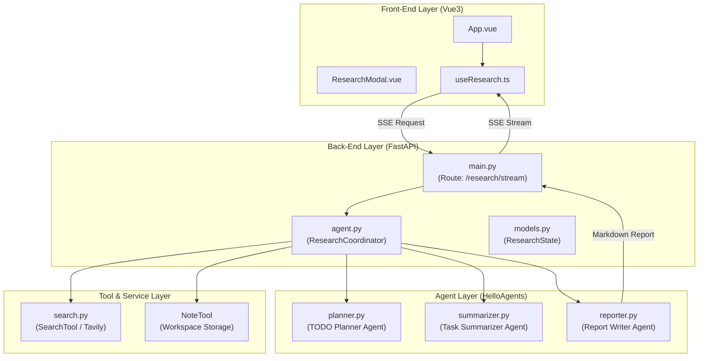
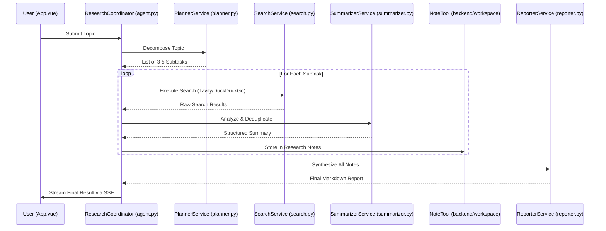

<!-- source: DeepWiki mcp.deepwiki.com · repo datawhalechina/hello-agents · page 9.2 Automated Deep Research Agent · fetched 2026-10-29 -->

# Automated Deep Research Agent

Relevant source files

The following files were used as context for generating this wiki page:

- [Co-creation-projects/README.md](Co-creation-projects/README.md)
- [code/chapter14/helloagents-deepresearch/backend/pyproject.toml](code/chapter14/helloagents-deepresearch/backend/pyproject.toml)
- [code/chapter14/helloagents-deepresearch/frontend/src/App.vue](code/chapter14/helloagents-deepresearch/frontend/src/App.vue)
- [docs/chapter10/Chapter10-Agent-Communication-Protocols.md](docs/chapter10/Chapter10-Agent-Communication-Protocols.md)
- [docs/chapter11/Chapter11-Agentic-RL.md](docs/chapter11/Chapter11-Agentic-RL.md)
- [docs/chapter12/Chapter12-Agent-Performance-Evaluation.md](docs/chapter12/Chapter12-Agent-Performance-Evaluation.md)
- [docs/chapter13/Chapter13-Intelligent-Travel-Assistant.md](docs/chapter13/Chapter13-Intelligent-Travel-Assistant.md)
- [docs/chapter14/Chapter14-Automated-Deep-Research-Agent.md](docs/chapter14/Chapter14-Automated-Deep-Research-Agent.md)
- [docs/images/16-figures/16-1.png](docs/images/16-figures/16-1.png)
- [docs/images/16-figures/16-2.png](docs/images/16-figures/16-2.png)
- [docs/images/16-figures/16-4.png](docs/images/16-figures/16-4.png)
- [fix_bold_format.py](fix_bold_format.py)

## Purpose and Scope

The Automated Deep Research Agent is a knowledge-intensive multi-agent system designed to autonomously execute deep investigation tasks. Unlike simpler assistants, it focuses on the continuous divergence of information, rapid fact updates, and rigorous citation requirements. The system transforms open-ended user topics into structured, trustworthy research reports by coordinating specialized agents in a pipeline architecture that emphasizes problem analysis, multi-round collection, and iterative reflection.

For information about single-agent paradigms used as building blocks, see `ReActAgent` or `PlanAndSolveAgent` [docs/chapter12/Chapter12-Agent-Performance-Evaluation.md:15-44](). For coordination patterns, compare this with the Intelligent Travel Assistant [docs/chapter13/Chapter13-Intelligent-Travel-Assistant.md:1-70]().

**Sources:** [docs/chapter14/Chapter14-Automated-Deep-Research-Agent.md:1-12](), [docs/chapter14/Chapter14-Automated-Deep-Research-Agent.md:15-27]()

## Architecture Overview

The system utilizes a classic front-end and back-end separation architecture, specifically optimized for long-running research tasks via Server-Sent Events (SSE).

### System Component Diagram

This diagram maps the functional layers to the specific code entities within the `helloagents-deepresearch` project.

**Sources:** [docs/chapter14/Chapter14-Automated-Deep-Research-Agent.md:28-46](), [docs/chapter14/Chapter14-Automated-Deep-Research-Agent.md:66-95](), [code/chapter14/helloagents-deepresearch/backend/pyproject.toml:11-21]()

## Research Pipeline and Data Flow

The agent operates through a sequential pipeline where state is managed by a central coordinator. This process ensures that information is not just gathered, but analyzed and synthesized incrementally.

### Pipeline Execution Flow

The following diagram illustrates the data flow from user input to the final report, citing the specific backend services involved.

**Sources:** [docs/chapter14/Chapter14-Automated-Deep-Research-Agent.md:47-65](), [code/chapter14/helloagents-deepresearch/frontend/src/App.vue:137-166]()

## Key Implementation Details

### 1. Problem Analysis (Planner)
The system uses a `TODO Planner` agent to handle the initial "divergence" of the research topic. It breaks down an open topic (e.g., "Impact of Multi-modal Models in 2025") into specific, retrievable query statements [docs/chapter14/Chapter14-Automated-Deep-Research-Agent.md:7-12]().

### 2. Multi-Round Collection (Search & Summarize)
The execution phase combines different search APIs (configured via `.env`) with a summarization agent.
*   **Search APIs**: Supports `tavily-python` and `ddgs` (DuckDuckGo) [code/chapter14/helloagents-deepresearch/backend/pyproject.toml:14-19]().
*   **Deduplication**: The `Task Summarizer` identifies knowledge gaps and integrates new materials with existing notes [docs/chapter14/Chapter14-Automated-Deep-Research-Agent.md:9-11]().

### 3. State Persistence (NoteTool)
Intermediate findings are stored in the `backend/workspace/` directory using the `NoteTool`. This allows the agent to maintain a long-term "memory" of the research session that persists even if the LLM context window is cleared [docs/chapter14/Chapter14-Automated-Deep-Research-Agent.md:61-84]().

### 4. Real-time Feedback (SSE)
The front-end `App.vue` tracks research progress using a progress bar and a real-time log of agent activities.

| UI Component | Backend Data Source | Purpose |
|--------------|---------------------|---------|
| `progress-fill` | `completedTasks / totalTasks` | Visual progress tracking [code/chapter14/helloagents-deepresearch/frontend/src/App.vue:119-122]() |
| `timeline` | `progressLogs` | Real-time agent activity audit [code/chapter14/helloagents-deepresearch/frontend/src/App.vue:159-166]() |
| `task-list` | `todoTasks` | Detailed status of individual sub-investigations [code/chapter14/helloagents-deepresearch/frontend/src/App.vue:168-190]() |

**Sources:** [code/chapter14/helloagents-deepresearch/frontend/src/App.vue:93-134](), [docs/chapter14/Chapter14-Automated-Deep-Research-Agent.md:54-65]()

## Setup and Configuration

The agent requires specific environment variables defined in `backend/.env` to function:

*   **LLM_PROVIDER**: Selection of model (OpenAI, DeepSeek, Qwen) [docs/chapter14/Chapter14-Automated-Deep-Research-Agent.md:128]().
*   **SEARCH_API**: Choice of search engine (Tavily is recommended for high-quality research) [docs/chapter14/Chapter14-Automated-Deep-Research-Agent.md:130]().

The backend uses `uv` or `pip` for dependency management, requiring `hello-agents==0.2.9` and `fastapi` [code/chapter14/helloagents-deepresearch/backend/pyproject.toml:11-13]().

**Sources:** [docs/chapter14/Chapter14-Automated-Deep-Research-Agent.md:109-134](), [code/chapter14/helloagents-deepresearch/backend/pyproject.toml:1-21]()

---

