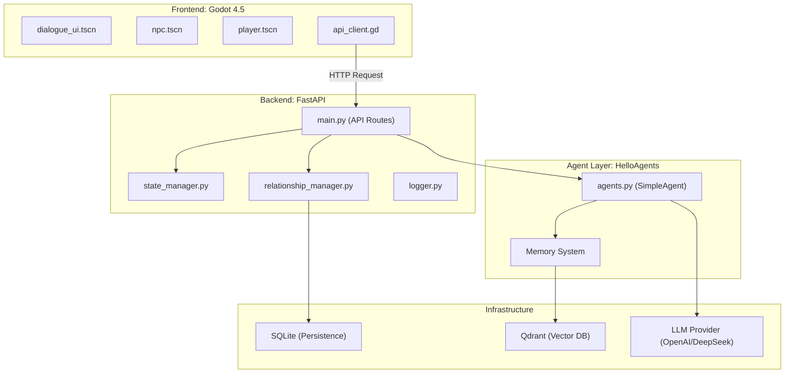
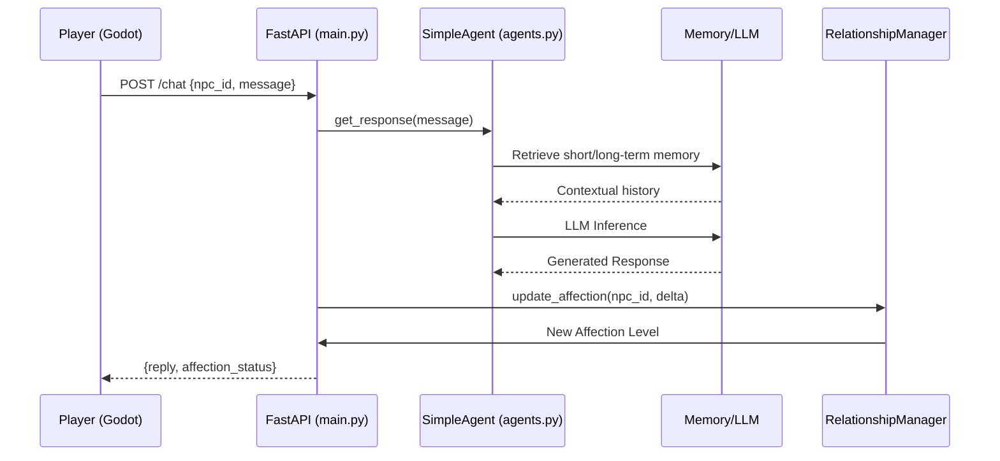

<!-- source: DeepWiki mcp.deepwiki.com · repo datawhalechina/hello-agents · page 9.3 Cyber Town Simulation · fetched 2026-10-29 -->

# Cyber Town Simulation

Relevant source files

The following files were used as context for generating this wiki page:

- [code/chapter15/Helloagents-AI-Town/SETUP_GUIDE.md](code/chapter15/Helloagents-AI-Town/SETUP_GUIDE.md)
- [code/chapter15/Helloagents-AI-Town/backend/requirements.txt](code/chapter15/Helloagents-AI-Town/backend/requirements.txt)
- [docs/chapter15/Chapter15-Building-Cyber-Town.md](docs/chapter15/Chapter15-Building-Cyber-Town.md)

## Purpose and Scope

Cyber Town is a sophisticated multi-agent simulation that integrates the HelloAgents framework with the Godot game engine to create a living digital ecosystem. Unlike static simulations, Cyber Town features NPCs with independent personalities, dynamic memory systems, and evolving social relationships. The project demonstrates the practical application of peer-to-peer A2A (Agent-to-Agent) communication and the ANP (Agent Network Protocol) within a gamified environment.

The system allows players to interact with AI-driven NPCs in a 2D pixel-style office scene. These NPCs do not follow preset dialogue trees; instead, they generate responses based on their unique role settings, interaction history, and real-time affection levels toward the player.

Sources: [docs/chapter15/Chapter15-Building-Cyber-Town.md:3-15](), [docs/chapter15/Chapter15-Building-Cyber-Town.md:21-25]()

## Technical Architecture

Cyber Town adopts a decoupled **game engine + back-end service** architecture. This separation ensures that the high-frequency rendering and input logic of the game do not block the heavy reasoning processes of the AI agents.

### Architecture Diagram

Sources: [docs/chapter15/Chapter15-Building-Cyber-Town.md:29-37](), [docs/chapter15/Chapter15-Building-Cyber-Town.md:49-81]()

## Core Components and Data Flow

The simulation's lifecycle is driven by player interaction and background state updates. When a player initiates a conversation, the data flows through the system to generate a contextually aware response.

### Interaction Data Flow

### Key Code Entities

| Component | File Path | Responsibility |
|-----------|-----------|----------------|
| **FastAPI Backend** | [code/chapter15/Helloagents-AI-Town/backend/main.py]() | Orchestrates API routing and high-level NPC state management. |
| **NPC Agent System** | [code/chapter15/Helloagents-AI-Town/backend/agents.py]() | Implements `SimpleAgent` instances with specific personality prompts. |
| **Affection Manager** | [code/chapter15/Helloagents-AI-Town/backend/relationship_manager.py]() | Calculates and persists NPC attitudes (stranger to intimate). |
| **API Client** | [code/chapter15/Helloagents-AI-Town/helloagents-ai-town/scripts/api_client.gd]() | Handles Godot-to-Python communication via HTTP. |
| **NPC Behavior** | [code/chapter15/Helloagents-AI-Town/helloagents-ai-town/scripts/npc.gd]() | Manages NPC animations and interaction triggers (E key). |

Sources: [docs/chapter15/Chapter15-Building-Cyber-Town.md:40-45](), [docs/chapter15/Chapter15-Building-Cyber-Town.md:49-81]()

## Emergent Social Dynamics

Cyber Town utilizes the A2A (Agent-to-Agent) protocol to enable autonomous social behavior without centralized scripts.

### 1. Memory and Context
NPCs utilize a dual-memory system. Short-term memory captures the immediate dialogue flow, while long-term memory (backed by a vector database) allows NPCs to recall interactions from previous game sessions. This allows for emergent recognition: an NPC might mention a topic the player discussed days ago.

### 2. Affection System
The `relationship_manager.py` tracks interaction quality. Positive sentiment in player messages or helpful actions increases affection scores, which in turn modifies the system prompt for the `SimpleAgent`. Higher affection levels unlock friendlier dialogue styles and potentially new information or "quests."

### 3. Real-Time Logging
All agent "thoughts," memory retrievals, and communications are recorded via `logger.py`. This provides a transparent view of the agent's reasoning process, essential for debugging emergent behaviors that might seem unpredictable.

Sources: [docs/chapter15/Chapter15-Building-Cyber-Town.md:7-15](), [docs/chapter15/Chapter15-Building-Cyber-Town.md:71-81]()

## Setup and Configuration

The simulation requires both a Python backend and the Godot editor.

### Backend Dependencies
The backend relies on `fastapi`, `uvicorn`, and the `hello-agents` framework (version 0.2.4 to 0.2.9).
Sources: [code/chapter15/Helloagents-AI-Town/backend/requirements.txt:1-15]()

### Environment Variables
Configuration is managed via a `.env` file in the backend directory:
- `LLM_API_KEY`: Authentication for the LLM provider.
- `LLM_BASE_URL`: The endpoint for the LLM (e.g., OpenAI or DeepSeek).
- `NPC_UPDATE_INTERVAL`: Frequency of background state updates.

Sources: [code/chapter15/Helloagents-AI-Town/SETUP_GUIDE.md:68-81]()

### Execution Steps
1. **Start Backend**: Run `python main.py` within the `backend` directory to initialize the FastAPI server on port 8000.
2. **Launch Godot**: Import the project in Godot 4.2+ and run the `main.tscn` scene.
3. **Interact**: Use **WASD** to move and **E** to initiate A2A dialogue with NPCs.

Sources: [code/chapter15/Helloagents-AI-Town/SETUP_GUIDE.md:87-125]()

## Comparison with Coordinator Patterns

Unlike the Intelligent Travel Assistant (Section 9.1), which uses a central coordinator to delegate tasks, Cyber Town's agents are autonomous peers.

| Feature | Cyber Town (P2P) | Travel Assistant (Coordinator) |
|---------|------------------|-------------------------------|
| **Logic Core** | Distributed in each NPC | Centralized in Coordinator |
| **Communication** | A2A / ANP | MCP / Direct Delegation |
| **Social Structure** | Emergent/Fluid | Fixed Hierarchy |
| **Primary Goal** | Social Simulation | Task Completion |

Sources: [docs/chapter15/Chapter15-Building-Cyber-Town.md:29-37](), [docs/chapter15/Chapter15-Building-Cyber-Town.md:40-45]()

---

