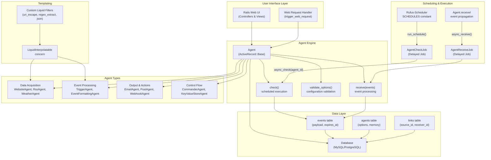
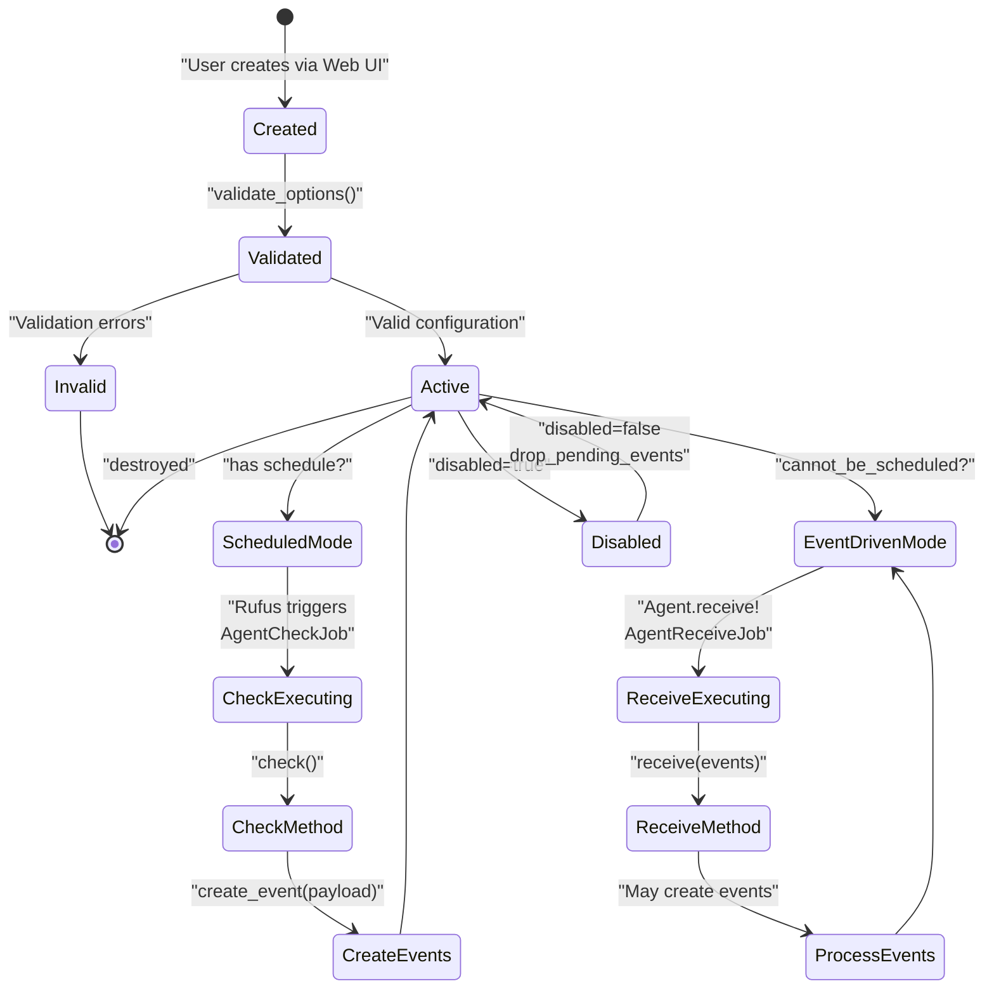
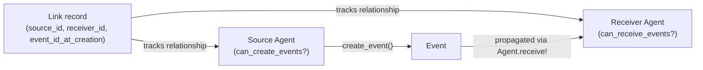
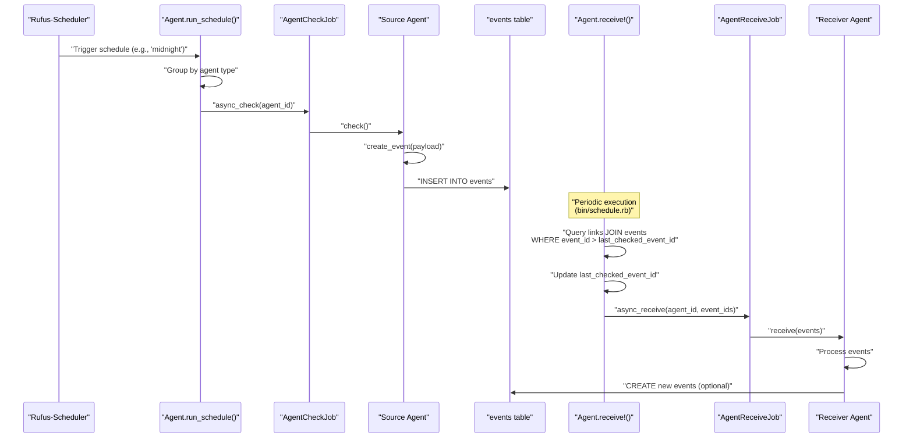
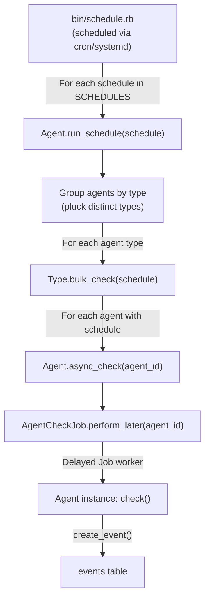
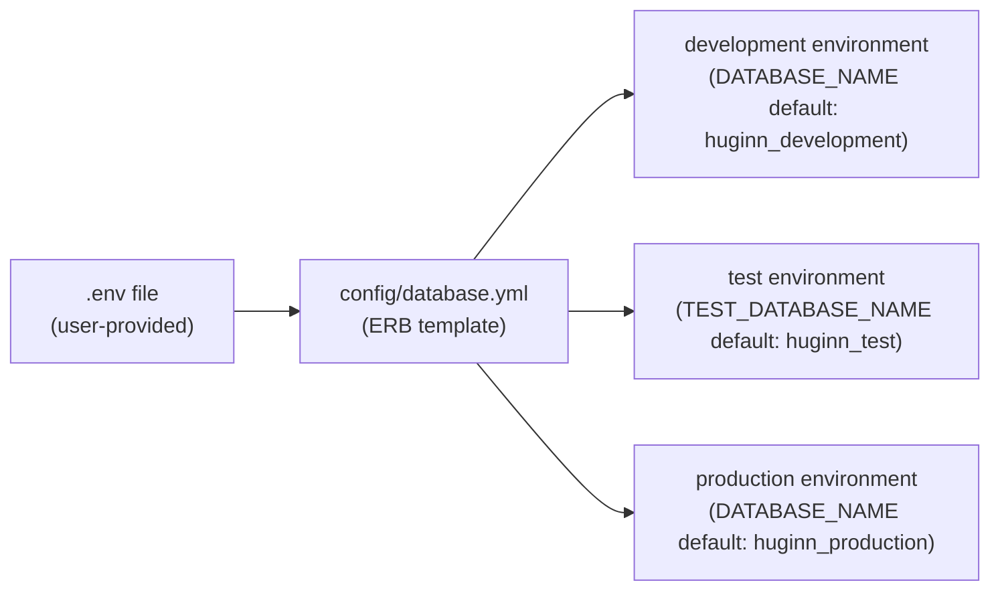

<!-- source: DeepWiki mcp.deepwiki.com · repo huginn/huginn · page 1 Overview · fetched 2026-10-29 -->

# Overview

<details>
<summary>Relevant source files</summary>

The following files were used as context for generating this wiki page:

- [.dockerignore](.dockerignore)
- [README.md](README.md)
- [app/models/agent.rb](app/models/agent.rb)
- [app/views/agents/_form.html.erb](app/views/agents/_form.html.erb)
- [config/database.yml](config/database.yml)
- [spec/models/agent_spec.rb](spec/models/agent_spec.rb)

</details>


## Purpose and Scope

This document provides an architectural overview of Huginn, introducing its core concepts, system components, and data flow patterns. It serves as an entry point for understanding how Huginn operates as an agent-based automation platform. For detailed information about specific components referenced here, see:

- Installation and deployment options: [Installation and Deployment](#2)
- Agent system internals: [Agent System](#3.1)
- Event propagation mechanics: [Event-Driven Architecture](#3.2)
- Liquid templating features: [Liquid Templating System](#4)
- Individual agent documentation: [Agent Reference](#5)

**Sources:** [README.md:1-156]()

---

## What is Huginn?

Huginn is a self-hosted automation platform built on Ruby on Rails that enables users to create workflows of interconnected agents. Each agent performs a specific task (web scraping, API calls, data transformation, notifications) and can create and consume events. Agents are connected in directed graphs where events propagate from source agents to receiver agents, enabling complex automation workflows.

**Key characteristics:**

| Aspect | Description |
|--------|-------------|
| **Architecture** | Agent-based, event-driven system |
| **Language** | Ruby 3.2.6, Rails 7.1 |
| **Agent Base Class** | `Agent` ([app/models/agent.rb:6]()) |
| **Event Model** | `Event` records linked to agents |
| **Scheduling** | Rufus-Scheduler for periodic execution |
| **Background Jobs** | Delayed Job (via `AgentCheckJob`, `AgentReceiveJob`) |
| **Templating** | Liquid via `LiquidInterpolatable` concern |
| **Databases** | MySQL or PostgreSQL ([config/database.yml:1-42]()) |

**Sources:** [README.md:5-24](), [app/models/agent.rb:1-6]()

---

## Core Architecture Components



**Sources:** [app/models/agent.rb:1-523](), [README.md:7]()

---

## Agent System

### Agent Base Class

The `Agent` class ([app/models/agent.rb:6]()) is an `ActiveRecord::Base` model that serves as the foundation for all agent types. It includes several concerns that provide core functionality:

| Concern | Purpose | Key Methods |
|---------|---------|-------------|
| `LiquidInterpolatable` | Liquid template processing | `interpolate_string`, `interpolate_options` |
| `WorkingHelpers` | Status tracking | `working?`, `recent_error_logs?` |
| `DryRunnable` | Testing mode | `dry_run?` |
| `HasGuid` | Unique identifiers | `guid` generation |

**Sources:** [app/models/agent.rb:7-16]()

### Agent Lifecycle Methods

Agents implement three primary execution methods:



| Method | Trigger | Purpose | Examples |
|--------|---------|---------|----------|
| `check()` | Schedule (Rufus-Scheduler) | Periodic execution to generate events | `WebsiteAgent` scrapes URL, `WeatherAgent` calls API |
| `receive(events)` | Event propagation (`Agent.receive!`) | Process incoming events from source agents | `TriggerAgent` filters events, `EmailAgent` sends notifications |
| `receive_web_request(params, method, format)` | HTTP request to agent's webhook URL | Handle external HTTP requests | `WebhookAgent` receives webhooks, `DataOutputAgent` serves RSS feeds |

**Sources:** [app/models/agent.rb:95-115](), [app/models/agent.rb:170-190](), [spec/models/agent_spec.rb:140-161]()

### Agent Configuration

Agents are configured through three key attributes:

- **`options`**: JSON-serialized hash containing agent-specific configuration ([app/models/agent.rb:39]())
- **`memory`**: JSON-serialized hash for persistent state storage ([app/models/agent.rb:39]())
- **`schedule`**: String from `SCHEDULES` constant defining execution frequency ([app/models/agent.rb:21-28]())

**Sources:** [app/models/agent.rb:39-49]()

---

## Event-Driven Architecture

### Event Model

Events are the primary data structure for inter-agent communication. Each event record contains:

| Column | Type | Purpose |
|--------|------|---------|
| `payload` | JSON | The actual data being transmitted |
| `agent_id` | Integer | Foreign key to creating agent |
| `user_id` | Integer | Foreign key to owner |
| `expires_at` | DateTime | Automatic cleanup timestamp |
| `created_at` | DateTime | Event creation time |

**Sources:** [app/models/agent.rb:60-61]()

### Link System

The `links` table establishes directed edges in the agent graph:



Key associations in `Agent`:

- `has_many :links_as_source` ([app/models/agent.rb:63-64]())
- `has_many :links_as_receiver` ([app/models/agent.rb:65-66]())
- `has_many :sources, through: :links_as_receiver` ([app/models/agent.rb:67]())
- `has_many :receivers, through: :links_as_source` ([app/models/agent.rb:69]())

**Sources:** [app/models/agent.rb:63-69]()

### Event Propagation Flow



The `Agent.receive!` method ([app/models/agent.rb:400-443]()) is the core event propagation engine:

1. Joins `agents`, `links`, and `events` tables
2. Finds events created after the link was established
3. Groups events by receiver agent
4. Updates `last_checked_event_id` on each receiver
5. Enqueues `AgentReceiveJob` for each receiver with pending events

**Sources:** [app/models/agent.rb:400-443](), [spec/models/agent_spec.rb:284-426]()

---

## Agent Categories

### Data Acquisition Agents

Agents that gather data from external sources and create events:

| Agent Class | Purpose | Scheduling | Key Options |
|-------------|---------|------------|-------------|
| `WebsiteAgent` | Web scraping (HTML/XML/JSON) | Scheduled | `url`, `extract`, `type`, `mode` |
| `RssAgent` | RSS/Atom feed parsing | Scheduled | `url`, `clean` |
| `WeatherAgent` | Weather data from Pirate Weather API | Scheduled | `location`, `api_key` |
| `TwitterUserAgent` | Twitter timeline monitoring | Scheduled | OAuth credentials, `username` |

**Key method:** `check()` - fetches external data and calls `create_event(payload: {...})`

**Sources:** [README.md:11-24]()

### Event Processing Agents

Agents that transform, filter, or aggregate events:

| Agent Class | Purpose | Trigger | Key Options |
|-------------|---------|---------|-------------|
| `TriggerAgent` | Conditional filtering | Event-driven | `rules` (conditions), `must_match` |
| `EventFormattingAgent` | Data transformation | Event-driven | `instructions` (Liquid templates), `matchers` |
| `DigestAgent` | Event aggregation | Scheduled | `expected_receive_period_in_days` |

**Key method:** `receive(events)` - processes incoming events, may create new events

**Sources:** [README.md:14]()

### Output Agents

Agents that perform actions or expose data:

| Agent Class | Purpose | Trigger | Key Options |
|-------------|---------|---------|-------------|
| `EmailAgent` | Send emails | Event-driven | `recipients`, `subject`, `body` |
| `PostAgent` | HTTP POST requests | Event-driven | `post_url`, `payload`, `method` |
| `WebhookAgent` | Receive HTTP requests | External HTTP | `secret`, `response` |
| `DataOutputAgent` | Expose RSS/JSON feeds | HTTP request | `template`, `events_to_show` |

**Key method:** `receive(events)` for event-driven agents, `receive_web_request()` for HTTP agents

**Sources:** [README.md:18-21]()

---

## Scheduling System

### Schedule Options

The `SCHEDULES` constant ([app/models/agent.rb:21-28]()) defines available schedules:

| Category | Values |
|----------|--------|
| **Minutes** | `every_1m`, `every_2m`, `every_5m`, `every_10m`, `every_30m` |
| **Hours** | `every_1h`, `every_2h`, `every_5h`, `every_12h` |
| **Days** | `every_1d`, `every_2d`, `every_7d` |
| **Times** | `midnight`, `1am`...`11pm`, `noon` |
| **Special** | `never` (manual triggering only) |

### Execution Flow



**Key methods:**

- `Agent.run_schedule(schedule)` ([app/models/agent.rb:453-462]()): Entry point, groups by type
- `Agent.bulk_check(schedule)` ([app/models/agent.rb:466-472]()): Finds agents with schedule, calls `async_check`
- `Agent.async_check(agent_id)` ([app/models/agent.rb:476-478]()): Enqueues `AgentCheckJob`

**Sources:** [app/models/agent.rb:453-478](), [spec/models/agent_spec.rb:34-94]()

---

## Configuration System

### Environment Variables

Huginn uses environment variables from the `.env` file for configuration:

| Variable | Purpose | Example |
|----------|---------|---------|
| `DATABASE_ADAPTER` | Database type | `mysql2` or `postgresql` |
| `DATABASE_NAME` | Database name | `huginn_production` |
| `DATABASE_USERNAME` | Database username | `root` |
| `DATABASE_PASSWORD` | Database password | (secure password) |
| `APP_SECRET_TOKEN` | Rails secret key | (random string) |
| `INVITATION_CODE` | Registration control | (optional code) |
| `SMTP_*` | Email settings | Various SMTP options |

**Sources:** [config/database.yml:1-42](), [README.md:65-76]()

### Database Configuration

The `config/database.yml` file ([config/database.yml:1-42]()) defines three environments, all configurable via environment variables with fallback defaults:



**Sources:** [config/database.yml:1-42]()

---

## Deployment Options

Huginn supports multiple deployment strategies:

### Docker Deployment

| Option | Image | Use Case |
|--------|-------|----------|
| **All-in-one** | `huginn/huginn` | Quick evaluation, contains web + workers + MySQL |
| **Multi-container** | `huginn/huginn-single-process` | Production, separate web/worker containers, external DB |

### Manual Installation

Components required:
- Ruby 3.2.6 (compiled from source)
- Bundler for dependency management
- Unicorn web server
- Runit for process management
- Nginx as reverse proxy
- MySQL or PostgreSQL database

### PaaS Deployment

Supported platforms:
- Heroku (via Deploy button)
- OpenShift (via JSON templates)

**Sources:** [README.md:56-134](), [.dockerignore:1-39]()

---

## Agent Web Interface

The web UI provides agent management through Rails controllers and views:

### Agent Form Structure

The agent form ([app/views/agents/_form.html.erb:1-152]()) includes:

| Section | Form Fields | Purpose |
|---------|-------------|---------|
| **Type Selection** | `type` select (new records only) | Choose agent class |
| **Basic Settings** | `name`, `schedule` | Identity and execution timing |
| **Relationships** | `source_ids`, `receiver_ids`, `controller_ids`, `control_target_ids` | Link agents together |
| **Event Management** | `keep_events_for`, `propagate_immediately` | Event retention and propagation |
| **Scenarios** | `scenario_ids` | Group agents for organization |
| **Options** | Agent-specific JSON configuration | Agent behavior customization |

**Dynamic behavior:**
- Schedule field hidden if `cannot_be_scheduled?` is true
- Source field hidden if `cannot_receive_events?` is true
- Receiver field hidden if `cannot_create_events?` is true

**Sources:** [app/views/agents/_form.html.erb:1-152]()

---

## Data Persistence

### Agent Memory

Each agent has a `memory` attribute ([app/models/agent.rb:39]()) - a JSON-serialized hash for persistent state:

```ruby
# Example memory usage in an agent
def check
  memory[:last_checked] = Time.now
  memory[:seen_ids] ||= []
  memory[:seen_ids] << new_id
  save!
end
```

Common use cases:
- Deduplication tracking (`seen_ids` arrays)
- Cursor/pagination state
- Rate limiting counters
- Cached API responses

**Sources:** [app/models/agent.rb:39](), [spec/models/agent_spec.rb:535-563]()

### Event Expiration

Events can be automatically deleted based on `keep_events_for`:

| Setting | Duration | Use Case |
|---------|----------|----------|
| `0` | Forever | Critical audit logs |
| `1.hour` to `365.days` | Configurable | Most agents |

The `new_event_expiration_date` method ([app/models/agent.rb:158-160]()) calculates `expires_at` timestamps. When `keep_events_for` changes, `update_event_expirations!` ([app/models/agent.rb:162-168]()) recalculates all existing event expiration dates.

**Sources:** [app/models/agent.rb:158-168](), [spec/models/agent_spec.rb:669-727]()

---

## Control Flow Features

### Propagate Immediately

By default, events propagate from sources to receivers once per minute via `Agent.receive!`. Setting `propagate_immediately = true` ([app/models/agent.rb:322]()) causes events to trigger receivers synchronously during event creation.

**Trade-offs:**
- **Advantage:** Near-instant event propagation
- **Disadvantage:** Increased CPU usage, slower event creation

**Sources:** [spec/models/agent_spec.rb:461-514]()

### Drop Pending Events

When re-enabling a disabled agent, setting `drop_pending_events = true` ([app/models/agent.rb:257-259]()) updates `last_checked_event_id` to skip accumulated events, preventing event backlog processing.

**Sources:** [app/models/agent.rb:257-259](), [spec/models/agent_spec.rb:932-967]()

### Control Links

Agents with `can_control_other_agents!` ([app/models/agent.rb:364-370]()) can have `control_targets` - other agents they can enable, disable, or trigger via `ControlLink` associations ([app/models/agent.rb:70-75]()).

**Sources:** [app/models/agent.rb:70-75](), [app/models/agent.rb:364-370]()

---

## Validation and Error Handling

### Option Validation

Each agent subclass implements `validate_options` ([app/models/agent.rb:293-295]()):

```ruby
def validate_options
  errors.add(:base, "api_key is required") unless options[:api_key].present?
  errors.add(:base, "url must be a valid URL") unless options[:url] =~ URI::regexp
end
```

Validation occurs before save, with errors displayed in the web UI.

**Sources:** [app/models/agent.rb:293-295](), [spec/models/agent_spec.rb:517-524]()

### Agent Logging

Agents log messages via `log(message, options)` and `error(message, options)` methods ([app/models/agent.rb:240-246]()):

```ruby
log("Fetched #{results.count} items")
error("API request failed: #{e.message}")
```

Logs are stored in the `agent_logs` table with severity levels (1=info, 4=error). The `last_error_log_at` timestamp tracks the most recent error for status display.

**Sources:** [app/models/agent.rb:240-251]()

---

## Testing Infrastructure

Huginn includes comprehensive RSpec tests:

| Test Type | Location | Coverage |
|-----------|----------|----------|
| **Model specs** | `spec/models/agent_spec.rb` | Agent lifecycle, validation, scheduling |
| **Agent specs** | `spec/models/agents/*_spec.rb` | Individual agent behavior |
| **Integration specs** | `spec/features/*_spec.rb` | End-to-end workflows |

**Key test patterns:**
- Shared examples for common agent behaviors (e.g., `WorkingHelpers`, `LiquidInterpolatable`)
- Fixtures defined in `spec/data_fixtures/` for API responses
- Time travel via `travel_to` for testing scheduled behavior

**Sources:** [spec/models/agent_spec.rb:1-1095](), [README.md:84-93]()

---

