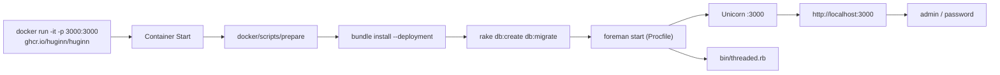
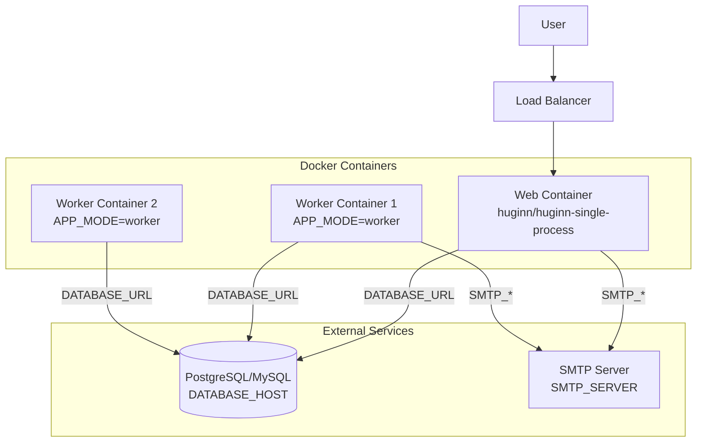
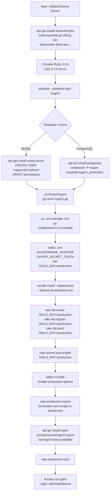
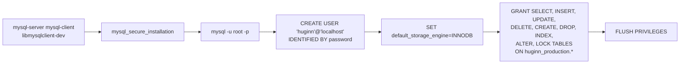
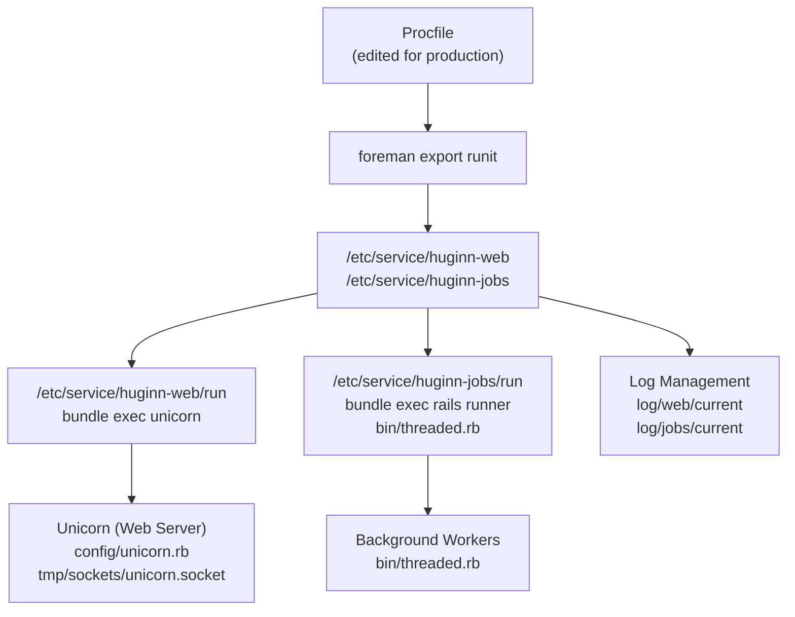
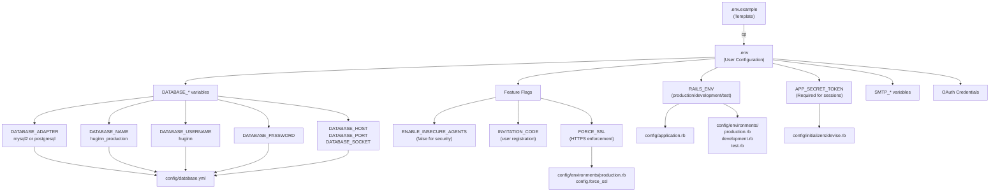
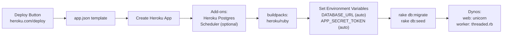

<!-- source: DeepWiki mcp.deepwiki.com · repo huginn/huginn · page 2 Installation and Deployment · fetched 2026-10-29 -->

# Installation and Deployment

<details>
<summary>Relevant source files</summary>

The following files were used as context for generating this wiki page:

- [.dockerignore](.dockerignore)
- [README.md](README.md)
- [config/database.yml](config/database.yml)
- [doc/README.md](doc/README.md)
- [doc/docker/install.md](doc/docker/install.md)
- [doc/heroku/update.md](doc/heroku/update.md)
- [doc/manual/installation.md](doc/manual/installation.md)
- [doc/manual/requirements.md](doc/manual/requirements.md)
- [doc/manual/update.md](doc/manual/update.md)
- [docker/README.md](docker/README.md)
- [docker/scripts/prepare](docker/scripts/prepare)
- [lib/tasks/database_test.rake](lib/tasks/database_test.rake)

</details>


This document covers all supported methods for deploying Huginn, including Docker containers, manual installation on Debian/Ubuntu systems, and PaaS platforms. It also explains the configuration system used across all deployment methods. For information about updating an existing deployment, see the update documentation referenced in [doc/manual/update.md:1-120](). For development setup, refer to the development sections in [README.md:84-93]().

## Deployment Architecture Overview

Huginn supports multiple deployment strategies, each suitable for different use cases. The system requires a web application server, background job workers, and a relational database (MySQL or PostgreSQL).

### Deployment Options Comparison

```mermaid
graph TB
    subgraph DockerMulti["Docker: huginn/huginn (Multi-Process)"]
        DM_Container["Single Container"]
        DM_Web["Web: Unicorn"]
        DM_Worker["Worker: threaded.rb"]
        DM_DB["MySQL (internal)"]
        DM_Foreman["foreman via Procfile"]
        
        DM_Container --> DM_Foreman
        DM_Foreman --> DM_Web
        DM_Foreman --> DM_Worker
        DM_Container --> DM_DB
    end
    
    subgraph DockerSingle["Docker: huginn/huginn-single-process"]
        DS_Web["Web Container"]
        DS_Worker1["Worker Container 1"]
        DS_WorkerN["Worker Container N"]
        DS_ExtDB[("External PostgreSQL/MySQL")]
        
        DS_Web --> DS_ExtDB
        DS_Worker1 --> DS_ExtDB
        DS_WorkerN --> DS_ExtDB
    end
    
    subgraph Manual["Manual: /home/huginn/huginn"]
        M_Runit["runit (/etc/service)"]
        M_Unicorn["unicorn -c config/unicorn.rb"]
        M_Threaded["rails runner bin/threaded.rb"]
        M_Nginx["nginx (reverse proxy)"]
        M_ExtDB2[("MySQL/PostgreSQL")]
        
        M_Runit --> M_Unicorn
        M_Runit --> M_Threaded
        M_Nginx --> M_Unicorn
        M_Unicorn --> M_ExtDB2
        M_Threaded --> M_ExtDB2
    end
    
    subgraph PaaS["PaaS"]
        H_Heroku["Heroku: bin/setup_heroku"]
        H_DB[("Heroku Postgres")]
        OS_Template["OpenShift: huginn-mysql.json"]
        OS_DB[("OpenShift MySQL/PostgreSQL")]
        
        H_Heroku --> H_DB
        OS_Template --> OS_DB
    end
```



**Sources:** [README.md:56-133](), [docker/README.md:1-13](), [doc/manual/installation.md:20-30]()

| Deployment Type | Use Case | Pros | Cons | Documentation |
|----------------|----------|------|------|---------------|
| `huginn/huginn` Docker | Evaluation, quick demo | Single command to start | Not recommended for production, difficult backups | [doc/docker/install.md:9-15]() |
| `huginn/huginn-single-process` Docker | Production, scalable | Separate web/worker containers, easy scaling | Requires external database | [docker/README.md:10-12]() |
| Manual Installation | Production, full control | Maximum flexibility, detailed control | Manual setup and maintenance | [doc/manual/installation.md:1-489]() |
| Heroku | Managed PaaS | No server management | Paid plans only, limited control | [README.md:107-109]() |
| OpenShift | Managed PaaS | Kubernetes-based | Platform-specific configuration | [README.md:111-129]() |

## Docker Deployment

### Quick Start: Multi-Process Image

The `huginn/huginn` image runs all processes in a single container with an internal MySQL database.



**Default Credentials:**
- Username: `admin`
- Password: `password`

**Sources:** [README.md:56-58](), [doc/docker/install.md:9-15]()

### Production: Single-Process Image

The `huginn/huginn-single-process` image runs one process per container, requiring separate containers for web and workers.



**Required Environment Variables:**
- `DATABASE_ADAPTER`: `postgresql` or `mysql2`
- `DATABASE_URL` or individual `DATABASE_*` variables
- `APP_SECRET_TOKEN`: Random secure token
- `DOMAIN`: Your deployment domain

**Sources:** [docker/README.md:10-12](), [doc/docker/install.md:16-22]()

## Manual Installation

Manual installation provides full control and is recommended for production deployments where Docker is not suitable.

### Installation Flow



**Sources:** [doc/manual/installation.md:1-489]()

### System Requirements

The manual installation requires specific packages and system configurations:

**Required Packages** [doc/manual/installation.md:47-49]():
```bash
sudo apt-get install -y runit build-essential git zlib1g-dev libyaml-dev \
  libssl-dev libgdbm-dev libreadline-dev libncurses5-dev libffi-dev \
  curl openssh-server checkinstall libxml2-dev libxslt-dev \
  libcurl4-openssl-dev libicu-dev logrotate pkg-config cmake nodejs \
  graphviz jq shared-mime-info
```

**Ruby Installation** [doc/manual/installation.md:72-79]():
- Ruby 3.2.6 compiled from source
- Location: `/tmp/ruby/ruby-3.2.6`
- Configure flags: `--disable-install-rdoc`
- Post-install: `gem install foreman --no-document`

**System User** [doc/manual/installation.md:87-89]():
- Username: `huginn`
- Home directory: `/home/huginn`
- Shell: disabled login (system account)

**Sources:** [doc/manual/installation.md:31-89](), [doc/manual/requirements.md:1-69]()

### Database Setup

#### MySQL Configuration



**MySQL Version Check** [doc/manual/installation.md:105-107]():
```bash
mysql --version  # Check if >= 5.5.3 for utf8mb4 support
```

**Sources:** [doc/manual/installation.md:93-152]()

#### PostgreSQL Configuration

```bash
# Install packages
sudo apt-get install -y postgresql libpq-dev

# Create user (interactive password prompt)
sudo -u postgres -H createuser -P huginn

# Create database
sudo -u postgres -H createdb -O huginn -T template0 huginn_production

# Test connection
sudo -u huginn psql -h localhost -W huginn_production
```

**Sources:** [doc/manual/installation.md:154-174]()

### Process Management with Runit

Huginn uses `foreman` to generate runit service scripts from the `Procfile`.



**Procfile Configuration** [doc/manual/installation.md:286-302]():

For production, disable development options:
```
# Comment out:
# web: bundle exec rails server -p ${PORT-3000} -b ${IP-0.0.0.0}
# jobs: bundle exec rails runner bin/threaded.rb

# Enable production options:
web: bundle exec unicorn -c config/unicorn.rb
jobs: bundle exec rails runner bin/threaded.rb
```

**Export Command** [doc/manual/installation.md:307-311]():
```bash
sudo bundle exec rake production:export
# Generates runit scripts in /etc/service/
```

**Sources:** [doc/manual/installation.md:284-322]()

### Nginx Configuration

Nginx serves as a reverse proxy to the Unicorn application server.

**Configuration Path** [doc/manual/installation.md:333-342]():
```bash
sudo cp deployment/nginx/huginn /etc/nginx/sites-available/huginn
sudo ln -s /etc/nginx/sites-available/huginn /etc/nginx/sites-enabled/huginn
```

**Key Configuration Elements:**
- Upstream: `unix:/home/huginn/huginn/tmp/sockets/unicorn.socket`
- Static assets: `/home/huginn/huginn/public`
- Server name: Replace `YOUR_SERVER_FQDN`

For HTTPS deployments, use `deployment/nginx/huginn-ssl` instead [doc/manual/installation.md:348-409]().

**Sources:** [doc/manual/installation.md:323-361]()

## Configuration System

Huginn's configuration is managed through environment variables, which flow into Rails configurations and database settings.

### Environment Variable Configuration Flow



**Sources:** [README.md:65-66](), [doc/manual/installation.md:207-241](), [config/database.yml:1-42]()

### Critical Environment Variables

#### Database Configuration

**MySQL Example** [doc/manual/installation.md:212-228]():
```bash
DATABASE_ADAPTER=mysql2
DATABASE_RECONNECT=true
DATABASE_NAME=huginn_production
DATABASE_POOL=20
DATABASE_USERNAME=huginn
DATABASE_PASSWORD='your_secure_password'
# Optional: DATABASE_HOST, DATABASE_PORT, DATABASE_SOCKET

DATABASE_ENCODING=utf8
# For MySQL >= 5.5.3, use utf8mb4 for emoji support:
# DATABASE_ENCODING=utf8mb4
```

**PostgreSQL Example** [doc/manual/installation.md:230-241]():
```bash
DATABASE_ADAPTER=postgresql
DATABASE_RECONNECT=true
DATABASE_NAME=huginn_production
DATABASE_POOL=20
DATABASE_USERNAME=huginn
DATABASE_PASSWORD='your_secure_password'
DATABASE_HOST=localhost
DATABASE_PORT=5432
DATABASE_ENCODING=utf8
```

**Database Configuration Processing** [config/database.yml:30-42]():

The `config/database.yml` file reads environment variables with fallback defaults:
- `adapter`: `ENV['DATABASE_ADAPTER']` defaults to `mysql2`
- `encoding`: `ENV['DATABASE_ENCODING']` defaults to `utf8`
- `pool`: `ENV['DATABASE_POOL']` defaults to `20`
- Socket auto-detection for MySQL: `/var/run/mysqld/mysqld.sock`, `/opt/local/var/run/mysql5/mysqld.sock`, `/tmp/mysql.sock`

#### Application Configuration

**Required Variables:**
- `APP_SECRET_TOKEN`: Cryptographic secret for session cookies (must be unique per installation)
- `RAILS_ENV`: Set to `production` for production deployments [doc/manual/installation.md:243-245]()

**Security Variables:**
- `ENABLE_INSECURE_AGENTS`: Controls whether dangerous agents (ShellCommandAgent, etc.) are available
- `FORCE_SSL`: Enforces HTTPS connections [doc/manual/installation.md:386-387]()
- `INVITATION_CODE`: Required code for user registration (if enabled)

**Sources:** [README.md:65-66](), [doc/manual/installation.md:207-255]()

### Unicorn Configuration

The web server configuration is managed via `config/unicorn.rb`.

**Key Settings** [doc/manual/installation.md:247-252]():
```ruby
# config/unicorn.rb
worker_processes 2  # Adjust based on available RAM
working_directory "/home/huginn/huginn"
listen "/home/huginn/huginn/tmp/sockets/unicorn.socket"
timeout 30
pid "/home/huginn/huginn/tmp/pids/unicorn.pid"
```

**Worker Calculation** [doc/manual/requirements.md:53-60]():
- 512MB RAM: 1 worker
- 1GB+ RAM: 2 workers (recommended)
- General rule: CPU cores = unicorn workers
- Each additional 300MB RAM supports one more DelayedJob worker

**Sources:** [doc/manual/installation.md:204-206](), [doc/manual/requirements.md:53-60]()

## Platform-as-a-Service Deployments

### Heroku Deployment



**Deployment Command** [README.md:109]():
```bash
# One-click deploy via Heroku button
# Or manual:
heroku create your-huginn-app
git push heroku master
heroku run rake db:migrate
heroku run rake db:seed
```

**Requirements:**
- Paid Heroku plan required (no free tier support)
- Heroku Postgres add-on (automatically provisioned)
- At least 1GB dyno recommended

**Updates** [doc/heroku/update.md:1-10]():
```bash
git fetch origin
git merge origin/master
git push -f heroku master
heroku run rake db:migrate
```

**Sources:** [README.md:107-109](), [doc/heroku/update.md:1-10]()

### OpenShift Deployment

OpenShift deployments use JSON templates for MySQL or PostgreSQL variants.

**Template Deployment** [README.md:117-124]():
```bash
# MySQL variant
oc new-app -f https://raw.githubusercontent.com/huginn/huginn/master/openshift/templates/huginn-mysql.json

# PostgreSQL variant
oc new-app -f https://raw.githubusercontent.com/huginn/huginn/master/openshift/templates/huginn-postgresql.json
```

**Platform Support:**
- OpenShift v3 installations
- OpenShift v4 (current online version)
- Can also import via web console: "Add to Project" → "Import YAML/JSON"

**Sources:** [README.md:111-129]()

## Post-Installation Steps

### Initial Access

After successful deployment, access Huginn via:
- Docker: `http://localhost:3000`
- Manual: `http://YOUR_SERVER_FQDN`
- Heroku/OpenShift: Provided deployment URL

**Default Credentials** [doc/manual/installation.md:366-369]():
- Username: `admin` (or `SEED_USERNAME` if customized)
- Password: `password` (or `SEED_PASSWORD` if customized)

**Important:** Change the default password immediately when exposed to the internet.

### Database Initialization

The database is initialized with seed data [doc/manual/installation.md:267-275]():
```bash
sudo -u huginn -H bundle exec rake db:seed RAILS_ENV=production \
  SEED_USERNAME=admin SEED_PASSWORD=password
```

This creates:
- Initial admin user
- Example agents demonstrating Huginn capabilities
- Default configuration values

### Service Management

**Manual Installation** [doc/manual/installation.md:374]():
```bash
# Start services
cd /home/huginn/huginn && sudo bundle exec rake production:start

# Stop services
cd /home/huginn/huginn && sudo bundle exec rake production:stop

# Check status
sudo bundle exec rake production:status

# Force stop (if stuck)
sudo bundle exec rake production:force_stop
```

**Docker:**
```bash
# Multi-process image
docker stop <container_id>
docker start <container_id>

# Single-process image (use docker-compose)
docker-compose down
docker-compose up -d
```

**Sources:** [doc/manual/installation.md:319-322](), [doc/manual/installation.md:374](), [doc/manual/update.md:12-23]()

### Log Files and Troubleshooting

**Manual Installation Log Locations** [doc/manual/installation.md:420-461]():

| Log File | Purpose | Common Issues |
|----------|---------|---------------|
| `/var/log/nginx/huginn_error.log` | Nginx errors | Unicorn socket connection failures, permission errors |
| `/home/huginn/huginn/log/unicorn.log` | Web server requests | Ruby exceptions, gem dependency issues |
| `/home/huginn/huginn/log/production.log` | Rails application | Agent errors, database queries |
| `/home/huginn/huginn/log/*/current` | Background workers | Agent check failures, runit process logs |

**Troubleshooting Commands** [doc/manual/installation.md:417-418]():
```bash
# Run self-check
cd /home/huginn/huginn
sudo bundle exec rake production:check

# Monitor all logs
tail -f /home/huginn/huginn/log/*/current
```

**Docker Logs:**
```bash
docker logs <container_id>
docker logs -f <container_id>  # Follow logs
```

**Sources:** [doc/manual/installation.md:411-465]()

### Security Hardening

**HTTPS Configuration** [doc/manual/installation.md:382-409]():

1. Set `.env` variable:
   ```bash
   FORCE_SSL=true
   ```

2. Use SSL Nginx configuration:
   ```bash
   sudo cp deployment/nginx/huginn-ssl /etc/nginx/sites-available/huginn
   ```

3. Configure SSL certificates:
   - Update `ssl_certificate` path
   - Update `ssl_certificate_key` path
   - Use Let's Encrypt or commercial certificates (avoid self-signed)

4. Re-export and restart:
   ```bash
   sudo service nginx restart
   sudo bundle exec rake production:export
   ```

**Additional Security:**
- Install firewall (ufw recommended) [doc/manual/installation.md:378]()
- Change default admin password immediately
- Set `INVITATION_CODE` to control user registration
- Keep `ENABLE_INSECURE_AGENTS=false` unless specifically needed

**Sources:** [doc/manual/installation.md:380-409](), [README.md:145-147]()

## Configuration Updates

When modifying configuration after initial installation, certain actions are required:

**After changing `.env`, `Procfile`, or `config/unicorn.rb`** [doc/manual/installation.md:259]():
```bash
cd /home/huginn/huginn
sudo bundle exec rake production:export  # Re-generate runit scripts
```

**After code updates** [doc/manual/update.md:74-86]():
```bash
bundle install --deployment --without development test
bundle exec rake db:migrate RAILS_ENV=production
bundle exec rake assets:clean assets:precompile RAILS_ENV=production
```

**Sources:** [doc/manual/installation.md:259](), [doc/manual/update.md:1-120]()

## Hardware and Software Requirements

### Minimum Requirements

[doc/manual/requirements.md:44-51]():
- **RAM:** 0.5GB physical + 0.5GB swap (minimum, not recommended)
- **Recommended RAM:** 2GB for production with 2 unicorn workers
- **CPU:** Single core works, dual core recommended
- **Disk:** Varies based on event retention and database size

### Supported Platforms

**Operating Systems** [doc/manual/requirements.md:5-20]():
- Ubuntu 18.04, 16.04, 14.04 (supported)
- Debian Stretch, Jessie, BullsEye (supported)
- CentOS, RHEL, Arch, Fedora, FreeBSD (unsupported but possible)
- Windows: Not supported (use Docker or VM)

**Ruby Version** [doc/manual/requirements.md:28-32]():
- Ruby 3.2.6 (current requirement)
- MRI implementation only (JRuby and Rubinius not supported due to native extensions)

**Databases** [doc/manual/installation.md:92-174]():
- MySQL 5.5.3+ (supports utf8mb4)
- MariaDB (drop-in MySQL replacement)
- PostgreSQL 9.4+

**Sources:** [doc/manual/requirements.md:1-69](), [doc/manual/installation.md:72-79]()

---

