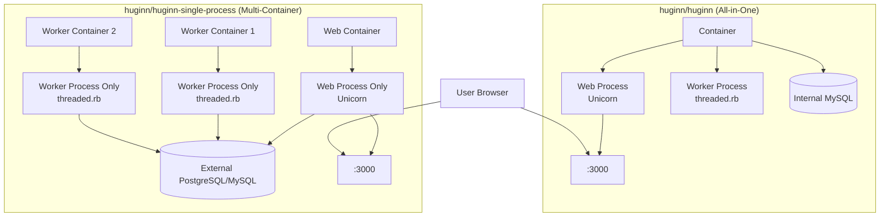
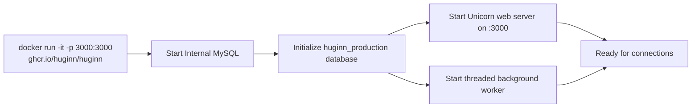
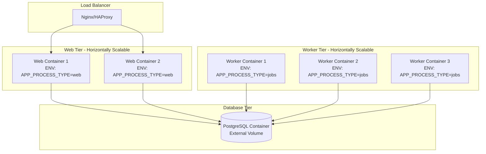
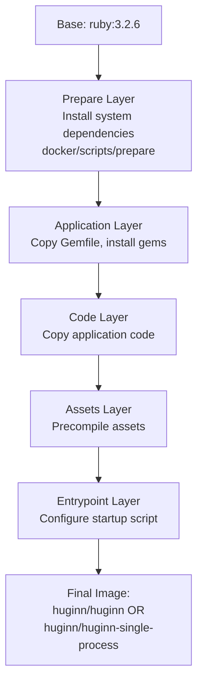
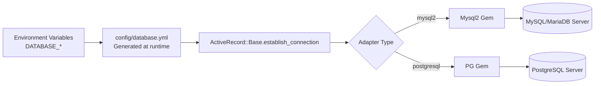
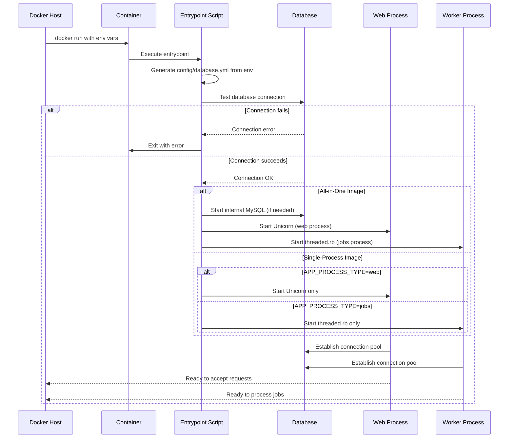

<!-- source: DeepWiki mcp.deepwiki.com · repo huginn/huginn · page 2.1 Docker Deployment · fetched 2026-10-29 -->

# Docker Deployment

<details>
<summary>Relevant source files</summary>

The following files were used as context for generating this wiki page:

- [doc/README.md](doc/README.md)
- [doc/docker/install.md](doc/docker/install.md)
- [doc/heroku/update.md](doc/heroku/update.md)
- [doc/manual/installation.md](doc/manual/installation.md)
- [doc/manual/requirements.md](doc/manual/requirements.md)
- [doc/manual/update.md](doc/manual/update.md)
- [docker/README.md](docker/README.md)
- [docker/scripts/prepare](docker/scripts/prepare)
- [lib/tasks/database_test.rake](lib/tasks/database_test.rake)

</details>


This document covers Docker-based deployment options for Huginn, including single-container (all-in-one) and multi-container architectures. For manual installation on Linux servers, see [Manual Installation](#2.2). For environment variable configuration details, see [Configuration System](#2.3).

## Overview

Huginn provides two Docker image types with different deployment strategies. The all-in-one image packages all processes and an internal MySQL database into a single container for quick evaluation. The single-process image enables production-ready multi-container deployments where web servers and background workers run in separate, independently scalable containers.

**Sources:** [docker/README.md:1-13](), [doc/docker/install.md:1-6]()

## Image Architecture

### All-in-One Image: huginn/huginn

The `huginn/huginn` image runs multiple processes within a single container using process management. When no external database is linked, it starts an internal MySQL instance automatically. This approach simplifies initial deployment but complicates maintenance, backups, and scaling.

**Container Contents:**
- Web server process (Unicorn)
- Background worker process (threaded.rb)
- Internal MySQL database (optional, when not linked externally)
- All application code and dependencies

**Use Cases:**
- Rapid evaluation and testing
- Development environments
- Single-user deployments
- Scenarios where container orchestration is unavailable

**Sources:** [docker/README.md:6-8](), [doc/docker/install.md:9-15]()

### Single-Process Image: huginn/huginn-single-process

The `huginn/huginn-single-process` image runs exactly one process per container, following Docker best practices. This architecture requires at least two containers (web + worker) and an external database. Individual worker processes can be distributed across multiple containers for horizontal scaling.

**Container Process Types:**
- `web`: Runs the Unicorn web server
- `jobs`: Runs the threaded background worker (bin/threaded.rb)

**Use Cases:**
- Production deployments
- High-availability configurations
- Environments requiring independent scaling of web and worker processes
- Container orchestration platforms (Docker Compose, Kubernetes)

**Sources:** [docker/README.md:10-12](), [doc/docker/install.md:20-22]()

## Image Architecture Comparison



**Sources:** [docker/README.md:4-12]()

## Quick Start Evaluation Setup

The fastest way to evaluate Huginn is using the all-in-one image with default settings:

**Basic Command:**
```bash
docker run -it -p 3000:3000 ghcr.io/huginn/huginn
```

**Access:**
- URL: `http://localhost:3000`
- Username: `admin`
- Password: `password`

**Process Flow:**



**Limitations:**
- Data persistence requires volume mounting (not shown in basic command)
- Single point of failure (all processes in one container)
- Difficult to scale workers independently
- Internal MySQL makes backups complex

**Sources:** [doc/docker/install.md:9-15]()

## Production Deployment with External Database

### Environment Variable Configuration

Docker deployments use environment variables instead of the `.env` file used in manual installations. Variables are passed via the `docker run -e` flag or Docker Compose environment sections.

**Critical Configuration Variables:**

| Variable | Purpose | Example Value |
|----------|---------|---------------|
| `DATABASE_ADAPTER` | Database type | `postgresql` or `mysql2` |
| `DATABASE_NAME` | Database name | `huginn_production` |
| `DATABASE_USERNAME` | Database user | `huginn` |
| `DATABASE_PASSWORD` | Database password | (secret) |
| `DATABASE_HOST` | Database hostname | `postgres-container` |
| `DATABASE_PORT` | Database port | `5432` (PostgreSQL) or `3306` (MySQL) |
| `RAILS_ENV` | Rails environment | `production` |
| `APP_SECRET_TOKEN` | Session encryption key | (generated secret) |
| `DOMAIN` | Public hostname | `huginn.example.com` |

**Sources:** [doc/docker/install.md:16-18](), [doc/manual/installation.md:209-242]()

### Single-Container Production Setup

Example using external PostgreSQL:

```bash
docker run -d \
  --name huginn \
  -p 3000:3000 \
  -e DATABASE_ADAPTER=postgresql \
  -e DATABASE_HOST=db.example.com \
  -e DATABASE_NAME=huginn_production \
  -e DATABASE_USERNAME=huginn \
  -e DATABASE_PASSWORD=secret \
  -e RAILS_ENV=production \
  -e APP_SECRET_TOKEN=$(openssl rand -hex 64) \
  -e DOMAIN=huginn.example.com \
  ghcr.io/huginn/huginn
```

**Sources:** [doc/docker/install.md:16-18]()

### Multi-Container Production Architecture

Using `huginn/huginn-single-process` enables horizontal scaling and process isolation:



**Process Type Selection:**

The `APP_PROCESS_TYPE` environment variable determines which process runs in each container:
- `web`: Executes the Unicorn web server (corresponds to `web:` in Procfile)
- `jobs`: Executes the threaded background worker (corresponds to `jobs:` in Procfile)

**Sources:** [docker/README.md:10-12](), [doc/docker/install.md:20-22]()

### Docker Compose Example

**File Structure for Multi-Container Setup:**

```yaml
# Example: docker-compose.yml (conceptual)
services:
  postgres:
    image: postgres:15
    environment:
      POSTGRES_USER: huginn
      POSTGRES_PASSWORD: secret
      POSTGRES_DB: huginn_production
    volumes:
      - postgres-data:/var/lib/postgresql/data
  
  web:
    image: huginn/huginn-single-process
    environment:
      APP_PROCESS_TYPE: web
      DATABASE_ADAPTER: postgresql
      DATABASE_HOST: postgres
      DATABASE_NAME: huginn_production
      DATABASE_USERNAME: huginn
      DATABASE_PASSWORD: secret
      RAILS_ENV: production
    ports:
      - "3000:3000"
    depends_on:
      - postgres
  
  worker:
    image: huginn/huginn-single-process
    environment:
      APP_PROCESS_TYPE: jobs
      DATABASE_ADAPTER: postgresql
      DATABASE_HOST: postgres
      DATABASE_NAME: huginn_production
      DATABASE_USERNAME: huginn
      DATABASE_PASSWORD: secret
      RAILS_ENV: production
    depends_on:
      - postgres

volumes:
  postgres-data:
```

**Scaling Workers:**
```bash
docker-compose up --scale worker=3
```

**Sources:** [docker/README.md:12]()

## Image Build Process

The Docker images are built using multi-stage builds and system preparation scripts.

### Build-Time Dependencies

The `prepare` script installs system packages required for compiling Ruby gems with native extensions:

**Package Categories:**
- **Build Tools:** build-essential, checkinstall, git-core
- **Ruby Dependencies:** zlib1g-dev, libyaml-dev, libssl-dev, libgdbm-dev, libreadline-dev, libncurses5-dev, libffi-dev
- **XML/HTTP:** libxml2-dev, libxslt-dev, libcurl4-openssl-dev
- **Database Clients:** libmysqlclient-dev, libpq-dev, libsqlite3-dev
- **Utilities:** graphviz, shared-mime-info, iputils-ping

**Optimizations:**
- Documentation removal to reduce image size ([docker/scripts/prepare:4-14]())
- Locale generation limited to en_US.UTF-8 ([docker/scripts/prepare:31-32]())
- Python and unnecessary packages purged ([docker/scripts/prepare:36]())
- Latest jq binary downloaded for JqAgent support ([docker/scripts/prepare:46-47]())

**Sources:** [docker/scripts/prepare:1-51]()

### Image Layer Structure



**File Ownership:**
- Application runs as non-root user
- `/app` directory permissions configured ([docker/scripts/prepare:49-50]())
- `/etc/passwd` made group-writable for OpenShift compatibility ([docker/scripts/prepare:50]())

**Sources:** [docker/scripts/prepare:49-51]()

## Process Management in Containers

### Procfile-Based Process Definition

Docker containers execute processes defined in the `Procfile`. The manual installation guide references this same file, but Docker uses it differently:

**Procfile Process Types** (from manual installation context):

```
web: bundle exec unicorn -c config/unicorn.rb
jobs: bundle exec rails runner bin/threaded.rb
```

In Docker:
- **All-in-One Image:** Runs both `web` and `jobs` processes simultaneously using a process supervisor
- **Single-Process Image:** Runs only the process specified by `APP_PROCESS_TYPE` environment variable

**Sources:** [doc/manual/installation.md:286-302]()

### Worker Process: bin/threaded.rb

The background worker executes scheduled agent checks and event propagation. The threaded implementation runs multiple tasks concurrently within a single process.

**Worker Responsibilities:**
- Execute scheduled agents via `AgentCheckJob`
- Process event propagation via `AgentReceiveJob`
- Manage delayed job queue
- Handle agent memory state persistence

**Sources:** [doc/manual/installation.md:295]()

### Web Process: Unicorn

The Unicorn web server handles HTTP requests from users and external webhooks.

**Configuration:**
- Worker count determined by available RAM
- Unix socket communication with reverse proxy (in manual setups)
- Port 3000 exposed in Docker containers

**Sources:** [doc/manual/installation.md:247-252](), [doc/manual/installation.md:299]()

## Database Connectivity

### Database Adapters

Huginn supports two database adapters, selected via `DATABASE_ADAPTER`:

| Adapter | Gem | Use Case |
|---------|-----|----------|
| `mysql2` | mysql2 | MySQL 5.5+, MariaDB |
| `postgresql` | pg | PostgreSQL 9.3+ |

**Adapter Dependencies Installed:**
- `libmysqlclient-dev` for mysql2 gem ([docker/scripts/prepare:29]())
- `libpq-dev` for pg gem ([docker/scripts/prepare:29]())
- `libsqlite3-dev` for development/testing ([docker/scripts/prepare:29]())

**Sources:** [docker/scripts/prepare:29](), [lib/tasks/database_test.rake:1-10]()

### Connection Configuration Flow



**Connection Validation:**

The `database_test:ping` task verifies database connectivity:
- Loads ActiveRecord, mysql2, and pg gems ([lib/tasks/database_test.rake:4-6]())
- Establishes connection ([lib/tasks/database_test.rake:7]())
- Verifies connection alive ([lib/tasks/database_test.rake:8]())

**Sources:** [lib/tasks/database_test.rake:1-10]()

### Database Encoding

**MySQL/MariaDB:**
- Default: `utf8`
- MySQL ≥5.5.3: Use `utf8mb4` for 4-byte UTF-8 characters (emoji support)
- Set via `DATABASE_ENCODING=utf8mb4`

**PostgreSQL:**
- Default: `utf8`
- No special configuration needed

**Sources:** [doc/manual/installation.md:224-228]()

## Container Startup Sequence



**Sources:** [docker/README.md:6-12]()

## Comparison with Manual Installation

| Aspect | Docker Deployment | Manual Installation |
|--------|-------------------|---------------------|
| **Process Management** | Docker/Supervisor | Runit ([doc/manual/installation.md:286-312]()) |
| **Configuration** | Environment variables | `.env` file ([doc/manual/installation.md:189-211]()) |
| **Init System** | Container restart policies | Runit service directory ([doc/manual/installation.md:309]()) |
| **Reverse Proxy** | Optional (direct port exposure) | Nginx required ([doc/manual/installation.md:323-361]()) |
| **Ruby Installation** | Pre-installed in image | Compiled from source ([doc/manual/installation.md:64-79]()) |
| **Database** | Container linking or internal | Local system service ([doc/manual/installation.md:92-175]()) |
| **Updates** | Pull new image | Git pull + bundle install ([doc/update.md:3-120]()) |
| **Logs** | Docker logs commands | Runit log directories ([doc/manual/installation.md:451-461]()) |

**Sources:** [docker/README.md:1-13](), [doc/manual/installation.md:20-489](), [doc/update.md:1-120]()

## Volume Mounting for Data Persistence

Both image types require volume mounting to persist data across container restarts:

**Recommended Volumes:**

| Path in Container | Purpose | Critical |
|-------------------|---------|----------|
| `/var/lib/mysql` | Internal MySQL data (all-in-one only) | Yes |
| `/app/log` | Application logs | No |
| `/app/tmp` | Temporary files, job queues | No |

**Note:** When using external databases, only log and tmp volumes are relevant. Database persistence is handled by the database container's own volumes.

**Sources:** [docker/README.md:8]()

## Troubleshooting Docker Deployments

### Common Issues

**Database Connection Failures:**
- Verify `DATABASE_HOST` resolves correctly from within container
- Check `DATABASE_PORT` matches database server configuration
- Ensure database user has correct permissions
- For Docker Compose, verify service names match `DATABASE_HOST`

**Process Not Starting:**
- Check Docker logs: `docker logs <container_name>`
- For single-process image, verify `APP_PROCESS_TYPE` is set to `web` or `jobs`
- Ensure `RAILS_ENV=production` is set

**Assets Not Loading:**
- Assets are precompiled during image build
- Rebuilding container may be required after pulling new image
- Check for JavaScript console errors indicating missing asset paths

**Sources:** [doc/manual/installation.md:411-465]()

### Log Access

**Docker Logs Command:**
```bash
# View all logs
docker logs huginn

# Follow logs in real-time
docker logs -f huginn

# Last 100 lines
docker logs --tail 100 huginn
```

**Log Files Inside Container:**
- Application log: `/app/log/production.log`
- Unicorn log: `/app/log/unicorn.log`
- Worker logs: Visible in `docker logs` output

**Sources:** [doc/manual/installation.md:432-461]()

## Migration from Manual Installation

To migrate from a manual installation to Docker:

1. **Backup Database:**
   - Export database using `mysqldump` or `pg_dump`
   
2. **Start Database Container:**
   - Import database dump into containerized database

3. **Configure Environment Variables:**
   - Transfer settings from `.env` file to Docker environment variables
   - Update `DATABASE_HOST` to point to database container

4. **Start Application Container:**
   - Use `huginn/huginn-single-process` for production deployments
   - Deploy separate web and worker containers

5. **Update DNS/Reverse Proxy:**
   - Point to new container port or load balancer

**Sources:** [doc/manual/installation.md:176-282]()

---

