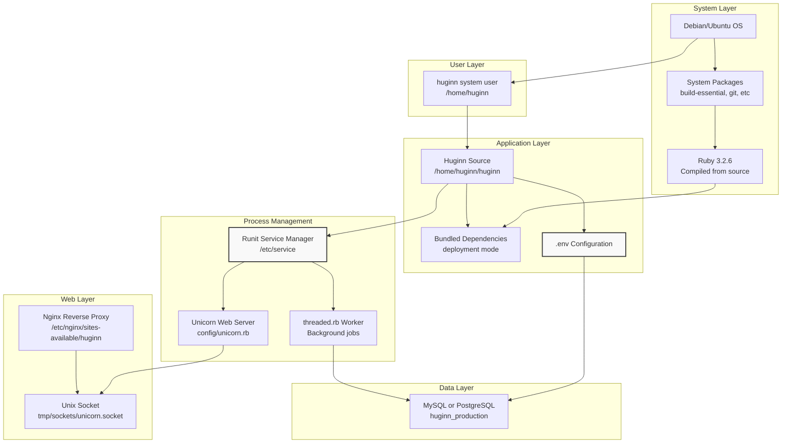
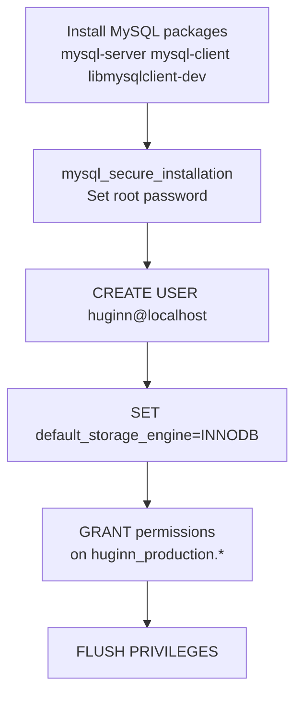
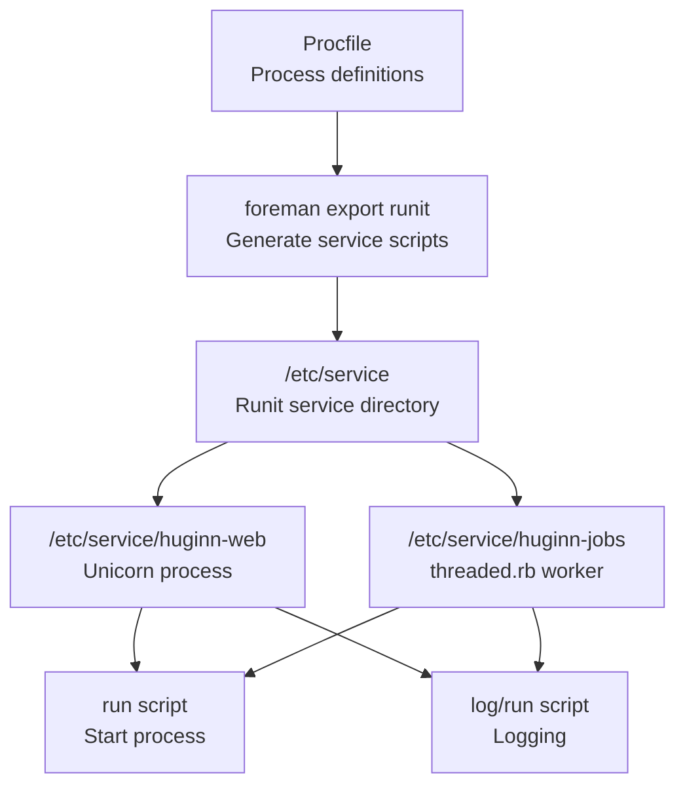
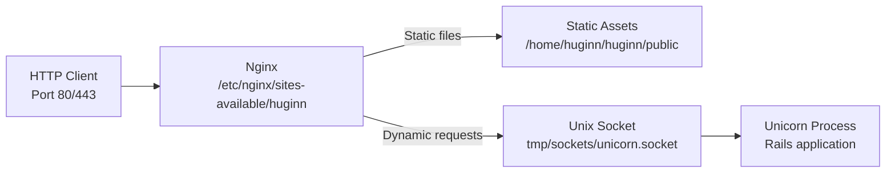
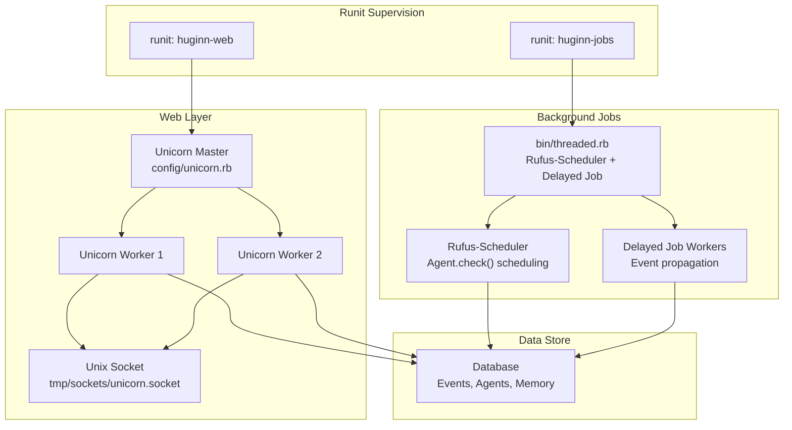

<!-- source: DeepWiki mcp.deepwiki.com · repo huginn/huginn · page 2.2 Manual Installation · fetched 2026-10-29 -->

# Manual Installation

<details>
<summary>Relevant source files</summary>

The following files were used as context for generating this wiki page:

- [.dockerignore](.dockerignore)
- [README.md](README.md)
- [config/database.yml](config/database.yml)
- [doc/README.md](doc/README.md)
- [doc/docker/install.md](doc/docker/install.md)
- [doc/heroku/update.md](doc/heroku/update.md)
- [doc/manual/installation.md](doc/manual/installation.md)
- [doc/manual/requirements.md](doc/manual/requirements.md)
- [doc/manual/update.md](doc/manual/update.md)
- [docker/scripts/prepare](docker/scripts/prepare)

</details>


This page provides detailed instructions for installing Huginn manually on Debian/Ubuntu systems. Manual installation gives you maximum control over the deployment and is recommended for production environments where you need fine-grained configuration.

For containerized deployments, see [Docker Deployment](#2.1). For configuration details after installation, see [Configuration System](#2.3).

## Overview

Manual installation involves setting up a complete Ruby application stack with the following components:



**Sources:** [doc/manual/installation.md:20-30](), [README.md:131-133]()

## Prerequisites and System Requirements

Manual installation is supported on:
- **Ubuntu:** 18.04, 16.04, 14.04
- **Debian:** Stretch, Jessie, Bullseye

### Hardware Requirements

| Component | Minimum | Recommended |
|-----------|---------|-------------|
| CPU | Single core | Dual core |
| RAM | 512MB | 2GB |
| Swap | 512MB | 1GB |
| Disk | 2GB | 5GB |

The system requires a Unix-based operating system. Windows is not supported.

**Sources:** [doc/manual/requirements.md:1-27](), [doc/manual/requirements.md:34-52]()

## Installation Process

### Step 1: System Packages and Dependencies

Update the system and install `sudo`:

```bash
# Run as root
apt-get update -y
apt-get upgrade -y
apt-get install sudo -y
```

Install required build dependencies and runtime packages:

```bash
sudo apt-get install -y runit build-essential git zlib1g-dev libyaml-dev \
  libssl-dev libgdbm-dev libreadline-dev libncurses5-dev libffi-dev curl \
  openssh-server checkinstall libxml2-dev libxslt-dev libcurl4-openssl-dev \
  libicu-dev logrotate pkg-config cmake nodejs graphviz jq shared-mime-info
```

**Platform-specific adjustments:**

For **Debian Stretch** (requires OpenSSL 1.0 and runit-systemd):
```bash
sudo apt-get install -y runit-systemd libssl1.0-dev
```

For **Ubuntu 18.04 Bionic** (requires runit-systemd):
```bash
sudo apt-get install -y runit-systemd
```

These packages provide:
- **Build tools:** `build-essential`, `cmake` for compiling Ruby and native gems
- **Ruby dependencies:** `zlib1g-dev`, `libyaml-dev`, `libssl-dev`, `libreadline-dev`
- **XML/HTML processing:** `libxml2-dev`, `libxslt-dev` (for Nokogiri)
- **Process management:** `runit`, `runit-systemd`
- **Utilities:** `jq` (for JqAgent), `graphviz` (for diagrams), `nodejs` (asset pipeline)

**Sources:** [doc/manual/installation.md:31-62](), [docker/scripts/prepare:26-30]()

### Step 2: Ruby Installation from Source

Huginn requires Ruby 3.2.6 compiled from source. Using system Ruby version managers (RVM, rbenv, chruby) is not recommended for production as it leads to permission and path issues.


**Installation commands:**

```bash
# Remove old Ruby versions
sudo apt-get remove -y ruby1.8 ruby1.9

# Download and compile Ruby 3.2.6
mkdir /tmp/ruby && cd /tmp/ruby
curl -L --progress-bar https://cache.ruby-lang.org/pub/ruby/3.2/ruby-3.2.6.tar.xz | tar xJ
cd ruby-3.2.6
./configure --disable-install-rdoc
make -j`nproc`
sudo make install

# Install foreman for process management
sudo gem install foreman --no-document
```

The `--disable-install-rdoc` flag skips documentation generation, reducing installation time. The `-j$(nproc)` flag enables parallel compilation using all available CPU cores.

**Sources:** [doc/manual/installation.md:64-83](), [doc/manual/update.md:54-71]()

### Step 3: System User Creation

Create a dedicated `huginn` user without login capability:

```bash
sudo adduser --disabled-login --gecos 'Huginn' huginn
```

This creates:
- User: `huginn`
- Home directory: `/home/huginn`
- No password (login disabled)

All Huginn processes will run as this unprivileged user for security.

**Sources:** [doc/manual/installation.md:85-89]()

### Step 4: Database Setup

Huginn supports both MySQL/MariaDB and PostgreSQL. Choose one based on your requirements.

#### MySQL/MariaDB Installation



**Installation commands:**

```bash
# Install packages (Debian Stretch: use default-libmysqlclient-dev)
sudo apt-get install -y mysql-server mysql-client libmysqlclient-dev

# For Debian Bullseye
sudo apt-get install -y default-mysql-server default-mysql-client default-libmysqlclient-dev

# Secure installation
sudo mysql_secure_installation

# Login to MySQL
mysql -u root -p
```

**Database configuration (in MySQL shell):**

```sql
-- Create huginn user
CREATE USER 'huginn'@'localhost' IDENTIFIED BY 'your_password';

-- Ensure InnoDB engine is available
SET default_storage_engine=INNODB;

-- Grant permissions
GRANT SELECT, INSERT, UPDATE, DELETE, CREATE, DROP, INDEX, ALTER, LOCK TABLES 
  ON `huginn_production`.* TO 'huginn'@'localhost';

-- Apply changes
FLUSH PRIVILEGES;
```

Test the connection:
```bash
sudo -u huginn -H mysql -u huginn -p -D huginn_production
# Should see: ERROR 1049 (42000): Unknown database 'huginn_production'
# This is expected - the database will be created later
```

**Ubuntu-specific note:** On Ubuntu systems (>= 5.7.26), MySQL uses the `auth_socket` plugin by default. To set a password for the root user:

```sql
ALTER USER 'root'@'localhost' IDENTIFIED WITH mysql_native_password BY 'new-password';
```

**Sources:** [doc/manual/installation.md:91-152](), [doc/manual/installation.md:473-488]()

#### PostgreSQL Installation

```bash
# Install packages
sudo apt-get install -y postgresql libpq-dev

# Create user with password (-d allows database creation)
sudo -u postgres -H createuser -P huginn

# Create database
sudo -u postgres -H createdb -O huginn -T template0 huginn_production

# Test connection
sudo -u huginn psql -h localhost -W huginn_production
```

**Sources:** [doc/manual/installation.md:154-174]()

### Step 5: Huginn Application Setup

#### Clone the Repository

```bash
cd /home/huginn
sudo -u huginn -H git clone https://github.com/huginn/huginn.git -b master huginn
cd /home/huginn/huginn
```

#### Initialize Directory Structure

```bash
# Copy configuration template
sudo -u huginn -H cp .env.example .env

# Create required directories
sudo -u huginn mkdir -p log tmp/pids tmp/sockets

# Set permissions
sudo chown -R huginn log/ tmp/
sudo chmod -R u+rwX,go-w log/ tmp/
sudo -u huginn -H chmod o-rwx .env

# Copy Unicorn configuration
sudo -u huginn -H cp config/unicorn.rb.example config/unicorn.rb
```

**Sources:** [doc/manual/installation.md:176-206]()

#### Configure .env File

Edit `/home/huginn/huginn/.env` to configure the application:

```bash
sudo -u huginn -H editor .env
```

**MySQL configuration:**

```bash
DATABASE_ADAPTER=mysql2
DATABASE_RECONNECT=true
DATABASE_NAME=huginn_production
DATABASE_POOL=20
DATABASE_USERNAME=huginn
DATABASE_PASSWORD='your_password'

DATABASE_ENCODING=utf8
# For MySQL >= 5.5.3, use utf8mb4 for emoji support
# DATABASE_ENCODING=utf8mb4
```

**PostgreSQL configuration:**

```bash
DATABASE_ADAPTER=postgresql
DATABASE_RECONNECT=true
DATABASE_NAME=huginn_production
DATABASE_POOL=20
DATABASE_USERNAME=huginn
DATABASE_PASSWORD='your_password'
DATABASE_HOST=localhost
DATABASE_PORT=5432

DATABASE_ENCODING=utf8
```

**Critical settings:**

```bash
# Enable production environment
RAILS_ENV=production

# Generate secure token (required)
APP_SECRET_TOKEN=<generate_with_rake_secret>
```

The `.env` file maps to [config/database.yml:30-41]() for database configuration and provides environment variables for the entire application.

**Sources:** [doc/manual/installation.md:207-255](), [config/database.yml:30-41](), [README.md:65-66]()

#### Install Dependencies

```bash
sudo -u huginn -H bundle install --deployment --without development test
```

The `--deployment` flag installs gems to `vendor/bundle` and the `--without` flag excludes test and development dependencies.

**Sources:** [doc/manual/installation.md:261-263]()

#### Initialize Database

```bash
# Create the database
sudo -u huginn -H bundle exec rake db:create RAILS_ENV=production

# Run migrations
sudo -u huginn -H bundle exec rake db:migrate RAILS_ENV=production

# Seed with default admin user
sudo -u huginn -H bundle exec rake db:seed RAILS_ENV=production \
  SEED_USERNAME=admin SEED_PASSWORD=password
```

The seed task creates:
- Default admin user (username: `admin`, password: `password`)
- Example agents demonstrating capabilities
- Initial database schema

**Warning:** Change the default password after first login.

**Sources:** [doc/manual/installation.md:265-278]()

#### Precompile Assets

```bash
sudo -u huginn -H bundle exec rake assets:precompile RAILS_ENV=production
```

This compiles JavaScript, CSS, and other assets for production serving.

**Sources:** [doc/manual/installation.md:280-282]()

### Step 6: Process Management with Runit

Huginn uses `foreman` to generate `runit` service scripts from a `Procfile`.



#### Edit Procfile

The `Procfile` defines which processes to run. Edit `/home/huginn/huginn/Procfile`:

```bash
sudo -u huginn -H editor Procfile
```

**For production, disable development entries** ([Procfile:6-7]()):
```
# web: bundle exec rails server -p ${PORT-3000} -b ${IP-0.0.0.0}
# jobs: bundle exec rails runner bin/threaded.rb
```

**Enable production entries** ([Procfile:24-25]() or [Procfile:28-31]()):
```
web: bundle exec unicorn -c config/unicorn.rb
jobs: bundle exec rails runner bin/threaded.rb
```

#### Export Runit Services

```bash
sudo bundle exec rake production:export
```

This generates service scripts in `/etc/service/huginn-{web,jobs}/` that `runit` automatically manages.

**Note:** Re-export whenever you modify `.env`, `Procfile`, or `config/unicorn.rb`.

**Sources:** [doc/manual/installation.md:284-311](), [doc/manual/installation.md:259]()

#### Verify Service Status

```bash
sudo bundle exec rake production:status
```

**Sources:** [doc/manual/installation.md:319-321]()

### Step 7: Nginx Reverse Proxy

Nginx serves as the reverse proxy and static asset server for Huginn.



#### Install Nginx

```bash
sudo apt-get install -y nginx
```

#### Configure Site

```bash
# Copy configuration template
sudo cp deployment/nginx/huginn /etc/nginx/sites-available/huginn
sudo ln -s /etc/nginx/sites-available/huginn /etc/nginx/sites-enabled/huginn

# Edit configuration
sudo editor /etc/nginx/sites-available/huginn
```

Key configuration points in the Nginx config:
- **upstream huginn:** Points to `unix:/home/huginn/huginn/tmp/sockets/unicorn.socket`
- **root:** Set to `/home/huginn/huginn/public` for static assets
- **server_name:** Replace `YOUR_SERVER_FQDN` with your domain
- **proxy_pass:** Routes dynamic requests to Unicorn via socket

**For HTTPS:** Use `deployment/nginx/huginn-ssl` instead and configure SSL certificates. See [Using HTTPS](#https-configuration).

#### Remove Default Site (Optional)

```bash
# Only if Huginn is the sole site
sudo rm /etc/nginx/sites-enabled/default
```

#### Test and Restart

```bash
# Validate configuration
sudo nginx -t

# Restart Nginx
sudo service nginx restart
```

**Sources:** [doc/manual/installation.md:323-360]()

### Step 8: Logrotate Configuration

Set up log rotation to prevent disk space issues:

```bash
sudo cp deployment/logrotate/huginn /etc/logrotate.d/huginn
```

Modify if using a non-default log directory.

**Sources:** [doc/manual/installation.md:313-317]()

## Process Architecture



The `threaded.rb` worker ([bin/threaded.rb]()) combines:
- **Rufus-Scheduler:** Triggers `Agent.check()` on scheduled agents
- **Delayed Job:** Processes background jobs (event propagation, long-running tasks)

Unicorn workers handle HTTP requests from Nginx via Unix socket. The number of Unicorn workers is configured in [config/unicorn.rb]() and should match CPU cores (recommended 2 for most systems).

**Sources:** [doc/manual/installation.md:284-311](), [doc/manual/requirements.md:53-69]()

## HTTPS Configuration

For production deployments, enable HTTPS:

**In `.env`:**
```bash
FORCE_SSL=true
```

**Use SSL Nginx config:**
```bash
sudo cp deployment/nginx/huginn-ssl /etc/nginx/sites-available/huginn
sudo editor /etc/nginx/sites-available/huginn
```

Configure:
- `YOUR_SERVER_FQDN`: Your domain name
- `ssl_certificate`: Path to certificate file
- `ssl_certificate_key`: Path to private key

**Self-signed certificate (development only):**
```bash
sudo mkdir -p /etc/nginx/ssl/
cd /etc/nginx/ssl/
sudo openssl req -newkey rsa:2048 -x509 -nodes -days 3560 -out huginn.crt -keyout huginn.key
sudo chmod o-r huginn.key
```

Re-export services after changing `.env`:
```bash
cd /home/huginn/huginn
sudo service nginx restart
sudo bundle exec rake production:export
```

**Sources:** [doc/manual/installation.md:382-409]()

## Post-Installation

### Initial Login

Access your Huginn instance at `http://YOUR_SERVER` (or `https://` if configured).

Default credentials:
- **Username:** `admin` (or `SEED_USERNAME` value)
- **Password:** `password` (or `SEED_PASSWORD` value)

**Important:** Change the default password immediately via the web interface.

### Managing Services

```bash
# Check status
cd /home/huginn/huginn && sudo bundle exec rake production:status

# Start services
cd /home/huginn/huginn && sudo bundle exec rake production:start

# Stop services
cd /home/huginn/huginn && sudo bundle exec rake production:stop

# Force stop (if stuck)
cd /home/huginn/huginn && sudo bundle exec rake production:force_stop
```

### Verify Installation

```bash
cd /home/huginn/huginn
sudo bundle exec rake production:check
```

This validates:
- Database connectivity
- Required directories and permissions
- Service status
- Configuration validity

**Sources:** [doc/manual/installation.md:363-377](), [doc/manual/update.md:5-10]()

## Troubleshooting

### Log File Locations

| Log File | Purpose |
|----------|---------|
| `/var/log/nginx/huginn_error.log` | Nginx errors |
| `/home/huginn/huginn/log/unicorn.log` | Unicorn HTTP requests |
| `/home/huginn/huginn/log/production.log` | Rails application log |
| `/home/huginn/huginn/log/*/current` | Runit service logs (web, jobs) |

### Common Issues

**Nginx 502 Bad Gateway:**
- Symptom: `connect() to unix:/home/huginn/huginn/tmp/sockets/unicorn.socket failed`
- Cause: Unicorn not running
- Solution: Check `Procfile` has uncommented `web:` line and re-export: `sudo bundle exec rake production:export`

**Permission Denied:**
- Symptom: `failed (13: Permission denied)` in Nginx logs
- Cause: Nginx cannot read `/home/huginn/huginn/public`
- Solution: Ensure `/home/huginn/huginn/public` is readable by `www-data` user

**Database Connection Errors:**
- Symptom: `Can't connect to MySQL server` or `could not connect to server`
- Cause: Wrong credentials in `.env` or database not running
- Solution: Verify `.env` credentials match database user, ensure database service is running

### Monitoring Logs

Monitor all background worker logs:
```bash
tail -f /home/huginn/huginn/log/*/current
```

List available log files:
```bash
ls -al /home/huginn/huginn/log/*/current
```

**Sources:** [doc/manual/installation.md:411-465]()

## Updating an Installation

To update an existing manual installation:

```bash
cd /home/huginn/huginn

# Stop services
sudo bundle exec rake production:stop

# Backup configuration
sudo -u huginn -H cp Procfile Procfile.bak

# Update code
sudo -u huginn -H git fetch --all
sudo -u huginn -H git checkout master
sudo -u huginn -H git pull

# Restore configuration
sudo -u huginn -H cp Procfile.bak Procfile

# Update dependencies
sudo -u huginn -H bundle install --deployment --without development test

# Migrate database
sudo -u huginn -H bundle exec rake db:migrate RAILS_ENV=production

# Precompile assets
sudo -u huginn -H bundle exec rake assets:clean assets:precompile tmp:cache:clear RAILS_ENV=production

# Re-export services (if .env or Procfile changed)
sudo bundle exec rake production:export

# Services will auto-start via runit
```

For Capistrano-based deployments, see [Capistrano documentation](https://github.com/huginn/huginn/blob/master/doc/manual/capistrano.md).

**Sources:** [doc/manual/update.md:1-120](), [README.md:376]()

## Security Recommendations

After installation:

1. **Change default password** immediately after first login
2. **Configure firewall** (ufw on Ubuntu/Debian):
   ```bash
   sudo apt-get install -y ufw
   sudo ufw allow 22/tcp  # SSH
   sudo ufw allow 80/tcp  # HTTP
   sudo ufw allow 443/tcp # HTTPS
   sudo ufw enable
   ```
3. **Enable HTTPS** for production deployments
4. **Regular updates:** Monitor the Huginn repository for security updates
5. **Backup strategy:** Regular backups of database and `.env` configuration

**Sources:** [doc/manual/installation.md:378]()

---

