<!-- source: DeepWiki mcp.deepwiki.com · repo huginn/huginn · page 2.3 Configuration System · fetched 2026-10-29 -->

# Configuration System

<details>
<summary>Relevant source files</summary>

The following files were used as context for generating this wiki page:

- [.dockerignore](.dockerignore)
- [.env.example](.env.example)
- [README.md](README.md)
- [bin/setup](bin/setup)
- [config/application.rb](config/application.rb)
- [config/boot.rb](config/boot.rb)
- [config/database.yml](config/database.yml)
- [config/environment.rb](config/environment.rb)
- [config/environments/development.rb](config/environments/development.rb)
- [config/environments/production.rb](config/environments/production.rb)
- [config/environments/test.rb](config/environments/test.rb)
- [config/initializers/wrap_parameters.rb](config/initializers/wrap_parameters.rb)
- [config/spring.rb](config/spring.rb)

</details>


## Purpose and Scope

This document explains Huginn's configuration system, covering environment variables, the `.env` file structure, database configuration, and Rails environment settings. The configuration system controls application behavior, security settings, external integrations, and deployment-specific parameters.

For information about deploying Huginn with different configuration strategies, see [Docker Deployment](#2.1) and [Manual Installation](#2.2). For dependency management and gem configuration, see [Dependency Management](#7.1).

---

## Configuration Hierarchy

Huginn's configuration system operates in three layers: environment variables, Rails application configuration, and environment-specific overrides.

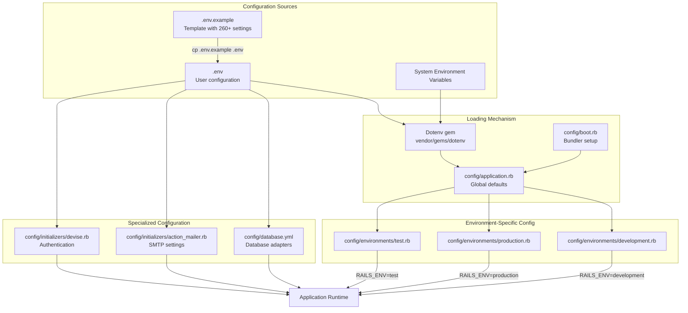

**Sources:** [.env.example:1-267](), [config/application.rb:1-71](), [config/boot.rb:1-7](), [config/environments/production.rb:1-150]()

---

## Environment Variables (.env File)

The `.env` file is the primary configuration mechanism. Users copy `.env.example` to `.env` and customize settings for their deployment.

### Critical Required Settings

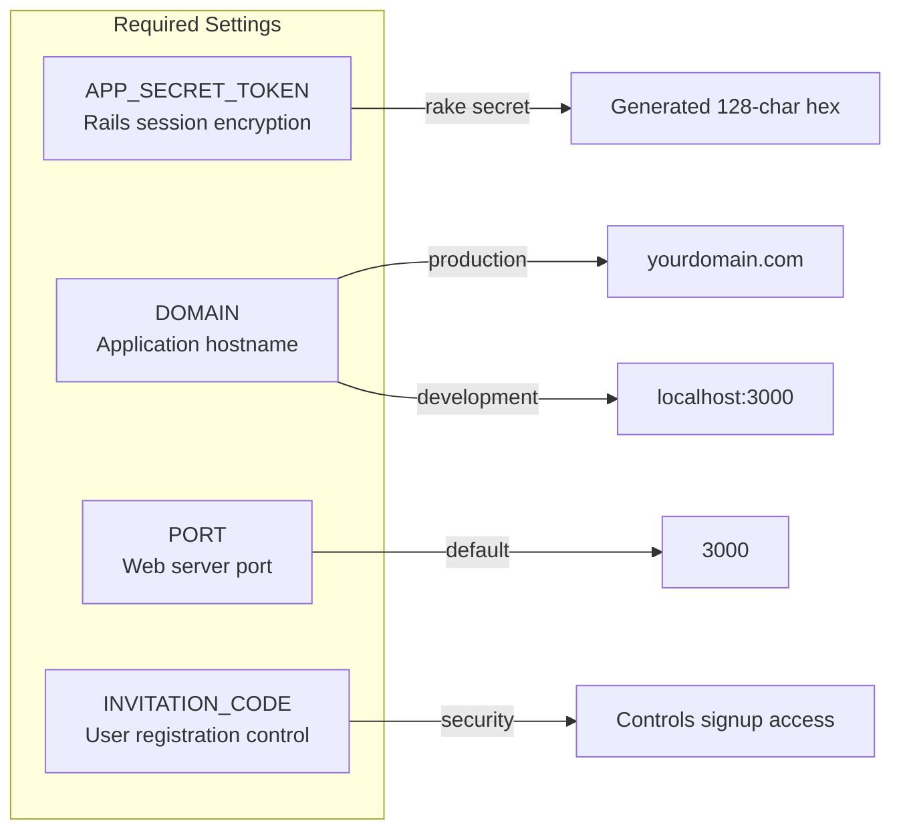

| Variable | Purpose | Default | Required |
|----------|---------|---------|----------|
| `APP_SECRET_TOKEN` | Rails session encryption key | N/A | Yes |
| `DOMAIN` | Application domain/hostname | `localhost:3000` | Yes |
| `PORT` | Web server port | `3000` | Yes |
| `INVITATION_CODE` | Required code for user signup | `try-huginn` | Yes |

**Sources:** [.env.example:3-10](), [.env.example:47-49]()

### Database Configuration

Database settings control which adapter is used and connection parameters:

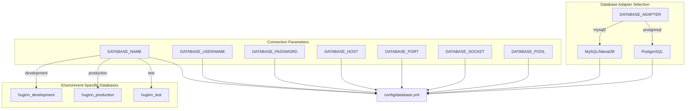

| Variable | Purpose | Default | Notes |
|----------|---------|---------|-------|
| `DATABASE_ADAPTER` | Database type | `mysql2` | Options: `mysql2`, `postgresql` |
| `DATABASE_ENCODING` | Character encoding | `utf8` | Use `utf8mb4` for MySQL ≥5.5.3 (emoji support) |
| `DATABASE_RECONNECT` | Auto-reconnect on connection loss | `true` | Boolean |
| `DATABASE_NAME` | Database name | `huginn_development` | Environment-specific |
| `DATABASE_POOL` | Connection pool size | `20` | Integer |
| `DATABASE_USERNAME` | Database user | `root` | Required for authentication |
| `DATABASE_PASSWORD` | Database password | `""` | Empty string for no password |
| `DATABASE_HOST` | Database host | `""` | Empty for socket connection |
| `DATABASE_PORT` | Database port | `""` | Empty uses default (3306/5432) |
| `DATABASE_SOCKET` | Unix socket path | Auto-detected | Used when host is empty |

The `config/database.yml` file uses ERB to interpolate these environment variables for each Rails environment:

**Sources:** [.env.example:15-34](), [config/database.yml:1-42]()

### Security and Feature Flags

Security-related settings control dangerous functionality and authentication parameters:

| Variable | Purpose | Default | Security Impact |
|----------|---------|---------|-----------------|
| `ENABLE_INSECURE_AGENTS` | Allow ShellCommandAgent and similar | `false` | **HIGH**: Enables arbitrary code execution |
| `ENABLE_SECOND_PRECISION_SCHEDULE` | Allow second-level scheduling | `false` | **MEDIUM**: May cause resource abuse |
| `FORCE_SSL` | Require HTTPS for all requests | `false` | **HIGH**: Should be `true` in production |
| `SKIP_INVITATION_CODE` | Allow signup without invitation | `false` | **MEDIUM**: Opens registration |
| `REQUIRE_CONFIRMED_EMAIL` | Require email verification | `false` | **MEDIUM**: Email-based security |
| `LOCK_STRATEGY` | Account locking strategy | `failed_attempts` | Options: `failed_attempts`, `none` |
| `MAX_FAILED_LOGIN_ATTEMPTS` | Failed logins before lock | `10` | Integer |
| `UNLOCK_STRATEGY` | Unlock mechanism | `both` | Options: `email`, `time`, `both`, `none` |

**Sources:** [.env.example:210-218](), [.env.example:40-82]()

### Email Configuration (SMTP)

Email delivery is configured through SMTP settings:

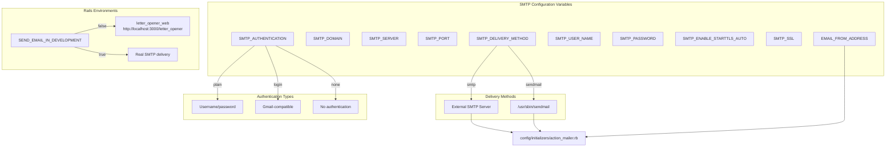

| Variable | Purpose | Example |
|----------|---------|---------|
| `SMTP_DELIVERY_METHOD` | Delivery mechanism | `smtp` (or `sendmail`) |
| `SMTP_DOMAIN` | SMTP domain | `your-domain-here.com` |
| `SMTP_SERVER` | SMTP server hostname | `smtp.gmail.com` |
| `SMTP_PORT` | SMTP port | `587` (TLS) or `465` (SSL) |
| `SMTP_ENABLE_STARTTLS_AUTO` | Enable STARTTLS | `true` |
| `SMTP_SSL` | Use SSL/TLS | `false` (use STARTTLS instead) |
| `SMTP_AUTHENTICATION` | Auth method | `plain`, `login`, or `none` |
| `SMTP_USER_NAME` | SMTP username | `you@gmail.com` |
| `SMTP_PASSWORD` | SMTP password | (sensitive) |
| `EMAIL_FROM_ADDRESS` | From address in emails | `from_address@gmail.com` |
| `SEND_EMAIL_IN_DEVELOPMENT` | Send real emails in dev | `false` |

**Sources:** [.env.example:91-129](), [config/environments/development.rb:76-85](), [config/environments/production.rb:89-98]()

### OAuth Credentials

OAuth integrations require API keys from external services:

| Variable | Service | Purpose |
|----------|---------|---------|
| `TWITTER_OAUTH_KEY` | Twitter | TwitterUserAgent, TwitterStreamAgent |
| `TWITTER_OAUTH_SECRET` | Twitter | TwitterUserAgent, TwitterStreamAgent |
| `GITHUB_OAUTH_KEY` | GitHub | GitHub authentication |
| `GITHUB_OAUTH_SECRET` | GitHub | GitHub authentication |
| `TUMBLR_OAUTH_KEY` | Tumblr | TumblrPublishAgent |
| `TUMBLR_OAUTH_SECRET` | Tumblr | TumblrPublishAgent |
| `DROPBOX_OAUTH_KEY` | Dropbox | DropboxWatchAgent, DropboxFileUrlAgent |
| `DROPBOX_OAUTH_SECRET` | Dropbox | DropboxWatchAgent, DropboxFileUrlAgent |
| `EVERNOTE_OAUTH_KEY` | Evernote | EvernoteAgent |
| `EVERNOTE_OAUTH_SECRET` | Evernote | EvernoteAgent |
| `USE_EVERNOTE_SANDBOX` | Evernote | Use sandbox environment (dev) |
| `GOOGLE_CLIENT_ID` | Google | Various Google service agents |
| `GOOGLE_CLIENT_SECRET` | Google | Various Google service agents |
| `THIRTY_SEVEN_SIGNALS_OAUTH_KEY` | Basecamp | BasecampAgent |
| `THIRTY_SEVEN_SIGNALS_OAUTH_SECRET` | Basecamp | BasecampAgent |

**Sources:** [.env.example:138-165]()

### Agent and System Behavior

Configuration variables that control agent behavior and system performance:

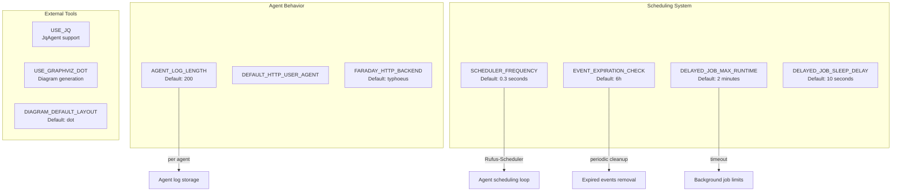

| Variable | Purpose | Default | Notes |
|----------|---------|---------|-------|
| `AGENT_LOG_LENGTH` | Lines of logs per agent | `200` | Integer |
| `DEFAULT_HTTP_USER_AGENT` | Default User-Agent header | `Huginn - https://...` | String |
| `FARADAY_HTTP_BACKEND` | HTTP library for agents | `typhoeus` | Options: `typhoeus`, `net_http`, `em_http` |
| `SCHEDULER_FREQUENCY` | Scheduler check interval | `0.3` | Seconds (float) |
| `EVENT_EXPIRATION_CHECK` | Event cleanup frequency | `6h` | Time format: `m`, `h`, `d` |
| `DELAYED_JOB_MAX_RUNTIME` | Max background job runtime | `2` | Minutes (integer) |
| `DELAYED_JOB_SLEEP_DELAY` | Job queue polling interval | `10` | Seconds (integer) |
| `FAILED_JOBS_TO_KEEP` | Failed job history size | `100` | Integer |
| `TIMEZONE` | Application timezone | `Pacific Time (US & Canada)` | Rails timezone name |
| `USE_JQ` | Enable JqAgent | (unset) | Path to `jq` binary or `jq` |
| `USE_GRAPHVIZ_DOT` | Use Graphviz for diagrams | (unset) | Path to `dot` binary |
| `DIAGRAM_DEFAULT_LAYOUT` | Graphviz layout algorithm | `dot` | Options: `dot`, `neato`, `circo`, etc. |

**Sources:** [.env.example:132-258]()

### User Registration and Authentication

Devise-based authentication settings:

| Variable | Purpose | Default | Type |
|----------|---------|---------|------|
| `INVITATION_CODE` | Required signup code | `try-huginn` | String |
| `SKIP_INVITATION_CODE` | Bypass invitation requirement | `false` | Boolean |
| `REQUIRE_CONFIRMED_EMAIL` | Require email confirmation | `false` | Boolean |
| `ALLOW_UNCONFIRMED_ACCESS_FOR` | Grace period for confirmation | `2.days` | Duration |
| `CONFIRM_WITHIN` | Confirmation token validity | `3.days` | Duration |
| `MIN_PASSWORD_LENGTH` | Minimum password length | `8` | Integer |
| `RESET_PASSWORD_WITHIN` | Password reset token validity | `6.hours` | Duration |
| `REMEMBER_FOR` | "Remember me" duration | `4.weeks` | Duration |
| `UNLOCK_AFTER` | Auto-unlock duration | `1.hour` | Duration |
| `IMPORT_DEFAULT_SCENARIO_FOR_ALL_USERS` | Create default agents | `true` | Boolean |
| `DEFAULT_SCENARIO_FILE` | Custom scenario template | (unset) | Path or URL |

**Sources:** [.env.example:43-90]()

### AWS and Mechanical Turk

Amazon Web Services configuration for the HumanTaskAgent:

| Variable | Purpose | Example |
|----------|---------|---------|
| `AWS_ACCESS_KEY_ID` | AWS access key ID | `your aws access key id` |
| `AWS_ACCESS_KEY` | AWS secret key | `your aws access key` |
| `AWS_SANDBOX` | Use MTurk sandbox | `false` (true for development) |

**Sources:** [.env.example:166-176]()

---

## Rails Application Configuration

The `config/application.rb` file sets global defaults that apply to all environments:

### Global Configuration Options

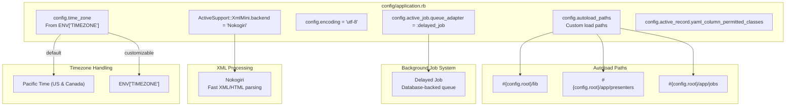

**Key Settings:**

- **Autoload Paths** [config/application.rb:33](): Adds `lib/`, `app/presenters/`, and `app/jobs/` to the autoload path
- **Timezone** [config/application.rb:40](): Uses `ENV['TIMEZONE']` with fallback to Pacific Time
- **Encoding** [config/application.rb:47](): Forces UTF-8 encoding throughout
- **Background Jobs** [config/application.rb:57](): Uses Delayed Job with database persistence
- **XML Backend** [config/application.rb:68](): Uses Nokogiri for XML processing
- **YAML Security** [config/application.rb:64-66](): Permits Symbol, Date, and Time classes in YAML columns

**Sources:** [config/application.rb:20-71]()

---

## Environment-Specific Configuration

Rails uses environment-specific configuration files that override global settings:

### Development Environment

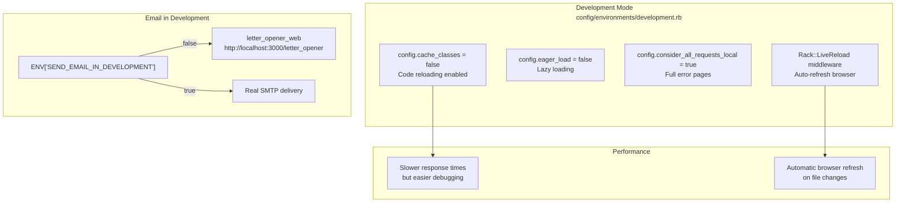

**Key Features:**

- Code reloading on every request [config/environments/development.rb:15]()
- Full error reports with stack traces [config/environments/development.rb:21]()
- Email interception via letter_opener_web unless `SEND_EMAIL_IN_DEVELOPMENT=true` [config/environments/development.rb:79-83]()
- Rack::LiveReload for automatic browser refresh [config/environments/development.rb:13]()
- Asset debugging enabled [config/environments/development.rb:71]()

**Sources:** [config/environments/development.rb:1-91]()

### Production Environment

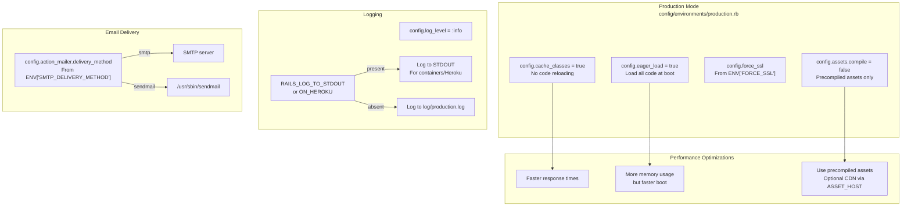

**Key Features:**

- Code caching enabled for performance [config/environments/production.rb:7]()
- Eager loading of all code at boot [config/environments/production.rb:13]()
- SSL enforcement controlled by `ENV['FORCE_SSL']` [config/environments/production.rb:65]()
- Stdout logging detection for Heroku/containers [config/environments/production.rb:32-40]()
- Asset host support via `ENV['ASSET_HOST']` [config/environments/production.rb:82-84]()
- SMTP delivery method from `ENV['SMTP_DELIVERY_METHOD']` [config/environments/production.rb:96]()

**Sources:** [config/environments/production.rb:1-150]()

### Test Environment

The test environment is used exclusively for RSpec tests:

**Key Features:**

- No code caching to reflect test changes immediately [config/environments/test.rb:10]()
- No eager loading for faster test startup [config/environments/test.rb:15]()
- Test email delivery method (accumulates in memory) [config/environments/test.rb:42]()
- Exception raising instead of error pages [config/environments/test.rb:29]()
- Deprecation warnings printed to stderr [config/environments/test.rb:47]()
- CI-specific optimizations when `ENV['CI']` is present [config/environments/test.rb:67-72]()

**Sources:** [config/environments/test.rb:1-74]()

---

## Configuration Loading Process

The configuration system loads in a specific order during application boot:

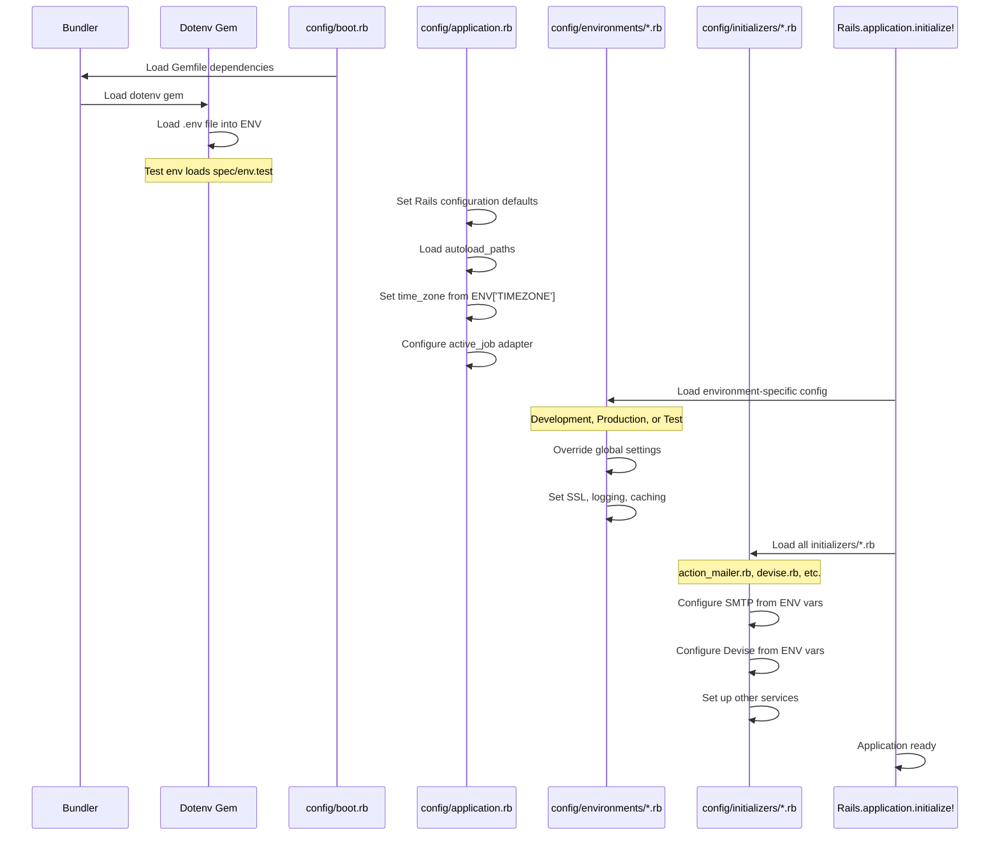

**Loading Order:**

1. **Bundler Setup** [config/boot.rb:3](): Loads all gems from Gemfile
2. **Dotenv Loading** [config/application.rb:22](): Loads `.env` (or `spec/env.test` in test mode)
3. **Application Configuration** [config/application.rb:24-69](): Sets global Rails defaults
4. **Environment-Specific Config**: Loads `config/environments/#{Rails.env}.rb`
5. **Initializers**: Loads all files in `config/initializers/` alphabetically
6. **Rails Initialization** [config/environment.rb:5](): Finalizes the application

**Sources:** [config/boot.rb:1-7](), [config/application.rb:1-71](), [config/environment.rb:1-6]()

---

## Database Configuration Template

The `config/database.yml` file uses ERB templating to reference environment variables:

### Database Adapter Pattern

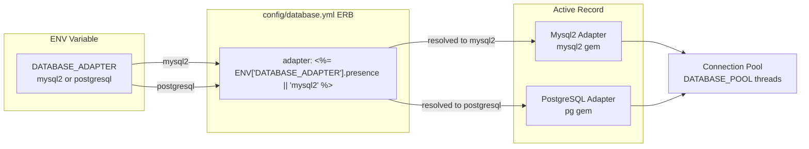

### Socket vs TCP Connection

The database configuration supports both Unix socket and TCP connections:

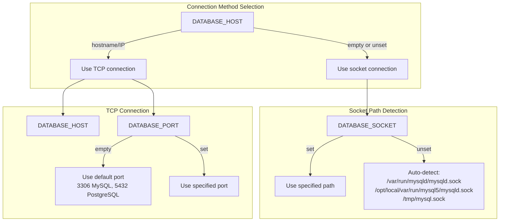

**Template Structure (per environment):**

```yaml
development:
  adapter: <%= ENV['DATABASE_ADAPTER'].presence || "mysql2" %>
  encoding: <%= ENV['DATABASE_ENCODING'].presence || "utf8" %>
  reconnect: <%= ENV['DATABASE_RECONNECT'].presence || "true" %>
  database: <%= ENV['DATABASE_NAME'].presence || "huginn_development" %>
  pool: <%= ENV['DATABASE_POOL'].presence || "20" %>
  username: <%= ENV['DATABASE_USERNAME'].presence || "root" %>
  password: <%= ENV['DATABASE_PASSWORD'] || "" %>
  host: <%= ENV['DATABASE_HOST'] || "" %>
  port: <%= ENV['DATABASE_PORT'] || "" %>
  socket: <%= ENV['DATABASE_SOCKET'] || auto_detect_path %>
  strict: false
```

**Sources:** [config/database.yml:1-42]()

---

## Configuration Best Practices

### Security Recommendations

| Setting | Development | Production | Rationale |
|---------|-------------|------------|-----------|
| `FORCE_SSL` | `false` | `true` | Encrypt all traffic in production |
| `ENABLE_INSECURE_AGENTS` | `false` | `false` | Never enable unless single-user deployment |
| `SKIP_INVITATION_CODE` | `true` | `false` | Control who can register |
| `REQUIRE_CONFIRMED_EMAIL` | `false` | `true` | Verify user email addresses |
| `APP_SECRET_TOKEN` | Generated | Generated (different) | Never reuse between environments |

### Performance Tuning

| Setting | Small Deployment | Large Deployment | Notes |
|---------|------------------|------------------|-------|
| `DATABASE_POOL` | `20` | `50-100` | Match web server threads + workers |
| `SCHEDULER_FREQUENCY` | `0.3` | `1.0-5.0` | Reduce CPU usage on large installations |
| `DELAYED_JOB_SLEEP_DELAY` | `10` | `5` | Faster job processing with more workers |
| `DELAYED_JOB_MAX_RUNTIME` | `2` | `10` | Allow longer-running jobs |
| `AGENT_LOG_LENGTH` | `200` | `100` | Reduce database size |

### Development Workflow

1. **Initial Setup:**
   ```bash
   cp .env.example .env
   # Edit .env with your settings
   rake secret  # Generate APP_SECRET_TOKEN
   ```

2. **Database Setup:**
   ```bash
   # MySQL
   bundle exec rake db:create db:migrate db:seed
   
   # PostgreSQL
   DATABASE_ADAPTER=postgresql bundle exec rake db:create db:migrate db:seed
   ```

3. **Testing Email Delivery:**
   - Keep `SEND_EMAIL_IN_DEVELOPMENT=false` [.env.example:126]()
   - View emails at http://localhost:3000/letter_opener
   - Set to `true` only when testing real SMTP

**Sources:** [README.md:62-77](), [.env.example:1-267]()

---

## Common Configuration Scenarios

### Scenario 1: Docker Deployment

Docker environments typically use environment variables passed via `docker-compose.yml` or Kubernetes ConfigMaps:

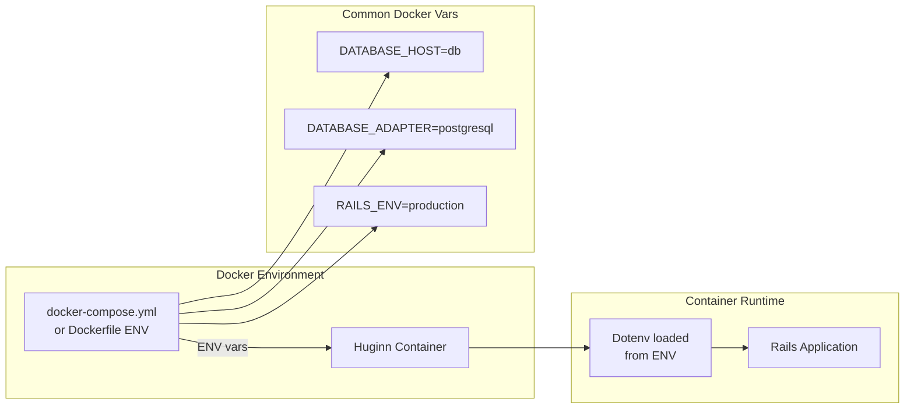

**Sources:** [README.md:56-59](), Diagram 3 from high-level overview

### Scenario 2: Heroku Deployment

Heroku uses environment variables exclusively (no `.env` file):

- Config vars set via `heroku config:set KEY=value`
- Database URL automatically parsed by Rails
- `ON_HEROKU` or `HEROKU_POSTGRESQL_*` detected for logging [config/environments/production.rb:32-36]()
- Requires `RAILS_ENV=production` and `DOMAIN` set to your Heroku domain

**Sources:** [README.md:107-109](), [config/environments/production.rb:32-40]()

### Scenario 3: Manual Installation

Traditional server deployment with `.env` file:

1. Copy `.env.example` to `.env` [README.md:65]()
2. Edit `.env` with production values
3. Set `RAILS_ENV=production` in environment or `.env`
4. Precompile assets: `bundle exec rake assets:precompile`
5. Start services via Runit or systemd

**Sources:** [README.md:62-77](), [README.md:131-133]()

---

## Configuration Validation

Huginn does not have extensive configuration validation at boot time. Invalid configurations typically surface as runtime errors. Key validation points:

### Required Variables Check

- `APP_SECRET_TOKEN` must be set and non-empty (Rails will refuse to start otherwise)
- `DATABASE_NAME`, `DATABASE_USERNAME` required for database connection
- Invalid `DATABASE_ADAPTER` causes immediate failure

### Common Configuration Errors

| Error Symptom | Likely Cause | Solution |
|---------------|--------------|----------|
| `FATAL: password authentication failed` | Wrong `DATABASE_PASSWORD` | Check database credentials |
| `Unknown database 'huginn_production'` | Database not created | Run `rake db:create` |
| `NameError: uninitialized constant Mysql2` | Wrong adapter or missing gem | Check `DATABASE_ADAPTER` and Gemfile |
| Emails not sending | SMTP misconfiguration | Verify all `SMTP_*` variables |
| "Invalid invitation code" | `INVITATION_CODE` mismatch | Check code or set `SKIP_INVITATION_CODE=true` |
| Agent won't schedule | Wrong `TIMEZONE` | Use `rake time:zones:all` to find correct name |

**Sources:** [.env.example:1-267](), [config/database.yml:1-42](), [README.md:65-77]()

---

