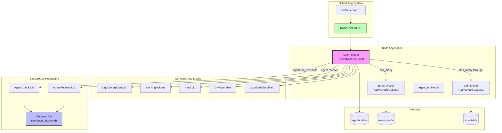
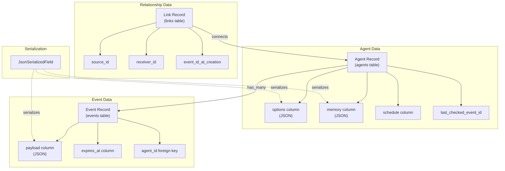
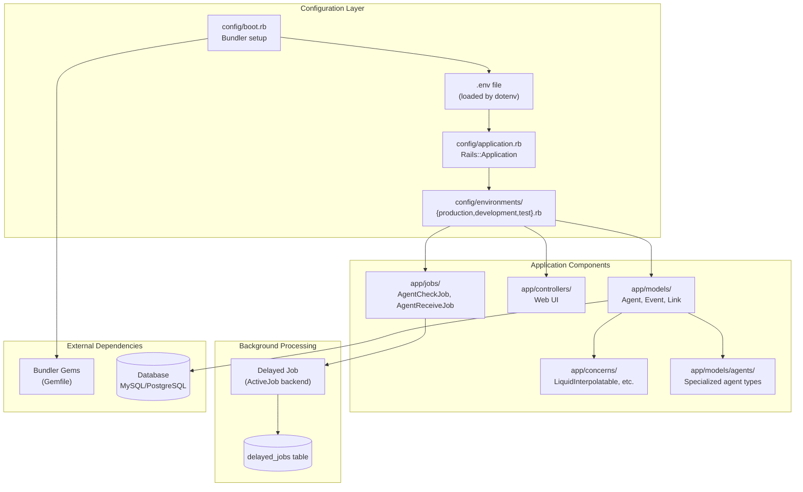
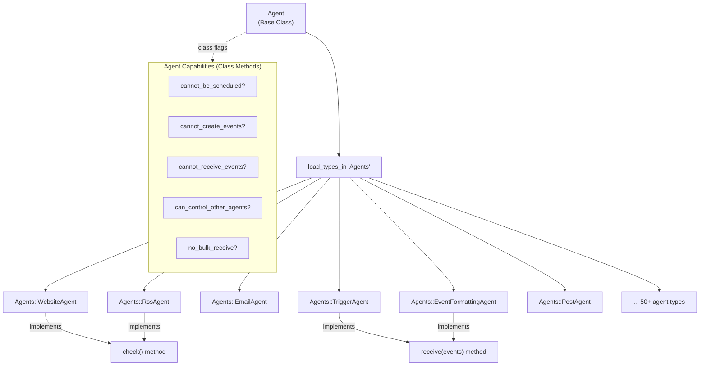
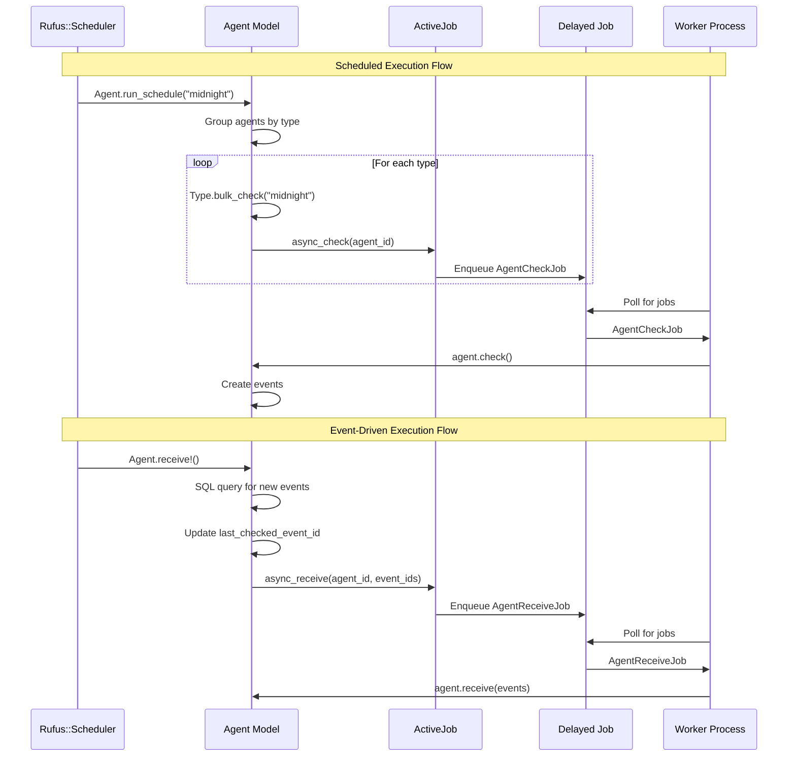

<!-- source: DeepWiki mcp.deepwiki.com · repo huginn/huginn · page 3 Core Architecture · fetched 2026-10-29 -->

# Core Architecture

Relevant source files

The following files were used as context for generating this wiki page:

- [.env.example](.env.example)
- [Gemfile](Gemfile)
- [Gemfile.lock](Gemfile.lock)
- [app/models/agent.rb](app/models/agent.rb)
- [app/views/agents/_form.html.erb](app/views/agents/_form.html.erb)
- [bin/setup](bin/setup)
- [config/application.rb](config/application.rb)
- [config/boot.rb](config/boot.rb)
- [config/environment.rb](config/environment.rb)
- [config/environments/development.rb](config/environments/development.rb)
- [config/environments/production.rb](config/environments/production.rb)
- [config/environments/test.rb](config/environments/test.rb)
- [config/initializers/wrap_parameters.rb](config/initializers/wrap_parameters.rb)
- [config/spring.rb](config/spring.rb)
- [spec/models/agent_spec.rb](spec/models/agent_spec.rb)
- [spec/rails_helper.rb](spec/rails_helper.rb)

This page provides a comprehensive overview of Huginn's core architectural components and how they interact to enable the agent-based automation platform. It covers the fundamental systems that underpin all agent functionality, including the Agent base class, event propagation, scheduling, background job processing, and data persistence.

For detailed information about specific subsystems, see:
- [Agent System](#3.1) - Agent base class, lifecycle, capabilities, and memory management
- [Event-Driven Architecture](#3.2) - Event creation, propagation, and the Link system
- [Scheduling and Background Jobs](#3.3) - Rufus-Scheduler integration and Delayed Job execution
- [Liquid Templating System](#4) - Template interpolation and custom filters
- [Configuration System](#2.3) - Environment variables and Rails configuration

## System Overview

Huginn is built on Rails 7.0 as an agent-based automation platform. The architecture is centered around the `Agent` model class, which serves as the base class for all specialized agent types. Agents operate asynchronously through a combination of scheduled execution and event-driven triggers, with all background work processed through Delayed Job.

**Sources:** [app/models/agent.rb:1-6](), [config/application.rb:20-57]()

## Core Components

**Sources:** [app/models/agent.rb:6-15](), [config/application.rb:57](), [Gemfile:88-89](), [Gemfile:122]()

### Agent Base Class

The `Agent` class at [app/models/agent.rb:6]() is the core abstraction in Huginn. It inherits from `ActiveRecord::Base` and includes several concerns that provide key functionality:

| Concern | Purpose | Location |
|---------|---------|----------|
| `AssignableTypes` | Dynamic agent type loading | Line 7 |
| `LiquidInterpolatable` | Template interpolation with event data | Line 12 |
| `HasGuid` | UUID generation for agents | Line 13 |
| `DryRunnable` | Test execution without side effects | Line 14 |
| `WorkingHelpers` | Status checking utilities | Line 11 |
| `JsonSerializedField` | JSON serialization for options/memory | Line 9 |

Agents store their configuration in a `options` JSON field and maintain state in a `memory` JSON field [app/models/agent.rb:39](). Each agent has a `schedule` field that determines when it should be executed [app/models/agent.rb:21-28]().

**Sources:** [app/models/agent.rb:6-39]()

### Event Model

Events are the primary data structure for inter-agent communication. Each event:
- Belongs to an agent that created it [app/models/agent.rb:60]()
- Has a `payload` containing arbitrary JSON data
- Has an `expires_at` timestamp for automatic cleanup [app/models/agent.rb:130]()
- Can be ordered and filtered through associations [app/models/agent.rb:60-68]()

**Sources:** [app/models/agent.rb:60-68](), [app/models/agent.rb:126-142]()

### Link Model

Links define the agent graph topology by connecting source agents to receiver agents. The `Link` model tracks:
- `source_id` - Agent creating events
- `receiver_id` - Agent receiving events  
- `event_id_at_creation` - Prevents backfilling old events [spec/models/agent_spec.rb:384-418]()

Links enable event propagation through the `sources` and `receivers` associations on `Agent` [app/models/agent.rb:63-69]().

**Sources:** [app/models/agent.rb:63-69](), [spec/models/agent_spec.rb:384-418]()

## Execution Models

Huginn agents execute through two distinct patterns:

```mermaid
graph LR
    subgraph "Scheduled Execution"
        S1["Rufus::Scheduler<br/>(bin/schedule.rb)"]
        S2["Agent.run_schedule(schedule)"]
        S3["AgentType.bulk_check(schedule)"]
        S4["Agent.async_check(agent_id)"]
        S5["AgentCheckJob.perform_later"]
        S6["agent.check()"]
        
        S1 -->|"every schedule"| S2
        S2 -->|"group by type"| S3
        S3 -->|"for each agent"| S4
        S4 --> S5
        S5 -->|"Delayed Job"| S6
    end
    
    subgraph "Event-Driven Execution"
        E1["Agent.receive!<br/>(periodic)"]
        E2["Find agents with<br/>new events"]
        E3["Update last_checked_event_id"]
        E4["Agent.async_receive(agent_id, event_ids)"]
        E5["AgentReceiveJob.perform_later"]
        E6["agent.receive(events)"]
        
        E1 --> E2
        E2 --> E3
        E3 --> E4
        E4 --> E5
        E5 -->|"Delayed Job"| E6
    end
    
    S6 -.->|"may create"| Events[("Events")]
    Events -.->|"triggers"| E1
    E6 -.->|"may create"| Events
```

**Sources:** [app/models/agent.rb:453-478](), [app/models/agent.rb:400-449]()

### Scheduled Execution

Agents with a non-`nil` schedule are executed periodically via `Agent.run_schedule(schedule)` [app/models/agent.rb:453-462](). The flow:

1. **Schedule Trigger**: `bin/schedule.rb` uses Rufus-Scheduler to call `Agent.run_schedule` for each schedule in `SCHEDULES` [app/models/agent.rb:21-28]()
2. **Type Grouping**: The method groups agents by type to enable bulk operations [app/models/agent.rb:456-461]()
3. **Bulk Check**: Each agent type's `bulk_check` method is invoked [app/models/agent.rb:466-472]()
4. **Job Enqueueing**: `Agent.async_check(agent_id)` enqueues an `AgentCheckJob` [app/models/agent.rb:476-478]()
5. **Execution**: The background job calls `agent.check` on the instance [spec/models/agent_spec.rb:250-261]()

Valid schedules include time-based (`midnight`, `5pm`), interval-based (`every_1h`, `every_1d`), and `never` for event-only agents [app/models/agent.rb:21-28]().

**Sources:** [app/models/agent.rb:453-478](), [app/models/agent.rb:21-28]()

### Event-Driven Execution

Agents connected via `Link` relationships receive events through the `Agent.receive!` mechanism [app/models/agent.rb:400-443](). The flow:

1. **Event Discovery**: A SQL query joins `agents`, `links`, and `events` to find new events [app/models/agent.rb:402-410]()
2. **Filtering**: Only active agents receive events; those with `disabled` or `deactivated` flags are skipped [app/models/agent.rb:407]()
3. **Checkpoint Update**: Each agent's `last_checked_event_id` is updated to the maximum event ID received [app/models/agent.rb:429]()
4. **Job Enqueueing**: `Agent.async_receive(agent_id, event_ids)` enqueues an `AgentReceiveJob` [app/models/agent.rb:447-449]()
5. **Batch Processing**: By default, events are batched; agents with `no_bulk_receive!` get individual jobs [app/models/agent.rb:431-435]()

The `event_id_at_creation` field on `Link` prevents backfilling events that existed before the link was created [spec/models/agent_spec.rb:404]().

**Sources:** [app/models/agent.rb:400-443](), [spec/models/agent_spec.rb:384-418]()

## Data Persistence Strategy

**Sources:** [app/models/agent.rb:39-42](), [app/models/agent.rb:60-77]()

### Options and Memory

Agents store configuration in `options` and runtime state in `memory`, both serialized as JSON [app/models/agent.rb:39](). The `JsonSerializedField` concern provides:

- **Symbol-indifferent access**: Keys can be accessed as strings or symbols [spec/models/agent_spec.rb:526-541]()
- **Validation**: Invalid JSON triggers validation errors [spec/models/agent_spec.rb:556-583]()
- **Type safety**: Only hashes are allowed; other types are rejected [spec/models/agent_spec.rb:579-583]()

**Sources:** [app/models/agent.rb:39](), [spec/models/agent_spec.rb:526-583]()

### Event Retention

Events have configurable retention periods via the `keep_events_for` agent attribute [app/models/agent.rb:30-37](). The `expires_at` timestamp is set on event creation [app/models/agent.rb:130](), and a background process periodically deletes expired events. Retention options range from 1 hour to forever [app/models/agent.rb:30-37]().

**Sources:** [app/models/agent.rb:30-37](), [app/models/agent.rb:158-168]()

### Checkpoint System

The `last_checked_event_id` field tracks the most recent event an agent has processed [app/models/agent.rb:429](). This prevents duplicate processing during `Agent.receive!` execution. When a new agent is created, this field is initialized to the current maximum event ID to prevent backfilling [app/models/agent.rb:271-275]().

**Sources:** [app/models/agent.rb:271-275](), [app/models/agent.rb:429](), [spec/models/agent_spec.rb:438-459]()

## Rails Application Structure

**Sources:** [config/boot.rb:1-5](), [config/application.rb:1-69](), [config/environments/production.rb:1-149]()

### Configuration Hierarchy

Huginn's configuration follows the standard Rails pattern with environment-specific overrides:

1. **config/boot.rb**: Initializes Bundler and Bootsnap for dependency management [config/boot.rb:3-4]()
2. **config/application.rb**: Defines the base `Huginn::Application` class with global defaults [config/application.rb:20-69]()
   - Sets Active Job backend to `:delayed_job` [config/application.rb:57]()
   - Configures autoload paths for `lib` and custom directories [config/application.rb:33]()
   - Sets default timezone from `ENV['TIMEZONE']` [config/application.rb:40]()
3. **config/environment.rb**: Initializes the Rails application [config/environment.rb:1-5]()
4. **Environment-specific files**: Override settings for production, development, and test [config/environments/production.rb:1-149]()

The `.env` file (based on `.env.example`) provides environment variables that control database selection, feature flags, and external service credentials [.env.example:1-267]().

**Sources:** [config/boot.rb:1-5](), [config/application.rb:20-69](), [config/environment.rb:1-5]()

### Dependency Management

Dependencies are declared in `Gemfile` and locked in `Gemfile.lock`:

| Dependency | Purpose | Version |
|------------|---------|---------|
| `rails` | Web framework | ~> 7.0.1 |
| `delayed_job` | Background job queue | Latest |
| `delayed_job_active_record` | Active Record backend for Delayed Job | Latest |
| `rufus-scheduler` | Periodic task scheduling | ~> 3.9 |
| `liquid` | Template engine | ~> 5.6 |
| `nokogiri` | HTML/XML parsing | >= 1.18.10 |
| `faraday` | HTTP client | Latest |

Agent-specific gems can be loaded via the `ADDITIONAL_GEMS` environment variable [.env.example:179-194](), parsed by `GemfileHelper` [Gemfile:213-215]().

**Sources:** [Gemfile:1-216](), [Gemfile.lock:1-985](), [.env.example:179-194]()

## Agent Type System

**Sources:** [app/models/agent.rb:19](), [app/models/agent.rb:335-386]()

### Agent Capabilities

Agents declare their capabilities through class-level flags:

- **`cannot_be_scheduled!`**: Prevents scheduling; agent only responds to events [app/models/agent.rb:335-341]()
- **`cannot_create_events!`**: Agent cannot emit events [app/models/agent.rb:348-354]()
- **`cannot_receive_events!`**: Agent cannot receive events from other agents [app/models/agent.rb:356-362]()
- **`can_control_other_agents!`**: Agent can trigger other agents on-demand [app/models/agent.rb:364-370]()
- **`no_bulk_receive!`**: Forces individual event processing instead of batching [app/models/agent.rb:380-386]()

These capabilities affect UI presentation (e.g., hiding schedule dropdown) and execution behavior (e.g., skipping event propagation) [app/views/agents/_form.html.erb:46-50]().

**Sources:** [app/models/agent.rb:335-386](), [app/views/agents/_form.html.erb:46-50]()

### Agent Lifecycle Callbacks

Agents implement lifecycle hooks:

- **`validate_options`**: Called during validation to check agent-specific configuration [app/models/agent.rb:293-295]()
- **`check`**: Executed on schedule to perform agent's primary work [app/models/agent.rb:95-97]()
- **`receive(events)`**: Executed when receiving events from source agents [app/models/agent.rb:104-106]()
- **`working?`**: Returns boolean indicating if agent is functioning correctly [app/models/agent.rb:122-124]()

**Sources:** [app/models/agent.rb:95-124](), [app/models/agent.rb:293-295]()

## Asynchronous Processing

**Sources:** [app/models/agent.rb:453-478](), [app/models/agent.rb:400-449]()

### ActiveJob Integration

Huginn uses ActiveJob with Delayed Job as the backend [config/application.rb:57](). Job classes:

- **`AgentCheckJob`**: Executes scheduled agent checks [app/models/agent.rb:476-478]()
- **`AgentReceiveJob`**: Delivers events to receiving agents [app/models/agent.rb:447-449]()

Jobs are enqueued with agent and event IDs rather than full objects to keep job payloads small [app/models/agent.rb:447]().

**Sources:** [config/application.rb:57](), [app/models/agent.rb:447-449](), [app/models/agent.rb:476-478]()

### Error Handling

Background jobs log exceptions to the agent's logs when errors occur during execution [spec/models/agent_spec.rb:263-274](), [spec/models/agent_spec.rb:327-341](). The `AgentLog` model stores error messages with severity levels, viewable through the web UI.

**Sources:** [spec/models/agent_spec.rb:263-274](), [spec/models/agent_spec.rb:327-341](), [app/models/agent.rb:240-246]()

## Special Execution Modes

### Propagate Immediately

Agents with `propagate_immediately = true` bypass the periodic `Agent.receive!` mechanism and trigger receiving agents synchronously upon event creation [spec/models/agent_spec.rb:461-481](). This reduces latency at the cost of increased resource usage.

**Sources:** [spec/models/agent_spec.rb:461-514](), [app/views/agents/_form.html.erb:95-99]()

### Dry Run Mode

The `DryRunnable` concern enables agents to execute in a test mode that prevents side effects [app/models/agent.rb:14](). This is useful for validating agent configuration before enabling production execution.

**Sources:** [app/models/agent.rb:14](), [app/models/agent.rb:232-234]()

### Drop Pending Events

When re-enabling a disabled agent, users can set `drop_pending_events = true` to reset the `last_checked_event_id` checkpoint, preventing accumulated events from being processed [app/models/agent.rb:253-259]().

**Sources:** [app/models/agent.rb:253-259]()

## Credential System

Agents access external service credentials through the `credential(name)` method [app/models/agent.rb:144-151](). This retrieves values from the `user_credentials` table, with caching to minimize database queries [spec/models/agent_spec.rb:96-116]().

The credential cache is cleared on agent reload to ensure fresh values [app/models/agent.rb:153-156]().

**Sources:** [app/models/agent.rb:144-156](), [spec/models/agent_spec.rb:96-116]()

---

