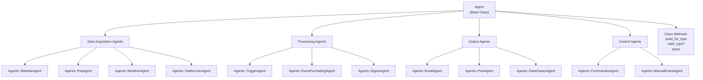
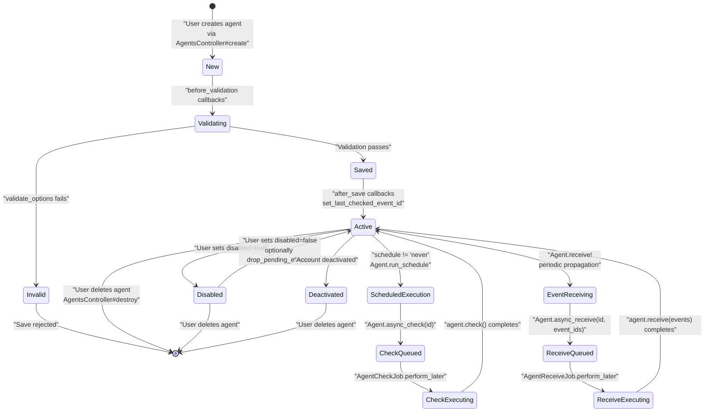
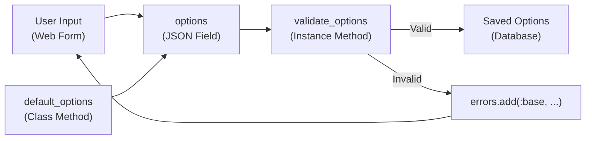
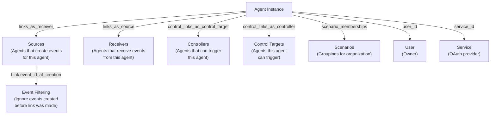
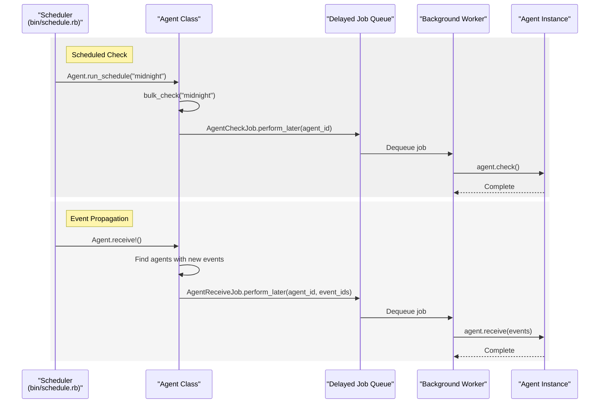
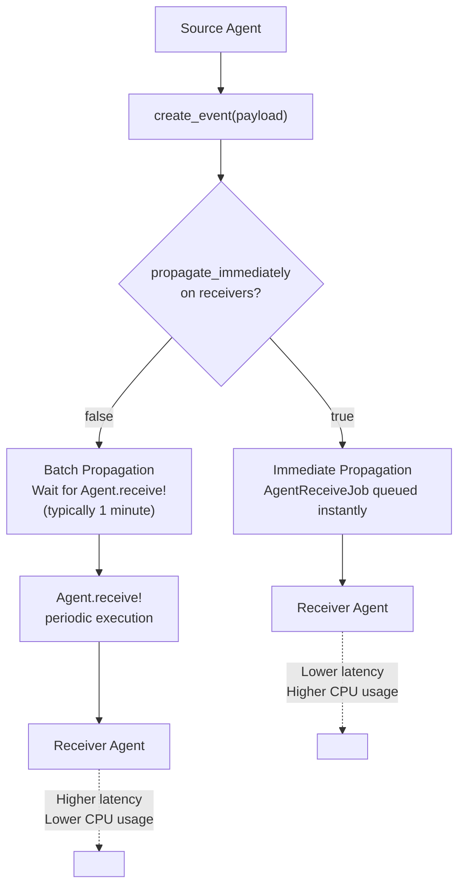

<!-- source: DeepWiki mcp.deepwiki.com · repo huginn/huginn · page 3.1 Agent System · fetched 2026-10-29 -->

# Agent System

<details>
<summary>Relevant source files</summary>

The following files were used as context for generating this wiki page:

- [app/controllers/agents_controller.rb](app/controllers/agents_controller.rb)
- [app/models/agent.rb](app/models/agent.rb)
- [app/views/agents/_action_menu.html.erb](app/views/agents/_action_menu.html.erb)
- [app/views/agents/_form.html.erb](app/views/agents/_form.html.erb)
- [config/routes.rb](config/routes.rb)
- [spec/controllers/agents_controller_spec.rb](spec/controllers/agents_controller_spec.rb)
- [spec/fixtures/agents.yml](spec/fixtures/agents.yml)
- [spec/models/agent_spec.rb](spec/models/agent_spec.rb)

</details>


## Purpose and Scope

This page documents the core Agent system in Huginn, including the `Agent` base class, agent lifecycle, capabilities, validation, memory management, and the relationship between agents. For information about specific agent types and their usage, see the Agent Reference section ([5](#5)). For details on event propagation between agents, see [Event-Driven Architecture](#3.2). For scheduling and background job execution, see [Scheduling and Background Jobs](#3.3).

---

## The Agent Base Class

The `Agent` class [app/models/agent.rb:6]() is the foundation of Huginn's automation system. All agent types inherit from this base class, which provides a consistent interface for scheduling, event processing, configuration, and state management.

### Class Definition and Modules

```ruby
class Agent < ActiveRecord::Base
  include AssignableTypes
  include MarkdownClassAttributes
  include JsonSerializedField
  include RdbmsFunctions
  include WorkingHelpers
  include LiquidInterpolatable
  include HasGuid
  include DryRunnable
  include SortableEvents
```

**Sources:** [app/models/agent.rb:6-15]()

### Core Attributes

| Attribute | Type | Purpose |
|-----------|------|---------|
| `name` | String | User-defined name for the agent |
| `type` | String | Agent class name (e.g., "Agents::WebsiteAgent") |
| `schedule` | String | When the agent runs (e.g., "midnight", "every_1h") |
| `disabled` | Boolean | Whether the agent is disabled by the user |
| `deactivated` | Boolean | Whether the agent's owner account is deactivated |
| `options` | JSON | Agent-specific configuration parameters |
| `memory` | JSON | Persistent state storage for the agent |
| `keep_events_for` | Integer | Event retention period in seconds (0 = forever) |
| `last_check_at` | DateTime | Timestamp of last scheduled execution |
| `last_receive_at` | DateTime | Timestamp of last event received |
| `last_checked_event_id` | Integer | Last event ID processed (for event propagation) |
| `last_web_request_at` | DateTime | Timestamp of last webhook/web request |
| `propagate_immediately` | Boolean | Whether to receive events immediately vs. batch processing |

**Sources:** [app/models/agent.rb:39-60](), [app/views/agents/_form.html.erb:1-152]()

---

## Agent Type System

### Type Loading and Validation

Agents are loaded dynamically from the `app/models/agents/` directory:

```ruby
load_types_in "Agents"
```

The type system ensures agents can only be instantiated with valid, defined agent classes [app/models/agent.rb:19](). Type changes are not allowed after an agent is saved [spec/models/agent_spec.rb:129-133]().

### Available Agent Types

The system provides `Agent.types` to enumerate all valid agent classes [spec/models/agent_spec.rb:136-137]().

**Title: Agent Type Hierarchy and Class Method**



**Sources:** [app/models/agent.rb:19](), [spec/models/agent_spec.rb:135-138]()

---

## Agent Capabilities and Constraints

Agents declare their capabilities through class-level methods. These control what operations are allowed and how the agent integrates with the system.

### Capability Declaration Methods

| Class Method | Instance Method | Purpose |
|--------------|-----------------|---------|
| `cannot_be_scheduled!` | `can_be_scheduled?` | Agent runs only on events, not on a schedule |
| `cannot_receive_events!` | `can_receive_events?` | Agent cannot accept events from other agents |
| `cannot_create_events!` | `can_create_events?` | Agent cannot emit events |
| `can_control_other_agents!` | `can_control_other_agents?` | Agent can control/trigger other agents |
| `can_dry_run!` | `can_dry_run?` | Agent supports dry run mode for testing |
| `no_bulk_receive!` | `no_bulk_receive?` | Agent processes events one at a time |

**Sources:** [app/models/agent.rb:335-386]()

### Example Agent with Constraints

```ruby
class Agents::CannotBeScheduled < Agent
  cannot_be_scheduled!
  
  def receive(events)
    events.each do |event|
      create_event payload: { events_received: 1 }
    end
  end
end
```

**Sources:** [spec/models/agent_spec.rb:153-161]()

### Schedule Validation

When an agent `cannot_be_scheduled?`, its `schedule` field is automatically set to `nil` and cannot be changed [app/models/agent.rb:263-269]():

```ruby
def set_default_schedule
  self.schedule = default_schedule unless schedule.present? || cannot_be_scheduled?
end

def unschedule_if_cannot_schedule
  self.schedule = nil if cannot_be_scheduled?
end
```

**Sources:** [app/models/agent.rb:263-269](), [spec/models/agent_spec.rb:207-219]()

---

## Agent Lifecycle

**Title: Agent State Machine and Lifecycle**



**Sources:** [app/models/agent.rb:51-56](), [app/models/agent.rb:263-296](), [app/controllers/agents_controller.rb:156-205]()

### Creation and Initialization

Agents are created through `AgentsController#create` [app/controllers/agents_controller.rb:156-169]():

1. `build_agent` constructs the agent from parameters
2. `validate_options` is called during validation [app/models/agent.rb:293-295]()
3. `set_default_schedule` sets the default schedule [app/models/agent.rb:263-265]()
4. `set_last_checked_event_id` initializes event tracking [app/models/agent.rb:271-275]()

**Sources:** [app/controllers/agents_controller.rb:156-169](), [app/models/agent.rb:51-56]()

### Scheduled Execution

For agents with `can_be_scheduled? == true`:

1. `Agent.run_schedule(schedule_name)` is called periodically by the scheduler [app/models/agent.rb:453-462]()
2. Agents are grouped by type for efficient bulk processing
3. Each type calls `bulk_check(schedule)` [app/models/agent.rb:466-472]()
4. Individual agents are queued via `async_check(agent_id)` [app/models/agent.rb:476-478]()
5. `AgentCheckJob` executes the agent's `check` method

**Sources:** [app/models/agent.rb:453-478](), [spec/models/agent_spec.rb:34-94]()

### Event Reception

For agents with `can_receive_events? == true`:

1. `Agent.receive!` is called periodically (typically every minute) [app/models/agent.rb:400-443]()
2. SQL query finds agents with new events from their sources
3. `last_checked_event_id` is updated to prevent reprocessing [app/models/agent.rb:429]()
4. Events are batched and passed to `async_receive(agent_id, event_ids)` [app/models/agent.rb:434]()
5. `AgentReceiveJob` executes the agent's `receive(events)` method

**Sources:** [app/models/agent.rb:400-443](), [spec/models/agent_spec.rb:284-436]()

---

## Agent Schedules

### Available Schedules

The `SCHEDULES` constant defines all valid schedule values [app/models/agent.rb:21-28]():

```ruby
SCHEDULES = %w[
  every_1m every_2m every_5m every_10m every_30m
  every_1h every_2h every_5h every_12h
  every_1d every_2d every_7d
  midnight 1am 2am 3am 4am 5am 6am 7am 8am 9am 10am 11am
  noon 1pm 2pm 3pm 4pm 5pm 6pm 7pm 8pm 9pm 10pm 11pm
  never
]
```

The `never` schedule prevents scheduled execution but keeps the agent active for event reception [spec/models/agent_spec.rb:89-93]().

**Sources:** [app/models/agent.rb:21-28](), [app/views/agents/_form.html.erb:45-52]()

### Default Schedule

Agent subclasses can declare a default schedule:

```ruby
class Agents::SomethingSource < Agent
  default_schedule "2pm"
end
```

This is applied during initialization and saved if not explicitly overridden [spec/models/agent_spec.rb:186-205]().

**Sources:** [app/models/agent.rb:343-346](), [spec/models/agent_spec.rb:186-205]()

---

## Options and Configuration

### Options Field

The `options` field is a JSON-serialized hash that stores agent-specific configuration [app/models/agent.rb:39](). Each agent type defines its own schema.

**Title: Options Validation and Default Lifecycle**



**Sources:** [app/models/agent.rb:39](), [app/models/agent.rb:99-102](), [app/models/agent.rb:293-295]()

### Default Options

Agents implement `default_options` to provide initial configuration [app/models/agent.rb:99-102]():

```ruby
def default_options
  # Implement me in your subclass of Agent.
  {}
end
```

**Sources:** [app/models/agent.rb:99-102](), [app/controllers/agents_controller.rb:62]()

### Options Validation

Agents implement `validate_options` to enforce constraints [app/models/agent.rb:293-295]():

```ruby
def validate_options
  # Implement me in your subclass to test for valid options.
end
```

Example validation [spec/models/agent_spec.rb:148-150]():

```ruby
def validate_options
  errors.add(:base, "bad is bad") if options[:bad]
end
```

Options are automatically converted to symbol-indifferent access before validation [spec/models/agent_spec.rb:526-533]().

**Sources:** [app/models/agent.rb:48-49](), [app/models/agent.rb:293-295](), [spec/models/agent_spec.rb:517-584]()

---

## Memory System

The `memory` field provides persistent state storage for agents across executions [app/models/agent.rb:39]().

### Memory Characteristics

- JSON-serialized hash stored in the database
- Automatically symbol-indifferent [spec/models/agent_spec.rb:535-541]()
- Persists across agent restarts
- Can be manually cleared via `AgentsController#destroy_memory` [app/controllers/agents_controller.rb:113-121]()

### Memory Usage Example

```ruby
# Store data
memory[:last_seen_id] = event.id
memory[:item_count] = (memory[:item_count] || 0) + 1

# Read data
if memory[:last_run_at]
  # Process only new items
end
```

**Sources:** [app/models/agent.rb:39](), [spec/models/agent_spec.rb:535-563](), [app/controllers/agents_controller.rb:113-121]()

---

## Event Management

### Creating Events

Agents create events using `create_event` [app/models/agent.rb:134-142]():

```ruby
def create_event(event)
  if can_create_events?
    event = build_event(event)
    event.save!
    event
  else
    error "This Agent cannot create events!"
  end
end
```

Events are automatically:
- Associated with the agent and user [app/models/agent.rb:126-132]()
- Assigned an expiration date based on `keep_events_for` [app/models/agent.rb:130]()

**Sources:** [app/models/agent.rb:126-142](), [spec/models/agent_spec.rb:222-241]()

### Event Retention

The `keep_events_for` field controls how long events are retained [app/models/agent.rb:30-37]():

```ruby
EVENT_RETENTION_SCHEDULES = [
  ["Forever", 0], ['1 hour', 1.hour], ['6 hours', 6.hours], ["1 day", 1.day],
  *(
    [2, 3, 4, 5, 7, 14, 21, 30, 45, 90, 180, 365].map { |n|
      ["#{n} days", n.days]
    }
  )
]
```

- `0` means events are kept forever
- Non-zero values set an expiration timestamp
- Changing `keep_events_for` updates all existing events [app/models/agent.rb:162-168]()

**Sources:** [app/models/agent.rb:30-37](), [app/models/agent.rb:158-168](), [spec/models/agent_spec.rb:669-727]()

---

## Agent Relationships

**Title: Agent Relationship Types and Link System**



**Sources:** [app/models/agent.rb:63-77]()

### Sources and Receivers

- **Sources** (`sources`): Agents whose events this agent receives [app/models/agent.rb:67]()
- **Receivers** (`receivers`): Agents that receive this agent's events [app/models/agent.rb:69]()
- Links are created through the `links_as_source` and `links_as_receiver` associations [app/models/agent.rb:63-66]()
- Each link records `event_id_at_creation` to ignore old events [spec/models/agent_spec.rb:384-418]()

**Sources:** [app/models/agent.rb:63-69](), [spec/models/agent_spec.rb:384-418]()

### Controllers and Control Targets

- **Controllers** (`controllers`): Agents that can manually trigger this agent [app/models/agent.rb:74]()
- **Control Targets** (`control_targets`): Agents this agent can trigger [app/models/agent.rb:75]()
- Used for manual execution workflows
- Requires `can_control_other_agents?` capability

**Sources:** [app/models/agent.rb:70-75](), [app/views/agents/_form.html.erb:54-75]()

### Scenarios

Agents can belong to multiple scenarios for organization and export [app/models/agent.rb:76-77]().

**Sources:** [app/models/agent.rb:76-77](), [app/views/agents/_form.html.erb:116-124]()

### Relationship Validation

All relationships are validated to ensure agents can only link to agents owned by the same user [app/models/agent.rb:43-47]():

```ruby
validates :sources, owned_by: :user_id
validates :receivers, owned_by: :user_id
validates :controllers, owned_by: :user_id
validates :control_targets, owned_by: :user_id
validates :scenarios, owned_by: :user_id
```

**Sources:** [app/models/agent.rb:43-47](), [spec/models/agent_spec.rb:585-644]()

---

## Background Job Integration

### Asynchronous Execution Model

Huginn uses background jobs to execute agents asynchronously, allowing the system to scale horizontally.

**Title: Agent Execution Flow Through Background Jobs**



**Sources:** [app/models/agent.rb:447-478]()

### AgentCheckJob

`AgentCheckJob` executes an agent's `check` method [app/models/agent.rb:476-478]():

```ruby
def async_check(agent_id)
  AgentCheckJob.perform_later(agent_id)
end
```

This is called by:
- `Agent.run_schedule` for scheduled agents [app/models/agent.rb:453-462]()
- `AgentsController#run` for manual execution [app/controllers/agents_controller.rb:41-49]()

**Sources:** [app/models/agent.rb:476-478](), [spec/models/agent_spec.rb:243-282]()

### AgentReceiveJob

`AgentReceiveJob` executes an agent's `receive` method with events [app/models/agent.rb:447-449]():

```ruby
def async_receive(agent_id, event_ids)
  AgentReceiveJob.perform_later(agent_id, event_ids)
end
```

Called by `Agent.receive!` during event propagation [app/models/agent.rb:431-435]().

**Sources:** [app/models/agent.rb:447-449](), [spec/models/agent_spec.rb:428-435]()

### Bulk vs. Individual Receive

By default, agents receive events in batches. Agents with `no_bulk_receive!` receive events one at a time [app/models/agent.rb:431-435]():

```ruby
if agent.no_bulk_receive?
  event_ids.each { |event_id| Agent.async_receive(agent.id, [event_id]) }
else
  Agent.async_receive(agent.id, event_ids)
end
```

**Sources:** [app/models/agent.rb:380-386](), [app/models/agent.rb:431-435](), [spec/models/agent_spec.rb:374-382]()

---

## Agent Propagation System

### Immediate vs. Batch Propagation

Agents can be configured for immediate or batch event propagation using the `propagate_immediately` flag.

**Title: Event Propagation Modes**



**Sources:** [spec/models/agent_spec.rb:461-514](), [app/views/agents/_form.html.erb:95-99]()

### The receive! Method

`Agent.receive!` is the core propagation mechanism [app/models/agent.rb:400-443](). It:

1. Queries for agents that have new events from their sources
2. Filters events created after `Link.event_id_at_creation` [spec/models/agent_spec.rb:384-418]()
3. Skips disabled and deactivated agents [app/models/agent.rb:407]()
4. Updates `last_checked_event_id` to prevent reprocessing [app/models/agent.rb:429]()
5. Queues `AgentReceiveJob` for each agent

**Sources:** [app/models/agent.rb:400-443](), [spec/models/agent_spec.rb:284-426]()

---

## Credentials System

### Credential Access

Agents access user credentials via the `credential(name)` method [app/models/agent.rb:144-151]():

```ruby
def credential(name)
  @credential_cache ||= {}
  if @credential_cache.has_key?(name)
    @credential_cache[name]
  else
    @credential_cache[name] = user.user_credentials.where(credential_name: name).first.try(:credential_value)
  end
end
```

Features:
- Automatic caching for performance [spec/models/agent_spec.rb:107-115]()
- Returns `nil` if credential doesn't exist [spec/models/agent_spec.rb:103-105]()
- Cache is cleared on `reload` [app/models/agent.rb:153-156]()

**Sources:** [app/models/agent.rb:144-156](), [spec/models/agent_spec.rb:96-116]()

---

## Web Request Handling

### Receiving Web Requests

Agents can receive HTTP requests via `receive_web_request` [app/models/agent.rb:112-119]():

```ruby
def receive_web_request(params, method, format)
  # Implement me in your subclass of Agent.
  ["not implemented", 404, "text/plain", {}] # last two elements are optional
end
```

Alternative signature with full request object [app/models/agent.rb:117-119]():

```ruby
def receive_web_request(request=ActionDispatch::Request.new(...))
end
```

**Sources:** [app/models/agent.rb:112-119](), [spec/models/agent_spec.rb:777-865]()

### Triggering Web Requests

The `trigger_web_request(request)` method [app/models/agent.rb:170-190]():

1. Extracts params from the request
2. Calls the agent's `receive_web_request` method
3. Updates `last_web_request_at` timestamp
4. Supports both old `receive_webhook` and new `receive_web_request` APIs

**Sources:** [app/models/agent.rb:170-190](), [config/routes.rb:99-101]()

---

## Agent Operations

### Active and Inactive Scopes

The system provides scopes to filter agents [app/models/agent.rb:79-80]():

```ruby
scope :active,   -> { where(disabled: false, deactivated: false) }
scope :inactive, -> { where(disabled: true).or(where(deactivated: true)) }
```

**Sources:** [app/models/agent.rb:79-80](), [spec/models/agent_spec.rb:6-32]()

### Manual Execution

Users can manually trigger agents via `AgentsController#run` [app/controllers/agents_controller.rb:41-49]():

```ruby
def run
  @agent = current_user.agents.find(params[:id])
  Agent.async_check(@agent.id)
  # ...
end
```

**Sources:** [app/controllers/agents_controller.rb:41-49](), [app/views/agents/_action_menu.html.erb:2-6]()

### Dry Run Mode

Agents with `can_dry_run?` support testing without side effects [app/models/agent.rb:232-234](), [app/models/agent.rb:372-378]().

**Sources:** [app/models/agent.rb:232-234](), [app/models/agent.rb:372-378](), [app/views/agents/_action_menu.html.erb:8-12]()

### Re-emitting Events

`AgentsController#reemit_events` allows agents to re-emit all their past events [app/controllers/agents_controller.rb:78-88]():

- Useful for replaying data through a pipeline
- Optional `delete_old_events` parameter to clean up originals

**Sources:** [app/controllers/agents_controller.rb:78-88](), [app/views/agents/_action_menu.html.erb:99-124]()

### Cloning Agents

`Agent.build_clone` creates a copy of an agent for editing [app/models/agent.rb:319-333]():

```ruby
def self.build_clone(original)
  new(original.slice(
    :type, :options, :service_id, :schedule, :controller_ids, :control_target_ids,
    :source_ids, :receiver_ids, :keep_events_for, :propagate_immediately, :scenario_ids
  )) { |clone|
    # Give it a unique name
    2.step do |i|
      name = '%s (%d)' % [original.name, i]
      unless exists?(name:)
        clone.name = name
        break
      end
    end
  }
end
```

Key points:
- Copies configuration but not memory or events
- Generates a unique name by appending a number
- Preserves source/receiver relationships

**Sources:** [app/models/agent.rb:319-333](), [spec/models/agent_spec.rb:729-774](), [app/views/agents/_action_menu.html.erb:24-26]()

### Disabling and Enabling

Agents can be disabled/enabled via the UI [app/views/agents/_action_menu.html.erb:71-97]():

- Disabled agents don't run on schedule and don't receive events
- When re-enabling, `drop_pending_events` option skips events accumulated while disabled [app/models/agent.rb:253-259]():

```ruby
def drop_pending_events
  false
end

def drop_pending_events=(bool)
  set_last_checked_event_id if bool
end
```

This prevents event floods when re-enabling agents [spec/controllers/agents_controller_spec.rb:358-368]().

**Sources:** [app/models/agent.rb:253-259](), [app/views/agents/_action_menu.html.erb:71-97](), [spec/controllers/agents_controller_spec.rb:358-368]()

### Memory Management

Users can clear an agent's memory via `AgentsController#destroy_memory` [app/controllers/agents_controller.rb:113-121]():

```ruby
def destroy_memory
  @agent = current_user.agents.find(params[:id])
  @agent.update!(memory: {})
  # ...
end
```

Route: `DELETE /agents/:id/memory` [config/routes.rb:9]()

**Sources:** [app/controllers/agents_controller.rb:113-121](), [config/routes.rb:9](), [spec/controllers/agents_controller_spec.rb:448-466]()

---

## Logging System

### Creating Log Entries

Agents create log entries using `log(message, options)` and `error(message, options)` [app/models/agent.rb:240-246]():

```ruby
def log(message, options = {})
  AgentLog.log_for_agent(self, message, options.merge(inbound_event: current_event))
end

def error(message, options = {})
  log(message, options.merge(level: 4))
end
```

Logs are associated with:
- The agent that created them
- Optionally, the event being processed (`current_event`)
- A severity level (4 = error)

**Sources:** [app/models/agent.rb:240-246](), [app/models/agent.rb:62]()

### Viewing Logs

Logs are accessible via:
- `agent.logs` association [app/models/agent.rb:62]()
- Web UI at `/agents/:id/logs` [config/routes.rb:22-26]()
- `AgentsController#delete_logs!` to clear logs [app/models/agent.rb:248-251]()

**Sources:** [app/models/agent.rb:62](), [app/models/agent.rb:248-251](), [config/routes.rb:22-26]()

---

## Working Status

Agents must implement the `working?` method to indicate their health status [app/models/agent.rb:122-124]():

```ruby
def working?
  raise "Implement me in your subclass"
end
```

This is used by the UI to show agent status and is part of the `WorkingHelpers` concern [spec/models/agent_spec.rb:4]().

**Sources:** [app/models/agent.rb:122-124](), [spec/models/agent_spec.rb:4]()

---

## Type Safety and Validation

### Type Constraints

- Type must be a valid Agent subclass [spec/models/agent_spec.rb:119-127]()
- Type cannot be changed after creation [spec/models/agent_spec.rb:129-133]()
- Type must match a loaded agent class from `app/models/agents/`

### Unknown Type Handling

The system gracefully handles agents with unknown types (e.g., from deleted custom agents):

- Skipped during `run_schedule` [spec/models/agent_spec.rb:77-82]()
- Skipped during `receive!` propagation [spec/models/agent_spec.rb:302-325]()
- Can be bulk-deleted via `AgentsController#destroy_undefined` [spec/controllers/agents_controller_spec.rb:468-480]()

**Sources:** [spec/models/agent_spec.rb:77-82](), [spec/models/agent_spec.rb:302-325](), [spec/controllers/agents_controller_spec.rb:468-480]()

---

## Dependencies and Gem Requirements

Agents can declare gem dependencies using `gem_dependency_check` [app/models/agent.rb:388-395]():

```ruby
gem_dependency_check do
  require 'some_optional_gem'
  true
rescue LoadError
  false
end
```

If dependencies are missing:
- `dependencies_missing?` returns `true` [app/models/agent.rb:393-395]()
- `unavailable?` returns `true` [app/models/agent.rb:192-198]()
- Agent creation may be blocked or display warnings

**Sources:** [app/models/agent.rb:192-198](), [app/models/agent.rb:388-395]()

---

## Summary Table of Key Methods

| Method | Type | Purpose |
|--------|------|---------|
| `check` | Instance | Called on schedule to perform work |
| `receive(events)` | Instance | Called when events arrive from sources |
| `receive_web_request` | Instance | Called when HTTP request arrives |
| `validate_options` | Instance | Validates agent configuration |
| `default_options` | Instance | Provides initial configuration |
| `working?` | Instance | Returns health status |
| `create_event(payload)` | Instance | Creates a new event |
| `credential(name)` | Instance | Retrieves user credential |
| `log(message)` | Instance | Creates log entry |
| `error(message)` | Instance | Creates error log entry |
| `run_schedule(schedule)` | Class | Executes all agents with schedule |
| `receive!` | Class | Propagates events to receivers |
| `async_check(agent_id)` | Class | Queues agent check job |
| `async_receive(agent_id, event_ids)` | Class | Queues agent receive job |
| `bulk_check(schedule)` | Class | Queues checks for all agents of type |
| `build_clone(original)` | Class | Creates editable copy |

**Sources:** [app/models/agent.rb:95-478]()

---

