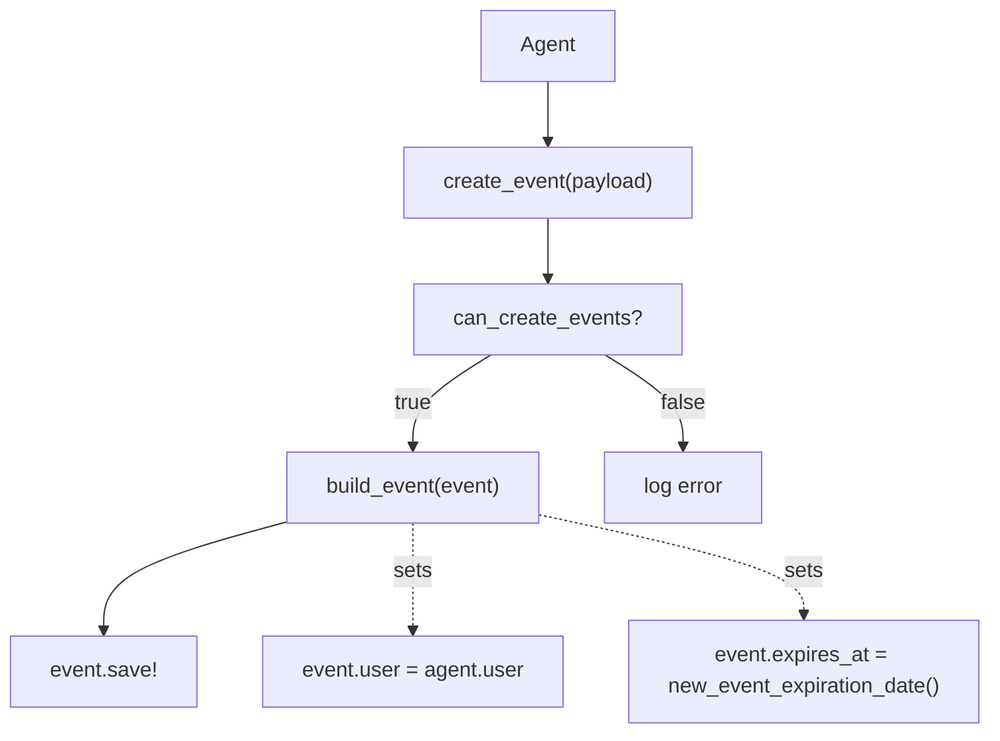
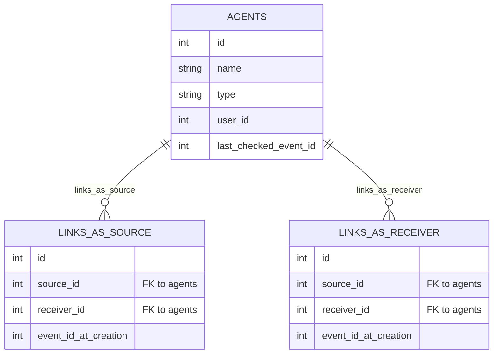
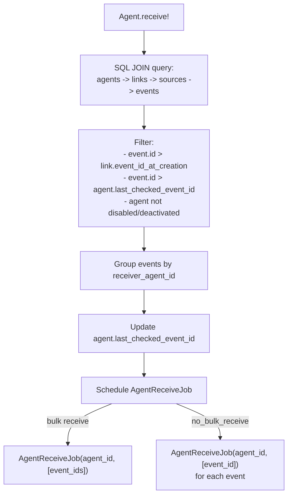
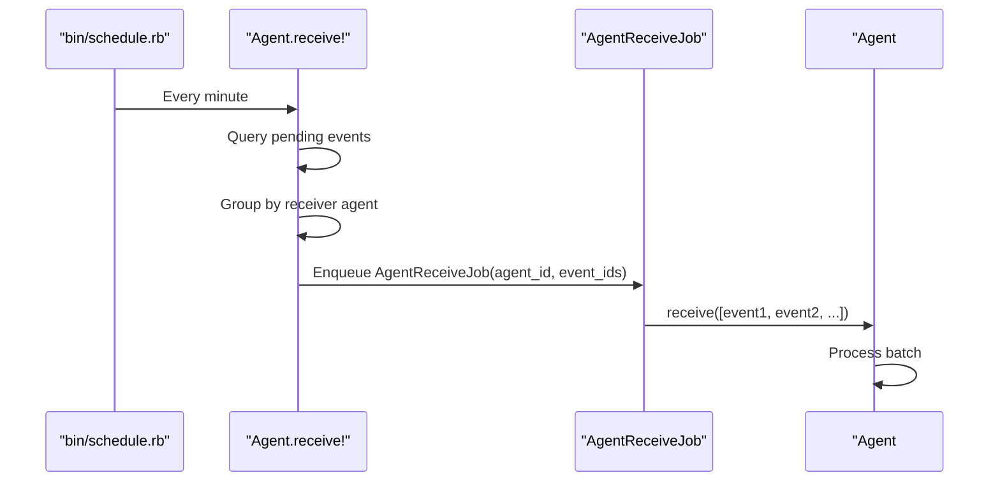
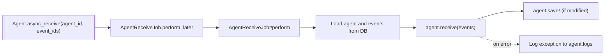

<!-- source: DeepWiki mcp.deepwiki.com · repo huginn/huginn · page 3.2 Event-Driven Architecture · fetched 2026-10-29 -->

# Event-Driven Architecture

<details>
<summary>Relevant source files</summary>

The following files were used as context for generating this wiki page:

- [app/controllers/agents_controller.rb](app/controllers/agents_controller.rb)
- [app/models/agent.rb](app/models/agent.rb)
- [app/views/agents/_action_menu.html.erb](app/views/agents/_action_menu.html.erb)
- [app/views/agents/_form.html.erb](app/views/agents/_form.html.erb)
- [config/routes.rb](config/routes.rb)
- [spec/controllers/agents_controller_spec.rb](spec/controllers/agents_controller_spec.rb)
- [spec/fixtures/agents.yml](spec/fixtures/agents.yml)
- [spec/models/agent_spec.rb](spec/models/agent_spec.rb)

</details>


This document describes Huginn's event-driven architecture, which enables agents to communicate by creating and receiving events through a directed graph of Links. Events are the primary data structure that flows between agents, carrying arbitrary JSON payloads. For information about the Agent system itself, see [Agent System](#3.1). For details on scheduling and background job execution, see [Scheduling and Background Jobs](#3.3).

---

## Core Concepts

Huginn's architecture centers around three key entities:

| Entity | Purpose | Primary Table |
|--------|---------|---------------|
| **Event** | Data payload created by agents | `events` |
| **Link** | Directional connection between agents | `links` |
| **Agent** | Processes that create/receive events | `agents` |

Events flow from **source agents** to **receiver agents** through **Links**. Source agents create events via `create_event()`, which are then propagated to all connected receiver agents via their `receive(events)` method.

**Sources**: [app/models/agent.rb:60-69]()

---

## Event Model and Lifecycle

### Event Structure

Events are ActiveRecord models with the following key attributes:

```ruby
# Core attributes
event.user         # Owner (User instance)
event.agent        # Creating agent (Agent instance)
event.payload      # JSON data (Hash)
event.created_at   # Creation timestamp
event.expires_at   # Expiration timestamp (nullable)
```

### Event Creation

Agents create events through the `create_event` method:



**Sources**: [app/models/agent.rb:126-142]()

### Event Expiration

Events automatically expire based on the agent's `keep_events_for` setting:

| Setting | Behavior |
|---------|----------|
| `0` | Events never expire (`expires_at = nil`) |
| `> 0` | Events expire after specified seconds |

Expiration is calculated at creation time:

```ruby
def new_event_expiration_date
  keep_events_for > 0 ? keep_events_for.seconds.from_now : nil
end
```

**Sources**: [app/models/agent.rb:158-160](), [app/models/agent.rb:162-168](), [app/models/agent.rb:30-37]()

---

## Link System

### Database Schema

Links create directional connections between agents:



### Agent Link Associations

Agents have four key associations for event flow:

```ruby
# Outgoing connections
has_many :links_as_source      # Links where this agent is the source
has_many :receivers            # Agents that receive events from this agent

# Incoming connections  
has_many :links_as_receiver    # Links where this agent is the receiver
has_many :sources              # Agents that send events to this agent
has_many :received_events      # Events from all source agents
```

**Sources**: [app/models/agent.rb:63-69]()

### Link Creation Tracking

Each Link records `event_id_at_creation`, which prevents backfilling events that existed before the link was established. Only events created **after** the link are propagated to the receiver.

**Sources**: [spec/models/agent_spec.rb:384-418]()

---

## Event Propagation Mechanism

### The Agent.receive! Method

The `Agent.receive!` class method is the core of event propagation. It runs periodically (typically every minute) to move events from source agents to receiver agents.



**Sources**: [app/models/agent.rb:397-443]()

### Propagation Query

The SQL query that drives propagation:

```sql
SELECT 
  agents.id AS receiver_agent_id,
  sources.type AS source_agent_type,
  agents.type AS receiver_agent_type,
  events.id AS event_id
FROM agents
JOIN links ON (links.receiver_id = agents.id)
JOIN agents AS sources ON (links.source_id = sources.id)
JOIN events ON (events.agent_id = sources.id 
                AND events.id > links.event_id_at_creation)
WHERE 
  NOT agents.disabled 
  AND NOT agents.deactivated
  AND (agents.last_checked_event_id IS NULL 
       OR events.id > agents.last_checked_event_id)
```

This query finds all events that:
1. Were created by a source agent
2. Are newer than the link's `event_id_at_creation`
3. Are newer than the receiver agent's `last_checked_event_id`
4. Belong to an active (not disabled/deactivated) receiver agent

**Sources**: [app/models/agent.rb:402-412]()

### Event Deduplication

The `last_checked_event_id` field on each agent tracks the most recent event ID that has been processed. This prevents reprocessing events:

```ruby
# When propagation happens
agent.update_attribute :last_checked_event_id, event_ids.max

# Next propagation skips events with id <= last_checked_event_id
WHERE events.id > agents.last_checked_event_id
```

When a new receiver agent is created, `last_checked_event_id` is initialized to the current maximum event ID, preventing backfilling of historical events.

**Sources**: [app/models/agent.rb:271-275](), [app/models/agent.rb:427-429](), [spec/models/agent_spec.rb:437-459]()

---

## Propagation Modes

### Batch Propagation (Default)

By default, events are propagated once per minute via `Agent.receive!`:



**Sources**: [app/models/agent.rb:397-443]()

### Immediate Propagation

Agents can enable `propagate_immediately` to receive events without waiting for the next propagation cycle:

```ruby
# When a source agent creates an event
create_event(payload: data)
  # If any receivers have propagate_immediately = true
  receivers.where(propagate_immediately: true).each do |receiver|
    Agent.async_receive(receiver.id, [event.id])
  end
```

This trades CPU efficiency for lower latency. Immediate propagation is useful for time-sensitive workflows.

**Sources**: [app/views/agents/_form.html.erb:95-99](), [spec/models/agent_spec.rb:461-514]()

### No Bulk Receive

Some agents require individual event processing. They can declare `no_bulk_receive!` in their class:

```ruby
class MyAgent < Agent
  no_bulk_receive!
  
  def receive(events)
    # Called once per event instead of batched
  end
end
```

When `no_bulk_receive?` returns true, each event is passed individually:

```ruby
if agent.no_bulk_receive?
  event_ids.each { |event_id| Agent.async_receive(agent.id, [event_id]) }
else
  Agent.async_receive(agent.id, event_ids)
end
```

**Sources**: [app/models/agent.rb:380-386](), [app/models/agent.rb:431-435]()

---

## Background Job Integration

### AgentReceiveJob

The `AgentReceiveJob` processes events for a specific agent:



The job:
1. Loads the agent and events from the database
2. Calls `agent.receive(events)`
3. Saves any changes to agent options or memory
4. Logs exceptions if the receive method fails

**Sources**: [app/models/agent.rb:447-449]()

### AgentPropagateJob

The `AgentPropagateJob` is a singleton job that calls `Agent.receive!`:

```ruby
# From the web UI or API
AgentPropagateJob.perform_later if AgentPropagateJob.can_enqueue?
```

This allows manual triggering of event propagation from the web interface.

**Sources**: [app/controllers/agents_controller.rb:100-111](), [spec/controllers/agents_controller_spec.rb:129-144]()

---

## Event Flow Example

Here's a complete example of event flow through a simple workflow:

```mermaid
graph TB
    subgraph "t0: Agent Creation"
        WA["WeatherAgent<br/>(id=1)"]
        TA["TriggerAgent<br/>(id=2)<br/>last_checked_event_id=null"]
        Link["Link created<br/>event_id_at_creation=5"]
    end
    
    subgraph "t1: WeatherAgent.check()"
        Check["WeatherAgent.check()"]
        E6["Event(id=6)<br/>agent_id=1<br/>payload={temp: 72}"]
        Check --> E6
    end
    
    subgraph "t2: Agent.receive!()"
        Query["SQL finds Event(6)<br/>6 > last_checked_event_id(null)<br/>6 > event_id_at_creation(5)"]
        Update["TriggerAgent.last_checked_event_id = 6"]
        Schedule["AgentReceiveJob(2, [6])"]
        Query --> Update
        Update --> Schedule
    end
    
    subgraph "t3: AgentReceiveJob Execution"
        Job["AgentReceiveJob.perform"]
        Receive["TriggerAgent.receive([Event(6)])"]
        Process["Check trigger rules"]
        E7["Event(id=7)<br/>agent_id=2<br/>payload={alert: true}"]
        Job --> Receive
        Receive --> Process
        Process -.->|rules match| E7
    end
    
    WA --> Link
    Link --> TA
```



### Step-by-Step Flow

1. **Agent Creation**: TriggerAgent links to WeatherAgent. Link records `event_id_at_creation=5`
2. **Event Creation**: WeatherAgent checks weather and creates Event(6)
3. **Propagation Discovery**: `Agent.receive!` finds Event(6) because:
   - `6 > event_id_at_creation (5)` ✓
   - `6 > last_checked_event_id (null)` ✓
4. **Tracking Update**: TriggerAgent's `last_checked_event_id` set to 6
5. **Job Scheduling**: AgentReceiveJob enqueued with Event(6)
6. **Event Processing**: TriggerAgent receives Event(6), evaluates rules, may create Event(7)

**Sources**: [spec/models/agent_spec.rb:284-426]()

---

## Controlling Event Propagation

### Manual Propagation Trigger

Users can manually trigger event propagation through the web interface:

```ruby
# POST /agents/propagate
def propagate
  if AgentPropagateJob.can_enqueue?
    details = Agent.receive!
    # Returns: { agent_count: X, event_count: Y }
  end
end
```

**Sources**: [app/controllers/agents_controller.rb:100-111](), [config/routes.rb:14]()

### Dropping Pending Events

When re-enabling a disabled agent, users can drop accumulated pending events:

```ruby
# Updates last_checked_event_id to current max event ID
agent.drop_pending_events = true
agent.disabled = false
agent.save!
```

This prevents the agent from receiving a backlog of events created while it was disabled.

**Sources**: [app/models/agent.rb:253-259](), [app/views/agents/_action_menu.html.erb:83-88](), [spec/controllers/agents_controller_spec.rb:358-368]()

---

## Agent Capabilities

Agents declare their capabilities regarding event creation and reception:

| Class Method | Instance Method | Behavior |
|--------------|----------------|----------|
| `cannot_create_events!` | `can_create_events?` | Agent cannot emit events |
| `cannot_receive_events!` | `can_receive_events?` | Agent cannot receive events |
| `cannot_be_scheduled!` | `can_be_scheduled?` | Agent runs only on event receipt |

These capabilities control:
- Which agents appear in source/receiver dropdowns
- Whether propagation logic includes the agent
- UI behavior (showing/hiding event-related options)

**Sources**: [app/models/agent.rb:212-226](), [app/models/agent.rb:348-362]()

---

## Event-Related Agent Methods

Agents interact with events through these key methods:

```ruby
# Event creation (implemented by Agent base class)
def create_event(event_hash_or_instance)
  # Builds event with user, agent, expires_at
  # Returns saved Event instance
end

# Event reception (implemented by agent subclasses)
def receive(events)
  # Called with array of Event instances
  # Process events and optionally create new events
end

# Scheduled checks (implemented by agent subclasses)
def check
  # Called on schedule
  # Typically creates events from external sources
end
```

**Sources**: [app/models/agent.rb:95-106](), [app/models/agent.rb:126-142]()

---

## Event Tracking Across Agent States

### Disabled Agents

Disabled agents:
- Do not receive events (filtered in propagation query)
- Can still have events created manually via API
- Accumulate pending events while disabled
- Can use `drop_pending_events` when re-enabled

**Sources**: [app/models/agent.rb:79-80](), [spec/models/agent_spec.rb:296-301]()

### Deactivated Users

Agents belonging to deactivated users:
- Do not run on schedule
- Do not receive events during propagation
- Events remain in database but are not processed

**Sources**: [spec/models/agent_spec.rb:50-54](), [spec/models/agent_spec.rb:420-425]()

---

## Link Management Through UI

The agent form includes link configuration:

```erb
<!-- Source agents (event producers) -->
<%= f.select(:source_ids, 
             options_for_select(eventSources.map {|s| [s.name, s.id] },
                                @agent.source_ids),
             {}, { multiple: true }) %>

<!-- Receiver agents (event consumers) -->
<%= f.select(:receiver_ids,
             options_for_select(eventTargets.pluck(:name, :id),
                                @agent.receiver_ids),
             {}, { multiple: true }) %>

<!-- Propagate immediately checkbox -->
<%= f.check_box :propagate_immediately %>
```

The form filters agents based on capabilities:
- `eventSources` includes only `can_create_events?` agents
- `eventTargets` includes only `can_receive_events?` agents

**Sources**: [app/views/agents/_form.html.erb:86-114]()

---

## Event Query Optimization

### Pre-filtering Invalid Agent Types

The propagation query checks agent class existence before processing:

```ruby
agents_to_events.each do |receiver_agent_id, event_ids|
  begin
    Object.const_get(source_agent_type)
    Object.const_get(receiver_agent_type)
  rescue NameError
    next  # Skip if agent class no longer exists
  end
  # ... process events
end
```

This prevents errors when agent types are removed from the codebase.

**Sources**: [app/models/agent.rb:416-421](), [spec/models/agent_spec.rb:303-325]()

### Event Grouping

Events are grouped by receiver agent to minimize database queries and job overhead:

```ruby
# Single job per agent, multiple events
Agent.async_receive(agent_id, [event1_id, event2_id, event3_id])

# vs. multiple jobs (when no_bulk_receive? is true)
event_ids.each { |event_id| Agent.async_receive(agent_id, [event_id]) }
```

**Sources**: [app/models/agent.rb:427-435]()

---

## Related Background Jobs

Three jobs interact with the event system:

| Job | Purpose | Triggered By |
|-----|---------|--------------|
| `AgentCheckJob` | Runs agent.check() on schedule | `Agent.run_schedule(schedule)` |
| `AgentReceiveJob` | Calls agent.receive(events) | `Agent.async_receive(agent_id, event_ids)` |
| `AgentPropagateJob` | Calls Agent.receive! | Manual trigger or scheduled |
| `AgentReemitJob` | Re-emits existing events | User action |

**Sources**: [app/models/agent.rb:447-478](), [app/controllers/agents_controller.rb:78-88]()

---

## Summary

Huginn's event-driven architecture enables agent-to-agent communication through:

1. **Events** - JSON payloads created by source agents
2. **Links** - Directional connections with creation-time tracking
3. **Propagation** - Periodic movement of events to receivers via `Agent.receive!`
4. **Background Jobs** - Asynchronous processing of checks and event reception
5. **Tracking** - `last_checked_event_id` prevents duplicate processing

This architecture supports both batch and immediate propagation modes, handles agent lifecycle states (disabled/deactivated), and prevents backfilling through link creation timestamps.

---

