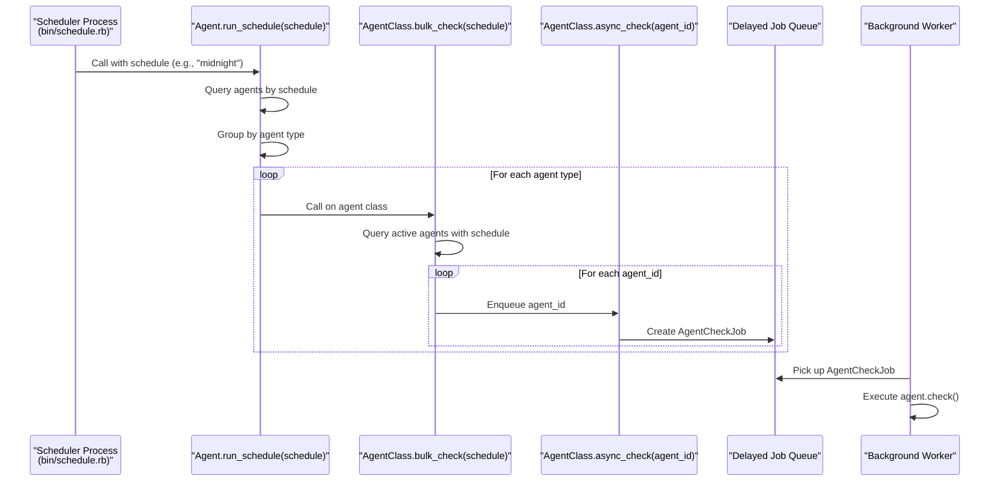
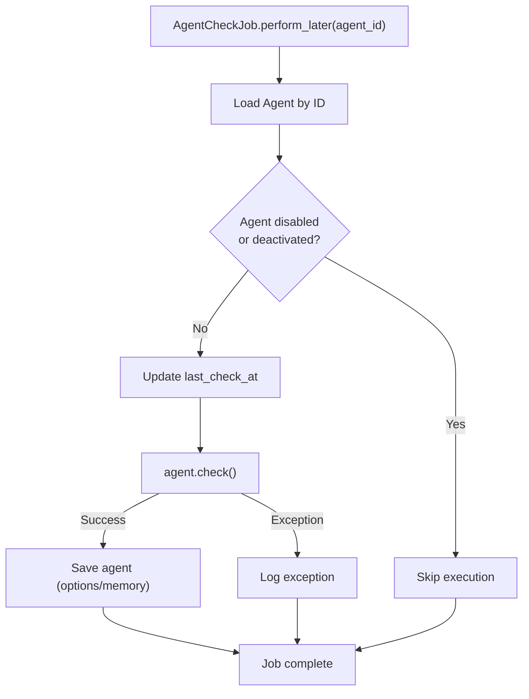
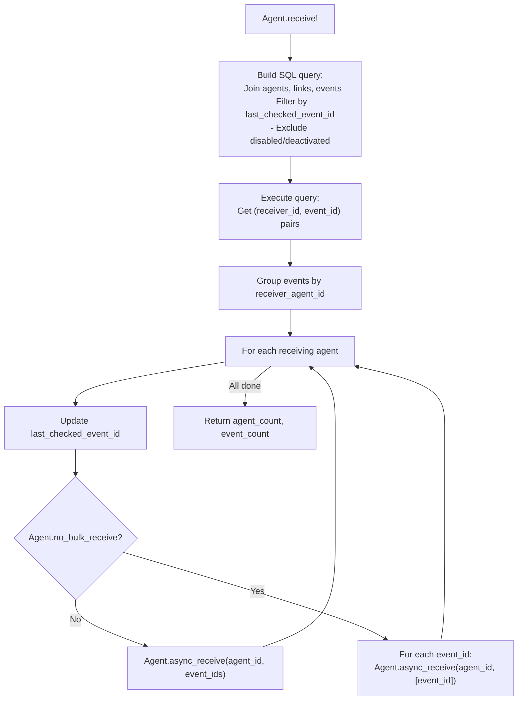
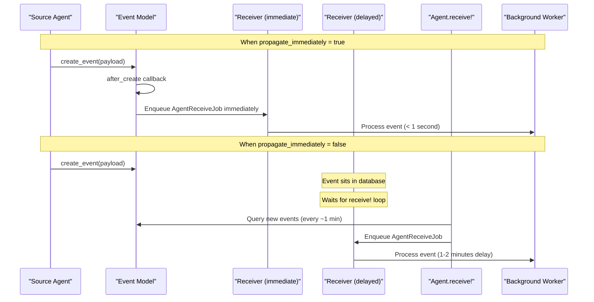
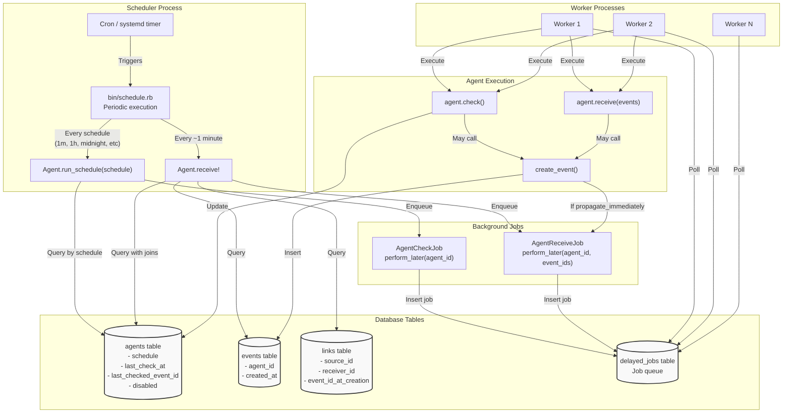

<!-- source: DeepWiki mcp.deepwiki.com · repo huginn/huginn · page 3.3 Scheduling and Background Jobs · fetched 2026-10-29 -->

# Scheduling and Background Jobs

<details>
<summary>Relevant source files</summary>

The following files were used as context for generating this wiki page:

- [Gemfile](Gemfile)
- [Gemfile.lock](Gemfile.lock)
- [app/models/agent.rb](app/models/agent.rb)
- [app/views/agents/_form.html.erb](app/views/agents/_form.html.erb)
- [spec/models/agent_spec.rb](spec/models/agent_spec.rb)
- [spec/rails_helper.rb](spec/rails_helper.rb)

</details>


This document explains Huginn's scheduling and background job processing systems, which together enable automated agent execution and event propagation. It covers the Rufus-Scheduler integration for time-based scheduling, Delayed Job for asynchronous task processing, and the mechanisms for propagating events between agents.

For information about the Agent lifecycle and capabilities, see [Agent System](#3.1). For details on event creation and propagation through agent graphs, see [Event-Driven Architecture](#3.2).

## Overview

Huginn's scheduling system consists of two complementary subsystems:

1. **Time-based Scheduling**: Rufus-Scheduler triggers agent checks at configured intervals (e.g., `every_1h`, `midnight`, `5pm`)
2. **Asynchronous Job Processing**: Delayed Job executes agent checks and event propagation in background workers

Agents are either schedule-driven (run at fixed intervals) or event-driven (run when receiving events from sources). The system tracks which events have been propagated to which agents to prevent duplicate processing.

**Sources**: [app/models/agent.rb:1-524](), [Gemfile:88-89](), [Gemfile:122]()

## Scheduling System

### Schedule Configuration

Huginn defines 27 built-in schedule options in the `SCHEDULES` constant. These include minute-based intervals, hour-based intervals, day-based intervals, and specific times of day:

| Schedule Type | Examples |
|---------------|----------|
| Minute intervals | `every_1m`, `every_2m`, `every_5m`, `every_10m`, `every_30m` |
| Hour intervals | `every_1h`, `every_2h`, `every_5h`, `every_12h` |
| Day intervals | `every_1d`, `every_2d`, `every_7d` |
| Specific times | `midnight`, `1am`, `2am`, ..., `11pm`, `noon` |
| Special | `never` (disables scheduled execution) |

The `never` schedule explicitly prevents an agent from being scheduled, which is useful for event-driven agents.

**Sources**: [app/models/agent.rb:21-28]()

### Schedule Validation and Assignment

Agents validate their schedule during the validation phase and automatically set default schedules:

```
Agent Initialization Flow:

1. after_initialize → set_default_schedule
2. before_validation → set_default_schedule
3. before_validation → unschedule_if_cannot_schedule
4. validate → validate_schedule
```

The `validate_schedule` method ensures the schedule is in the `SCHEDULES` list (unless the agent `cannot_be_scheduled`). The `set_default_schedule` callback applies the agent class's default schedule if none is set. The `unschedule_if_cannot_schedule` callback forces the schedule to `nil` for agents that declare `cannot_be_scheduled!`.

**Sources**: [app/models/agent.rb:51-54](), [app/models/agent.rb:263-269](), [app/models/agent.rb:287-295]()

### Schedule Execution: `Agent.run_schedule`

The `Agent.run_schedule` class method is the entry point for executing all agents with a given schedule. It is called periodically by the scheduler process (typically `bin/schedule.rb`):

**Diagram: Schedule Execution Flow**



The method performs the following steps:

1. Returns immediately if schedule is `"never"`
2. Queries all agents with the given schedule, grouped by type
3. For each agent type, calls `AgentClass.bulk_check(schedule)`
4. Each `bulk_check` implementation queries its active agents and calls `async_check` for each
5. `async_check` enqueues an `AgentCheckJob` with the agent's ID

**Sources**: [app/models/agent.rb:453-462](), [app/models/agent.rb:466-472](), [app/models/agent.rb:476-478]()

### Type-Based Bulk Checking

The `bulk_check` method is called once per agent type for a given schedule. The default implementation queries all non-disabled, non-deactivated agents with the schedule and enqueues them individually:

```
Default bulk_check logic:
where("NOT disabled AND NOT deactivated AND schedule = ?", schedule)
  .pluck("agents.id")
  .each { |agent_id| async_check(agent_id) }
```

Custom agent types can override `bulk_check` to implement specialized bulk processing logic, though this is rarely needed.

**Sources**: [app/models/agent.rb:466-472](), [spec/models/agent_spec.rb:34-54](), [spec/models/agent_spec.rb:57-93]()

## Background Job Processing

### AgentCheckJob

`AgentCheckJob` is an ActiveJob that executes an agent's `check` method. When the job runs:

1. Loads the agent from the database by ID
2. Skips execution if the agent is disabled or deactivated
3. Updates `last_check_at` timestamp
4. Calls `agent.check()`
5. Saves any changes to the agent's options or memory
6. Logs any exceptions that occur

**Diagram: AgentCheckJob Execution**



The job is fire-and-forget: it doesn't return a value or block on completion. This allows the scheduler to enqueue thousands of agents simultaneously without blocking.

**Sources**: [app/models/agent.rb:476-478](), [spec/models/agent_spec.rb:243-282]()

### AgentReceiveJob

`AgentReceiveJob` is an ActiveJob that delivers events to an agent. It accepts an agent ID and an array of event IDs:

1. Loads the agent from the database
2. Skips execution if the agent is disabled or deactivated
3. Loads all events by their IDs
4. Calls `agent.receive(events)` with the array of Event objects
5. Logs any exceptions that occur

The key difference from `AgentCheckJob` is that `receive` is passed events rather than being parameterless.

**Sources**: [app/models/agent.rb:447-449](), [spec/models/agent_spec.rb:428-435]()

### Job Queuing with Delayed Job

Huginn uses Delayed Job (via ActiveJob) as its background job processor. The `delayed_job_active_record` gem stores jobs in the database's `delayed_jobs` table, which background workers poll for pending jobs.

Configuration:
- Gem: `delayed_job_active_record` (version 4.1.7)
- Adapter: ActiveRecord (stores jobs in database)
- Workers: Run via `bin/threaded.rb` or similar process manager

Workers can be scaled horizontally by running multiple worker processes, which all poll the same job queue.

**Sources**: [Gemfile:88-89](), [Gemfile.lock:255-259]()

## Event Propagation System

### `Agent.receive!` Method

The `Agent.receive!` class method is the core of Huginn's event propagation system. It's called periodically (typically every minute) to propagate events from source agents to their receivers:

**Diagram: Event Propagation with Agent.receive!**



The method performs a complex SQL join across three tables:

```
SELECT 
  agents.id AS receiver_agent_id,
  sources.type AS source_agent_type,
  agents.type AS receiver_agent_type,
  events.id AS event_id
FROM agents
JOIN links ON (links.receiver_id = agents.id)
JOIN agents AS sources ON (links.source_id = sources.id)
JOIN events ON (events.agent_id = sources.id 
            AND events.id > links.event_id_at_creation)
WHERE NOT agents.disabled 
  AND NOT agents.deactivated
  AND (agents.last_checked_event_id IS NULL 
       OR events.id > agents.last_checked_event_id)
```

This query finds all events that:
1. Were created by a source agent
2. Are newer than the link between source and receiver (prevents backfill)
3. Haven't been seen by the receiver yet (based on `last_checked_event_id`)
4. Belong to non-disabled agents

**Sources**: [app/models/agent.rb:400-443](), [spec/models/agent_spec.rb:284-426]()

### Event Tracking with `last_checked_event_id`

Each agent tracks the highest event ID it has processed in the `last_checked_event_id` column. This prevents duplicate event delivery:

1. When `Agent.receive!` runs, it only finds events with `id > last_checked_event_id`
2. After enqueueing jobs for an agent, it updates `last_checked_event_id` to the maximum event ID
3. Subsequent `receive!` calls skip those events

This tracking is transactional: the entire `receive!` method runs inside `Agent.transaction` to ensure consistency.

**Sources**: [app/models/agent.rb:400-443](), [spec/models/agent_spec.rb:343-355]()

### Link Creation and `event_id_at_creation`

When a link is created between two agents, it records the current maximum event ID in `event_id_at_creation`. This prevents old events from being backfilled to newly connected receivers:

```
Flow when creating a link:
1. User connects Agent A → Agent B
2. Link.event_id_at_creation = max(Agent A's events.id)
3. Only events with id > event_id_at_creation are propagated
```

This design ensures that adding a new receiver doesn't trigger reprocessing of historical events.

**Sources**: [spec/models/agent_spec.rb:384-418]()

### Bulk vs Individual Event Delivery

By default, `Agent.receive!` batches all pending events for an agent into a single job. However, agents can declare `no_bulk_receive!` to receive events one at a time:

| Mode | Behavior | Use Case |
|------|----------|----------|
| Bulk (default) | `async_receive(agent_id, [event1, event2, event3])` | Efficient for most agents |
| Individual | `async_receive(agent_id, [event1])`<br/>`async_receive(agent_id, [event2])`<br/>etc. | Agents with expensive per-event processing |

The `no_bulk_receive?` flag is checked during event propagation, and individual jobs are enqueued accordingly.

**Sources**: [app/models/agent.rb:431-435](), [app/models/agent.rb:380-386](), [spec/models/agent_spec.rb:374-382]()

## Advanced Scheduling Features

### `cannot_be_scheduled!` Declaration

Agents that are purely event-driven can declare `cannot_be_scheduled!` in their class definition. This:

1. Sets the agent's schedule to `nil` and keeps it `nil` (via `unschedule_if_cannot_schedule` callback)
2. Skips schedule validation
3. Hides the schedule field in the UI

Example usage:
```ruby
class Agents::TriggerAgent < Agent
  cannot_be_scheduled!
  
  def receive(events)
    # Process events
  end
end
```

**Sources**: [app/models/agent.rb:335-341](), [app/models/agent.rb:204-210](), [app/models/agent.rb:267-269](), [spec/models/agent_spec.rb:153-161](), [spec/models/agent_spec.rb:207-219]()

### `propagate_immediately` Option

By default, events propagate from sources to receivers when `Agent.receive!` runs (typically every minute). The `propagate_immediately` flag bypasses this delay:

**Diagram: Immediate vs Delayed Propagation**



This feature is useful for time-sensitive workflows where immediate reaction is required. However, it increases CPU usage and job queue load.

**Sources**: [spec/models/agent_spec.rb:461-514]()

### Controller Agents

Agents can be manually triggered by "controller" agents via `ControlLink` relationships. This provides programmatic control over agent execution outside the normal schedule:

| Relationship | Purpose |
|--------------|---------|
| `controllers` | Agents that can trigger this agent |
| `control_targets` | Agents that this agent can trigger |

Controller agents declare `can_control_other_agents!` and typically implement custom logic for when to trigger their targets. This is separate from the scheduling system but complements it for complex workflows.

**Sources**: [app/models/agent.rb:70-75](), [app/models/agent.rb:364-370](), [app/views/agents/_form.html.erb:54-75]()

### `drop_pending_events` Virtual Attribute

When re-enabling a disabled agent, accumulated events may cause a backlog. Setting `drop_pending_events = true` updates `last_checked_event_id` to skip all pending events:

```
Flow for dropping pending events:
1. Agent is disabled for 1 week
2. Source agents create 1000 events during that time
3. User re-enables agent with drop_pending_events = true
4. last_checked_event_id = max(events.id)
5. Agent.receive! skips all 1000 old events
```

This prevents overwhelming agents with stale data after a long disable period.

**Sources**: [app/models/agent.rb:253-259](), [spec/models/agent_spec.rb:916-930](), [spec/models/agent_spec.rb:932-967]()

## System Architecture Summary

**Diagram: Complete Scheduling and Job Architecture**



The complete system involves:

1. **Scheduler Process**: Periodically calls `Agent.run_schedule` (for time-based triggers) and `Agent.receive!` (for event propagation)
2. **Job Queue**: Stores pending `AgentCheckJob` and `AgentReceiveJob` tasks in the database
3. **Worker Processes**: Poll the job queue and execute agent methods (`check` or `receive`)
4. **Database**: Tracks agent schedules, event history, links, and job state

This architecture allows Huginn to scale horizontally by adding more worker processes while maintaining exactly-once event delivery semantics through database-backed tracking.

**Sources**: [app/models/agent.rb:400-478](), [Gemfile:88-89](), [Gemfile:122]()

---

