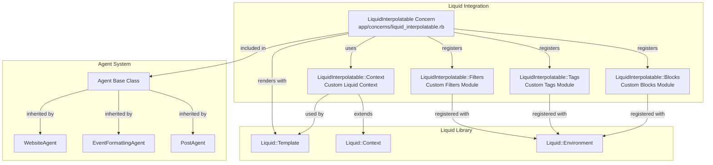
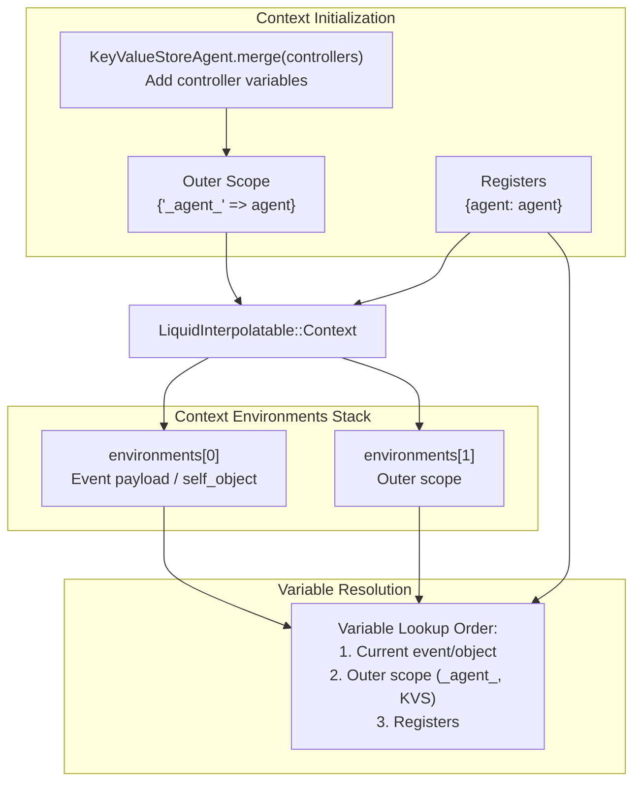
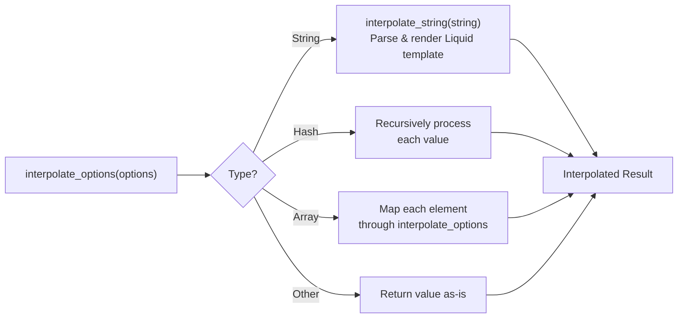
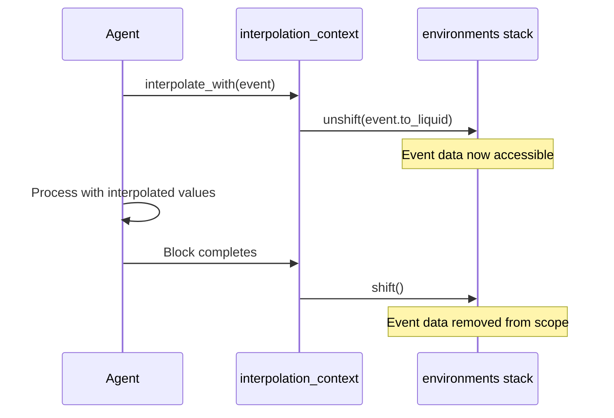
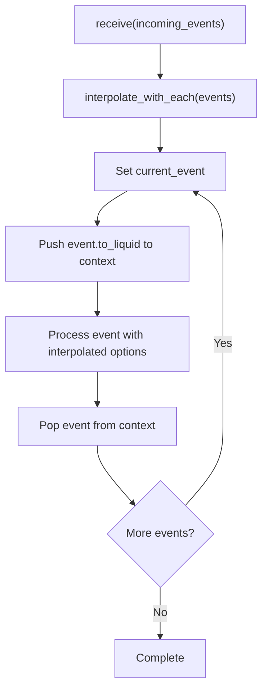
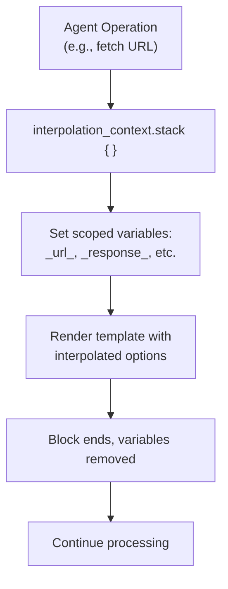
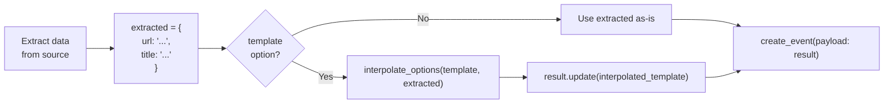
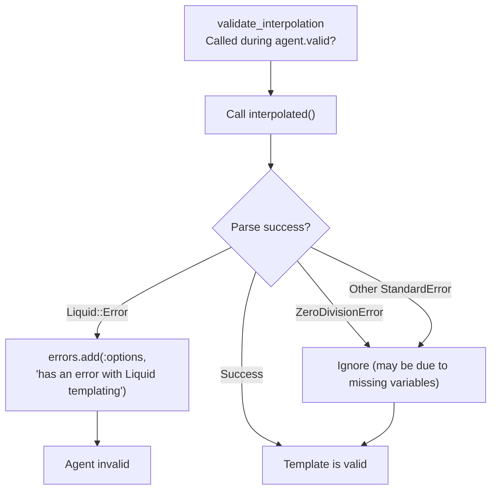
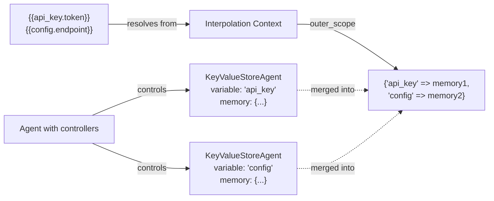

<!-- source: DeepWiki mcp.deepwiki.com · repo huginn/huginn · page 4 Liquid Templating System · fetched 2026-10-29 -->

# Liquid Templating System

<details>
<summary>Relevant source files</summary>

The following files were used as context for generating this wiki page:

- [app/concerns/liquid_droppable.rb](app/concerns/liquid_droppable.rb)
- [app/concerns/liquid_interpolatable.rb](app/concerns/liquid_interpolatable.rb)
- [app/concerns/web_request_concern.rb](app/concerns/web_request_concern.rb)
- [app/models/agents/event_formatting_agent.rb](app/models/agents/event_formatting_agent.rb)
- [app/models/agents/website_agent.rb](app/models/agents/website_agent.rb)
- [lib/utils.rb](lib/utils.rb)
- [lib/utils/html_transformer.rb](lib/utils/html_transformer.rb)
- [spec/concerns/liquid_interpolatable_spec.rb](spec/concerns/liquid_interpolatable_spec.rb)
- [spec/data_fixtures/urlTest.html](spec/data_fixtures/urlTest.html)
- [spec/lib/utils_spec.rb](spec/lib/utils_spec.rb)
- [spec/models/agents/event_formatting_agent_spec.rb](spec/models/agents/event_formatting_agent_spec.rb)
- [spec/models/agents/website_agent_spec.rb](spec/models/agents/website_agent_spec.rb)
- [spec/support/shared_examples/liquid_interpolatable.rb](spec/support/shared_examples/liquid_interpolatable.rb)
- [spec/support/shared_examples/web_request_concern.rb](spec/support/shared_examples/web_request_concern.rb)

</details>


The Liquid Templating System in Huginn provides dynamic configuration and data transformation capabilities across all agents. Liquid is a templating language that allows users to reference event data, agent properties, and credentials using expressions like `{{variable}}` in agent options. Huginn extends the standard Liquid implementation with custom filters, tags, and context management tailored for agent-based automation.

This page covers the core Liquid architecture and integration with agents. For details on how template interpolation works, see [Template Interpolation](#4.1). For documentation of Huginn's custom filters and tags, see [Custom Filters and Tags](#4.2).

## Core Architecture

### LiquidInterpolatable Concern

The Liquid templating system is implemented as the `LiquidInterpolatable` concern, which is included in the base `Agent` class. This makes Liquid templating available to all agents throughout the system.



**Sources:** [app/concerns/liquid_interpolatable.rb:3-8](), [app/concerns/liquid_interpolatable.rb:112-132](), [app/concerns/liquid_interpolatable.rb:408-436]()

The concern provides several key capabilities:

| Method | Purpose |
|--------|---------|
| `interpolation_context` | Returns the current Liquid context for the agent |
| `interpolate_with(object)` | Evaluates templates with a specific object as the data source |
| `interpolate_options(options)` | Recursively interpolates all strings in an options hash |
| `interpolate_string(string)` | Interpolates a single Liquid template string |
| `interpolated` | Returns the agent's options with all templates interpolated |

**Sources:** [app/concerns/liquid_interpolatable.rb:39-110]()

### Interpolation Context

The `LiquidInterpolatable::Context` class extends `Liquid::Context` to provide agent-specific functionality:



**Sources:** [app/concerns/liquid_interpolatable.rb:112-132]()

The context initialization in [app/concerns/liquid_interpolatable.rb:113-121]() performs these steps:

1. **Outer Scope Setup**: Creates a hash containing `_agent_` (the current agent)
2. **KeyValueStore Integration**: Merges controller agents' variables into the outer scope
3. **Registers**: Stores the agent reference for use by custom tags like ``

When an agent processes events, it uses `interpolate_with(event)` to push the event's payload onto the environment stack, making event data accessible as Liquid variables.

**Sources:** [app/concerns/liquid_interpolatable.rb:56-68]()

## Interpolation Methods

### Recursive Interpolation

The `interpolate_options` method recursively processes nested data structures:



**Sources:** [app/concerns/liquid_interpolatable.rb:80-95]()

This enables complex nested structures like:

```json
{
  "simple": "{{value}}",
  "nested": {
    "field": "{{nested.value}}"
  },
  "array": ["{{item1}}", "{{item2}}"]
}
```

### Scoped Variable Management

The `interpolate_with` method provides scoped variable access:



**Sources:** [app/concerns/liquid_interpolatable.rb:56-78]()

This pattern is used extensively in agent implementations, such as [app/models/agents/website_agent.rb:421-425]() where WebsiteAgent sets `_url_` and `_response_` for template processing.

## Agent Integration Patterns

### Pattern 1: Event Processing with Interpolation

Most agents follow this pattern when receiving events:



**Example Implementation:**
```ruby
def receive(incoming_events)
  incoming_events.each do |event|
    interpolate_with(event) do
      # Agent-specific processing using interpolated['option_name']
    end
  end
end
```

**Sources:** [app/concerns/liquid_interpolatable.rb:71-78](), [app/models/agents/event_formatting_agent.rb:126-138]()

### Pattern 2: Scoped Variables in Templates

Agents can provide temporary variables for specific template rendering:



**Example from WebsiteAgent:**
```ruby
interpolation_context.stack {
  interpolation_context['_url_'] = uri.to_s
  interpolation_context['_response_'] = ResponseDrop.new(response)
  handle_data(response.body, response.env[:url], existing_payload)
}
```

**Sources:** [app/models/agents/website_agent.rb:421-425](), [app/models/agents/website_agent.rb:517-520]()

### Pattern 3: Template Option

Many agents support a `template` option for post-processing extracted data:



**Sources:** [app/models/agents/website_agent.rb:468-481]()

## Available Variables in Liquid Templates

### Event Payload Variables

When processing events, all keys from the event's payload are accessible as Liquid variables:

```json
{
  "title": "Example",
  "nested": {
    "value": 42
  }
}
```

Can be accessed as:
- `{{title}}` → "Example"
- `{{nested.value}}` → 42

### Special Agent Variables

| Variable | Type | Description |
|----------|------|-------------|
| `_agent_` | Agent Drop | The current agent object with properties like `name`, `type`, `options` |
| `created_at` | Timestamp | Event creation time (when processing events) |
| `agent` | Agent Drop | The source agent of the event being processed |

**Sources:** [app/concerns/liquid_interpolatable.rb:114](), [app/models/agents/event_formatting_agent.rb:37]()

### Agent-Specific Variables

Different agents provide additional context variables:

**WebsiteAgent Variables:**
| Variable | Description |
|----------|-------------|
| `_url_` | The URL being fetched |
| `_response_.status` | HTTP status code |
| `_response_.headers` | HTTP response headers |
| `_response_.url` | Final URL after redirects |

**Sources:** [app/models/agents/website_agent.rb:186-197]()

## Custom Extensions Overview

Huginn extends Liquid with numerous custom filters, tags, and blocks designed for automation workflows. These are registered globally and available in all agent templates.

### Custom Filters (Brief Overview)

Huginn provides over 30 custom filters including:

- **URI Processing**: `uri_escape`, `to_uri`, `uri_expand`, `rebase_hrefs`
- **String Manipulation**: `regex_extract`, `regex_replace`, `regex_replace_first`, `to_xpath`, `unescape`
- **Data Transformation**: `json`, `fromjson`, `as_object`, `group_by`
- **Cryptographic**: `md5`, `sha1`, `sha256`, `hmac_sha1`, `hmac_sha256`
- **Encoding**: `hex_encode`, `hex_decode`

For complete documentation, see [Custom Filters and Tags](#4.2).

**Sources:** [app/concerns/liquid_interpolatable.rb:135-407]()

### Custom Tags

| Tag | Syntax | Purpose |
|-----|--------|---------|
| `credential` | `` | Access stored user credentials |
| `line_break` | `` | Insert a newline character |
| `uuidv4` | `` | Generate a UUID v4 string |

**Sources:** [app/concerns/liquid_interpolatable.rb:410-436]()

### Custom Blocks

The `regex_replace` and `regex_replace_first` blocks enable complex pattern matching and replacement:

```liquid

  Use me like this.

  {{ match | capitalize }}

```

The `match` variable provides access to capture groups and match metadata.

**Sources:** [app/concerns/liquid_interpolatable.rb:438-534]()

## Validation and Error Handling

The `LiquidInterpolatable` concern includes automatic validation of Liquid templates:



**Sources:** [app/concerns/liquid_interpolatable.rb:16-25]()

This ensures that agents with malformed Liquid templates cannot be saved, providing immediate feedback to users.

## Common Usage Examples

### Example 1: Simple Variable Interpolation

```json
{
  "message": "Hello {{name}}, the weather is {{conditions}}"
}
```

With event payload `{"name": "Alice", "conditions": "sunny"}`, this renders to:
```
"Hello Alice, the weather is sunny"
```

### Example 2: Accessing Nested Data

```json
{
  "url": "{{link | to_uri: _response_.url}}",
  "description": "{{body_text}}",
  "last_modified": "{{_response_.headers.Last-Modified | date: '%FT%T'}}"
}
```

**Sources:** [app/models/agents/website_agent.rb:174-180]()

### Example 3: Using Filters

```json
{
  "escaped_title": "{{title | uri_escape}}",
  "hash": "{{content | sha256}}",
  "parsed": "{{json_string | fromjson}}"
}
```

### Example 4: Conditional Templating

```json
{
  "mode": "mergeclean"
}
```

**Sources:** [app/models/agents/event_formatting_agent.rb:77-80]()

## Integration with KeyValueStoreAgent

The Liquid context automatically integrates with `KeyValueStoreAgent` controllers, making their stored variables globally accessible:



**Sources:** [app/concerns/liquid_interpolatable.rb:116-118]()

This allows agents to reference shared configuration without hardcoding values:

```json
{
  "url": "{{api_config.base_url}}/endpoint",
  "headers": {
    "Authorization": "Bearer {{credentials.token}}"
  }
}
```

## Performance Considerations

### Template Caching

The `interpolated` method caches parsed templates based on options and context:

```ruby
(@interpolated_cache ||= {})[[options, interpolation_context].hash] ||=
  interpolate_options(options)
```

This cache is invalidated when:
- Agent options change
- Interpolation context changes (different event being processed)

**Sources:** [app/concerns/liquid_interpolatable.rb:97-102]()

### Context Stack Management

The `interpolation_context.stack {}` pattern ensures variables are properly scoped and cleaned up, preventing memory leaks in long-running agent processes.

**Sources:** [app/concerns/liquid_interpolatable.rb:32-37]()

---

**Sources:** [app/concerns/liquid_interpolatable.rb](), [app/models/agents/website_agent.rb:17-201](), [app/models/agents/event_formatting_agent.rb:6-84](), [spec/concerns/liquid_interpolatable_spec.rb]()

---

