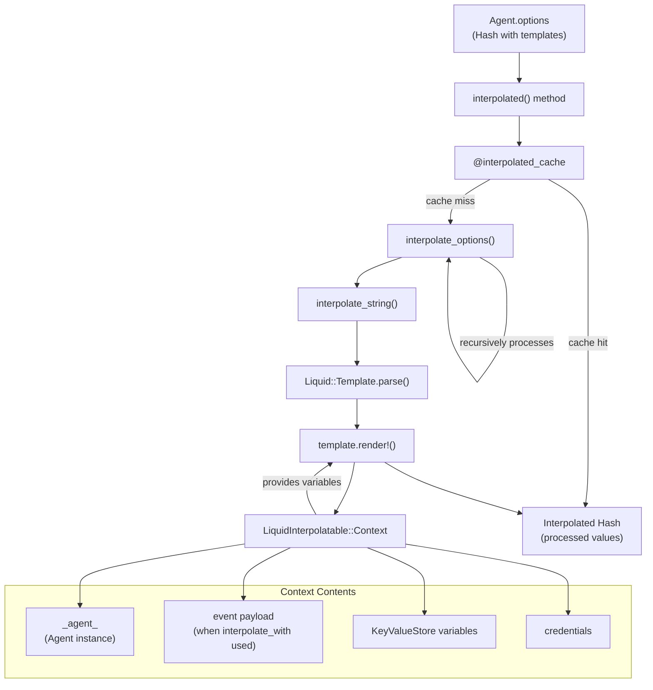
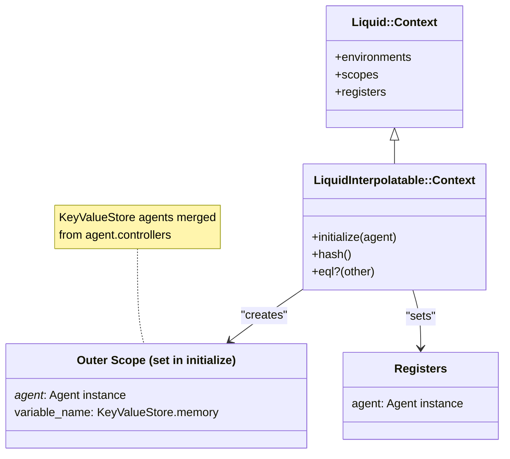
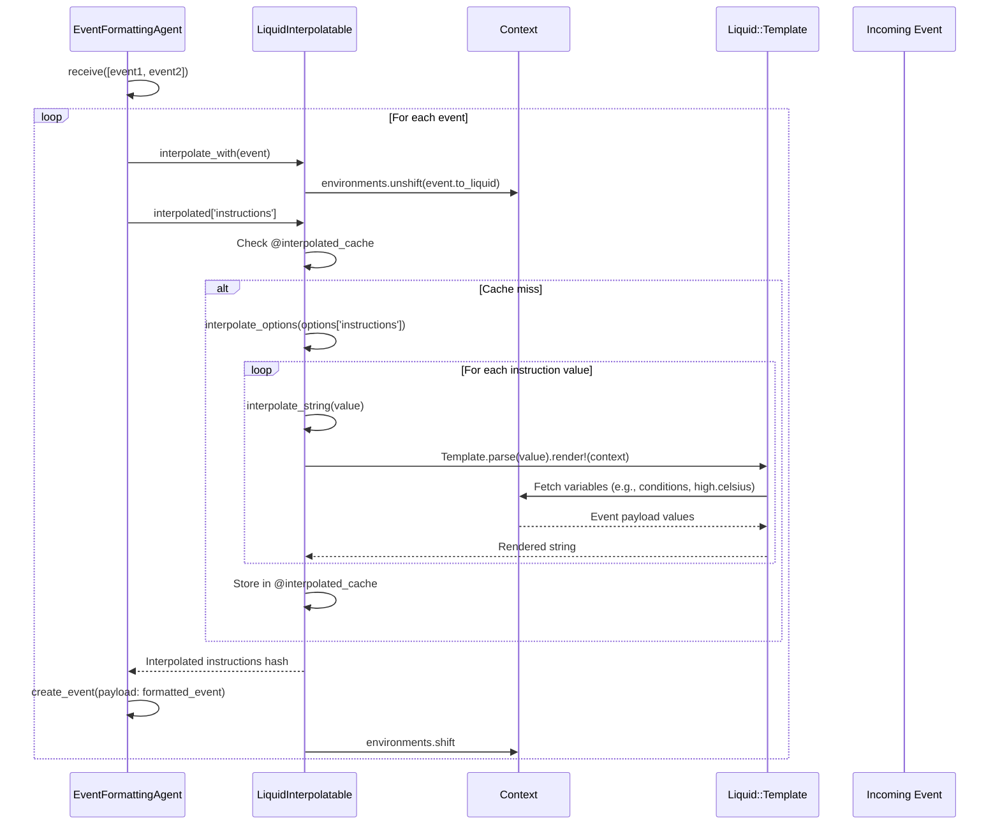

<!-- source: DeepWiki mcp.deepwiki.com · repo huginn/huginn · page 4.1 Template Interpolation · fetched 2026-10-29 -->

# Template Interpolation

<details>
<summary>Relevant source files</summary>

The following files were used as context for generating this wiki page:

- [app/concerns/liquid_droppable.rb](app/concerns/liquid_droppable.rb)
- [app/concerns/liquid_interpolatable.rb](app/concerns/liquid_interpolatable.rb)
- [app/models/agents/event_formatting_agent.rb](app/models/agents/event_formatting_agent.rb)
- [spec/concerns/liquid_interpolatable_spec.rb](spec/concerns/liquid_interpolatable_spec.rb)
- [spec/models/agents/event_formatting_agent_spec.rb](spec/models/agents/event_formatting_agent_spec.rb)
- [spec/support/shared_examples/liquid_interpolatable.rb](spec/support/shared_examples/liquid_interpolatable.rb)

</details>


## Purpose and Scope

Template Interpolation is the mechanism by which Huginn agents dynamically replace Liquid template expressions in their configuration options with actual values at runtime. This system allows agents to reference event data, agent properties, credentials, and KeyValueStore variables using Liquid template syntax (e.g., `{{event.payload.value}}`).

This page covers the interpolation engine, context management, and the core methods that agents use to process templated options. For information about specific Liquid filters and tags available in Huginn, see [Custom Filters and Tags](#4.2). For examples of how individual agents use interpolation, see [Agent Reference](#5).

---

## Core Concepts

Template interpolation in Huginn is implemented through the `LiquidInterpolatable` concern, which is included in the `Agent` base class. When an agent's options contain Liquid template expressions, those expressions are evaluated against an interpolation context that contains:

- Event payload data (when processing incoming events)
- The agent itself (accessible as `_agent_`)
- User credentials (via the `credential` tag)
- KeyValueStore variables (from controller agents)
- Temporary local variables (set within `interpolation_context.stack` blocks)

**Key Template Syntax:**
- Variable access: `{{event.payload.key}}` or `{{key}}`
- Filters: `{{text | upcase | uri_escape}}`
- Tags: ``, ``
- Blocks: `......`

**Sources:**
- [app/concerns/liquid_interpolatable.rb:1-535]()
- [spec/concerns/liquid_interpolatable_spec.rb:1-478]()

---

## Interpolation Workflow

The following diagram illustrates how template interpolation flows from raw agent options through the Liquid engine to produce final interpolated values:



**Sources:**
- [app/concerns/liquid_interpolatable.rb:97-102]() - `interpolated` method
- [app/concerns/liquid_interpolatable.rb:80-95]() - `interpolate_options` method
- [app/concerns/liquid_interpolatable.rb:104-110]() - `interpolate_string` method
- [app/concerns/liquid_interpolatable.rb:112-132]() - `Context` class

---

## Key Components

### LiquidInterpolatable Module

The `LiquidInterpolatable` concern is the core module that provides template interpolation capabilities to agents. It is included in the `Agent` base class.

| Method | Purpose | Returns |
|--------|---------|---------|
| `interpolated(self_object = nil)` | Returns fully interpolated options hash | `Hash` |
| `interpolate_options(options, self_object = nil)` | Recursively interpolates a data structure | `Hash`, `Array`, or `String` |
| `interpolate_string(string, self_object = nil)` | Interpolates a single string template | `String` or `Object` |
| `interpolate_with(self_object) { block }` | Temporarily adds context while executing block | `void` |
| `interpolation_context` | Returns the current interpolation context | `LiquidInterpolatable::Context` |

**Sources:**
- [app/concerns/liquid_interpolatable.rb:3-110]()

### Context Class

The `LiquidInterpolatable::Context` class extends `Liquid::Context` to provide Huginn-specific variable scoping and initialization:



**Initialization Process (line 113-121):**

1. Creates outer scope with `_agent_` variable pointing to the agent
2. Queries all `KeyValueStoreAgent` instances from `agent.controllers`
3. For each KeyValueStore, adds its memory under the variable name from options
4. Stores agent reference in registers for use by tags like `credential`

**Sources:**
- [app/concerns/liquid_interpolatable.rb:112-132]()
- [spec/concerns/liquid_interpolatable_spec.rb:469-476]() - `_agent_` usage example

---

## Context Management and Stacking

The interpolation context uses a stack-based scoping system to manage temporary variables and event-specific data. The `interpolate_with` method is the primary mechanism for adding context:

```mermaid
graph TB
    subgraph "Normal State"
        Context1["Context"]
        OuterScope1["Outer Scope<br/>{_agent_: agent,<br/>kvs_var: memory}"]
        Context1 --> OuterScope1
    end
    
    subgraph "During interpolate_with(event)"
        Context2["Context"]
        EventScope["Event Environment<br/>{event.payload keys}"]
        OuterScope2["Outer Scope<br/>{_agent_: agent,<br/>kvs_var: memory}"]
        Context2 --> EventScope
        EventScope --> OuterScope2
        EventScope -.->|"environments.unshift"| EventScope
        OuterScope2 -.->|"after block ends<br/>environments.shift"| OuterScope2
    end
    
    subgraph "During interpolation_context.stack"
        Context3["Context"]
        LocalScope["Local Scope<br/>{_var1_: value1,<br/>_var2_: value2}"]
        EventScope3["Event Environment<br/>(if applicable)"]
        OuterScope3["Outer Scope"]
        Context3 --> LocalScope
        LocalScope --> EventScope3
        EventScope3 --> OuterScope3
    end
```



### interpolate_with Pattern

The `interpolate_with` method temporarily adds an object's properties to the context environment stack:

**Method signature:** [app/concerns/liquid_interpolatable.rb:56-69]()

```
def interpolate_with(self_object)
  case self_object
  when nil
    yield
  else
    context = interpolation_context
    begin
      context.environments.unshift(self_object.to_liquid)
      yield
    ensure
      context.environments.shift
    end
  end
end
```

**Common Usage Pattern:**

```ruby
def receive(incoming_events)
  incoming_events.each do |event|
    interpolate_with(event) do
      # Within this block, event payload keys are accessible
      # as Liquid variables, e.g., {{title}} for event.payload['title']
      formatted = interpolated['some_option']
      # Process formatted value...
    end
  end
end
```

**Sources:**
- [app/concerns/liquid_interpolatable.rb:56-69]() - `interpolate_with` implementation
- [app/models/agents/event_formatting_agent.rb:129-138]() - Usage in EventFormattingAgent
- [spec/support/shared_examples/liquid_interpolatable.rb:75-85]() - Usage test

---

## Key Methods in Detail

### interpolated(self_object = nil)

The primary method agents use to access their interpolated options. This method:

1. Creates a cache key from options and context hash
2. Returns cached result if available
3. Otherwise calls `interpolate_options` and caches the result

**Implementation:** [app/concerns/liquid_interpolatable.rb:97-102]()

**Caching behavior:** The cache is keyed by `[options, interpolation_context].hash`, meaning the cache is invalidated when:
- Agent options change
- The interpolation context changes (different event, different scope)

**Example:**
```ruby
# In an agent's check or receive method
url = interpolated['url']  # Returns interpolated value of options['url']
```

**Sources:**
- [app/concerns/liquid_interpolatable.rb:97-102]()
- [spec/concerns/liquid_interpolatable_spec.rb:23-31]() - Basic interpolation test

### interpolate_options(options, self_object = nil)

Recursively processes a data structure, interpolating any strings it encounters. Handles:

- **Strings:** Passed to `interpolate_string`
- **Hashes:** Each value recursively interpolated
- **Arrays:** Each element recursively interpolated  
- **Other types:** Returned unchanged

**Implementation:** [app/concerns/liquid_interpolatable.rb:80-95]()

**Type handling:**

| Input Type | Processing |
|------------|-----------|
| `String` | `interpolate_string(value)` |
| `Hash` / `HashWithIndifferentAccess` | Recursively process each value |
| `Array` | Recursively process each element |
| Other | Return as-is |

**Sources:**
- [app/concerns/liquid_interpolatable.rb:80-95]()
- [spec/support/shared_examples/liquid_interpolatable.rb:33-51]() - Recursive interpolation tests

### interpolate_string(string, self_object = nil)

Parses and renders a single Liquid template string. Uses Ruby's `catch/throw` mechanism to support the `as_object` filter (which allows returning non-string objects from templates).

**Implementation:** [app/concerns/liquid_interpolatable.rb:104-110]()

```ruby
def interpolate_string(string, self_object = nil)
  interpolate_with(self_object) do
    catch :as_object do
      Liquid::Template.parse(string).render!(interpolation_context)
    end
  end
end
```

**The `as_object` filter:** [app/concerns/liquid_interpolatable.rb:314-316]() throws `:as_object` with the Ruby object, allowing templates to return arrays, hashes, or other objects instead of strings.

**Sources:**
- [app/concerns/liquid_interpolatable.rb:104-110]()
- [spec/concerns/liquid_interpolatable_spec.rb:316-368]() - `as_object` filter tests

---

## Validation and Error Handling

The module includes validation to catch Liquid syntax errors during agent configuration:

**Validation method:** [app/concerns/liquid_interpolatable.rb:16-25]()

```ruby
def validate_interpolation
  interpolated
rescue Liquid::ZeroDivisionError => e
  # Ignore (may be missing variables)
rescue Liquid::Error => e
  errors.add(:options, "has an error with Liquid templating: #{e.message}")
rescue StandardError
  # Calling interpolated without an incoming event may naturally fail
end
```

This validation runs when an agent is saved, catching common template errors like:
- Unclosed template tags: `{{foo}`
- Invalid filter syntax: `{{bar | invalid_filter}}`
- Syntax errors in regex patterns (for regex_replace blocks)

**Sources:**
- [app/concerns/liquid_interpolatable.rb:6-25]()
- [spec/concerns/liquid_interpolatable_spec.rb:34-38]() - Validation error test

---

## Integration with Agents

The following diagram shows how a typical event-processing agent uses the interpolation system:



### Example: EventFormattingAgent

The EventFormattingAgent demonstrates complete interpolation workflow:

**Configuration:**
```json
{
  "instructions": {
    "message": "Today's conditions: {{conditions}}",
    "temp": "{{high.celsius}} degrees"
  },
  "mode": "clean"
}
```

**Processing:** [app/models/agents/event_formatting_agent.rb:126-138]()

```ruby
def receive(incoming_events)
  incoming_events.each do |event|
    interpolate_with(event) do
      # Now event.payload keys are accessible as {{key}}
      formatted_event = interpolated['mode'].to_s == "merge" ? event.payload.dup : {}
      formatted_event.merge! interpolated['instructions']
      create_event payload: formatted_event
    end
  end
end
```

**Sources:**
- [app/models/agents/event_formatting_agent.rb:126-138]()
- [spec/models/agents/event_formatting_agent_spec.rb:65-102]()

---

## Caching Strategy

The interpolation system includes a caching mechanism to avoid re-parsing and re-rendering templates unnecessarily:

**Cache Implementation:** [app/concerns/liquid_interpolatable.rb:97-102]()

```ruby
def interpolated(self_object = nil)
  interpolate_with(self_object) do
    (@interpolated_cache ||= {})[[options, interpolation_context].hash] ||=
      interpolate_options(options)
  end
end
```

### Cache Key Structure

The cache key is a hash of two components:

1. **`options`** - The agent's configuration hash
2. **`interpolation_context`** - The current context (includes environments stack)

The `Context` class implements custom `hash` and `eql?` methods: [app/concerns/liquid_interpolatable.rb:123-131]()

```ruby
def hash
  [@environments, @scopes, @registers].hash
end

def eql?(other)
  other.environments == @environments &&
    other.scopes == @scopes &&
    other.registers == @registers
end
```

### Cache Invalidation

The cache is automatically invalidated when:

| Change | Effect |
|--------|--------|
| Agent options modified | Different `options` hash → new cache key |
| Different event processed | Different `environments` → new cache key |
| `interpolate_with` block entered | Context environment changes → new cache key |
| Local variables added/removed | Context scopes change → new cache key |

**Note:** The cache is instance-level (`@interpolated_cache`), so it persists across multiple method calls but not across agent instances.

**Sources:**
- [app/concerns/liquid_interpolatable.rb:97-102]()
- [app/concerns/liquid_interpolatable.rb:123-131]()

---

## Advanced Patterns

### Matchers in EventFormattingAgent

The EventFormattingAgent demonstrates an advanced pattern where regex matching results are merged into the interpolation context:

**Pattern:** [app/models/agents/event_formatting_agent.rb:183-215]()

```ruby
def apply_compiled_matchers(matchers, event, &block)
  return yield if matchers.nil?
  
  hash = {}.update(event.payload)
  
  matchers.each do |re, path, to|
    m = re.match(interpolate_string(path, hash)) or next
    
    # Create hash to store match results
    mhash = to ? (hash[to] = {}) : hash
    
    # Add numbered captures: "0", "1", "2", etc.
    m.size.times { |i| mhash[i.to_s] = m[i] }
    
    # Add named captures
    m.names.each { |name| mhash[name] = m[name] }
  end
  
  interpolate_with(hash, &block)
end
```

This pattern:
1. Performs regex matching against interpolated paths
2. Adds match data to a temporary hash
3. Uses `interpolate_with(hash)` to make match results available in subsequent interpolations

**Sources:**
- [app/models/agents/event_formatting_agent.rb:183-215]()
- [spec/models/agents/event_formatting_agent_spec.rb:91-102]() - Matchers test

### Local Variables with interpolation_context.stack

Agents can create temporary local scopes using `interpolation_context.stack`:

```ruby
interpolation_context.stack {
  interpolation_context['_temp_var_'] = computed_value
  result = interpolated['some_option']
  # _temp_var_ is accessible within this block
}
# _temp_var_ is no longer accessible
```

**Sources:**
- [app/concerns/liquid_interpolatable.rb:27-41]() - Documentation comment
- [spec/support/shared_examples/liquid_interpolatable.rb:58-73]() - Local variable test

---

## Special Context Variables

### _agent_ Variable

Every interpolation context includes the `_agent_` variable, providing access to the agent's properties:

**Available properties:** All methods defined in `Agent::Drop` [app/concerns/liquid_droppable.rb]() including:
- `{{_agent_.name}}` - Agent name
- `{{_agent_.type}}` - Agent class name
- `{{_agent_.options}}` - Raw (un-interpolated) options
- `{{_agent_.disabled}}` - Whether agent is disabled
- `{{_agent_.memory}}` - Agent memory hash

**Setup:** [app/concerns/liquid_interpolatable.rb:113-121]()

```ruby
def initialize(agent)
  outer_scope = { '_agent_' => agent }
  # ... KeyValueStore variables added ...
  super({}, outer_scope, { agent: }, true)
end
```

**Sources:**
- [app/concerns/liquid_interpolatable.rb:113-121]()
- [spec/concerns/liquid_interpolatable_spec.rb:469-476]()

### KeyValueStore Variables

When an agent has KeyValueStoreAgent controllers, their memory is automatically accessible:

```ruby
# If a KeyValueStoreAgent has options['variable'] = 'my_storage'
# Then in any controlled agent:
{{my_storage.some_key}}  # Accesses KeyValueStoreAgent.memory['some_key']
```

**Setup:** [app/concerns/liquid_interpolatable.rb:116-118]()

```ruby
Agents::KeyValueStoreAgent.merge(agent.controllers).find_each do |kvs|
  outer_scope[kvs.options[:variable]] = kvs.memory
end
```

**Sources:**
- [app/concerns/liquid_interpolatable.rb:116-118]()

---

## Summary

The Template Interpolation system provides a powerful, flexible way for agents to dynamically configure their behavior based on runtime data. Key takeaways:

1. **Primary method:** Use `interpolated` to access fully processed options
2. **Event context:** Use `interpolate_with(event)` to make event data accessible
3. **Validation:** Liquid errors are caught during agent configuration save
4. **Caching:** Interpolation results are cached per context to improve performance
5. **Scope management:** Context uses a stack-based system for variable scoping
6. **Special variables:** `_agent_` and KeyValueStore variables are always available

For specific filters and tags available in templates, see [Custom Filters and Tags](#4.2).

**Sources:**
- [app/concerns/liquid_interpolatable.rb:1-535]()
- [spec/concerns/liquid_interpolatable_spec.rb:1-478]()
- [spec/support/shared_examples/liquid_interpolatable.rb:1-109]()

---

