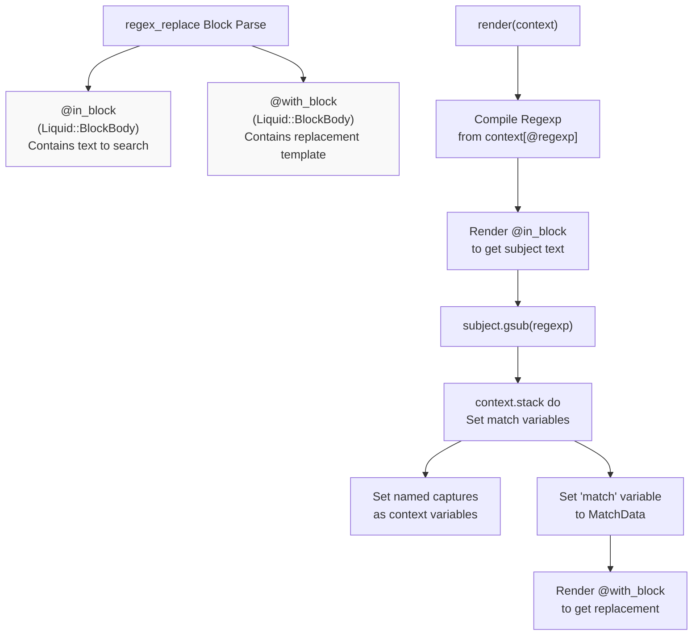
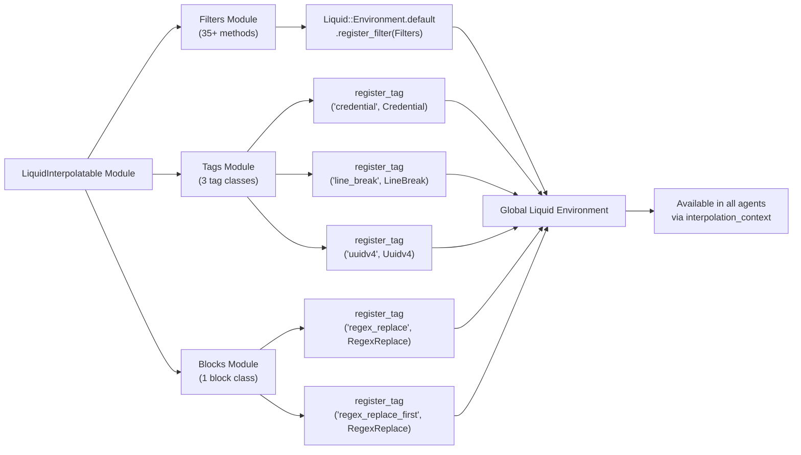

<!-- source: DeepWiki mcp.deepwiki.com · repo huginn/huginn · page 4.2 Custom Filters and Tags · fetched 2026-10-29 -->

# Custom Filters and Tags

<details>
<summary>Relevant source files</summary>

The following files were used as context for generating this wiki page:

- [app/concerns/liquid_droppable.rb](app/concerns/liquid_droppable.rb)
- [app/concerns/liquid_interpolatable.rb](app/concerns/liquid_interpolatable.rb)
- [app/models/agents/event_formatting_agent.rb](app/models/agents/event_formatting_agent.rb)
- [spec/concerns/liquid_interpolatable_spec.rb](spec/concerns/liquid_interpolatable_spec.rb)
- [spec/models/agents/event_formatting_agent_spec.rb](spec/models/agents/event_formatting_agent_spec.rb)
- [spec/support/shared_examples/liquid_interpolatable.rb](spec/support/shared_examples/liquid_interpolatable.rb)

</details>


This page documents Huginn's custom Liquid filters, tags, and blocks that extend the standard Liquid templating engine. These extensions provide specialized functionality for URL manipulation, string processing, cryptographic operations, and data transformation in agent configurations.

For information about basic Liquid template interpolation and context management, see [Template Interpolation](#4.1).

---

## Overview

Huginn extends Liquid's templating capabilities through three types of custom components:

- **Filters**: Functions that transform input values (e.g., `{{ url | uri_escape }}`)
- **Tags**: Self-contained template elements (e.g., ``)
- **Blocks**: Multi-line template structures with opening and closing tags (e.g., `...`)

All custom filters and tags are registered globally through the `Liquid::Environment.default` interface and are available in any agent that includes the `LiquidInterpolatable` concern.

**Sources:** [app/concerns/liquid_interpolatable.rb:3-8](), [app/concerns/liquid_interpolatable.rb:408](), [app/concerns/liquid_interpolatable.rb:434-436]()

---

## Filter Categories

```mermaid
graph TB
    Filters["LiquidInterpolatable::Filters"]
    
    URI["URI/URL Filters"]
    String["String Processing"]
    Data["Data Serialization"]
    Crypto["Encoding & Hashing"]
    Collections["Collection Operations"]
    
    Filters --> URI
    Filters --> String
    Filters --> Data
    Filters --> Crypto
    Filters --> Collections
    
    URI --> uri_escape["uri_escape<br/>CGI.escape"]
    URI --> to_uri["to_uri<br/>Utils.normalize_uri"]
    URI --> uri_expand["uri_expand<br/>Follow redirects"]
    URI --> rebase_hrefs["rebase_hrefs<br/>Utils.rebase_hrefs"]
    
    String --> unescape["unescape<br/>CGI.unescapeHTML"]
    String --> to_xpath["to_xpath<br/>XPath escaping"]
    String --> regex_extract["regex_extract<br/>Regexp.new"]
    String --> regex_replace["regex_replace<br/>gsub"]
    String --> regex_replace_first["regex_replace_first<br/>sub"]
    
    Data --> json["json<br/>JSON.dump"]
    Data --> fromjson["fromjson<br/>JSON.parse"]
    Data --> as_object["as_object<br/>Return Ruby object"]
    
    Crypto --> hex_encode["hex_encode<br/>unpack1('H*')"]
    Crypto --> hex_decode["hex_decode<br/>pack('H*')"]
    Crypto --> md5["md5<br/>Digest::MD5"]
    Crypto --> sha1["sha1<br/>Digest::SHA1"]
    Crypto --> sha256["sha256<br/>Digest::SHA256"]
    Crypto --> hmac_sha1["hmac_sha1<br/>OpenSSL::HMAC"]
    Crypto --> hmac_sha256["hmac_sha256<br/>OpenSSL::HMAC"]
    
    Collections --> group_by["group_by<br/>Enumerable#group_by"]
```



**Sources:** [app/concerns/liquid_interpolatable.rb:135-407]()

---

## URI and URL Manipulation Filters

### `uri_escape`

Percent-encodes a string for safe inclusion in URIs according to RFC 3986.

**Syntax:** `{{ string | uri_escape }}`

**Implementation:** Uses `CGI.escape` to encode characters. Returns the original string if an error occurs.

**Example:**
```liquid
{{ "hello world" | uri_escape }}
# Output: "hello+world"

{{ "abc:/?=" | uri_escape }}
# Output: "abc%3A%2F%3F%3D"
```

**Sources:** [app/concerns/liquid_interpolatable.rb:136-142](), [spec/concerns/liquid_interpolatable_spec.rb:11-19]()

---

### `to_uri`

Parses a string into a URI object, optionally resolving it against a base URI.

**Syntax:** `{{ uri_string | to_uri }}` or `{{ relative_uri | to_uri: base_uri }}`

**Returns:** A URI object with properties: `scheme`, `userinfo`, `host`, `port`, `path`, `query`, `fragment`

**Example:**
```liquid

{{ u.path }}
# Output: "/dir/1"


{{ u.path }}
# Output: "/dir/foo/index.html"
```

**Sources:** [app/concerns/liquid_interpolatable.rb:144-159](), [spec/concerns/liquid_interpolatable_spec.rb:83-132]()

---

### `uri_expand`

Recursively follows HTTP redirects up to a specified limit (default: 5) and returns the final destination URL.

**Syntax:** `{{ short_url | uri_expand }}` or `{{ short_url | uri_expand: limit }}`

**Implementation:** Uses Faraday to follow 301, 302, 303, and 307 redirects. Returns the original URL if it's not HTTP, encounters errors, or exceeds the redirect limit.

**Example:**
```liquid
{{ "https://t.co/abc123" | uri_expand }}
# Output: "http://example.com/final-destination"

{{ "http://many-redirects.com/start" | uri_expand: 10 }}
# Output: follows up to 10 redirects
```

**Sources:** [app/concerns/liquid_interpolatable.rb:161-210](), [spec/concerns/liquid_interpolatable_spec.rb:134-214]()

---

### `rebase_hrefs`

Rebases relative URIs in HTML attributes (`href`, `src`, `srcset`) against a base URI.

**Syntax:** `{{ html_fragment | rebase_hrefs: base_uri }}`

**Implementation:** Uses `Utils.rebase_hrefs` to transform relative URLs to absolute URLs.

**Example:**
```liquid

{{ html | rebase_hrefs: "http://example.com/dir/" }}
# Output: '<a href="http://example.com/dir/file.html">Link</a>'
```

**Sources:** [app/concerns/liquid_interpolatable.rb:212-217](), [spec/concerns/liquid_interpolatable_spec.rb:371-407]()

---

## String Processing Filters

### `unescape`

Decodes HTML entities in a string.

**Syntax:** `{{ html_string | unescape }}`

**Supported Entities:** `&apos;`, `&quot;`, `&lt;`, `&gt;`, `&amp;`, `&#dd;` (decimal), `&#xhh;` (hexadecimal)

**Implementation:** Uses `CGI.unescapeHTML`.

**Example:**
```liquid
{{ "&#39;&lt;foo&gt; &amp; bar" | unescape }}
# Output: "'<foo> & bar"
```

**Sources:** [app/concerns/liquid_interpolatable.rb:219-227](), [spec/concerns/liquid_interpolatable_spec.rb:41-49]()

---

### `to_xpath`

Escapes a string for safe use in XPath expressions by intelligently handling quotes.

**Syntax:** `{{ string | to_xpath }}`

**Implementation:** Splits strings containing both single and double quotes into concatenated segments.

**Example:**
```liquid
{{ "It's a \"test\"" | to_xpath }}
# Output: concat("It's a ", '"test"')
```

**Sources:** [app/concerns/liquid_interpolatable.rb:229-244](), [spec/concerns/liquid_interpolatable_spec.rb:61-81]()

---

### `regex_extract`

Extracts a portion of a string matching a regular expression.

**Syntax:** `{{ string | regex_extract: pattern }}` or `{{ string | regex_extract: pattern, index_or_name }}`

**Parameters:**
- `pattern`: Regular expression pattern
- `index_or_name`: Capture group index (default: 0) or named group name

**Example:**
```liquid
{{ "foo BAR BAZ" | regex_extract: "[A-Z]+" }}
# Output: "BAR"

{{ "foo BAR BAZ" | regex_extract: "[A-Z]([A-Z]+)", 1 }}
# Output: "AR"

{{ "foo BAZ" | regex_extract: "(?<x>.)AZ", "x" }}
# Output: "B"
```

**Sources:** [app/concerns/liquid_interpolatable.rb:246-250](), [spec/concerns/liquid_interpolatable_spec.rb:233-249]()

---

### `regex_replace` / `regex_replace_first`

Replaces text matching a regular expression pattern.

**Syntax:** `{{ string | regex_replace: pattern, replacement }}`

**Difference:** `regex_replace` replaces all occurrences; `regex_replace_first` replaces only the first.

**Escape Sequences in Replacement:**
The replacement string supports special escape sequences defined in [app/concerns/liquid_interpolatable.rb:365-406]():

| Sequence | Meaning |
|----------|---------|
| `\\` | Backslash |
| `\n` | Newline |
| `\t` | Tab |
| `\1`-`\9` | Numbered capture groups |
| `\&` or `\0` | Complete matched text |
| `\k<name>` | Named capture groups |

**Example:**
```liquid
{{ "foobar foobar" | regex_replace: "\S+bar", "foobaz" }}
# Output: "foobaz foobaz"

{{ "foobar zoobar" | regex_replace_first: "\S+bar", "foobaz" }}
# Output: "foobaz zoobar"

{{ "foo\\bar\n\nfoo\\baz" | regex_replace: "\\n+", "\n" }}
# Output: (with newlines collapsed)
```

**Sources:** [app/concerns/liquid_interpolatable.rb:252-258](), [app/concerns/liquid_interpolatable.rb:351-406](), [spec/concerns/liquid_interpolatable_spec.rb:216-266]()

---

## Data Serialization Filters

### `json`

Serializes data as JSON.

**Syntax:** `{{ object | json }}`

**Implementation:** Uses `JSON.dump`.

**Example:**
```liquid

{{ data | json }}
# Output: "{\"foo\":\"bar\"}"
```

**Sources:** [app/concerns/liquid_interpolatable.rb:260-263](), [spec/concerns/liquid_interpolatable_spec.rb:51-59]()

---

### `fromjson`

Parses a JSON string into a Ruby object.

**Syntax:** `{{ json_string | fromjson }}`

**Returns:** Parsed object, or `nil` if parsing fails.

**Example:**
```liquid

{{ obj.array[1] }} and {{ obj.number }}
# Output: "b and 42"
```

**Sources:** [app/concerns/liquid_interpolatable.rb:265-269](), [spec/concerns/liquid_interpolatable_spec.rb:306-314]()

---

### `as_object`

Returns the Ruby object representation instead of converting to a string. **Must be the last filter in an expression.**

**Syntax:** `{{ value | some_filter | as_object }}`

**Use Cases:**
1. Returning arrays from Liquid operations
2. Accessing nested object properties
3. Bypassing string conversion for complex objects

**Implementation:** Uses `throw :as_object` to short-circuit template rendering and return the raw object.

**Example:**
```liquid

# Returns: ["A", "B", "C"] as a Ruby array

{{ something.nested | as_object }}
# Returns: The nested hash without string conversion
```

**Sources:** [app/concerns/liquid_interpolatable.rb:299-316](), [spec/concerns/liquid_interpolatable_spec.rb:316-369]()

---

## Encoding and Hashing Filters

### Hexadecimal Encoding

**`hex_encode`**: `{{ "text" | hex_encode }}` → Converts to hexadecimal string using `unpack1('H*')`

**`hex_decode`**: `{{ "74657874" | hex_decode }}` → Converts from hexadecimal using `pack('H*')`

**Sources:** [app/concerns/liquid_interpolatable.rb:271-277]()

---

### Hash Digest Filters

All digest filters accept a string input and return a hexadecimal digest.

| Filter | Algorithm | Implementation |
|--------|-----------|----------------|
| `md5` | MD5 | `Digest::MD5.hexdigest` |
| `sha1` | SHA-1 | `Digest::SHA1.hexdigest` |
| `sha256` | SHA-256 | `Digest::SHA256.hexdigest` |
| `hmac_sha1` | HMAC-SHA1 | `OpenSSL::HMAC.hexdigest('sha1', key, input)` |
| `hmac_sha256` | HMAC-SHA256 | `OpenSSL::HMAC.hexdigest('sha256', key, input)` |

**Example:**
```liquid
{{ "Huginn" | md5 }}
# Output: "5fca9fe120027bc87fa9923cc926f8fe"

{{ "Huginn" | sha256 }}
# Output: "62c6099ec14502176974aadf0991525f50332ba552500556fea583ffdf0ba076"

{{ "Huginn" | hmac_sha1: "secret_key" }}
# Output: HMAC signature
```

**Sources:** [app/concerns/liquid_interpolatable.rb:279-297](), [spec/concerns/liquid_interpolatable_spec.rb:409-431]()

---

## Collection Operations

### `group_by`

Groups an enumerable collection by a property value.

**Syntax:** `{{ array | group_by: "property_name" }}`

**Returns:** Array of objects with `name` (the grouped value) and `items` (array of items with that value).

**Example:**
```liquid


  <dt>{{ author.name }}</dt>
  
    <dd>{{ post.title }}</dd>
  

```

**Sources:** [app/concerns/liquid_interpolatable.rb:318-337](), [spec/concerns/liquid_interpolatable_spec.rb:433-467]()

---

## Custom Tags

### `credential`

Retrieves a user credential by name. Returns an empty string if the credential doesn't exist.

**Syntax:** ``

**Implementation:** Calls `context.registers[:agent].credential(@credential_name)` to retrieve the credential value.

**Example:**
```liquid

# Output: "your-aws-key-value"


# Used in: "Authorization: Bearer "
```

**Sources:** [app/concerns/liquid_interpolatable.rb:411-420](), [spec/support/shared_examples/liquid_interpolatable.rb:89-100]()

---

### `line_break`

Inserts a literal newline character (`\n`) into the template output.

**Syntax:** ``

**Example:**
```liquid
First lineSecond line
# Output: "First line\nSecond line"
```

**Sources:** [app/concerns/liquid_interpolatable.rb:422-426](), [spec/support/shared_examples/liquid_interpolatable.rb:102-106]()

---

### `uuidv4`

Generates a random UUID version 4.

**Syntax:** ``

**Implementation:** Uses `SecureRandom.uuid`.

**Example:**
```liquid

# Output: "123e4567-e89b-12d3-a456-426614174000"
```

**Sources:** [app/concerns/liquid_interpolatable.rb:428-432]()

---

## Custom Blocks

### `regex_replace` / `regex_replace_first` Blocks

Advanced regex replacement with access to match data through a `with` clause.

**Syntax:**
```liquid

  text to search

  replacement using {{ match }}

```

The `regex_replace_first` variant replaces only the first match.

---

### Match Data Access

Within the `with` block, the following variables are available:

| Variable | Description |
|----------|-------------|
| `match` or `match[0]` | Complete matched string |
| `match[1]`...`match[n]` | Numbered capture groups |
| `match.size` | Total number of elements |
| `match.names` | Array of named capture group names |
| `match[name]` | Named capture groups |
| `match.pre_match` | Text before the match |
| `match.post_match` | Text after the match |

Named captures are also available directly as variables.

---

### Block Implementation Details



**Sources:** [app/concerns/liquid_interpolatable.rb:438-535]()

---

### Block Examples

**Basic replacement with capture groups:**
```liquid

  foobar zoobar

  {{ word | upcase }}{{ suffix }}

# Output: "FOObar ZOObar"
```

**Using pattern from a variable:**
```liquid


  {{ something }}

  {{ word | upcase }}{{ suffix }}

```

**Accessing match object properties:**
```liquid

  {{ text }}

  {{ match.word | upcase }}{{ match["suffix"] }}

```

**Sources:** [spec/concerns/liquid_interpolatable_spec.rb:268-304]()

---

## Filter and Tag Registration



**Registration Points:**
- **Filters:** [app/concerns/liquid_interpolatable.rb:408]() - All filters registered at once
- **Tags:** [app/concerns/liquid_interpolatable.rb:434-436]() - Individual tag registration
- **Blocks:** [app/concerns/liquid_interpolatable.rb:533-534]() - Block tag registration

**Sources:** [app/concerns/liquid_interpolatable.rb:3-535]()

---

## Usage in Agents

All custom filters and tags are automatically available in any agent that includes the `LiquidInterpolatable` concern through the `interpolation_context`.

**Example from EventFormattingAgent:**
```json
{
  "instructions": {
    "message": "Today's conditions: {{ conditions | unescape }}",
    "api_url": "https://api.example.com/search?q={{ query | uri_escape }}",
    "digest": "{{ data | sha256 }}",
    "uuid": "",
    "token": ""
  }
}
```

**Sources:** [app/models/agents/event_formatting_agent.rb:6-84](), [app/concerns/liquid_interpolatable.rb:39-41]()

---

