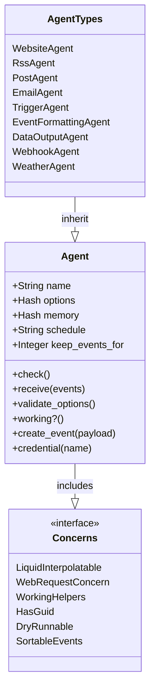
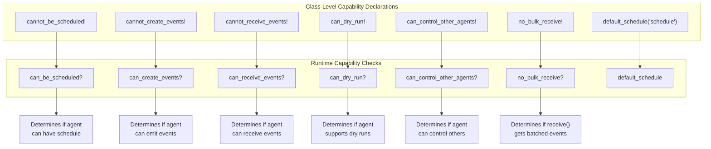
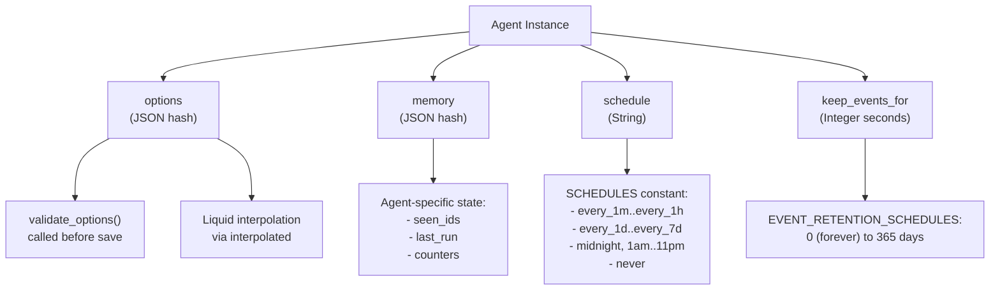
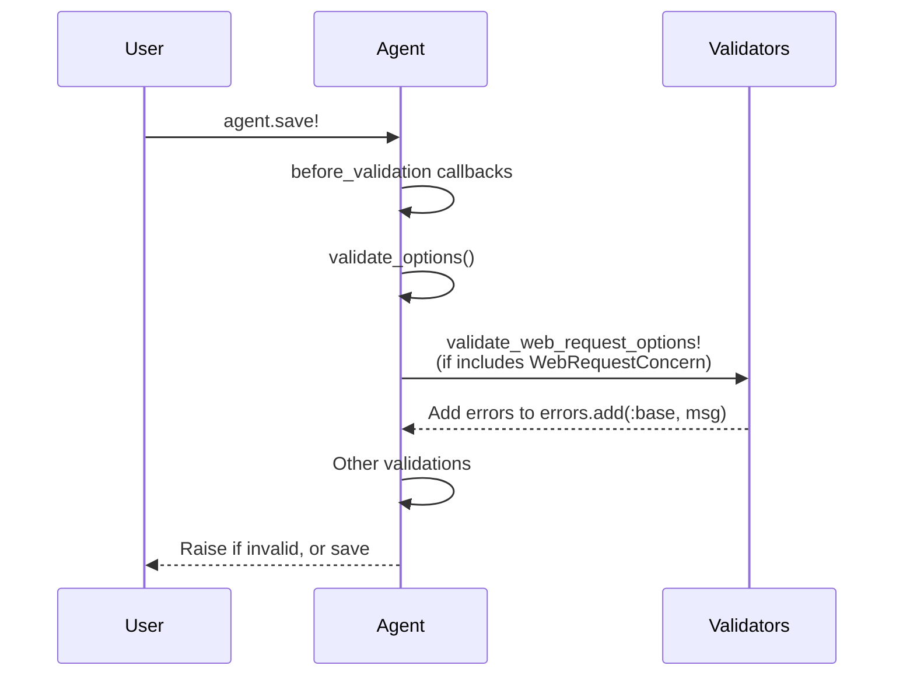
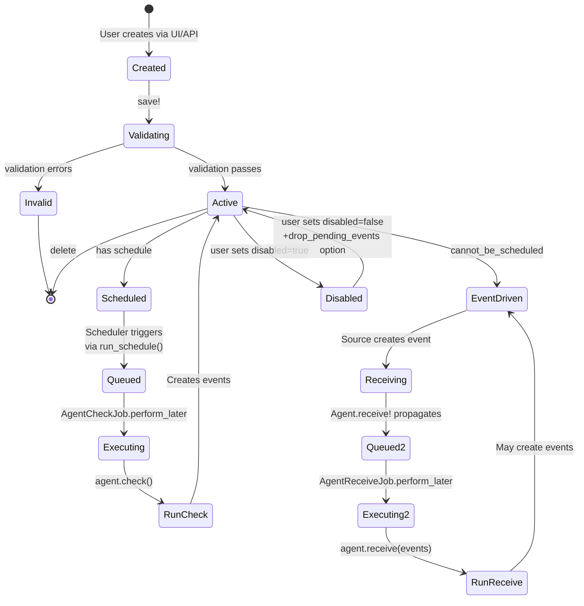
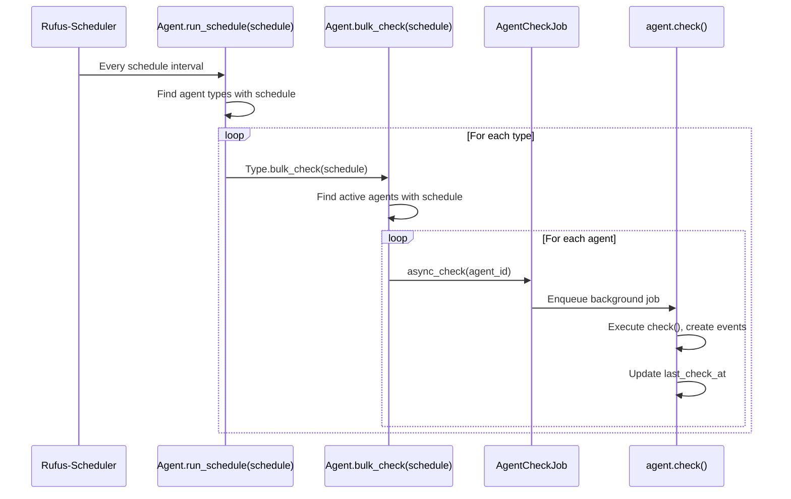
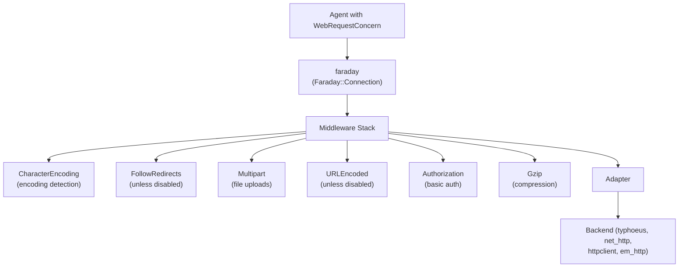
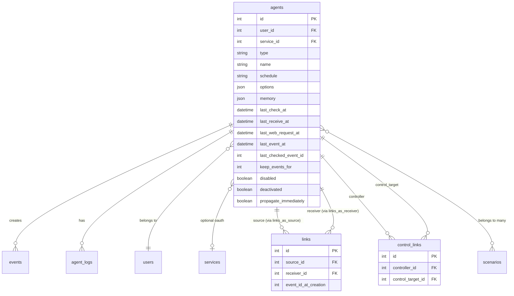
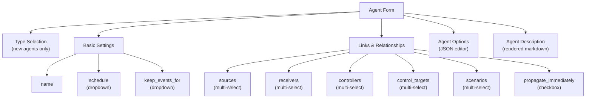

<!-- source: DeepWiki mcp.deepwiki.com · repo huginn/huginn · page 5 Agent Reference · fetched 2026-10-29 -->

# Agent Reference

<details>
<summary>Relevant source files</summary>

The following files were used as context for generating this wiki page:

- [app/concerns/web_request_concern.rb](app/concerns/web_request_concern.rb)
- [app/models/agent.rb](app/models/agent.rb)
- [app/models/agents/website_agent.rb](app/models/agents/website_agent.rb)
- [app/views/agents/_form.html.erb](app/views/agents/_form.html.erb)
- [lib/utils.rb](lib/utils.rb)
- [lib/utils/html_transformer.rb](lib/utils/html_transformer.rb)
- [spec/data_fixtures/urlTest.html](spec/data_fixtures/urlTest.html)
- [spec/lib/utils_spec.rb](spec/lib/utils_spec.rb)
- [spec/models/agent_spec.rb](spec/models/agent_spec.rb)
- [spec/models/agents/website_agent_spec.rb](spec/models/agents/website_agent_spec.rb)
- [spec/support/shared_examples/web_request_concern.rb](spec/support/shared_examples/web_request_concern.rb)

</details>


This page provides a comprehensive reference for Huginn's Agent system, covering the base `Agent` class, agent capabilities, configuration patterns, and lifecycle management. For detailed documentation on specific agent implementations, see the individual agent pages ([WebsiteAgent](#5.1), [RssAgent](#5.2), [PostAgent](#5.3), etc.).

For information about the event-driven architecture that connects agents, see [Event-Driven Architecture](#3.2). For Liquid templating used in agent configurations, see [Liquid Templating System](#4).

---

## Agent Base Class

The `Agent` class [app/models/agent.rb:6]() is the core abstraction in Huginn. All agents inherit from this base class and implement specific functionality by overriding key methods.

### Key Agent Methods

| Method | Purpose | Implementation Required |
|--------|---------|------------------------|
| `check` | Execute scheduled work | Optional - for scheduled agents |
| `receive(events)` | Process incoming events | Optional - for event-driven agents |
| `validate_options` | Validate agent configuration | Recommended |
| `default_options` | Provide default configuration | Recommended |
| `working?` | Determine if agent is functioning correctly | Required |

**Agent Base Class Structure**



**Sources:** [app/models/agent.rb:1-524]()

---

## Agent Capabilities

Agents declare their capabilities through class-level macros that control scheduling, event creation/reception, and other behaviors.

### Capability Declaration Methods



### Capability Matrix

| Capability | Agent Type Examples | Impact |
|------------|-------------------|---------|
| `can_be_scheduled` | WebsiteAgent, RssAgent, WeatherAgent | Agent has `schedule` field, runs via `AgentCheckJob` |
| `can_create_events` | WebsiteAgent, RssAgent, TriggerAgent | Agent can call `create_event()`, has event retention settings |
| `can_receive_events` | TriggerAgent, EmailAgent, EventFormattingAgent | Agent can be linked as receiver, implements `receive(events)` |
| `can_dry_run` | WebsiteAgent, PostAgent | Agent supports test mode without side effects |
| `can_control_other_agents` | CommanderAgent | Agent can be linked as controller, can enable/disable other agents |
| `no_bulk_receive` | WebhookAgent | Each event triggers separate `receive()` call |

**Sources:** [app/models/agent.rb:335-386](), [app/models/agents/website_agent.rb:8-11]()

---

## Agent Types and Categories

Agents are organized into functional categories based on their role in data processing pipelines.

```mermaid
graph LR
    subgraph "Data Acquisition"
        WA["WebsiteAgent<br/>(HTTP scraping)"]
        RA["RssAgent<br/>(Feed parsing)"]
        WTA["WeatherAgent<br/>(API calls)"]
        WHA["WebhookAgent<br/>(Webhook receiver)"]
    end
    
    subgraph "Event Processing"
        TGA["TriggerAgent<br/>(Filtering)"]
        EFA["EventFormattingAgent<br/>(Transformation)"]
        DSA["DigestAgent<br/>(Aggregation)"]
    end
    
    subgraph "Data Output"
        EA["EmailAgent<br/>(Notifications)"]
        PA["PostAgent<br/>(HTTP POST)"]
        DOA["DataOutputAgent<br/>(RSS/JSON feeds)"]
    end
    
    subgraph "Control & Storage"
        KVS["KeyValueStoreAgent<br/>(State storage)"]
        CA["CommanderAgent<br/>(Agent control)"]
    end
    
    WA --> Event1["Events"]
    RA --> Event1
    WTA --> Event1
    WHA --> Event1
    
    Event1 --> TGA
    Event1 --> EFA
    Event1 --> DSA
    
    TGA --> Event2["Events"]
    EFA --> Event2
    DSA --> Event2
    
    Event2 --> EA
    Event2 --> PA
    Event2 --> DOA
```



### Agent Type Reference

| Type | Primary Purpose | Key Methods | Schedule | Documentation |
|------|----------------|-------------|----------|---------------|
| WebsiteAgent | Scrape HTML/XML/JSON from URLs | `check()` | Yes | [WebsiteAgent](#5.1) |
| RssAgent | Parse RSS/Atom feeds | `check()` | Yes | [RssAgent](#5.2) |
| PostAgent | Send HTTP POST/PUT/GET requests | `receive(events)` | No | [PostAgent](#5.3) |
| DataOutputAgent | Expose events as RSS/JSON feeds | `receive(events)`, `receive_web_request()` | No | [DataOutputAgent and WebhookAgent](#5.4) |
| WebhookAgent | Receive HTTP webhooks | `receive_web_request()` | No | [DataOutputAgent and WebhookAgent](#5.4) |
| EmailAgent | Send email notifications | `receive(events)` | No | [Email Agents](#5.5) |
| WeatherAgent | Fetch weather data | `check()` | Yes | [WeatherAgent](#5.6) |
| EventFormattingAgent | Transform event payloads | `receive(events)` | No | [EventFormattingAgent](#5.7) |
| TriggerAgent | Filter events by conditions | `receive(events)` | No | Core agent |

**Sources:** [app/models/agent.rb:1-6](), Diagram 1 and 2 from system overview

---

## Agent Configuration

### Configuration Structure

Every agent stores its configuration in two primary fields:



### Options Field

The `options` hash contains agent-specific configuration. Common patterns:

| Option Pattern | Purpose | Example Agents |
|---------------|---------|----------------|
| `url` or `url_from_event` | Target URL for HTTP operations | WebsiteAgent, RssAgent |
| `extract` | Data extraction rules | WebsiteAgent (CSS/XPath/JSONPath) |
| `expected_update_period_in_days` | Working status threshold | WebsiteAgent, RssAgent |
| `basic_auth`, `headers`, `user_agent` | HTTP authentication/headers | WebsiteAgent, PostAgent (via WebRequestConcern) |
| `mode` | Operation mode (e.g., `on_change`, `all`, `merge`) | WebsiteAgent |
| `template` | Liquid template for output | EventFormattingAgent, EmailAgent |

**Sources:** [app/models/agent.rb:39](), [app/models/agents/website_agent.rb:227-239]()

### Memory Field

The `memory` hash stores agent-specific state between runs:

```ruby
# Example memory usage patterns
agent.memory['seen_ids'] = [123, 456, 789]  # Track processed items
agent.memory['last_fetch_at'] = Time.now.to_i
agent.memory['error_count'] = 0
```

Memory is automatically persisted to the database and symbol-indifferent [app/models/agent.rb:39]().

**Sources:** [app/models/agent.rb:39](), [spec/models/agent_spec.rb:535-563]()

### Validation

Agents validate their configuration in `validate_options`:



**Sources:** [app/models/agent.rb:48-49](), [app/models/agents/website_agent.rb:241-268]()

---

## Agent Lifecycle

### Agent States and Transitions



### Lifecycle Callbacks

| Callback | Timing | Purpose | Example |
|----------|--------|---------|---------|
| `after_initialize` | After `Agent.new()` | Set defaults | `set_default_schedule` [app/models/agent.rb:51]() |
| `before_validation` | Before validation | Normalize data | `set_default_schedule` [app/models/agent.rb:52-53]() |
| `validate` | During validation | Check configuration | `validate_schedule`, `validate_options` [app/models/agent.rb:48-49]() |
| `before_create` | Before first save | Initialize state | `set_last_checked_event_id` [app/models/agent.rb:55]() |
| `after_save` | After save | Update related data | `possibly_update_event_expirations` [app/models/agent.rb:56]() |

**Sources:** [app/models/agent.rb:51-56](), [app/models/agent.rb:263-279]()

---

## Agent Scheduling and Execution

### Schedule-Based Execution

Agents with schedules run via the scheduler [bin/schedule.rb]():



**Available Schedules:** [app/models/agent.rb:21-28]()
- Minute intervals: `every_1m`, `every_2m`, `every_5m`, `every_10m`, `every_30m`
- Hour intervals: `every_1h`, `every_2h`, `every_5h`, `every_12h`
- Day intervals: `every_1d`, `every_2d`, `every_7d`
- Specific times: `midnight`, `1am`...`11pm`, `noon`
- `never` - disabled scheduling

**Sources:** [app/models/agent.rb:21-28](), [app/models/agent.rb:453-478](), Diagram 5 from system overview

### Event-Based Execution

Agents that receive events run via the event propagation system:

```mermaid
sequenceDiagram
    participant SourceAgent
    participant Event
    participant Receiver as Agent.receive!()
    participant Link
    participant Job as AgentReceiveJob
    participant Instance as agent.receive(events)
    
    SourceAgent->>Event: create_event(payload)
    Note over Receiver: Periodic call (every minute)
    Receiver->>Link: Query links with new events
    Receiver->>Receiver: Find agents with events.id > last_checked_event_id
    Receiver->>Receiver: Group events by receiver agent
    loop For each receiving agent
        Receiver->>Job: async_receive(agent_id, event_ids)
        Job->>Instance: Enqueue background job
        Instance->>Instance: Execute receive(events)
        Instance->>Instance: May create new events
        Instance->>Instance: Update last_checked_event_id
    end
```

**Key Concepts:**

- **Links:** Connect source agents to receiver agents [app/models/agent.rb:63-75]()
- **last_checked_event_id:** Tracks last processed event [app/models/agent.rb:271-275]()
- **event_id_at_creation:** Prevents backfilling old events [spec/models/agent_spec.rb:384-418]()
- **no_bulk_receive:** Forces individual event processing [app/models/agent.rb:380-385]()
- **propagate_immediately:** Bypasses periodic propagation [app/views/agents/_form.html.erb:95-99]()

**Sources:** [app/models/agent.rb:397-443](), [spec/models/agent_spec.rb:284-426](), Diagram 5 from system overview

---

## Common Agent Patterns

### WebRequestConcern

Agents that make HTTP requests include `WebRequestConcern` [app/concerns/web_request_concern.rb:65]():

**Configuration Options:**

| Option | Type | Purpose | Default |
|--------|------|---------|---------|
| `user_agent` | String | Custom User-Agent header | `"Huginn - https://github.com/huginn/huginn"` |
| `basic_auth` | String or Array | HTTP basic authentication | None |
| `headers` | Hash | Custom HTTP headers | `{}` |
| `disable_ssl_verification` | Boolean | Skip SSL certificate validation | `false` |
| `proxy` | String | HTTP proxy URL | None |
| `force_encoding` | String | Force response encoding (e.g., `"UTF-8"`) | Auto-detect |
| `unzip` | String | Decompress response (e.g., `"gzip"`) | Auto |
| `disable_redirect_follow` | Boolean | Disable automatic redirects | `false` |
| `disable_url_encoding` | Boolean | Skip URL parameter encoding | `false` |

**Faraday Integration:**



**Sources:** [app/concerns/web_request_concern.rb:1-206](), [app/models/agents/website_agent.rb:6]()

### LiquidInterpolatable

All agents include `LiquidInterpolatable` [app/models/agent.rb:12](), enabling Liquid templating in options:

**Key Methods:**

| Method | Purpose | Usage |
|--------|---------|-------|
| `interpolated` | Returns options with Liquid interpolation | Access as `interpolated['option_name']` |
| `interpolate_options(options)` | Interpolate specific hash | Pass hash to interpolate |
| `interpolate_with_each(events) { }` | Set event context for interpolation | Used in `receive()` methods |

**Sources:** [app/models/agent.rb:12](), see [Liquid Templating System](#4) for details

### Working Status

Agents report their status via `working?`:

```ruby
# Common pattern for scheduled agents
def working?
  event_created_within?(options['expected_update_period_in_days']) && 
    !recent_error_logs?
end
```

**Helper Methods:**
- `event_created_within?(days)` - Check if events created recently [WorkingHelpers concern]
- `recent_error_logs?` - Check for recent errors [WorkingHelpers concern]

**Sources:** [app/models/agents/website_agent.rb:223-225](), [spec/models/agents/website_agent_spec.rb:638-658]()

---

## Agent Database Schema

Key agent fields and relationships:



**Sources:** [app/models/agent.rb:58-77]()

---

## Working with Agents in Code

### Creating Events

```ruby
# Basic event creation
create_event payload: { key: 'value' }

# With explicit expiration
event = build_event(payload: { data: 'value' })
event.expires_at = 1.day.from_now
event.save!
```

**Sources:** [app/models/agent.rb:126-142]()

### Accessing Credentials

```ruby
# Retrieve user credential
api_key = credential('my_api_key')
# Returns nil if not found
```

**Sources:** [app/models/agent.rb:144-156]()

### Logging

```ruby
# Log informational message
log "Processing #{events.count} events"

# Log error
error "Failed to process: #{e.message}", inbound_event: event
```

**Sources:** [app/models/agent.rb:240-246]()

### Event Retention

```ruby
# Update all event expiration dates
update_event_expirations!

# Get expiration date for new events
expires_at = new_event_expiration_date  # Based on keep_events_for
```

**Available Retention Options:** [app/models/agent.rb:30-37]()
- Forever (0 seconds)
- 1 hour to 365 days in various increments

**Sources:** [app/models/agent.rb:158-168]()

---

## Agent Form and UI Integration

The agent form [app/views/agents/_form.html.erb]() provides UI for configuring agents:

**Form Structure:**



**Dynamic Form Behavior:**

- Schedule dropdown hidden if `cannot_be_scheduled?` [app/views/agents/_form.html.erb:46-52]()
- Event retention hidden if `cannot_create_events?` [app/views/agents/_form.html.erb:77-83]()
- Source links disabled if `cannot_receive_events?` [app/views/agents/_form.html.erb:88-100]()
- Control target links shown only if `can_control_other_agents?` [app/views/agents/_form.html.erb:65-75]()

**Sources:** [app/views/agents/_form.html.erb:1-152]()

---

## Finding Specific Agent Documentation

For detailed documentation on specific agent implementations:

- **[WebsiteAgent](#5.1)** - Scrape websites using CSS, XPath, JSONPath, or regex
- **[RssAgent](#5.2)** - Parse RSS/Atom feeds with Feedjira
- **[PostAgent](#5.3)** - Send HTTP requests with full header/body control
- **[DataOutputAgent and WebhookAgent](#5.4)** - Expose data as feeds or receive webhooks
- **[Email Agents](#5.5)** - EmailAgent and EmailDigestAgent for notifications
- **[WeatherAgent](#5.6)** - Fetch weather data from Pirate Weather API
- **[EventFormattingAgent](#5.7)** - Transform events with matchers and templates

For understanding how agents interact through events, see [Event-Driven Architecture](#3.2).

For the Liquid templating syntax used throughout agent configurations, see [Liquid Templating System](#4).

**Sources:** Table of contents structure, [app/models/agents/]() directory

---

