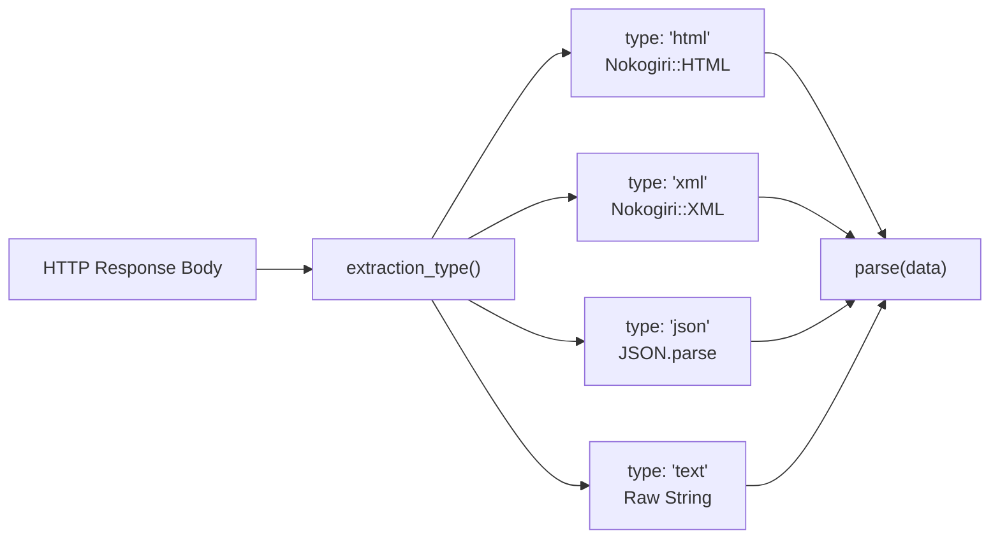
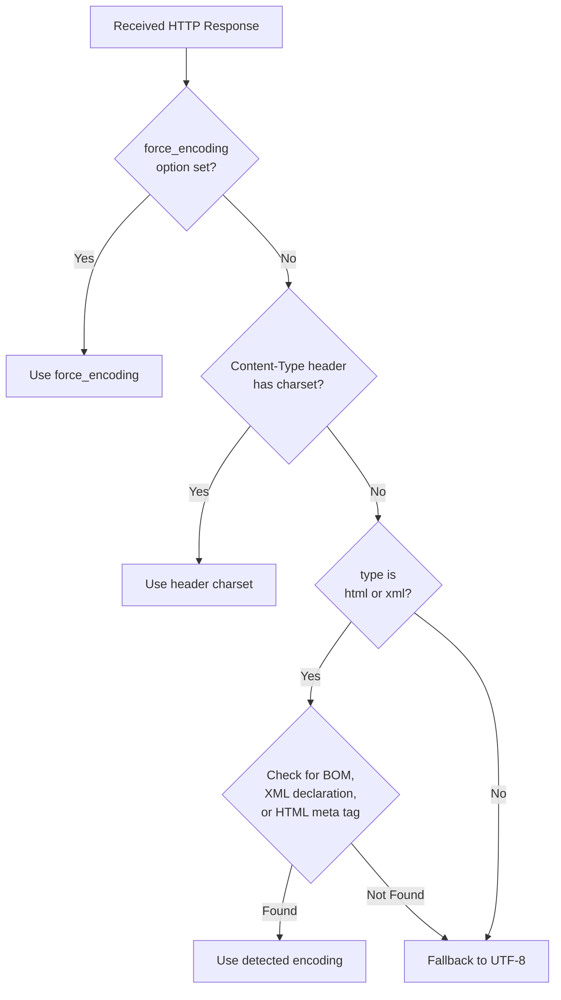
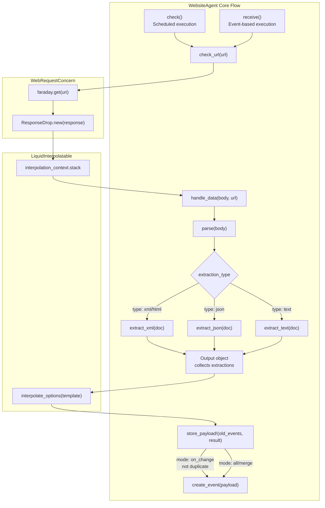
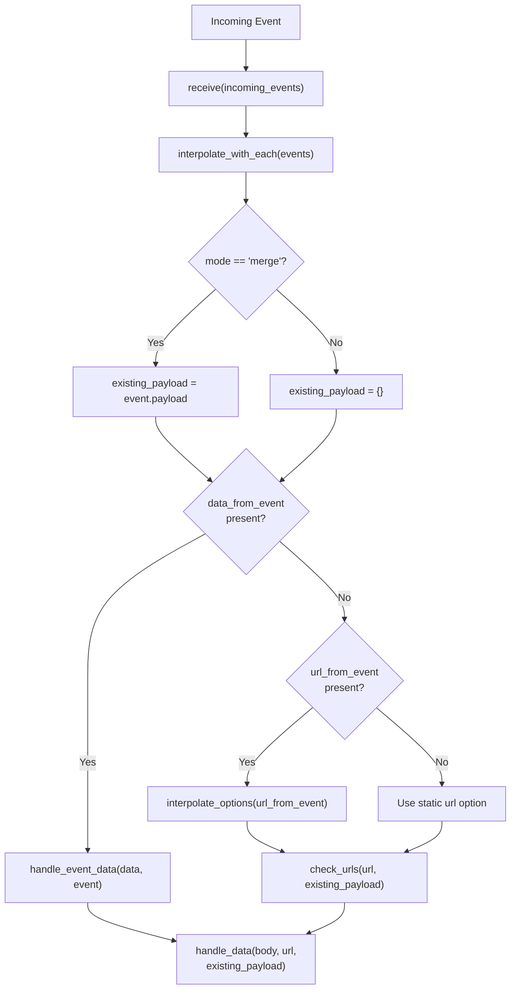
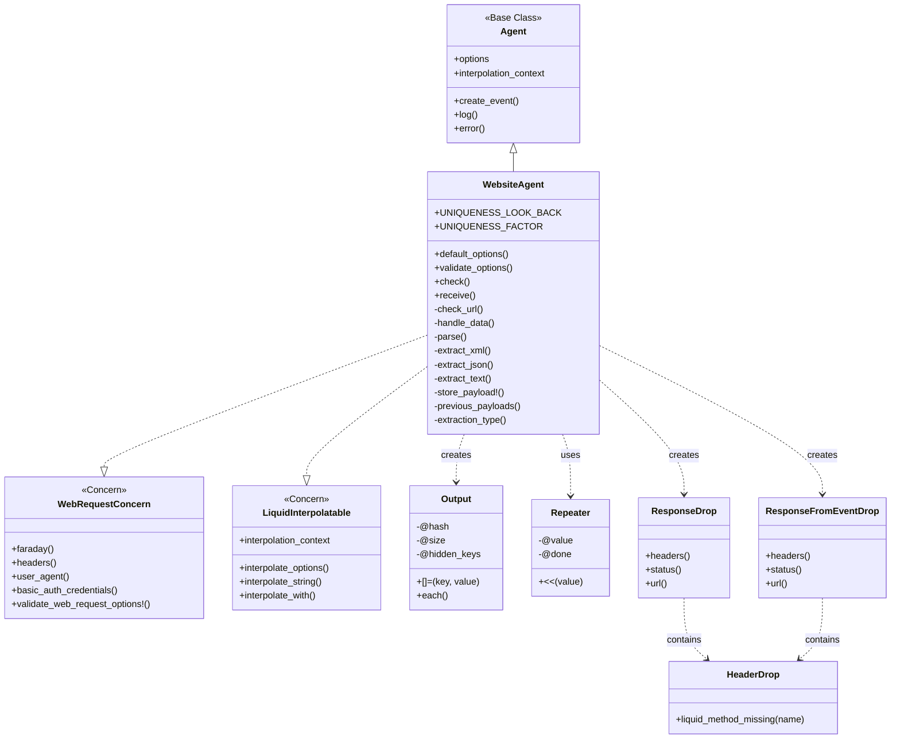
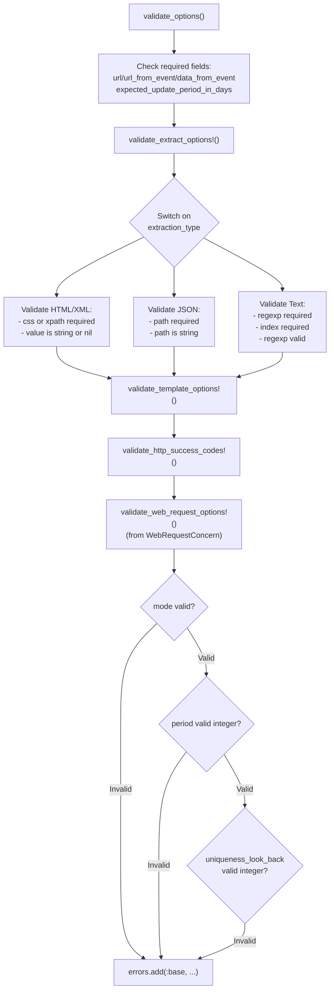

<!-- source: DeepWiki mcp.deepwiki.com · repo huginn/huginn · page 5.1 WebsiteAgent · fetched 2026-10-29 -->

# WebsiteAgent

<details>
<summary>Relevant source files</summary>

The following files were used as context for generating this wiki page:

- [app/concerns/liquid_droppable.rb](app/concerns/liquid_droppable.rb)
- [app/concerns/liquid_interpolatable.rb](app/concerns/liquid_interpolatable.rb)
- [app/concerns/web_request_concern.rb](app/concerns/web_request_concern.rb)
- [app/models/agents/event_formatting_agent.rb](app/models/agents/event_formatting_agent.rb)
- [app/models/agents/website_agent.rb](app/models/agents/website_agent.rb)
- [lib/utils.rb](lib/utils.rb)
- [lib/utils/html_transformer.rb](lib/utils/html_transformer.rb)
- [spec/concerns/liquid_interpolatable_spec.rb](spec/concerns/liquid_interpolatable_spec.rb)
- [spec/data_fixtures/urlTest.html](spec/data_fixtures/urlTest.html)
- [spec/lib/utils_spec.rb](spec/lib/utils_spec.rb)
- [spec/models/agents/event_formatting_agent_spec.rb](spec/models/agents/event_formatting_agent_spec.rb)
- [spec/models/agents/website_agent_spec.rb](spec/models/agents/website_agent_spec.rb)
- [spec/support/shared_examples/liquid_interpolatable.rb](spec/support/shared_examples/liquid_interpolatable.rb)
- [spec/support/shared_examples/web_request_concern.rb](spec/support/shared_examples/web_request_concern.rb)

</details>


The WebsiteAgent is a data acquisition agent that scrapes websites, XML documents, or JSON feeds and creates Events based on extracted data. It supports multiple document formats (HTML, XML, JSON, text), various extraction methods (CSS selectors, XPath, JSONPath, regex), and Liquid templating for dynamic configuration. The agent can operate on scheduled intervals or react to incoming events.

For information about processing and transforming scraped data, see [EventFormattingAgent](#5.7). For sending HTTP requests (POST/PUT), see [PostAgent](#5.3). For exposing scraped data as feeds, see [DataOutputAgent and WebhookAgent](#5.4).

---

## Basic Concepts

### Operational Modes

The WebsiteAgent supports three operational modes that control when events are created:

| Mode | Behavior | Use Case |
|------|----------|----------|
| `all` | Creates an event for every extraction | When you want all results, even duplicates |
| `on_change` | Creates events only when content changes | Monitoring for updates, avoiding duplicate notifications |
| `merge` | Merges extracted data with incoming event payload | When chaining agents and preserving upstream data |

The `on_change` mode compares the JSON representation of extracted payloads and updates the `expires_at` timestamp of existing events when duplicates are detected, preventing notification spam.

**Sources:** [app/models/agents/website_agent.rb:528-543]()

### Document Types

The agent automatically detects document type from the URL extension or accepts explicit configuration via the `type` option:



**Diagram: Document Type Detection and Parsing Pipeline**

**Sources:** [app/models/agents/website_agent.rb:562-575](), [app/models/agents/website_agent.rb:705-721]()

---

## Configuration Options

### Core Options

The WebsiteAgent configuration is defined in the `options` hash with the following key parameters:

| Option | Type | Required | Description |
|--------|------|----------|-------------|
| `url` | String or Array | Conditional | Single URL or array of URLs to scrape |
| `url_from_event` | Liquid template | Conditional | Generate URL dynamically from incoming event |
| `data_from_event` | Liquid template | Conditional | Use event payload directly without HTTP fetch |
| `type` | String | No | Document type: `html`, `xml`, `json`, or `text` |
| `mode` | String | No | When to create events: `all`, `on_change`, or `merge` |
| `extract` | Hash | Conditional | Extraction rules (required except for raw JSON) |
| `template` | Hash | No | Post-extraction Liquid template for transforming results |
| `expected_update_period_in_days` | Integer | Yes | Maximum time between events for "working" status |
| `uniqueness_look_back` | Integer | No | Number of recent events to check for duplicates |

**Note:** Either `url`, `url_from_event`, or `data_from_event` must be present.

**Sources:** [app/models/agents/website_agent.rb:227-239](), [app/models/agents/website_agent.rb:241-268]()

### HTTP Configuration

The WebsiteAgent inherits HTTP configuration options from `WebRequestConcern`:

| Option | Type | Description |
|--------|------|-------------|
| `basic_auth` | String or Array | HTTP basic authentication: `"username:password"` or `["username", "password"]` |
| `headers` | Hash | Custom HTTP headers |
| `user_agent` | String | Custom User-Agent string (default: `"Huginn - https://github.com/huginn/huginn"`) |
| `disable_ssl_verification` | Boolean | Disable SSL certificate verification |
| `force_encoding` | String | Force character encoding (e.g., `"UTF-8"`, `"ISO-8859-1"`) |
| `unzip` | String | Set to `"gzip"` to decompress gzipped content |
| `http_success_codes` | Array | Additional HTTP status codes to treat as successful (e.g., `[404, 422]`) |
| `proxy` | String | HTTP proxy URL |
| `disable_redirect_follow` | Boolean | Disable automatic redirect following |

**Sources:** [app/models/agents/website_agent.rb:151-173](), [app/concerns/web_request_concern.rb:67-102]()

### Encoding Detection

The agent follows a specific priority order for encoding detection:



**Diagram: Character Encoding Detection Flowchart**

**Sources:** [app/models/agents/website_agent.rb:157-162](), [app/concerns/web_request_concern.rb:16-61]()

---

## Extraction Methods

### HTML and XML Extraction

For HTML and XML documents, extraction rules use CSS selectors or XPath expressions to locate elements, then XPath expressions to extract values from those elements.

**Extraction Rule Structure:**

```json
{
  "extract": {
    "field_name": {
      "css": "#selector",          // CSS selector (alternative to xpath)
      "xpath": "//xpath/expression", // XPath selector (alternative to css)
      "value": "@attribute",         // XPath to extract value (default: ".")
      "hidden": false,               // Exclude from event payload if true
      "repeat": false,               // Include in all extracts if true
      "raw": false,                  // Return raw value without stringification
      "single_array": false          // Extract all matches into array
    }
  }
}
```

**Common XPath Value Expressions:**

| Expression | Purpose | Example Result |
|------------|---------|----------------|
| `@src` | Extract attribute value | Attribute string |
| `.` | Extract outer HTML | Full HTML of element |
| `string(.)` | Extract concatenated text | All text content |
| `normalize-space(.)` | Extract text, normalized | Text with whitespace cleaned |
| `./node()` | Extract inner HTML | HTML content inside element |
| `count(./a)` | Count child elements | Integer |

**Sources:** [app/models/agents/website_agent.rb:44-62](), [app/models/agents/website_agent.rb:631-703]()

#### Namespace Handling in XML

By default, the WebsiteAgent strips all namespaces from XML documents for easier querying. To preserve namespaces:

```json
{
  "use_namespaces": true,
  "extract": {
    "title": { 
      "xpath": "/xmlns:feed/xmlns:entry/xmlns:title",
      "value": "string(.)"
    }
  }
}
```

**Sources:** [app/models/agents/website_agent.rb:63](), [app/models/agents/website_agent.rb:577-585]()

### JSON Extraction

For JSON documents, extraction rules use JSONPath expressions to navigate the data structure:

```json
{
  "extract": {
    "title": { "path": "results.data[*].title" },
    "price": { "path": "results.data[*].price" }
  }
}
```

The `*` wildcard iterates through arrays, creating one event per array element. All extractors must match the same number of elements unless they have `repeat: true`.

**Special Case:** If `extract` is omitted for JSON type, the entire parsed JSON response becomes the event payload.

**Sources:** [app/models/agents/website_agent.rb:69-124](), [app/models/agents/website_agent.rb:608-615]()

### Text Extraction with Regular Expressions

For plain text documents, extraction rules use regular expressions with capture groups:

```json
{
  "extract": {
    "word": { 
      "regexp": "^(?<word>.+?): (?<definition>.+)$",
      "index": "word"
    },
    "definition": {
      "regexp": "^(?<word>.+?): (?<definition>.+)$",
      "index": "definition"
    }
  }
}
```

The `index` can be:
- An integer (0 for full match, 1+ for capture groups)
- A string matching a named capture group name

**Sources:** [app/models/agents/website_agent.rb:125-147](), [app/models/agents/website_agent.rb:617-629]()

### Extraction Pipeline Architecture



**Diagram: WebsiteAgent Extraction Pipeline with Code Entities**

**Sources:** [app/models/agents/website_agent.rb:398-428](), [app/models/agents/website_agent.rb:440-482](), [app/models/agents/website_agent.rb:587-703]()

---

## Liquid Templating

### Available Variables

The WebsiteAgent provides special variables in Liquid templates for accessing request and response metadata:

| Variable | Type | Description |
|----------|------|-------------|
| `_url_` | String | The URL that was fetched (not available with `data_from_event`) |
| `_response_.status` | Integer | HTTP status code (200, 404, etc.) |
| `_response_.headers` | Object | Response headers (case-insensitive access) |
| `_response_.url` | String | Final URL after redirects |

**Example Usage:**

```json
{
  "template": {
    "url": "{{ url | to_uri: _response_.url }}",
    "content_type": "{{ _response_.headers.Content-Type }}",
    "last_modified": "{{ _response_.headers.Last-Modified | date: '%FT%T' }}"
  }
}
```

**Sources:** [app/models/agents/website_agent.rb:186-197](), [app/models/agents/website_agent.rb:782-820]()

### Template Post-Processing

The `template` option applies Liquid transformations after extraction. This allows:

1. Resolving relative URLs: `{{ link | to_uri: _response_.url }}`
2. Reformatting dates: `{{ created_at | date: '%Y-%m-%d' }}`
3. Combining extracted fields: `{{ title }}: {{ description }}`
4. Rebasing HTML links: `{{ content | rebase_hrefs: _response_.url }}`

Extracted field names become variables in the template context. Fields marked as `hidden: true` are available for templating but excluded from the final event payload.

**Sources:** [app/models/agents/website_agent.rb:174-182](), [app/models/agents/website_agent.rb:468-481]()

### Hidden and Repeated Fields

**Hidden Fields** (`hidden: true`):
- Extracted but not included in event payload
- Available for use in `template` option
- Useful for intermediate data transformation

**Repeated Fields** (`repeat: true`):
- First match is included in ALL events
- Useful for including page-level metadata (e.g., page title) in every extracted item

```json
{
  "extract": {
    "page_title": { 
      "css": "title", 
      "value": "string(.)", 
      "repeat": true 
    },
    "secret_key": {
      "css": ".data-key",
      "value": "@data-key",
      "hidden": true
    },
    "item_name": { "css": ".item", "value": "string(.)" }
  },
  "template": {
    "name": "{{ item_name }}",
    "title": "{{ page_title }}",
    "hash": "{{ secret_key | sha256 }}"
  }
}
```

**Sources:** [app/models/agents/website_agent.rb:38-41](), [app/models/agents/website_agent.rb:587-606]()

---

## Event-Based Scraping

The WebsiteAgent can react to incoming events from other agents in three ways:

### 1. Dynamic URL Generation (`url_from_event`)

Generate the URL to scrape from incoming event data:

```json
{
  "url_from_event": "https://example.com/api/{{ user_id }}/profile",
  "type": "json",
  "extract": {
    "name": { "path": "name" }
  }
}
```

**Sources:** [app/models/agents/website_agent.rb:26](), [app/models/agents/website_agent.rb:496-502]()

### 2. Direct Data Processing (`data_from_event`)

Process data directly from the incoming event without making an HTTP request:

```json
{
  "data_from_event": "{{ html }}",
  "type": "html",
  "extract": {
    "title": { "css": "h1", "value": "string(.)" }
  }
}
```

This is useful for:
- Processing HTML/JSON from a previous agent
- Avoiding redundant HTTP requests
- Working with data that's already been fetched

**Sources:** [app/models/agents/website_agent.rb:27](), [app/models/agents/website_agent.rb:488-495]()

### 3. Merge Mode (`mode: merge`)

Preserve the incoming event's payload and merge extracted data into it:

```json
{
  "url_from_event": "{{ api_url }}",
  "mode": "merge",
  "type": "json",
  "extract": {
    "additional_data": { "path": "data.field" }
  }
}
```

The outgoing event will contain both the original event's payload and the newly extracted fields.

**Sources:** [app/models/agents/website_agent.rb:28](), [app/models/agents/website_agent.rb:486]()

### Event Handling Flow



**Diagram: Event-Based Scraping Decision Flow**

**Sources:** [app/models/agents/website_agent.rb:484-505](), [app/models/agents/website_agent.rb:516-523]()

---

## Advanced Features

### Deduplication and Uniqueness

In `on_change` mode, the agent maintains event uniqueness by comparing JSON-serialized payloads:

1. Extract new data from source
2. Compare with recent events (default: 200 or 3× extracted items, whichever is larger)
3. If match found: update existing event's `expires_at` timestamp
4. If no match: create new event

The `uniqueness_look_back` option limits the number of historical events to check:

```json
{
  "mode": "on_change",
  "uniqueness_look_back": 500
}
```

**Sources:** [app/models/agents/website_agent.rb:14-15](), [app/models/agents/website_agent.rb:155](), [app/models/agents/website_agent.rb:545-556]()

### Multiple URLs

The agent can scrape multiple URLs in a single execution by providing an array:

```json
{
  "url": [
    "https://example.com/page1",
    "https://example.com/page2",
    "https://example.com/page3"
  ]
}
```

Each URL is processed independently, and deduplication works across all results.

**Sources:** [app/models/agents/website_agent.rb:22](), [app/models/agents/website_agent.rb:402-408]()

### Raw Value Extraction

The `raw: true` option returns values without stringification, preserving their original types:

```json
{
  "extract": {
    "count": { 
      "css": "#items", 
      "value": "count(./li)", 
      "raw": true 
    },
    "tags": {
      "css": ".tag",
      "value": "string(.)",
      "raw": true
    }
  }
}
```

Without `raw: true`, XPath numeric results become strings. With it:
- Numbers remain as integers or floats
- Boolean values remain as booleans
- Arrays remain as arrays
- Special float values (NaN, Infinity, -Infinity) are handled appropriately

**Sources:** [app/models/agents/website_agent.rb:65](), [app/models/agents/website_agent.rb:664-687]()

### Single Array Extraction

The `single_array: true` option collects all matches into a single array:

```json
{
  "extract": {
    "all_links": {
      "css": "a",
      "value": "@href",
      "single_array": true
    }
  }
}
```

Result:
```json
{
  "all_links": [
    "/link1",
    "/link2",
    "/link3"
  ]
}
```

**Sources:** [app/models/agents/website_agent.rb:67](), [app/models/agents/website_agent.rb:694-697]()

### Custom HTTP Success Codes

By default, only 2xx status codes are considered successful. The `http_success_codes` option allows treating other codes as success:

```json
{
  "http_success_codes": [404, 422],
  "extract": {
    "error_message": { "path": "error" }
  }
}
```

This is useful for:
- Scraping error pages
- APIs that return errors with non-2xx codes
- Handling expected failure states

**Sources:** [app/models/agents/website_agent.rb:172](), [app/models/agents/website_agent.rb:509-514]()

---

## Code Architecture

### Class Structure



**Diagram: WebsiteAgent Class Hierarchy and Relationships**

**Sources:** [app/models/agents/website_agent.rb:5-829]()

### Key Internal Classes

#### Output Class

The `Output` class manages extracted data and enforces consistent array sizes across all extractors:

- Stores extracted values as hash of arrays
- Validates that all non-`repeat` extractors return the same number of matches
- Raises `UnevenSizeError` if sizes don't match
- Tracks `hidden_keys` for template-only fields
- Provides iterator over extracted records

**Sources:** [app/models/agents/website_agent.rb:726-754]()

#### Repeater Class

The `Repeater` class implements the `repeat: true` behavior using Ruby's `Enumerator`:

- Creates infinite sequence of the same value
- Allows single extracted value to appear in all output records
- Used for page-level metadata (titles, dates, etc.)

**Sources:** [app/models/agents/website_agent.rb:756-779]()

#### Response Drops

**ResponseDrop** (for HTTP requests):
- Wraps `Faraday::Response` object
- Exposes `status`, `headers`, and `url` to Liquid templates
- Created when fetching URLs normally

**ResponseFromEventDrop** (for event-based data):
- Wraps `Event` object
- Extracts `status`, `headers`, and `url` from event payload
- Created when using `data_from_event` option

**HeaderDrop**:
- Wraps HTTP headers hash
- Provides case-insensitive header access via `liquid_method_missing`
- Normalizes header name formats (dashes, underscores)

**Sources:** [app/models/agents/website_agent.rb:781-827]()

### Validation Flow



**Diagram: WebsiteAgent Option Validation Flow**

**Sources:** [app/models/agents/website_agent.rb:241-268](), [app/models/agents/website_agent.rb:286-388](), [app/models/agents/website_agent.rb:390-396]()

---

## Example Configurations

### Scraping HTML with CSS Selectors

```json
{
  "url": "https://example.com/blog",
  "type": "html",
  "mode": "on_change",
  "expected_update_period_in_days": 1,
  "extract": {
    "title": { "css": "article h2", "value": "string(.)" },
    "link": { "css": "article h2 a", "value": "@href" },
    "summary": { "css": "article .excerpt", "value": "string(.)" },
    "image": { "css": "article img", "value": "@src" }
  },
  "template": {
    "title": "{{ title }}",
    "url": "{{ link | to_uri: _response_.url }}",
    "summary": "{{ summary | strip }}",
    "image_url": "{{ image | to_uri: _response_.url }}"
  }
}
```

### Scraping JSON API

```json
{
  "url": "https://api.example.com/posts",
  "type": "json",
  "mode": "all",
  "expected_update_period_in_days": 1,
  "extract": {
    "id": { "path": "data[*].id" },
    "title": { "path": "data[*].attributes.title" },
    "published_at": { "path": "data[*].attributes.publishedAt" }
  },
  "template": {
    "post_id": "{{ id }}",
    "title": "{{ title }}",
    "published": "{{ published_at | date: '%Y-%m-%d' }}"
  }
}
```

### XML with Namespaces

```json
{
  "url": "https://example.com/feed.atom",
  "type": "xml",
  "mode": "on_change",
  "use_namespaces": true,
  "expected_update_period_in_days": 1,
  "extract": {
    "title": { 
      "xpath": "/xmlns:feed/xmlns:entry", 
      "value": "normalize-space(./xmlns:title)" 
    },
    "link": { 
      "xpath": "/xmlns:feed/xmlns:entry", 
      "value": "./xmlns:link[1]/@href" 
    },
    "page_title": {
      "xpath": "/xmlns:feed/xmlns:title",
      "value": "string(.)",
      "repeat": true
    }
  }
}
```

### Event-Driven Scraping

```json
{
  "url_from_event": "{{ url }}",
  "type": "html",
  "mode": "merge",
  "expected_update_period_in_days": 1,
  "extract": {
    "title": { "css": "h1", "value": "string(.)" },
    "content": { "css": ".content", "value": "./node()" }
  }
}
```

**Sources:** All examples derived from [app/models/agents/website_agent.rb:17-201]() and [spec/models/agents/website_agent_spec.rb]()

---

