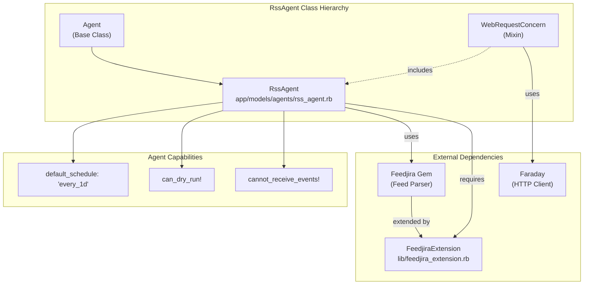
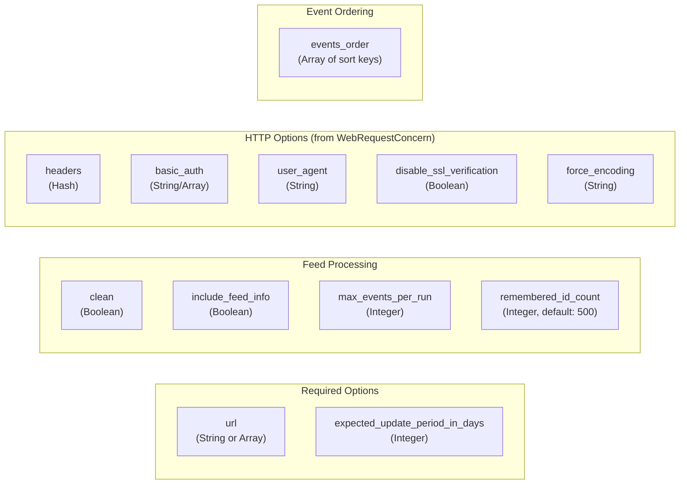
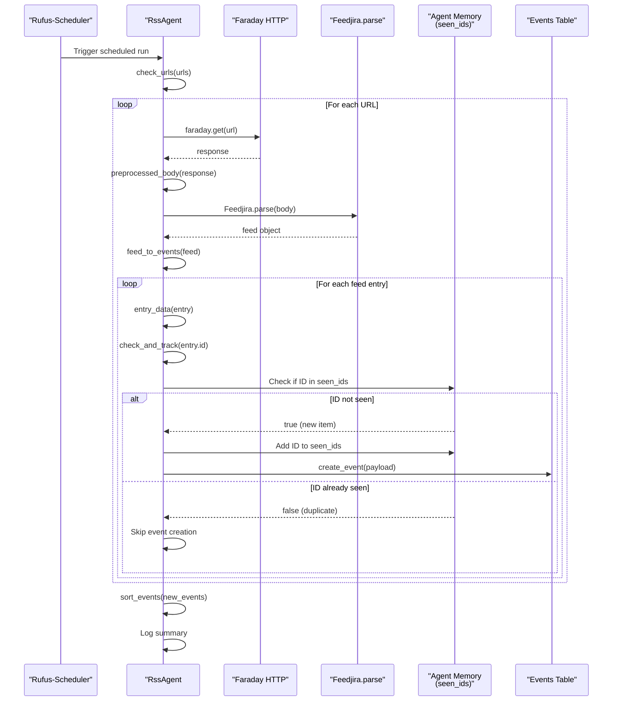
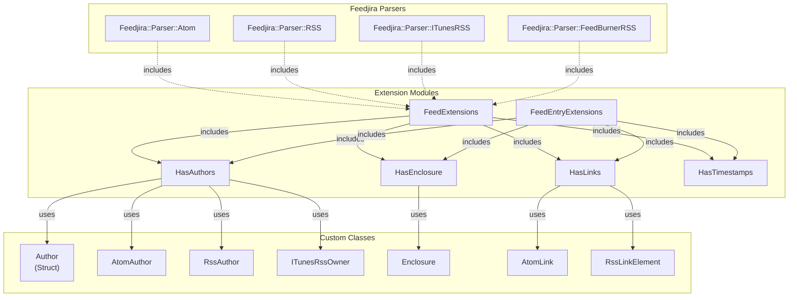
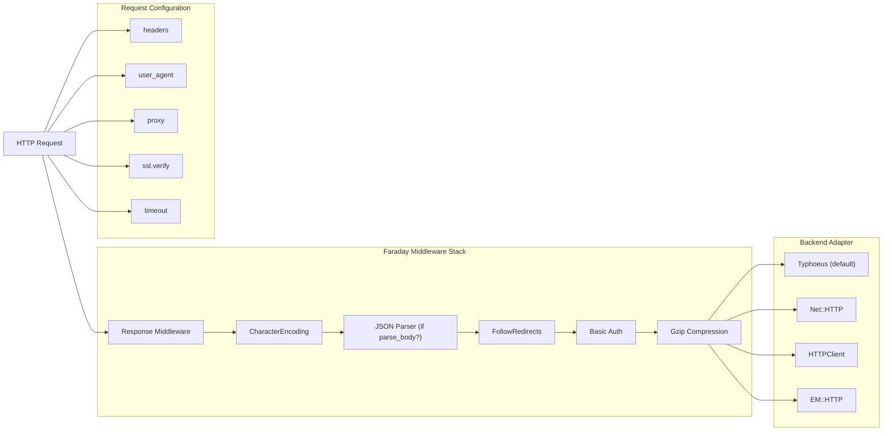

<!-- source: DeepWiki mcp.deepwiki.com · repo huginn/huginn · page 5.2 RssAgent · fetched 2026-10-29 -->

# RssAgent

<details>
<summary>Relevant source files</summary>

The following files were used as context for generating this wiki page:

- [CHANGES.md](CHANGES.md)
- [VERSION](VERSION)
- [app/concerns/web_request_concern.rb](app/concerns/web_request_concern.rb)
- [app/models/agents/rss_agent.rb](app/models/agents/rss_agent.rb)
- [app/models/agents/website_agent.rb](app/models/agents/website_agent.rb)
- [lib/feedjira_extension.rb](lib/feedjira_extension.rb)
- [lib/utils.rb](lib/utils.rb)
- [lib/utils/html_transformer.rb](lib/utils/html_transformer.rb)
- [spec/data_fixtures/iso-8859-1.rss](spec/data_fixtures/iso-8859-1.rss)
- [spec/data_fixtures/onethingwell.rss](spec/data_fixtures/onethingwell.rss)
- [spec/data_fixtures/podcast.rss](spec/data_fixtures/podcast.rss)
- [spec/data_fixtures/urlTest.html](spec/data_fixtures/urlTest.html)
- [spec/data_fixtures/youtube.xml](spec/data_fixtures/youtube.xml)
- [spec/lib/utils_spec.rb](spec/lib/utils_spec.rb)
- [spec/models/agents/rss_agent_spec.rb](spec/models/agents/rss_agent_spec.rb)
- [spec/models/agents/website_agent_spec.rb](spec/models/agents/website_agent_spec.rb)
- [spec/support/shared_examples/web_request_concern.rb](spec/support/shared_examples/web_request_concern.rb)

</details>


## Purpose and Scope

The RssAgent is a scheduled agent that consumes RSS and Atom feeds from URLs and emits events when new feed items are detected. It uses the Feedjira library to parse various feed formats including standard RSS 2.0, Atom, FeedBurner feeds, and iTunes podcast feeds. The agent tracks seen items to prevent duplicate event creation and supports configurable event ordering.

For scraping web pages with custom extraction logic, see [WebsiteAgent](#5.1). For exposing data as RSS feeds, see [DataOutputAgent](#5.4).

**Sources:** [app/models/agents/rss_agent.rb:1-42]()

## Agent Architecture



**Sources:** [app/models/agents/rss_agent.rb:1-10](), [app/concerns/web_request_concern.rb:1-65](), [lib/feedjira_extension.rb:1-329]()

## Core Components

### Class Definition and Configuration

The RssAgent is defined in [app/models/agents/rss_agent.rb:1-336]() with the following key characteristics:

| Capability | Value | Description |
|------------|-------|-------------|
| `cannot_receive_events!` | true | Does not process incoming events from other agents |
| `can_dry_run!` | true | Supports dry run mode for testing |
| `default_schedule` | `"every_1d"` | Runs once per day by default |
| `gem_dependency_check` | Feedjira | Requires Feedjira gem to be available |
| `DEFAULT_EVENTS_ORDER` | `[['{{date_published}}', 'time'], ['{{last_updated}}', 'time']]` | Default sorting for events |

**Sources:** [app/models/agents/rss_agent.rb:2-11]()

### Configuration Options



**Sources:** [app/models/agents/rss_agent.rb:13-41](), [app/models/agents/rss_agent.rb:130-145]()

## Feed Processing Pipeline



**Sources:** [app/models/agents/rss_agent.rb:155-183](), [app/models/agents/rss_agent.rb:189-198]()

## Feed Parsing Implementation

### Entry Point: check Method

The `check` method is the entry point called by the scheduler:

```ruby
def check
  check_urls(Array(interpolated['url']))
end
```

**Sources:** [app/models/agents/rss_agent.rb:155-157]()

### URL Processing: check_urls

The `check_urls` method in [app/models/agents/rss_agent.rb:161-183]() performs the following operations:

1. **Fetch feeds** - HTTP GET request via Faraday for each URL
2. **Parse body** - Call `preprocessed_body` to handle encoding
3. **Parse feed** - Use `Feedjira.parse` to convert to feed object
4. **Convert to events** - Call `feed_to_events` to create Event objects
5. **Sort events** - Apply `events_order` configuration via `sort_events`
6. **Deduplicate** - Filter using `check_and_track(event.payload[:id])`
7. **Limit** - Apply `max_events_per_run` if configured
8. **Create events** - Persist to database via `create_events`

**Sources:** [app/models/agents/rss_agent.rb:161-183]()

### Body Preprocessing

The `preprocessed_body` method in [app/models/agents/rss_agent.rb:204-217]() handles character encoding edge cases:

- Strips encoding declaration from XML if encoding is already known from Content-Type header
- Allows SAX parser to detect encoding from BOM or XML declaration for binary-encoded responses
- Prevents conflicts between Content-Type charset and XML declaration

**Sources:** [app/models/agents/rss_agent.rb:204-217]()

## Deduplication System

### Memory Structure

The agent uses the `memory` hash to track seen feed item IDs:

```ruby
memory['seen_ids'] = [
  'http://example.com/item/123',
  '829f845279611d7925146725317b868d',
  # ... up to 500 IDs by default
]
```

**Sources:** [app/models/agents/rss_agent.rb:189-198]()

### check_and_track Method

The `check_and_track` method in [app/models/agents/rss_agent.rb:189-198]() implements a FIFO queue:

1. Check if `entry_id` exists in `memory['seen_ids']`
2. If found, return `false` (skip duplicate)
3. If not found:
   - Prepend `entry_id` to beginning of array
   - Trim array to `remembered_id_count` size (default 500)
   - Return `true` (create event)

**Sources:** [app/models/agents/rss_agent.rb:189-198]()

### Fallback ID Generation

When feed entries lack IDs, the system generates MD5 hashes in [lib/feedjira_extension.rb:265-267]():

```ruby
def id
  entry_id || @dc_identifier || Digest::MD5.hexdigest(content || summary || '')
end
```

**Sources:** [lib/feedjira_extension.rb:265-267]()

## Event Structure

### Feed-Level Data

When `include_feed_info` is true, the `feed_data` method in [app/models/agents/rss_agent.rb:219-243]() extracts:

| Field | Description | Source |
|-------|-------------|--------|
| `id` | Feed identifier | `feed.feed_id` |
| `type` | Feed type (`"atom"` or `"rss"`) | Detected from feed class |
| `url` | Feed URL | `feed.url` |
| `links` | Array of link objects | `feed.links` |
| `title` | Feed title | `feed.title` |
| `description` | Feed description | `feed.description` |
| `copyright` | Copyright notice | `feed.copyright` |
| `generator` | Generator software | `feed.generator` |
| `icon` | Feed icon URL | `feed.icon` |
| `authors` | Array of author strings | `feed.authors` |
| `date_published` | ISO 8601 timestamp | `feed.date_published` |
| `last_updated` | ISO 8601 timestamp | `feed.last_updated` |

**Sources:** [app/models/agents/rss_agent.rb:219-243]()

### Entry-Level Data

The `entry_data` method in [app/models/agents/rss_agent.rb:275-292]() extracts:

| Field | Description | Processing |
|-------|-------------|------------|
| `id` | Entry identifier | Fallback to MD5 hash if missing |
| `url` | Primary URL | From `entry.url` |
| `urls` | All URLs | Union of `entry.url` and link hrefs |
| `links` | Link objects | Array of `{href, rel, type}` |
| `title` | Entry title | Direct from entry |
| `description` | Summary HTML | Cleaned via `clean_fragment` if `clean: true` |
| `content` | Full content HTML | Cleaned via `clean_fragment` if `clean: true` |
| `image` | Image URL | From enclosure if present |
| `enclosure` | Media enclosure | `{url, type, length}` |
| `authors` | Author array | Normalized format |
| `categories` | Category array | Direct from entry |
| `date_published` | ISO 8601 timestamp | Published date |
| `last_updated` | ISO 8601 timestamp | Updated date |

**Sources:** [app/models/agents/rss_agent.rb:275-292]()

### HTML Cleaning

When `clean` option is true, the `clean_fragment` method in [app/models/agents/rss_agent.rb:328-334]() uses Loofah to sanitize HTML:

```ruby
def clean_fragment(fragment)
  if boolify(interpolated['clean']) && fragment.present?
    Loofah.scrub_fragment(fragment, :prune).to_s
  else
    fragment
  end
end
```

This removes unsafe HTML elements and attributes while preserving safe content.

**Sources:** [app/models/agents/rss_agent.rb:328-334]()

## iTunes Podcast Support

### Feed-Level iTunes Data

The `itunes_feed_data` method in [app/models/agents/rss_agent.rb:245-273]() extracts iTunes-specific fields when parsing `Feedjira::Parser::ITunesRSS` feeds:

| Field | Description |
|-------|-------------|
| `itunes_block` | Blocking status (`"yes"`/`"no"`) |
| `itunes_categories` | Flat array of categories |
| `itunes_complete` | Completion status |
| `itunes_explicit` | Explicit content flag |
| `itunes_image` | Podcast artwork URL |
| `itunes_new_feed_url` | Migration URL |
| `itunes_owners` | Array of owner strings |
| `itunes_subtitle` | Podcast subtitle |
| `itunes_summary` | Podcast summary (cleaned) |
| `language` | Podcast language code |

**Sources:** [app/models/agents/rss_agent.rb:245-273]()

### Entry-Level iTunes Data

The `itunes_entry_data` method in [app/models/agents/rss_agent.rb:294-314]() extracts episode-specific fields:

| Field | Description |
|-------|-------------|
| `itunes_block` | Episode blocking status |
| `itunes_closed_captioned` | Closed caption availability |
| `itunes_duration` | Episode duration (e.g., `"04:34"`) |
| `itunes_explicit` | Episode explicit flag |
| `itunes_image` | Episode artwork URL |
| `itunes_order` | Episode order number |
| `itunes_subtitle` | Episode subtitle |
| `itunes_summary` | Episode summary |

**Sources:** [app/models/agents/rss_agent.rb:294-314]()

## Feedjira Extensions

### Extension Architecture



**Sources:** [lib/feedjira_extension.rb:1-329]()

### Author Normalization

The extension normalizes authors to a consistent string format in [lib/feedjira_extension.rb:14-30]():

```
"Name <email@example.com> (http://example.com/profile)"
```

Each component is optional. This handles:
- Atom authors with separate `name`, `email`, `uri` elements
- RSS authors in `"email (name)"` format
- iTunes owners with `itunes:name` and `itunes:email`

**Sources:** [lib/feedjira_extension.rb:6-65]()

### Link Extraction

The `HasLinks` module in [lib/feedjira_extension.rb:174-223]() provides:

- `links` - Array of link objects with empty links filtered out
- `alternate_link` - Primary `rel="alternate"` link for HTML content
- `url` - Convenience method returning `alternate_link.href` or first link

**Sources:** [lib/feedjira_extension.rb:174-223]()

### Timestamp Handling

The `HasTimestamps` module in [lib/feedjira_extension.rb:225-253]() provides:

- `published` / `date_published` - ISO 8601 formatted publish date (keeps oldest)
- `updated` / `last_updated` - ISO 8601 formatted update date (keeps most recent)
- Automatic DateTime parsing with fallback to nil

**Sources:** [lib/feedjira_extension.rb:225-253]()

## Event Ordering

### Configuration

The `events_order` option accepts an array of sort key specifications in [app/models/agents/rss_agent.rb:147-153]():

```ruby
"events_order": [
  ["{{date_published}}", "time"],
  ["{{last_updated}}", "time"]
]
```

Each element is `[liquid_template, order_type]` where:
- `liquid_template` - Liquid expression to extract sort value
- `order_type` - `"time"` for timestamp sorting, `"string"` for lexicographic, etc.

**Sources:** [app/models/agents/rss_agent.rb:11](), [app/models/agents/rss_agent.rb:147-153]()

### Sorting Implementation

The `sort_events` method (inherited from `SortableEvents` concern) applies tuple sorting via [lib/utils.rb:120-157]():

1. Extract sort keys from each event using Liquid templates
2. Create `SortableTuple` objects with comparison orders
3. Sort using Ruby's `sort_by!` with custom `<=>` operator
4. Add `sort_info` metadata to events if `include_sort_info: true`

**Sources:** [lib/utils.rb:120-157]()

## WebRequestConcern Integration

### HTTP Client Configuration

RssAgent inherits HTTP capabilities from `WebRequestConcern` in [app/concerns/web_request_concern.rb:115-167]():



**Sources:** [app/concerns/web_request_concern.rb:115-167]()

### Character Encoding Handling

The `CharacterEncoding` middleware in [app/concerns/web_request_concern.rb:16-61]() handles:

1. **Gzip decompression** if `unzip: "gzip"` option is set
2. **Encoding detection** from Content-Type charset parameter
3. **Force encoding** if `force_encoding` option specified
4. **Default encoding** to UTF-8 for text/* and application/json content
5. **Transcoding** to UTF-8 with invalid/undef character replacement

**Sources:** [app/concerns/web_request_concern.rb:16-61]()

## Validation

### Required Options

The `validate_options` method in [app/models/agents/rss_agent.rb:130-145]() enforces:

| Option | Validation | Error Message |
|--------|-----------|---------------|
| `url` | Must be present | `"url is required"` |
| `expected_update_period_in_days` | Must be present and > 0 | Long descriptive message |
| `remembered_id_count` | If present, must be >= 1 | `"Please provide 'remembered_id_count' as a number bigger than 0..."` |

Additionally calls:
- `validate_web_request_options!` from WebRequestConcern
- `validate_events_order` from SortableEvents concern

**Sources:** [app/models/agents/rss_agent.rb:130-145]()

## Working Status

The `working?` method in [app/models/agents/rss_agent.rb:126-128]() checks:

```ruby
def working?
  event_created_within?((interpolated['expected_update_period_in_days'].presence || 10).to_i) && !recent_error_logs?
end
```

Returns `true` only if:
1. An event was created within the expected update period (or 10 days default)
2. No recent error logs exist

**Sources:** [app/models/agents/rss_agent.rb:126-128]()

## Comparison with WebsiteAgent

| Feature | RssAgent | WebsiteAgent |
|---------|----------|--------------|
| **Primary Use Case** | Parse RSS/Atom feeds | Scrape arbitrary web pages |
| **Parser** | Feedjira | Nokogiri (HTML/XML/JSON/Text) |
| **Extraction Config** | Automatic (feed structure) | Manual (`extract` hash with CSS/XPath/JSONPath/Regex) |
| **Can Receive Events** | No (`cannot_receive_events!`) | Yes |
| **Supported Formats** | RSS 2.0, Atom, FeedBurner, iTunes | HTML, XML, JSON, Text |
| **Special Features** | iTunes podcast metadata, author normalization | Template system, multiple extraction modes, `on_change` mode |
| **Deduplication** | Built-in via `seen_ids` memory | Optional via `mode: "on_change"` |

**Sources:** [app/models/agents/rss_agent.rb:1-10](), [app/models/agents/website_agent.rb:5-10]()

## Example Configuration

### Basic RSS Feed

```json
{
  "url": "https://github.com/huginn/huginn/commits/master.atom",
  "expected_update_period_in_days": "2",
  "clean": "false"
}
```

### Multiple Feeds with Ordering

```json
{
  "url": [
    "https://example.com/feed1.rss",
    "https://example.com/feed2.atom"
  ],
  "expected_update_period_in_days": "1",
  "clean": "true",
  "include_feed_info": "true",
  "max_events_per_run": "50",
  "remembered_id_count": "1000",
  "events_order": [
    ["{{date_published}}", "time"]
  ]
}
```

### Authenticated Feed

```json
{
  "url": "https://private.example.com/feed.rss",
  "expected_update_period_in_days": "1",
  "basic_auth": ["username", "password"],
  "disable_ssl_verification": "false",
  "user_agent": "My RSS Reader/1.0",
  "headers": {
    "Accept-Language": "en-US"
  }
}
```

**Sources:** [app/models/agents/rss_agent.rb:44-50](), [spec/models/agents/rss_agent_spec.rb:5-8]()

---

