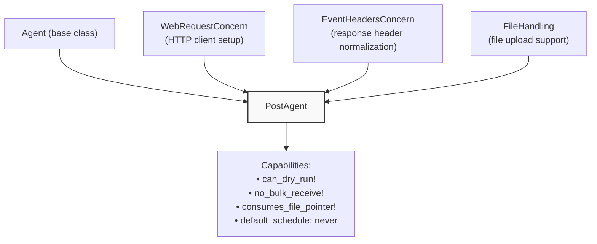
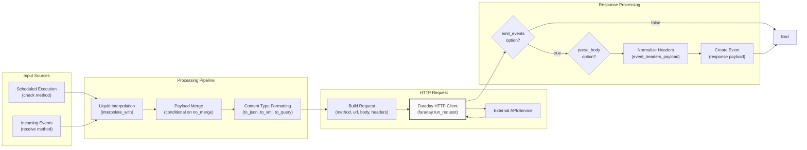
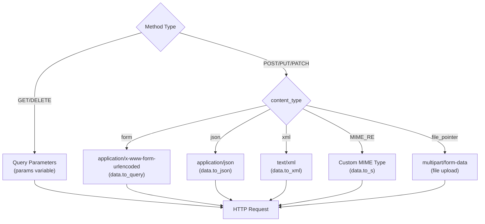
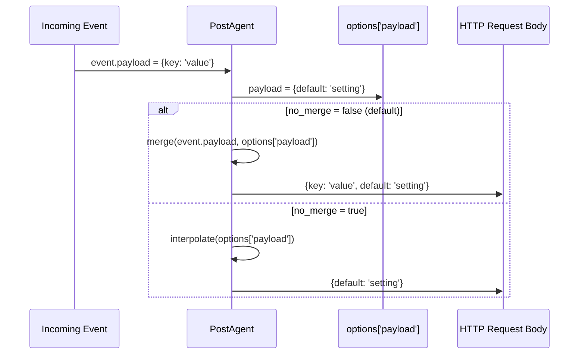
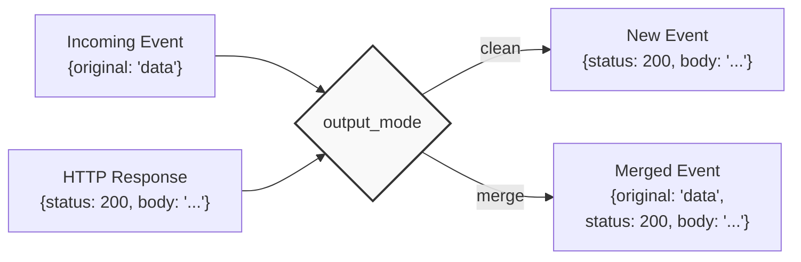
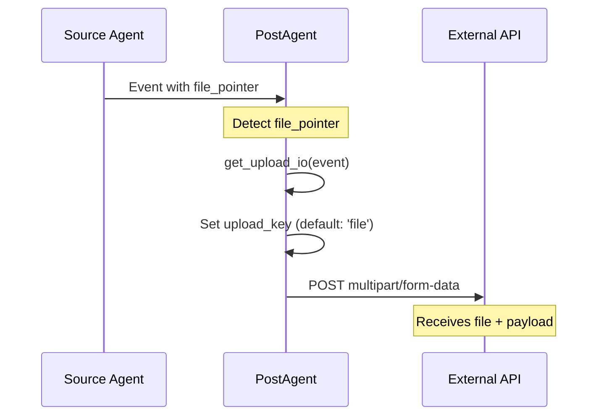
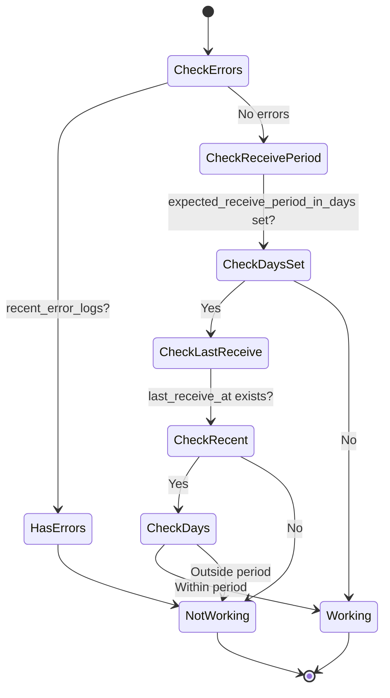
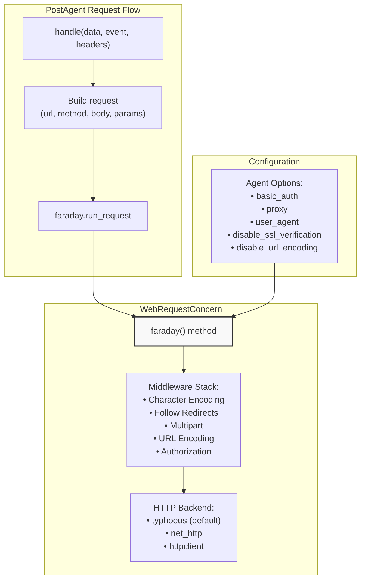

<!-- source: DeepWiki mcp.deepwiki.com · repo huginn/huginn · page 5.3 PostAgent · fetched 2026-10-29 -->

# PostAgent

<details>
<summary>Relevant source files</summary>

The following files were used as context for generating this wiki page:

- [app/concerns/event_headers_concern.rb](app/concerns/event_headers_concern.rb)
- [app/concerns/web_request_concern.rb](app/concerns/web_request_concern.rb)
- [app/models/agents/post_agent.rb](app/models/agents/post_agent.rb)
- [app/models/agents/website_agent.rb](app/models/agents/website_agent.rb)
- [db/migrate/20160405072512_post_agent_set_event_header_style.rb](db/migrate/20160405072512_post_agent_set_event_header_style.rb)
- [lib/utils.rb](lib/utils.rb)
- [lib/utils/html_transformer.rb](lib/utils/html_transformer.rb)
- [spec/data_fixtures/urlTest.html](spec/data_fixtures/urlTest.html)
- [spec/lib/utils_spec.rb](spec/lib/utils_spec.rb)
- [spec/models/agents/post_agent_spec.rb](spec/models/agents/post_agent_spec.rb)
- [spec/models/agents/website_agent_spec.rb](spec/models/agents/website_agent_spec.rb)
- [spec/support/shared_examples/web_request_concern.rb](spec/support/shared_examples/web_request_concern.rb)

</details>


## Purpose and Scope

The PostAgent sends HTTP requests to external services, either on a schedule or when receiving events from other agents. It merges incoming event data with configured payloads, applies Liquid template interpolation, and optionally emits the HTTP response as a new event. This agent serves as Huginn's primary interface for making outbound HTTP calls to APIs, webhooks, and web services.

For receiving incoming HTTP requests (webhooks), see [DataOutputAgent and WebhookAgent](#5.4). For retrieving data via HTTP GET with parsing capabilities, see [WebsiteAgent](#5.1).

**Sources:** [app/models/agents/post_agent.rb:1-56]()

---

## Agent Classification and Capabilities



PostAgent inherits from the base Agent class and includes three concerns that provide HTTP functionality, response header handling, and file upload capabilities.

**Sources:** [app/models/agents/post_agent.rb:2-13]()

---

## Data Flow Architecture



**Sources:** [app/models/agents/post_agent.rb:162-229](), [app/models/agents/post_agent.rb:175-177]()

---

## Request Configuration

### HTTP Method and URL

PostAgent supports five HTTP methods, configured via the `method` option:

| Method | Use Case | Payload Location |
|--------|----------|------------------|
| `get` | Retrieve data | Query parameters |
| `post` | Create resources | Request body |
| `put` | Replace resources | Request body |
| `patch` | Update resources | Request body |
| `delete` | Remove resources | Query parameters |

The `post_url` option specifies the target URL and supports Liquid interpolation:

```liquid
"post_url": "https://{{ domain }}/api/{{ endpoint }}"
```

**Sources:** [app/models/agents/post_agent.rb:101-103](), [app/models/agents/post_agent.rb:184-214](), [spec/models/agents/post_agent_spec.rb:144-155]()

### Content Types



**Content Type Configuration:**

- **`form`** (default): Sends data as `application/x-www-form-urlencoded`
- **`json`**: Converts payload to JSON with `application/json; charset=utf-8` header
- **`xml`**: Converts payload to XML with `text/xml; charset=utf-8` header, using `xml_root` option for root element name (default: `post`)
- **MIME type string**: Sets `Content-Type` header and sends payload as string (requires `no_merge: true`)

**Sources:** [app/models/agents/post_agent.rb:199-211](), [spec/models/agents/post_agent_spec.rb:197-246]()

---

## Payload Handling

### Default Payload Merging



By default, PostAgent merges the incoming event's payload with the configured `payload` option. The configured payload takes precedence for overlapping keys. Set `no_merge` to `true` to send only the configured payload (still interpolated with event data).

**Sources:** [app/models/agents/post_agent.rb:164-171](), [spec/models/agents/post_agent_spec.rb:134-141]()

### Liquid Interpolation

All string values in the `payload`, `post_url`, and `headers` options support Liquid templating:

```json
{
  "post_url": "https://api.example.com/users/{{ user_id }}",
  "payload": {
    "message": "User {{ name }} scored {{ points | plus: 10 }}"
  },
  "headers": {
    "X-Custom": "{{ event_type }}"
  }
}
```

**Sources:** [app/models/agents/post_agent.rb:164-171](), [spec/models/agents/post_agent_spec.rb:143-167]()

---

## Response Handling

### Event Emission

When `emit_events` is set to `true`, PostAgent creates events from HTTP responses with the following structure:

```json
{
  "status": 200,
  "headers": {
    "Content-Type": "application/json"
  },
  "body": "<response body as string or parsed JSON>"
}
```

**Sources:** [app/models/agents/post_agent.rb:220-228](), [app/models/agents/post_agent.rb:58-71]()

### Parse Body Option

The `parse_body` option controls response body parsing:

| `parse_body` | Content-Type | Result |
|-------------|--------------|--------|
| `true` | `application/json` | Parsed JSON object in `body` field |
| `true` | Other | Raw string in `body` field |
| `false` | Any | Raw string in `body` field |

**Sources:** [app/models/agents/post_agent.rb:158-160](), [spec/models/agents/post_agent_spec.rb:299-310]()

### Output Mode

The `output_mode` option determines event payload structure:



**Sources:** [app/models/agents/post_agent.rb:221](), [spec/models/agents/post_agent_spec.rb:342-354]()

### Header Normalization

The `event_headers_style` option normalizes response header keys in emitted events:

| Style | Example Input | Example Output |
|-------|--------------|----------------|
| `capitalized` (default) | `content-type` | `Content-Type` |
| `downcased` | `Content-Type` | `content-type` |
| `snakecased` | `Content-Type` | `content_type` |
| `raw` | (unchanged) | (unchanged) |

Use `event_headers` to filter which headers are included (array or comma-separated string):

```json
{
  "event_headers": ["content-type", "x-custom-header"],
  "event_headers_style": "snakecased"
}
```

**Sources:** [app/concerns/event_headers_concern.rb:14-27](), [app/models/agents/post_agent.rb:231-233](), [spec/models/agents/post_agent_spec.rb:312-340]()

---

## Authentication and Security

### HTTP Basic Authentication

Configure basic auth via the `basic_auth` option:

```json
// String format
{"basic_auth": "username:password"}

// Array format
{"basic_auth": ["username", "password"]}
```

**Sources:** [app/concerns/web_request_concern.rb:173-183](), [spec/support/shared_examples/web_request_concern.rb:46-64]()

### SSL Verification

Set `disable_ssl_verification` to `true` to disable SSL certificate verification (not recommended for production):

```json
{"disable_ssl_verification": true}
```

**Sources:** [app/concerns/web_request_concern.rb:117-119](), [spec/support/shared_examples/web_request_concern.rb:66-87]()

### Custom Headers

The `headers` option adds custom HTTP headers to requests:

```json
{
  "headers": {
    "Authorization": "Bearer ",
    "X-Custom-Header": "{{ custom_value }}"
  }
}
```

Headers support Liquid interpolation and credential tags.

**Sources:** [app/models/agents/post_agent.rb:181-182](), [spec/models/agents/post_agent_spec.rb:157-167](), [spec/models/agents/post_agent_spec.rb:248-255]()

---

## File Upload Support

PostAgent can send files using multipart encoding when receiving events with a `file_pointer`:



When a `file_pointer` is present:
1. The request uses `multipart/form-data` encoding (overrides `content_type`)
2. The file is sent in the field specified by `upload_key` (default: `file`)
3. Other payload fields are sent as form fields

**Sources:** [app/models/agents/post_agent.rb:7](), [app/models/agents/post_agent.rb:192-194](), [spec/models/agents/post_agent_spec.rb:169-186]()

---

## Validation Rules

PostAgent validates configuration with the following constraints:

| Option | Constraint |
|--------|-----------|
| `post_url` | Required, must be present |
| `method` | Must be one of: `post`, `get`, `put`, `delete`, `patch` |
| `payload` | For GET/DELETE: must be hash or array<br/>For POST/PUT/PATCH with MIME type: can be string if `no_merge: true` |
| `content_type` | Must be `form`, `json`, `xml`, or valid MIME type |
| `no_merge` | Must be `true` or `false` if present |
| `emit_events` | Must be `true` or `false` if present |
| `output_mode` | Must be `clean` or `merge` if present (or Liquid template) |
| `parse_body` | Must be `true` or `false` if present (or Liquid template) |
| `headers` | Must be a hash if present |

String payloads with custom MIME types require `no_merge: true` to prevent unintended merging.

**Sources:** [app/models/agents/post_agent.rb:105-156](), [spec/models/agents/post_agent_spec.rb:388-537]()

---

## Execution Modes

### Scheduled Execution

When PostAgent has a schedule, the `check` method executes periodically:

```ruby
# Sends configured payload to post_url
def check
  handle interpolated['payload'].presence || {}, headers
end
```

**Sources:** [app/models/agents/post_agent.rb:175-177]()

### Event-Driven Execution

When receiving events from upstream agents, the `receive` method processes each event:

```ruby
def receive(incoming_events)
  incoming_events.each do |event|
    interpolate_with(event) do
      # Merge or use configured payload
      # Make HTTP request
    end
  end
end
```

The agent processes events individually (no bulk receive) as indicated by the `no_bulk_receive!` declaration.

**Sources:** [app/models/agents/post_agent.rb:162-173](), [app/models/agents/post_agent.rb:12]()

---

## Working Status

PostAgent's `working?` method returns `true` when:
1. No recent error logs exist
2. If `expected_receive_period_in_days` is set: the agent received an event within that period



**Sources:** [app/models/agents/post_agent.rb:91-99](), [spec/models/agents/post_agent_spec.rb:359-386]()

---

## Common Usage Patterns

### Simple API POST

```json
{
  "post_url": "https://api.example.com/notifications",
  "method": "post",
  "content_type": "json",
  "payload": {
    "message": "{{ text }}",
    "priority": "high"
  },
  "no_merge": true
}
```

### GET Request with Query Parameters

```json
{
  "post_url": "https://api.example.com/search",
  "method": "get",
  "payload": {
    "q": "{{ search_term }}",
    "limit": "10"
  }
}
```

### XML POST with Custom Root

```json
{
  "post_url": "https://soap.example.com/endpoint",
  "method": "post",
  "content_type": "xml",
  "xml_root": "request",
  "payload": {
    "action": "{{ action_type }}",
    "data": "{{ payload }}"
  }
}
```

### Webhook with Response Capture

```json
{
  "post_url": "https://webhook.site/{{ webhook_id }}",
  "method": "post",
  "content_type": "json",
  "emit_events": "true",
  "parse_body": "true",
  "output_mode": "merge",
  "payload": {
    "event_type": "{{ type }}",
    "timestamp": "{{ 'now' | date: '%Y-%m-%d %H:%M:%S' }}"
  }
}
```

**Sources:** [app/models/agents/post_agent.rb:73-89](), [spec/models/agents/post_agent_spec.rb:77-357]()

---

## Integration with WebRequestConcern

PostAgent relies on WebRequestConcern for HTTP client functionality:



The `faraday` method from WebRequestConcern configures the HTTP client with:
- SSL verification settings
- Custom headers and user agent
- Proxy configuration
- Request/response middleware
- Timeout handling
- HTTP backend selection

**Sources:** [app/models/agents/post_agent.rb:4](), [app/concerns/web_request_concern.rb:115-167](), [app/models/agents/post_agent.rb:216-218]()

---

## Default Configuration

PostAgent provides sensible defaults for quick setup:

```ruby
{
  'post_url' => "http://www.example.com",
  'expected_receive_period_in_days' => '1',
  'content_type' => 'form',
  'method' => 'post',
  'payload' => {
    'key' => 'value',
    'something' => 'the event contained {{ somekey }}'
  },
  'headers' => {},
  'emit_events' => 'false',
  'parse_body' => 'true',
  'no_merge' => 'true',
  'output_mode' => 'clean'
}
```

**Sources:** [app/models/agents/post_agent.rb:73-89]()

---

