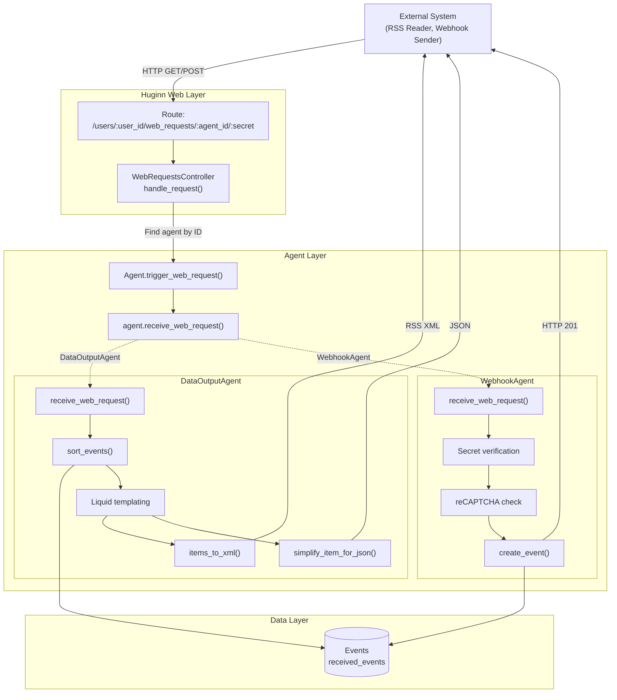
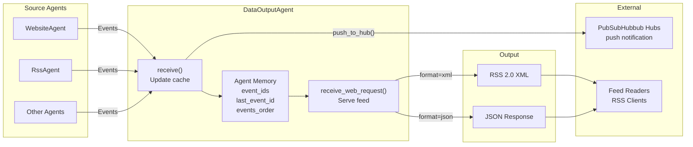
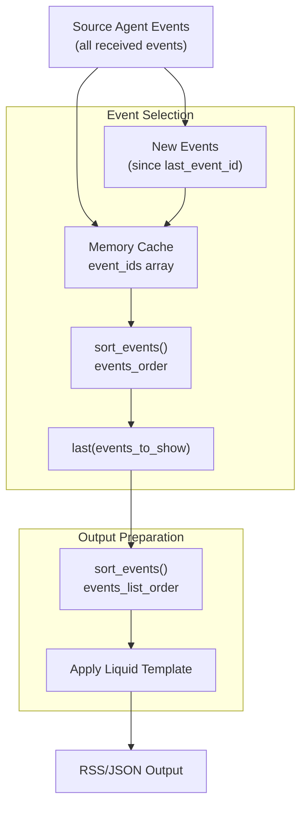
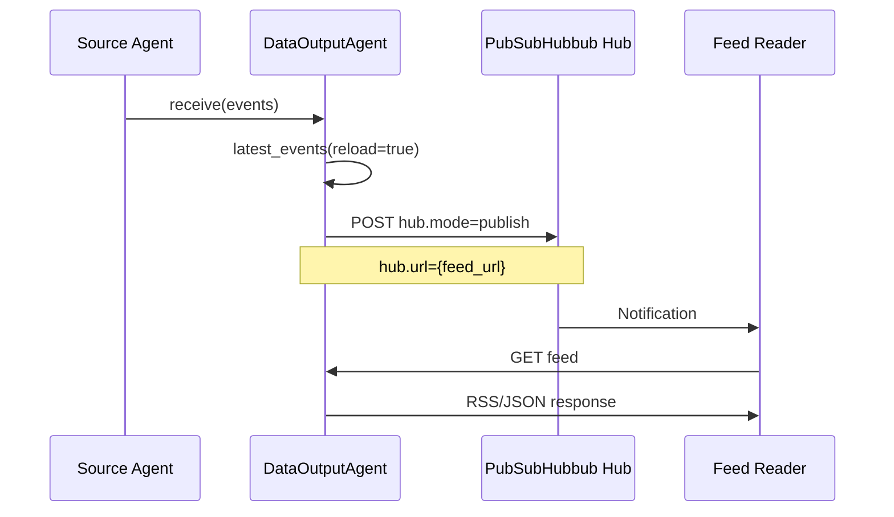
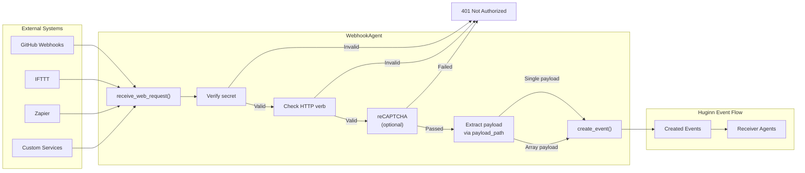
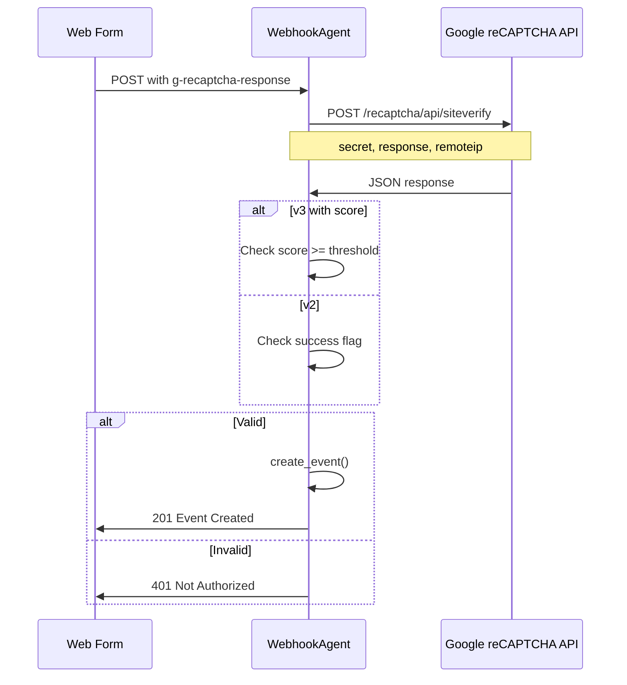
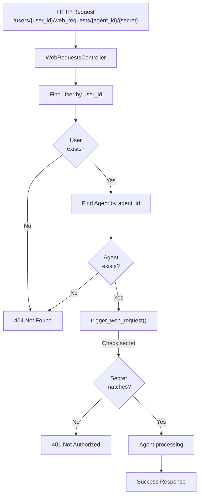

<!-- source: DeepWiki mcp.deepwiki.com · repo huginn/huginn · page 5.4 DataOutputAgent and WebhookAgent · fetched 2026-10-29 -->

# DataOutputAgent and WebhookAgent

<details>
<summary>Relevant source files</summary>

The following files were used as context for generating this wiki page:

- [app/controllers/web_requests_controller.rb](app/controllers/web_requests_controller.rb)
- [app/models/agent.rb](app/models/agent.rb)
- [app/models/agents/data_output_agent.rb](app/models/agents/data_output_agent.rb)
- [app/models/agents/webhook_agent.rb](app/models/agents/webhook_agent.rb)
- [app/views/agents/_form.html.erb](app/views/agents/_form.html.erb)
- [db/migrate/20160423163416_add_xml_namespace_option_to_data_output_agents.rb](db/migrate/20160423163416_add_xml_namespace_option_to_data_output_agents.rb)
- [db/migrate/20160607055850_change_events_order_to_events_list_order.rb](db/migrate/20160607055850_change_events_order_to_events_list_order.rb)
- [db/migrate/20170419073748_set_rss_content_type.rb](db/migrate/20170419073748_set_rss_content_type.rb)
- [spec/controllers/web_requests_controller_spec.rb](spec/controllers/web_requests_controller_spec.rb)
- [spec/models/agent_spec.rb](spec/models/agent_spec.rb)
- [spec/models/agents/data_output_agent_spec.rb](spec/models/agents/data_output_agent_spec.rb)
- [spec/models/agents/webhook_agent_spec.rb](spec/models/agents/webhook_agent_spec.rb)
- [spec/routing/webhooks_controller_spec.rb](spec/routing/webhooks_controller_spec.rb)

</details>


## Purpose and Scope

This page documents two complementary agents that enable Huginn to interact with external systems via HTTP:

- **DataOutputAgent**: Exposes internal Huginn events as public or authenticated RSS/JSON feeds
- **WebhookAgent**: Receives external HTTP requests (webhooks) and creates Huginn events

Both agents operate through the web request system and use secret-based authentication. For information about making outbound HTTP requests, see [PostAgent](#5.3). For web scraping capabilities, see [WebsiteAgent](#5.1).

**Sources:** [app/models/agents/data_output_agent.rb:1-11](), [app/models/agents/webhook_agent.rb:1-11]()

---

## Web Request Architecture

Both agents implement the `receive_web_request` interface, which allows agents to handle incoming HTTP requests without requiring user authentication.



**Diagram: Web Request Flow Architecture**

The `WebRequestsController` routes incoming requests to the appropriate agent's `receive_web_request` method. The controller handles response formatting, status codes, and custom headers.

**Sources:** [app/controllers/web_requests_controller.rb:1-56](), [app/models/agent.rb:170-190]()

---

## URL Structure and Routing

Both agents use the same URL pattern for web requests:

```
https://{DOMAIN}/users/{user_id}/web_requests/{agent_id}/{secret}
```

| Component | Description |
|-----------|-------------|
| `{DOMAIN}` | Configured via `ENV['DOMAIN']` |
| `{user_id}` | The numeric ID of the user who owns the agent |
| `{agent_id}` | The numeric ID of the specific agent |
| `{secret}` | User-defined authentication token |

The URL can optionally include a format extension:
- `.xml` or `.rss` for RSS output (DataOutputAgent)
- `.json` for JSON output (both agents)

Example URLs:
```
https://huginn.example.com/users/1/web_requests/42/abc123.xml
https://huginn.example.com/users/1/web_requests/43/xyz789
```

**Sources:** [app/controllers/web_requests_controller.rb:5-7](), [config/routes.rb](), [spec/routing/webhooks_controller_spec.rb:4-22]()

---

## DataOutputAgent

### Overview

The DataOutputAgent serves events from connected source agents as RSS or JSON feeds. It cannot be scheduled and cannot create events—it only outputs events it receives from other agents.



**Diagram: DataOutputAgent Event Flow**

**Sources:** [app/models/agents/data_output_agent.rb:2-6]()

### Configuration Options

The DataOutputAgent is configured through its `options` hash:

| Option | Type | Description |
|--------|------|-------------|
| `secrets` | Array of Strings | Authentication tokens (one or more) |
| `expected_receive_period_in_days` | Integer | Working status threshold |
| `template` | Hash | Liquid template for feed structure |
| `template.title` | String | Feed title |
| `template.description` | String | Feed description |
| `template.link` | String | Feed link URL |
| `template.icon` | String | Feed icon URL |
| `template.self` | String | Self-referential feed URL |
| `template.item` | Hash | Template for each event |
| `events_to_show` | Integer | Number of events in feed (default: 40) |
| `ttl` | Integer | RSS TTL in minutes (default: 60) |
| `ns_dc` | Boolean | Enable Dublin Core namespace |
| `ns_media` | Boolean | Enable Yahoo Media namespace |
| `ns_itunes` | Boolean | Enable iTunes namespace |
| `rss_content_type` | String | Content-Type header (default: `application/rss+xml`) |
| `response_headers` | Hash | Custom HTTP response headers |
| `push_hubs` | Array | PubSubHubbub hub URLs for push notifications |
| `events_order` | Array | Liquid expressions for event ordering |
| `events_list_order` | Array | Liquid expressions for list ordering |

Example configuration:

```json
{
  "secrets": ["a-secret-key"],
  "expected_receive_period_in_days": 2,
  "template": {
    "title": "XKCD comics as a feed",
    "description": "Recent XKCD comics from Huginn",
    "item": {
      "title": "{{title}}",
      "description": "Secret hovertext: {{hovertext}}",
      "link": "{{url}}"
    }
  },
  "ns_media": "true"
}
```

**Sources:** [app/models/agents/data_output_agent.rb:70-85](), [app/models/agents/data_output_agent.rb:21-33]()

### RSS/JSON Output Format

#### RSS Output

The agent generates RSS 2.0 XML with configurable namespaces:

```xml
<?xml version="1.0" encoding="UTF-8" ?>
<rss version="2.0" xmlns:atom="http://www.w3.org/2005/Atom">
  <channel>
    <atom:link href="..." rel="self" type="application/rss+xml"/>
    <title>{{template.title}}</title>
    <description>{{template.description}}</description>
    <link>{{template.link}}</link>
    <item>
      <title>{{item.title}}</title>
      <description>{{item.description}}</description>
      <guid isPermaLink="false">{{event.id}}</guid>
      <pubDate>{{event.created_at or item.pubDate}}</pubDate>
    </item>
  </channel>
</rss>
```

**XML Namespaces:**

| Namespace | Option | URI |
|-----------|--------|-----|
| Atom | Always included | `http://www.w3.org/2005/Atom` |
| Dublin Core | `ns_dc: "true"` | `http://purl.org/dc/elements/1.1/` |
| Yahoo Media | `ns_media: "true"` | `http://search.yahoo.com/mrss/` |
| iTunes | `ns_itunes: "true"` | `http://www.itunes.com/dtds/podcast-1.0.dtd` |

**Sources:** [app/models/agents/data_output_agent.rb:306-324](), [app/models/agents/data_output_agent.rb:183-196]()

#### JSON Output

JSON format returns a simplified structure:

```json
{
  "title": "Feed title",
  "description": "Feed description",
  "pubDate": "2024-01-01T12:00:00Z",
  "items": [
    {
      "title": "Event title",
      "description": "Event description",
      "guid": {"contents": 123, "isPermaLink": "false"},
      "pubDate": "RFC2822 date"
    }
  ]
}
```

**Sources:** [app/models/agents/data_output_agent.rb:288-296](), [app/models/agents/data_output_agent.rb:382-409]()

### Advanced Template Features

#### Nested XML Elements with Attributes

Use `_attributes` and `_contents` keys to create complex XML structures:

```json
{
  "template": {
    "item": {
      "enclosure": {
        "_attributes": {
          "url": "{{media_url}}",
          "length": "1234456789",
          "type": "audio/mpeg"
        }
      },
      "custom_tag": {
        "_attributes": {"key": "value"},
        "_contents": "Tag content"
      }
    }
  }
}
```

This generates:

```xml
<enclosure url="..." length="..." type="..."/>
<custom_tag key="value">Tag content</custom_tag>
```

**Sources:** [app/models/agents/data_output_agent.rb:35-50]()

#### Event Access in Templates

The special `events` variable provides access to the array of events being rendered:

```liquid
{{events.first.site_title}}
{{events.size}}
```

This is useful for feed-level interpolation based on event data.

**Sources:** [app/models/agents/data_output_agent.rb:63-66]()

### Event Ordering and Filtering

The DataOutputAgent maintains an internal cache of events and supports two levels of ordering:



**Diagram: Event Ordering Pipeline**

**Ordering Options:**

- `events_order`: Determines which events are selected (maintains total ordering)
- `events_list_order`: Determines output order only (default: reverse chronological)

Example:

```json
{
  "events_order": [["{{date_published}}", "string"]],
  "events_list_order": [["{{title}}", "string", true]]
}
```

**Sources:** [app/models/agents/data_output_agent.rb:202-209](), [app/models/agents/data_output_agent.rb:211-254](), [app/models/agents/data_output_agent.rb:265-267]()

### PubSubHubbub Integration

The agent can push notifications to PubSubHubbub hubs when new events are received:



**Diagram: PubSubHubbub Push Flow**

Configuration:

```json
{
  "push_hubs": [
    "https://pubsubhubbub.superfeedr.com/",
    "https://pubsubhubbub.appspot.com/"
  ],
  "template": {
    "self": "https://safe-proxy.example.com/feed"
  }
}
```

**Sources:** [app/models/agents/data_output_agent.rb:328-337](), [app/models/agents/data_output_agent.rb:427-452]()

### Internal Implementation

#### Memory Structure

The agent maintains state in its `memory` hash:

| Key | Type | Description |
|-----|------|-------------|
| `event_ids` | Array | Cached event IDs in current window |
| `last_event_id` | Integer | Last processed event ID |
| `events_order` | Array | Current ordering configuration |
| `events_to_show` | Integer | Current window size |

**Sources:** [app/models/agents/data_output_agent.rb:215-251]()

#### XML Node Transformation

The `XMLNode` class handles attributes and nested content:

```ruby
class XMLNode
  def initialize(tag_name, attributes, contents)
  def to_xml(options)
```

The `simplify_item_for_xml` method processes the template hash and converts `_attributes` and `_contents` keys into `XMLNode` objects.

**Sources:** [app/models/agents/data_output_agent.rb:341-359](), [app/models/agents/data_output_agent.rb:361-380]()

---

## WebhookAgent

### Overview

The WebhookAgent receives HTTP requests from external systems and creates Huginn events. It cannot be scheduled and cannot receive events from other agents—it only creates events from incoming webhooks.



**Diagram: WebhookAgent Request Processing Flow**

**Sources:** [app/models/agents/webhook_agent.rb:2-7]()

### Configuration Options

| Option | Type | Default | Description |
|--------|------|---------|-------------|
| `secret` | String | Random UUID | Authentication token |
| `expected_receive_period_in_days` | Integer | 1 | Working status threshold |
| `payload_path` | String | `"."` | JSONPath to event payload |
| `event_headers` | String | `""` | Comma-separated list of headers to include |
| `event_headers_key` | String | `"headers"` | Key for storing headers in payload |
| `verbs` | String | `"post"` | Allowed HTTP verbs (comma-separated) |
| `response` | String | `"Event Created"` | Response message |
| `response_headers` | Hash | - | Custom response headers |
| `code` | Integer/String | `201` | HTTP response code |
| `recaptcha_secret` | String | - | Google reCAPTCHA secret key |
| `recaptcha_send_remote_addr` | Boolean | `false` | Send IP to reCAPTCHA |
| `score_threshold` | Float | `0.5` | reCAPTCHA v3 score threshold |

Example configuration:

```json
{
  "secret": "my-webhook-secret-123",
  "expected_receive_period_in_days": 1,
  "payload_path": ".",
  "event_headers": "X-GitHub-Event,X-GitHub-Delivery",
  "event_headers_key": "github_headers",
  "verbs": "post",
  "response": "Webhook received"
}
```

**Sources:** [app/models/agents/webhook_agent.rb:48-57]()

### Receiving Webhooks

#### Request Processing

The `receive_web_request` method processes incoming requests:

1. **Secret Verification** - Compares URL secret with configured secret
2. **Verb Validation** - Checks HTTP method against allowed verbs
3. **reCAPTCHA Verification** - Optional bot protection
4. **Payload Extraction** - Uses JSONPath to extract relevant data
5. **Event Creation** - Creates one or more events
6. **Response** - Returns customized response

**Sources:** [app/models/agents/webhook_agent.rb:59-134]()

#### Multiple Event Creation

If `payload_path` points to an array, the agent creates multiple events:

```json
{
  "payload_path": "items"
}
```

For a request with:
```json
{
  "items": [
    {"name": "Item 1"},
    {"name": "Item 2"}
  ]
}
```

Creates two events with payloads `{"name": "Item 1"}` and `{"name": "Item 2"}`.

**Sources:** [app/models/agents/webhook_agent.rb:117-119](), [spec/models/agents/webhook_agent_spec.rb:33-50]()

#### Event Headers

The agent can capture HTTP headers and include them in event payloads:

```json
{
  "event_headers": "Accept,X-Hello-World",
  "event_headers_key": "http_headers"
}
```

HTTP headers starting with `HTTP_` are normalized (e.g., `HTTP_X_CUSTOM_HEADER` becomes `X-Custom-Header`) and included in the event payload under the specified key.

**Sources:** [app/models/agents/webhook_agent.rb:71-76](), [app/models/agents/webhook_agent.rb:118]()

### HTTP Verb Configuration

The `verbs` option controls which HTTP methods are accepted:

| Configuration | Accepted Methods |
|---------------|-----------------|
| `"post"` (default) | POST only |
| `"get"` | GET only |
| `"get,post"` | GET and POST |
| `"put,post,get"` | PUT, POST, and GET |

The option is case-insensitive and handles extra whitespace and commas gracefully.

**Sources:** [app/models/agents/webhook_agent.rb:79-80](), [spec/models/agents/webhook_agent_spec.rb:170-460]()

### reCAPTCHA Integration

The agent supports Google reCAPTCHA v2 and v3 for bot protection:



**Diagram: reCAPTCHA Verification Flow**

Configuration:

```json
{
  "recaptcha_secret": "your-recaptcha-secret-key",
  "recaptcha_send_remote_addr": true,
  "score_threshold": 0.5
}
```

The agent looks for `g-recaptcha-response` in request parameters and verifies it with Google's API.

**Sources:** [app/models/agents/webhook_agent.rb:86-115]()

### Response Customization

#### Dynamic Response Messages

The `response` option supports Liquid interpolation:

```json
{
  "response": "Received {{items.size}} items from {{source}}"
}
```

The response is interpolated with the incoming request parameters.

**Sources:** [app/models/agents/webhook_agent.rb:123](), [spec/models/agents/webhook_agent_spec.rb:89-101]()

#### Custom Response Codes and Headers

```json
{
  "code": "200",
  "response": "OK",
  "response_headers": {
    "Access-Control-Allow-Origin": "*",
    "X-Custom-Header": "value"
  }
}
```

Codes `301` and `302` trigger automatic redirects to the URL in `response`.

**Sources:** [app/models/agents/webhook_agent.rb:121-133](), [app/controllers/web_requests_controller.rb:40-48]()

---

## Security and Authentication

Both agents use secret-based authentication:



**Diagram: Authentication Flow**

### Secret Management

**DataOutputAgent:**
- Supports multiple secrets via the `secrets` array
- Allows different external systems to access the same feed with different tokens
- Secret is verified in `receive_web_request`

**WebhookAgent:**
- Uses a single secret (default: auto-generated UUID)
- Secret should be shared only with trusted external systems
- Recommended to use different secrets for different webhook sources

**Sources:** [app/models/agents/data_output_agent.rb:257-263](), [app/models/agents/webhook_agent.rb:60-62](), [app/controllers/web_requests_controller.rb:25-55]()

### Security Best Practices

1. **Use HTTPS**: Always access webhook URLs over HTTPS in production
2. **Unique Secrets**: Use different secrets for different agents
3. **Secret Rotation**: Periodically change secrets for sensitive integrations
4. **reCAPTCHA**: Enable for public-facing webhooks to prevent abuse
5. **IP Restrictions**: Consider using reverse proxy with IP allowlists for sensitive feeds
6. **Audit Logging**: Monitor `last_web_request_at` timestamp for unusual activity

**Sources:** [app/models/agent.rb:175-188]()

---

## Common Use Cases

### DataOutputAgent Use Cases

1. **Public RSS Feed**: Share filtered/transformed events with RSS readers
2. **JSON API**: Provide JSON endpoint for mobile apps or external services
3. **Podcast Feed**: Use iTunes namespace for podcast distribution
4. **Real-time Notifications**: Push to PubSubHubbub for instant updates
5. **Event Archive**: Expose historical events with custom ordering

### WebhookAgent Use Cases

1. **GitHub Integration**: Receive push notifications, PR events, issue updates
2. **Form Submissions**: Accept data from web forms
3. **IoT Device Events**: Receive sensor data or device status updates
4. **Payment Notifications**: Process payment gateway webhooks
5. **Chat Platform Integration**: Receive messages from Slack, Discord, etc.
6. **Monitoring Alerts**: Ingest alerts from monitoring systems

**Sources:** [app/models/agents/data_output_agent.rb:8-33](), [app/models/agents/webhook_agent.rb:9-38]()

---

## Testing and Debugging

### DataOutputAgent Testing

Access the feed directly via browser or curl:

```bash
# RSS feed
curl https://huginn.example.com/users/1/web_requests/42/secret.xml

# JSON feed
curl https://huginn.example.com/users/1/web_requests/42/secret.json
```

Check agent logs for:
- Template rendering errors
- PubSubHubbub push failures
- Event ordering issues

**Sources:** [spec/models/agents/data_output_agent_spec.rb:100-118]()

### WebhookAgent Testing

Test webhooks using curl:

```bash
# Simple POST
curl -X POST \
  https://huginn.example.com/users/1/web_requests/43/secret \
  -H "Content-Type: application/json" \
  -d '{"test": "data"}'

# With custom headers
curl -X POST \
  https://huginn.example.com/users/1/web_requests/43/secret \
  -H "X-Custom-Header: value" \
  -d '{"test": "data"}'
```

Monitor the agent's:
- `last_web_request_at` timestamp
- Event count
- Error logs for authentication failures

**Sources:** [spec/models/agents/webhook_agent_spec.rb:13-31](), [spec/controllers/web_requests_controller_spec.rb:27-49]()

---

## Related Concerns and Mixins

Both agents inherit common functionality:

| Concern | Purpose |
|---------|---------|
| `WebRequestConcern` | HTTP client functionality (used by DataOutputAgent for PubSubHubbub) |
| `EventHeadersConcern` | Header normalization and extraction (WebhookAgent) |
| `LiquidInterpolatable` | Liquid template processing (both agents) |
| `SortableEvents` | Event sorting functionality (DataOutputAgent) |

**Sources:** [app/models/agents/data_output_agent.rb:3](), [app/models/agents/webhook_agent.rb:3-4](), [app/models/agent.rb:12]()

---

