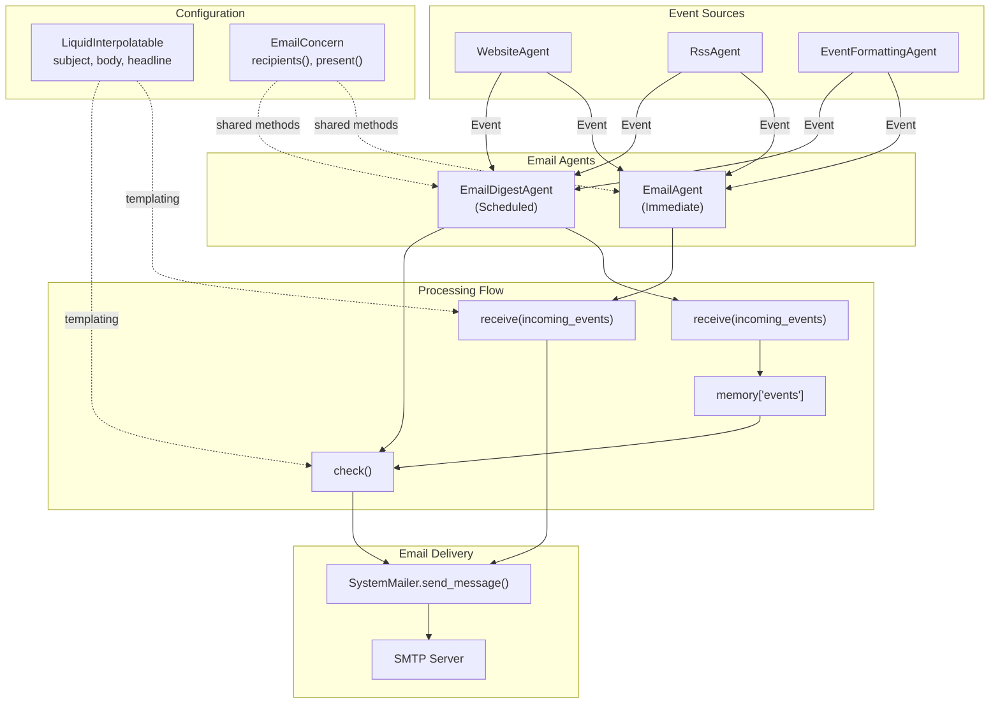
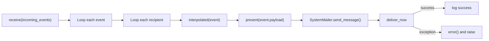
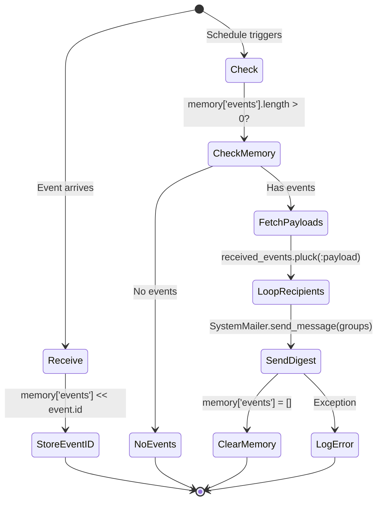
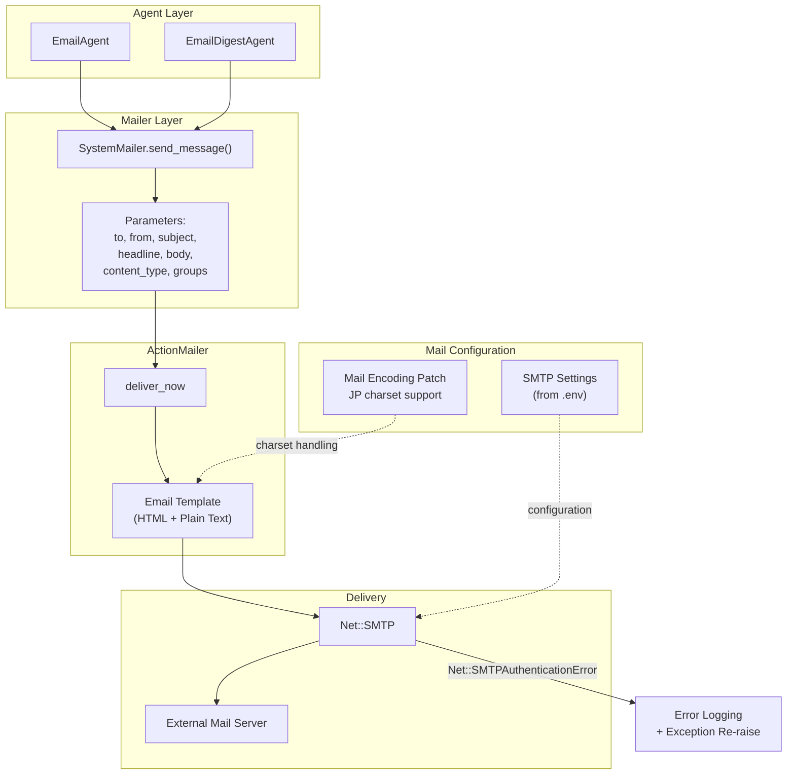

<!-- source: DeepWiki mcp.deepwiki.com · repo huginn/huginn · page 5.5 Email Agents · fetched 2026-10-29 -->

# Email Agents

<details>
<summary>Relevant source files</summary>

The following files were used as context for generating this wiki page:

- [app/concerns/liquid_droppable.rb](app/concerns/liquid_droppable.rb)
- [app/concerns/liquid_interpolatable.rb](app/concerns/liquid_interpolatable.rb)
- [app/models/agents/email_agent.rb](app/models/agents/email_agent.rb)
- [app/models/agents/email_digest_agent.rb](app/models/agents/email_digest_agent.rb)
- [app/models/agents/event_formatting_agent.rb](app/models/agents/event_formatting_agent.rb)
- [app/models/agents/weather_agent.rb](app/models/agents/weather_agent.rb)
- [config/initializers/mail_encoding_patch.rb](config/initializers/mail_encoding_patch.rb)
- [db/migrate/20160807000122_remove_queue_from_email_digest_agent_memory.rb](db/migrate/20160807000122_remove_queue_from_email_digest_agent_memory.rb)
- [db/seeds.rb](db/seeds.rb)
- [spec/concerns/liquid_interpolatable_spec.rb](spec/concerns/liquid_interpolatable_spec.rb)
- [spec/data_fixtures/weather.json](spec/data_fixtures/weather.json)
- [spec/models/agents/email_agent_spec.rb](spec/models/agents/email_agent_spec.rb)
- [spec/models/agents/email_digest_agent_spec.rb](spec/models/agents/email_digest_agent_spec.rb)
- [spec/models/agents/event_formatting_agent_spec.rb](spec/models/agents/event_formatting_agent_spec.rb)
- [spec/models/agents/weather_agent_spec.rb](spec/models/agents/weather_agent_spec.rb)
- [spec/support/shared_examples/liquid_interpolatable.rb](spec/support/shared_examples/liquid_interpolatable.rb)

</details>


This document covers the email notification agents in Huginn: `EmailAgent` and `EmailDigestAgent`. These agents send event data via email, either immediately upon receipt or batched on a schedule. For processing events before sending them to email agents, see [EventFormattingAgent](#5.7). For triggering email based on conditions, see the examples in [Event-Driven Architecture](#3.2).

---

## Overview

Huginn provides two agents for email notifications that differ in their delivery timing:

| Feature | EmailAgent | EmailDigestAgent |
|---------|-----------|------------------|
| **Delivery Timing** | Immediate (per event) | Batched (scheduled) |
| **Default Schedule** | `"never"` (event-driven) | `"5am"` (scheduled) |
| **Event Storage** | None | Stores event IDs in memory |
| **Primary Use Case** | Real-time alerts | Daily/periodic summaries |
| **Creates Events** | No | No |
| **Bulk Receive** | No | Yes |

Both agents extend from the `Agent` base class and include `EmailConcern`, which provides shared functionality for email handling.

**Sources:** [app/models/agents/email_agent.rb:1-68](), [app/models/agents/email_digest_agent.rb:1-73]()

---

## Email Agent Architecture



**Sources:** [app/models/agents/email_agent.rb:48-66](), [app/models/agents/email_digest_agent.rb:43-71]()

---

## EmailAgent

The `EmailAgent` sends emails immediately when it receives events. Each incoming event triggers a separate email to be sent.

### Configuration Options

```ruby
{
  'subject' => "You have a notification!",
  'headline' => "Your notification:",
  'expected_receive_period_in_days' => "2",
  'recipients' => [],  # optional, defaults to user's email
  'from' => "",        # optional, defaults to EMAIL_FROM_ADDRESS
  'body' => "",        # optional, custom email body
  'content_type' => "" # optional, 'text/plain' or 'text/html'
}
```

### Key Characteristics

- **Schedule:** `"never"` - operates as event-driven only via `receive()`
- **Capabilities:** `can_dry_run!`, `cannot_create_events!`, `no_bulk_receive!`
- **Processing:** Events are processed individually, one email per event

### Receive Method Flow



The `receive()` method at [app/models/agents/email_agent.rb:48-66]() processes each event immediately:

1. Iterates through `incoming_events`
2. Calls `recipients(event.payload)` to determine recipient list
3. Interpolates Liquid templates with event data via `interpolated(event)`
4. Calls `SystemMailer.send_message()` with interpolated values
5. Executes `deliver_now` for immediate delivery
6. Logs success or error for each email

### Email Body Formatting

When no `body` option is provided, the email displays an optional `headline` followed by the event payload. When `body` is specified, it's rendered as HTML with sanitization.

**Sources:** [app/models/agents/email_agent.rb:1-68](), [spec/models/agents/email_agent_spec.rb:21-106]()

---

## EmailDigestAgent

The `EmailDigestAgent` collects events in memory and sends them in a single batched email when scheduled to run.

### Configuration Options

```ruby
{
  'subject' => "You have some notifications!",
  'headline' => "Your notifications:",
  'expected_receive_period_in_days' => "2",
  'recipients' => [],  # optional, defaults to user's email
  'from' => "",        # optional, defaults to EMAIL_FROM_ADDRESS
  'content_type' => "" # optional, 'text/plain' or 'text/html'
}
```

Note: `EmailDigestAgent` does not support the `body` option that `EmailAgent` has.

### Key Characteristics

- **Schedule:** `"5am"` by default - runs on scheduled intervals
- **Capabilities:** `cannot_create_events!`
- **Storage:** Event IDs stored in `memory['events']` array
- **Processing:** Multiple events batched into single email

### Event Collection and Delivery Flow



The agent uses two methods:

**`receive(incoming_events)`** at [app/models/agents/email_digest_agent.rb:43-48]():
- Appends event IDs to `memory['events']` array
- Does not send emails immediately

**`check()`** at [app/models/agents/email_digest_agent.rb:50-71]():
- Retrieves payloads for stored event IDs
- Formats payloads using `present()` method
- Sends single email containing all events
- Clears `memory['events']` after successful delivery

### Memory Structure

The agent maintains state in the `memory` hash:

```ruby
{
  'events' => [123, 456, 789]  # Array of Event IDs
}
```

Event IDs persist until successfully sent. If email delivery fails, the events remain in memory for the next scheduled run.

**Sources:** [app/models/agents/email_digest_agent.rb:1-73](), [spec/models/agents/email_digest_agent_spec.rb:24-115]()

---

## Common Features

Both email agents share core functionality through `EmailConcern` and `LiquidInterpolatable`.

### Liquid Templating

All text fields support Liquid templating with access to event data:

```ruby
# Subject templating
'subject' => "Alert: {{title}}"

# Body templating (EmailAgent only)
'body' => "Event occurred at {{created_at | date:'%Y-%m-%d'}} with value {{value}}"

# Headline templating
'headline' => "{{agent.type}} notification"
```

Available template variables:
- Event payload fields (e.g., `{{field_name}}`)
- `{{created_at}}` - Event timestamp
- `{{agent.type}}`, `{{agent.name}}` - Source agent information
- All [Liquid filters](#4.2) (`uri_escape`, `date`, `json`, etc.)

**Sources:** [app/concerns/liquid_interpolatable.rb:97-110](), [spec/models/agents/email_agent_spec.rb:73-91]()

### Recipients Configuration

Both agents support flexible recipient specification:

```ruby
# Single recipient
'recipients' => "user@example.com"

# Multiple recipients (array)
'recipients' => ["user1@example.com", "user2@example.com"]

# Multiple recipients (comma-separated string)
'recipients' => "user1@example.com, user2@example.com"

# Use default (user's email address)
'recipients' => []  # or omit the field
```

The `recipients()` method from `EmailConcern` normalizes these formats and provides interpolation support.

### Email Content Types

Both agents support explicit content type specification:

| Content Type | Effect |
|--------------|--------|
| `"text/plain"` | Plain text email only |
| `"text/html"` | HTML email only |
| (not specified) | Multipart email (both text and HTML versions) |

When using `body` in `EmailAgent`, HTML content is sanitized to prevent XSS attacks while preserving formatting tags like `<strong>`, `<em>`, etc.

**Sources:** [spec/models/agents/email_agent_spec.rb:93-106](), [spec/models/agents/email_digest_agent_spec.rb:106-115]()

---

## Email Delivery System



### Error Handling

Both agents implement consistent error handling for mail delivery failures:

1. **Logging:** Errors are logged via `error()` method with details
2. **Re-raising:** Exceptions are re-raised to ensure visibility
3. **State preservation:** `EmailDigestAgent` preserves event IDs in memory on failure

Example from [app/models/agents/email_agent.rb:61-63]():
```ruby
rescue StandardError => e
  error("Error sending mail to #{recipient} with event #{event.id}: #{e.message}")
  raise
```

### Character Encoding

The system includes a custom encoder for improved handling of Japanese character sets via [config/initializers/mail_encoding_patch.rb:1-21](), which maps `iso-2022-jp` to `Encoding::CP50220` and `shift_jis` to `Encoding::Windows_31J`.

**Sources:** [app/models/agents/email_agent.rb:48-66](), [app/models/agents/email_digest_agent.rb:50-71](), [config/initializers/mail_encoding_patch.rb:1-21]()

---

## Configuration Reference

### Complete EmailAgent Options

| Option | Type | Required | Default | Description |
|--------|------|----------|---------|-------------|
| `subject` | String | Yes | `"You have a notification!"` | Email subject line (Liquid supported) |
| `headline` | String | No | `"Your notification:"` | Header text before event details |
| `body` | String | No | (auto-generated) | Custom email body (Liquid supported, HTML sanitized) |
| `recipients` | String/Array | No | User's email | Email recipient(s) |
| `from` | String | No | `EMAIL_FROM_ADDRESS` | Sender email address |
| `content_type` | String | No | (multipart) | `"text/plain"` or `"text/html"` |
| `expected_receive_period_in_days` | String/Integer | Yes | `"2"` | Expected event frequency for monitoring |

### Complete EmailDigestAgent Options

| Option | Type | Required | Default | Description |
|--------|------|----------|---------|-------------|
| `subject` | String | Yes | `"You have some notifications!"` | Email subject line (Liquid supported) |
| `headline` | String | No | `"Your notifications:"` | Header text before event list |
| `recipients` | String/Array | No | User's email | Email recipient(s) |
| `from` | String | No | `EMAIL_FROM_ADDRESS` | Sender email address |
| `content_type` | String | No | (multipart) | `"text/plain"` or `"text/html"` |
| `expected_receive_period_in_days` | String/Integer | Yes | `"2"` | Expected event frequency for monitoring |

**Sources:** [app/models/agents/email_agent.rb:36-42](), [app/models/agents/email_digest_agent.rb:31-37]()

---

## Usage Examples

### Example 1: Immediate Alert with Custom Body

```ruby
{
  'subject' => "Alert: {{event_type}}",
  'body' => "<strong>{{title}}</strong><br/>{{description}}<br/>Time: {{created_at}}",
  'recipients' => ["admin@example.com"],
  'content_type' => "text/html"
}
```

When this `EmailAgent` receives an event:
```json
{
  "event_type": "Critical Error",
  "title": "Database Connection Failed",
  "description": "Unable to connect to production database"
}
```

It sends an HTML email immediately with the interpolated subject and body.

### Example 2: Daily Digest Summary

```ruby
{
  'subject' => "Daily Report - {{_now_ | date:'%Y-%m-%d'}}",
  'headline' => "Events from the last 24 hours:",
  'recipients' => ["team@example.com"]
}
```

This `EmailDigestAgent` scheduled at `"5am"` collects all events during the day and sends one consolidated email at 5 AM containing all event payloads.

### Example 3: Conditional Formatting with EventFormattingAgent

Chain `EventFormattingAgent` before email agents to prepare data:

```ruby
# EventFormattingAgent instructions
{
  'instructions' => {
    'alert_title' => "{{type | upcase}}: {{name}}",
    'formatted_time' => "{{timestamp | date:'%I:%M %p'}}",
    'severity_icon' => "🔴🟡"
  }
}

# EmailAgent configuration
{
  'subject' => "{{alert_title}}",
  'body' => "{{severity_icon}} Alert at {{formatted_time}}"
}
```

**Sources:** [spec/models/agents/email_agent_spec.rb:73-91](), [spec/models/agents/email_digest_agent_spec.rb:43-70]()

---

## Working Status

Both agents implement the `working?` method to report their operational status:

**EmailAgent:** Returns `true` if an event was received without error within the expected period:
```ruby
def working?
  received_event_without_error?
end
```

**EmailDigestAgent:** Returns `true` if an event was received without error within the expected period:
```ruby
def working?
  received_event_without_error?
end
```

The `received_event_without_error?` helper checks:
1. At least one event was received within `expected_receive_period_in_days`
2. No recent error logs exist

**Sources:** [app/models/agents/email_agent.rb:44-46](), [app/models/agents/email_digest_agent.rb:39-41]()

---

