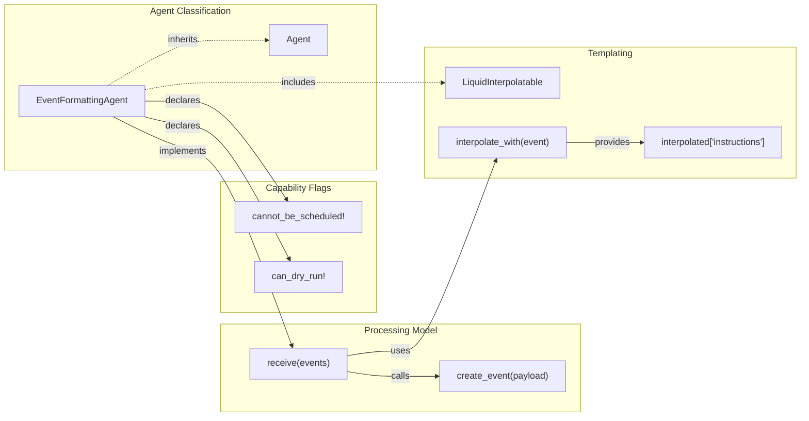
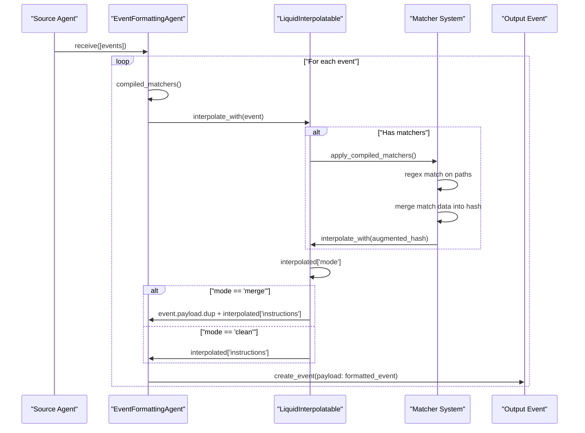
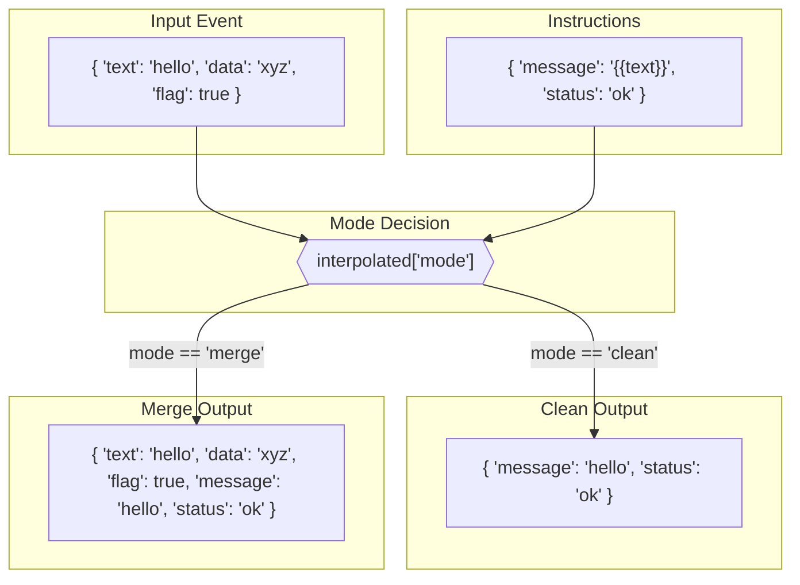
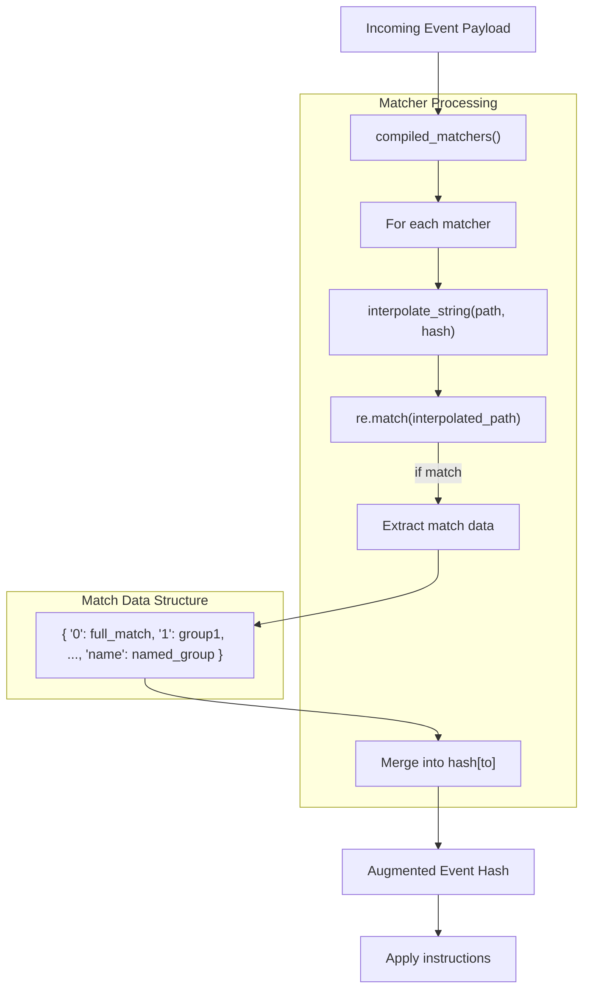
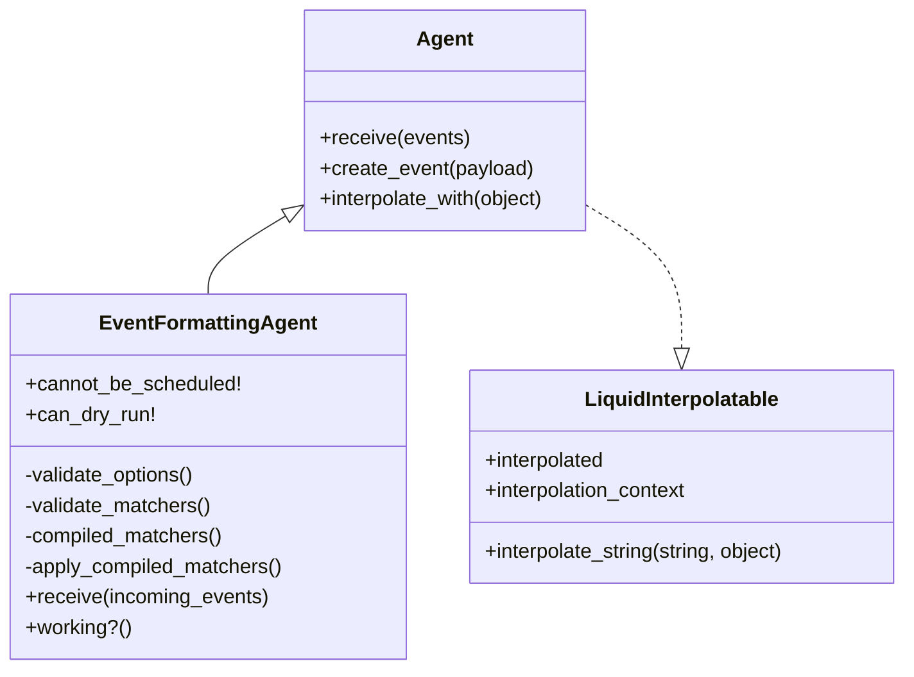
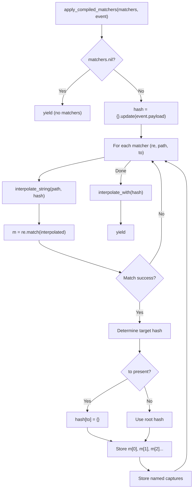

<!-- source: DeepWiki mcp.deepwiki.com · repo huginn/huginn · page 5.7 EventFormattingAgent · fetched 2026-10-29 -->

# EventFormattingAgent

<details>
<summary>Relevant source files</summary>

The following files were used as context for generating this wiki page:

- [app/concerns/liquid_droppable.rb](app/concerns/liquid_droppable.rb)
- [app/concerns/liquid_interpolatable.rb](app/concerns/liquid_interpolatable.rb)
- [app/models/agent.rb](app/models/agent.rb)
- [app/models/agents/event_formatting_agent.rb](app/models/agents/event_formatting_agent.rb)
- [app/views/agents/_form.html.erb](app/views/agents/_form.html.erb)
- [spec/concerns/liquid_interpolatable_spec.rb](spec/concerns/liquid_interpolatable_spec.rb)
- [spec/models/agent_spec.rb](spec/models/agent_spec.rb)
- [spec/models/agents/event_formatting_agent_spec.rb](spec/models/agents/event_formatting_agent_spec.rb)
- [spec/support/shared_examples/liquid_interpolatable.rb](spec/support/shared_examples/liquid_interpolatable.rb)

</details>


## Overview

The `EventFormattingAgent` transforms incoming events by applying Liquid templates to create new events with formatted payloads. This agent is event-driven and cannot be scheduled; it processes events received from source agents and outputs newly formatted events based on user-defined instructions.

The agent serves two primary use cases:
1. **Field restructuring**: Rename, combine, or extract specific fields from incoming events
2. **Content formatting**: Apply string formatting, date formatting, and text transformations using Liquid filters

For information about receiving external data and creating events, see [WebsiteAgent](#5.1). For conditional filtering before formatting, see the TriggerAgent documentation.

**Sources**: [app/models/agents/event_formatting_agent.rb:1-217]()

---

## Configuration Schema

The `EventFormattingAgent` accepts three main configuration options:

| Option | Type | Required | Description |
|--------|------|----------|-------------|
| `instructions` | Hash | Yes | Liquid template definitions for output event fields |
| `mode` | String | Yes | Either `"clean"` (replace) or `"merge"` (combine with original) |
| `matchers` | Array | No | Regular expression extractors for advanced field parsing |

**Sources**: [app/models/agents/event_formatting_agent.rb:100-109](), [app/models/agents/event_formatting_agent.rb:111-120]()

---

## Agent Capabilities



**Sources**: [app/models/agents/event_formatting_agent.rb:3-4](), [app/models/agents/event_formatting_agent.rb:126-138](), [app/models/agent.rb:12]()

---

## Event Processing Flow

### Basic Processing Lifecycle



**Sources**: [app/models/agents/event_formatting_agent.rb:126-138](), [app/models/agents/event_formatting_agent.rb:183-215]()

---

## Instructions and Mode

### Instructions Configuration

The `instructions` hash defines the output event structure using Liquid templates. Each key in `instructions` becomes a field in the output event:

```json
{
  "instructions": {
    "message": "{{conditions}} with temp {{high.celsius}}°C",
    "subject": "Weather Update",
    "timestamp": "{{created_at | date: '%Y-%m-%d %H:%M'}}"
  }
}
```

**Template Context**: Each instruction template has access to:
- All fields from the incoming event payload
- `created_at`: The event's timestamp
- `agent`: The source agent's properties (see [Agent::Drop](#3.1))
- Custom fields created by matchers (if defined)

**Sources**: [app/models/agents/event_formatting_agent.rb:26-31](), [app/models/agents/event_formatting_agent.rb:132-134]()

### Mode: Clean vs Merge



The `mode` option supports Liquid templating (e.g., `"mode": "{{_mode_var_}}"`), allowing dynamic mode selection based on event content.

**Sources**: [app/models/agents/event_formatting_agent.rb:77](), [app/models/agents/event_formatting_agent.rb:132](), [app/models/agents/event_formatting_agent.rb:104-106]()

---

## Matchers: Regex Extraction

### Matcher Configuration

Matchers enable regex-based field extraction before Liquid interpolation:

```json
{
  "matchers": [
    {
      "path": "{{date.pretty}}",
      "regexp": "\\A(?<time>\\d\\d:\\d\\d [AP]M [A-Z]+)",
      "to": "pretty_date"
    }
  ]
}
```

| Field | Type | Description |
|-------|------|-------------|
| `path` | String (Liquid) | Template to extract the string to match against |
| `regexp` | String | Regular expression with optional named capture groups |
| `to` | String (optional) | Target field name for match data; if omitted, merges into root |

**Sources**: [app/models/agents/event_formatting_agent.rb:48-67](), [app/models/agents/event_formatting_agent.rb:156-171]()

### Matcher Processing



**Match Data Fields**: After a successful match, the target hash contains:
- `"0"`: Full matched string
- `"1"`, `"2"`, ... : Numbered capture groups
- `"name"`: Named capture groups (e.g., `(?<name>...)`)

**Sources**: [app/models/agents/event_formatting_agent.rb:174-181](), [app/models/agents/event_formatting_agent.rb:183-215]()

---

## Liquid Template Integration

### Available Context

The `EventFormattingAgent` uses the `LiquidInterpolatable` concern to provide templating. Within `instructions`, the following context is available:

| Variable | Type | Description |
|----------|------|-------------|
| Event payload fields | Any | Direct access to all incoming event fields |
| `created_at` | Timestamp | Event creation timestamp |
| `agent` | Agent::Drop | Source agent metadata (id, name, type, options, memory, etc.) |
| Matcher results | Hash | Fields added by matchers (if configured) |
| `_agent_` | Agent::Drop | The EventFormattingAgent itself |

**Sources**: [app/models/agents/event_formatting_agent.rb:33-37](), [app/concerns/liquid_interpolatable.rb:56-69](), [app/concerns/liquid_interpolatable.rb:113-121]()

### Common Liquid Filters

The following filters are frequently used with `EventFormattingAgent`:

| Filter | Usage | Description |
|--------|-------|-------------|
| `uri_escape` | `{{text \| uri_escape}}` | URL-encode string |
| `date` | `{{created_at \| date: "%Y-%m-%d"}}` | Format timestamp |
| `upcase` / `downcase` | `{{text \| upcase}}` | Change case |
| `regex_extract` | `{{text \| regex_extract: "[0-9]+"}}` | Extract via regex |
| `regex_replace` | `{{text \| regex_replace: "foo", "bar"}}` | Replace via regex |
| `json` | `{{object \| json}}` | Serialize to JSON |
| `as_object` | `{{array \| as_object}}` | Return raw Ruby object |

For comprehensive filter documentation, see [Custom Filters and Tags](#4.2).

**Sources**: [app/models/agents/event_formatting_agent.rb:79-83](), [app/concerns/liquid_interpolatable.rb:135-407]()

---

## Usage Examples

### Example 1: Simple Field Transformation

**Incoming Event**:
```json
{
  "temperature": { "celsius": 22, "fahrenheit": 72 },
  "condition": "Sunny",
  "location": "San Francisco"
}
```

**Configuration**:
```json
{
  "instructions": {
    "message": "{{condition}} in {{location}} - {{temperature.celsius}}°C",
    "temp_f": "{{temperature.fahrenheit}}"
  },
  "mode": "clean"
}
```

**Output Event**:
```json
{
  "message": "Sunny in San Francisco - 22°C",
  "temp_f": "72"
}
```

**Sources**: [spec/models/agents/event_formatting_agent_spec.rb:84-89]()

### Example 2: Merge Mode with Agent Metadata

**Configuration**:
```json
{
  "instructions": {
    "formatted_by": "{{agent.name}}",
    "processed_at": "{{created_at | date: '%FT%T%:z'}}"
  },
  "mode": "merge"
}
```

**Result**: Original event fields are preserved, with new fields `formatted_by` and `processed_at` added.

**Sources**: [spec/models/agents/event_formatting_agent_spec.rb:72-75](), [spec/models/agents/event_formatting_agent_spec.rb:12-14]()

### Example 3: Using Matchers

**Incoming Event**:
```json
{
  "timestamp": "2023-10-15 14:30 PST",
  "message": "Error occurred"
}
```

**Configuration**:
```json
{
  "matchers": [
    {
      "path": "{{timestamp}}",
      "regexp": "(?<date>\\d{4}-\\d{2}-\\d{2}) (?<time>\\d{2}:\\d{2}) (?<tz>[A-Z]+)",
      "to": "parsed"
    }
  ],
  "instructions": {
    "log_date": "{{parsed.date}}",
    "log_time": "{{parsed.time}}",
    "timezone": "{{parsed.tz}}",
    "original": "{{timestamp}}"
  },
  "mode": "clean"
}
```

**Output Event**:
```json
{
  "log_date": "2023-10-15",
  "log_time": "14:30",
  "timezone": "PST",
  "original": "2023-10-15 14:30 PST"
}
```

**Sources**: [spec/models/agents/event_formatting_agent_spec.rb:17-27](), [spec/models/agents/event_formatting_agent_spec.rb:91-102]()

---

## Implementation Details

### Class Structure



**Sources**: [app/models/agents/event_formatting_agent.rb:2](), [app/models/agent.rb:3-15]()

### Method: receive

The `receive` method is the primary entry point for event processing:

```ruby
def receive(incoming_events)
  matchers = compiled_matchers                          # Line 127
  
  incoming_events.each do |event|                       # Line 129
    interpolate_with(event) do                          # Line 130
      apply_compiled_matchers(matchers, event) do       # Line 131
        formatted_event = interpolated['mode'].to_s == "merge" ? 
          event.payload.dup : {}                        # Line 132
        formatted_event.merge! interpolated['instructions']  # Line 133
        create_event payload: formatted_event           # Line 134
      end
    end
  end
end
```

**Processing Steps**:
1. Compile regex matchers once for efficiency
2. For each incoming event:
   - Set interpolation context to the event
   - Apply matchers to augment available fields
   - Choose merge or clean mode
   - Merge instructions into base payload
   - Create output event

**Sources**: [app/models/agents/event_formatting_agent.rb:126-138]()

### Method: apply_compiled_matchers



**Sources**: [app/models/agents/event_formatting_agent.rb:183-215]()

### Method: compiled_matchers

Matchers are compiled once at the start of `receive` to avoid repeated regex compilation:

```ruby
def compiled_matchers
  if matchers = options['matchers']
    matchers.map { |matcher|
      regexp, path, to = matcher.values_at(*%w[regexp path to])
      [Regexp.new(regexp), path, to]
    }
  end
end
```

Returns an array of `[Regexp, path_template, target_field]` tuples, or `nil` if no matchers are configured.

**Sources**: [app/models/agents/event_formatting_agent.rb:174-181]()

### Validation

The agent validates configuration during model validation:

```ruby
def validate_options
  errors.add(:base, "instructions and mode need to be present.") 
    unless options['instructions'].present? && options['mode'].present?
  
  if options['mode'].present? && 
     !options['mode'].to_s.include?('{{') && 
     !%(clean merge).include?(options['mode'].to_s)
    errors.add(:base, "mode must be 'clean' or 'merge'")
  end
  
  validate_matchers
end
```

**Mode Validation**: Allows either literal `"clean"`/`"merge"` or a Liquid template containing `{{`.

**Sources**: [app/models/agents/event_formatting_agent.rb:100-109](), [app/models/agents/event_formatting_agent.rb:142-172]()

---

## Working Status

The agent's `working?` method returns `true` if no recent errors have been logged:

```ruby
def working?
  !recent_error_logs?
end
```

This follows the standard Agent pattern for health checking.

**Sources**: [app/models/agents/event_formatting_agent.rb:122-124](), [app/models/agent.rb:122-124]()

---

## Dry Run Support

The `EventFormattingAgent` declares `can_dry_run!`, enabling testing via the web interface without persisting events. This allows users to preview formatted output before activating the agent.

**Sources**: [app/models/agents/event_formatting_agent.rb:4](), [app/models/agent.rb:372-378]()

---

## Testing

### RSpec Test Structure

The test suite covers:
1. **Mode behavior**: Clean vs merge output
2. **Liquid interpolation**: Variable substitution, filters
3. **Matchers**: Regex extraction with named groups
4. **Validation**: Instructions, mode, matcher format
5. **Multiple events**: Batch processing

**Key Test Cases**:

```ruby
it "should accept clean mode" do
  @checker.receive([@event])
  expect(Event.last.payload[:content]).to eq(nil)  # Original fields removed
end

it "should accept merge mode" do
  @checker.options[:mode] = "merge"
  @checker.receive([@event])
  expect(Event.last.payload[:content]).not_to eq(nil)  # Original preserved
end
```

**Sources**: [spec/models/agents/event_formatting_agent_spec.rb:65-152]()

---

## Performance Considerations

1. **Matcher Compilation**: Regex patterns are compiled once per `receive` call via `compiled_matchers`, not per event
2. **Hash Copying**: In matcher processing, `{}.update(event.payload)` creates a shallow copy to avoid mutating original events
3. **Liquid Context**: The `interpolation_context` is reused across interpolations within the same agent instance, with event-specific data pushed/popped via `interpolate_with`

**Sources**: [app/models/agents/event_formatting_agent.rb:127](), [app/models/agents/event_formatting_agent.rb:188](), [app/concerns/liquid_interpolatable.rb:56-69]()

---

## Related Agents

- **TriggerAgent**: Filters events before formatting based on conditions
- **WebsiteAgent**: Extracts structured data from web pages
- **DigestAgent**: Aggregates multiple events before formatting
- **EmailAgent**: Consumes formatted events to send notifications

For broader context on event propagation between agents, see [Event-Driven Architecture](#3.2).

---

