<!-- source: DeepWiki mcp.deepwiki.com · repo huginn/huginn · page 6 Web Interface · fetched 2026-10-29 -->

# Web Interface

<details>
<summary>Relevant source files</summary>

The following files were used as context for generating this wiki page:

- [app/controllers/agents_controller.rb](app/controllers/agents_controller.rb)
- [app/helpers/application_helper.rb](app/helpers/application_helper.rb)
- [app/views/agents/_action_menu.html.erb](app/views/agents/_action_menu.html.erb)
- [app/views/agents/index.html.erb](app/views/agents/index.html.erb)
- [app/views/layouts/_navigation.html.erb](app/views/layouts/_navigation.html.erb)
- [config.ru](config.ru)
- [config/routes.rb](config/routes.rb)
- [spec/controllers/agents_controller_spec.rb](spec/controllers/agents_controller_spec.rb)
- [spec/fixtures/agents.yml](spec/fixtures/agents.yml)
- [spec/helpers/application_helper_spec.rb](spec/helpers/application_helper_spec.rb)

</details>


## Purpose and Scope

This document describes Huginn's web interface layer, which provides the primary user interaction mechanism for managing agents, scenarios, events, and other system resources. The web interface is built on Ruby on Rails and follows the Model-View-Controller (MVC) pattern. This page covers the routing system, controller actions, view templates, helper methods, and navigation structure.

For information about agent implementation details, see [Agent System](#3.1). For background job execution, see [Scheduling and Background Jobs](#3.3). For API interactions outside the web UI, see the REST API documentation (Web Requests Controller).

## Architecture Overview

The web interface layer sits between users and Huginn's core agent system. It translates HTTP requests into agent operations and renders responses as HTML pages or JSON data.

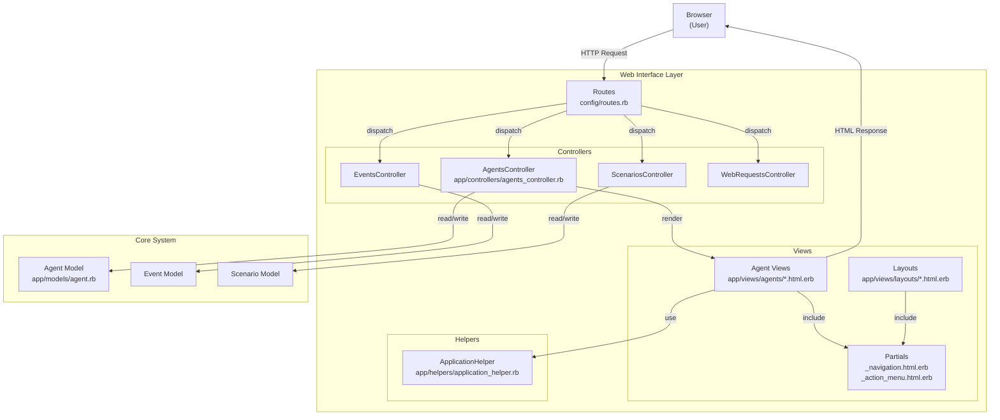

**Sources:** [app/controllers/agents_controller.rb:1-267](), [config/routes.rb:1-117](), [app/helpers/application_helper.rb:1-123](), [app/views/layouts/_navigation.html.erb:1-105]()

## Routing System

Huginn defines its routes in `config/routes.rb`. The routing system maps HTTP requests to controller actions using RESTful conventions and custom member/collection actions.

### Agent Routes

The core agent management routes follow Rails REST conventions with extensive custom actions:

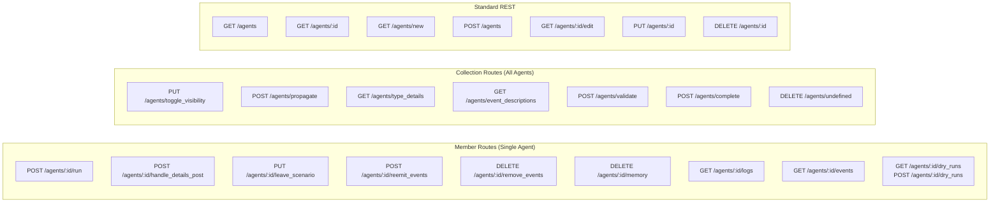

**Key Route Definitions:**

| Route | HTTP Method | Controller Action | Purpose |
|-------|-------------|-------------------|---------|
| `/agents` | GET | `index` | List all agents for current user |
| `/agents/new` | GET | `new` | Display agent creation form |
| `/agents` | POST | `create` | Create a new agent |
| `/agents/:id/edit` | GET | `edit` | Display agent edit form |
| `/agents/:id` | PUT | `update` | Update agent configuration |
| `/agents/:id` | DELETE | `destroy` | Delete an agent |
| `/agents/:id/run` | POST | `run` | Trigger immediate agent execution |
| `/agents/:id/reemit_events` | POST | `reemit_events` | Re-emit all agent events |
| `/agents/:id/memory` | DELETE | `destroy_memory` | Clear agent memory |
| `/agents/propagate` | POST | `propagate` | Trigger global event propagation |
| `/agents/type_details` | GET | `type_details` | Get agent type metadata (AJAX) |
| `/agents/validate` | POST | `validate` | Validate agent option (AJAX) |

**Sources:** [config/routes.rb:2-33]()

### Webhook and Web Request Routes

External systems can trigger agents via HTTP endpoints:

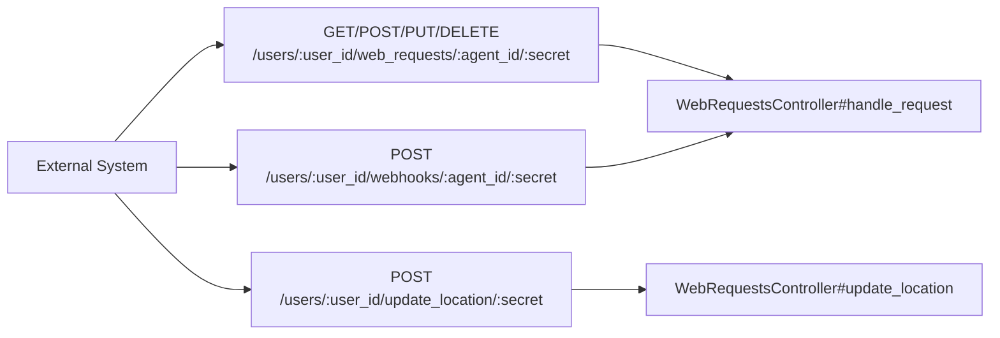

**Sources:** [config/routes.rb:99-101]()

## AgentsController

The `AgentsController` is the primary controller for agent management, handling CRUD operations and specialized agent actions.

### Controller Structure

```mermaid
graph TB
    subgraph "AgentsController"
        subgraph "CRUD Actions"
            index["index<br/>List agents"]
            show["show<br/>Display single agent"]
            new["new<br/>Create form"]
            create["create<br/>Save new agent"]
            edit["edit<br/>Edit form"]
            update["update<br/>Save changes"]
            destroy["destroy<br/>Delete agent"]
        end
        
        subgraph "Agent Operations"
            run["run<br/>Trigger check()"]
            reemit["reemit_events<br/>Re-emit events"]
            remove["remove_events<br/>Delete all events"]
            propagate["propagate<br/>Event propagation"]
            mem_destroy["destroy_memory<br/>Clear memory"]
        end
        
        subgraph "AJAX Actions"
            type_details["type_details<br/>Agent metadata"]
            event_desc["event_descriptions<br/>Event schemas"]
            validate["validate<br/>Option validation"]
            complete["complete<br/>Auto-completion"]
            handle_post["handle_details_post<br/>Agent-specific POST"]
        end
        
        subgraph "UI Actions"
            toggle_vis["toggle_visibility<br/>Show/hide disabled"]
            leave_scenario["leave_scenario<br/>Remove from scenario"]
        end
    end
    
    index --> Cookie["Check cookie<br/>huginn_view_only_enabled_agents"]
    Cookie --> Filter["Filter disabled agents"]
    
    run --> AsyncCheck["Agent.async_check(id)"]
    propagate --> Receive["Agent.receive!"]
    
    type_details --> BuildAgent["Agent.build_for_type"]
    BuildAgent --> Metadata["Return capabilities JSON"]
```

**Sources:** [app/controllers/agents_controller.rb:1-267]()

### Index Action

The `index` action lists agents with filtering and pagination:

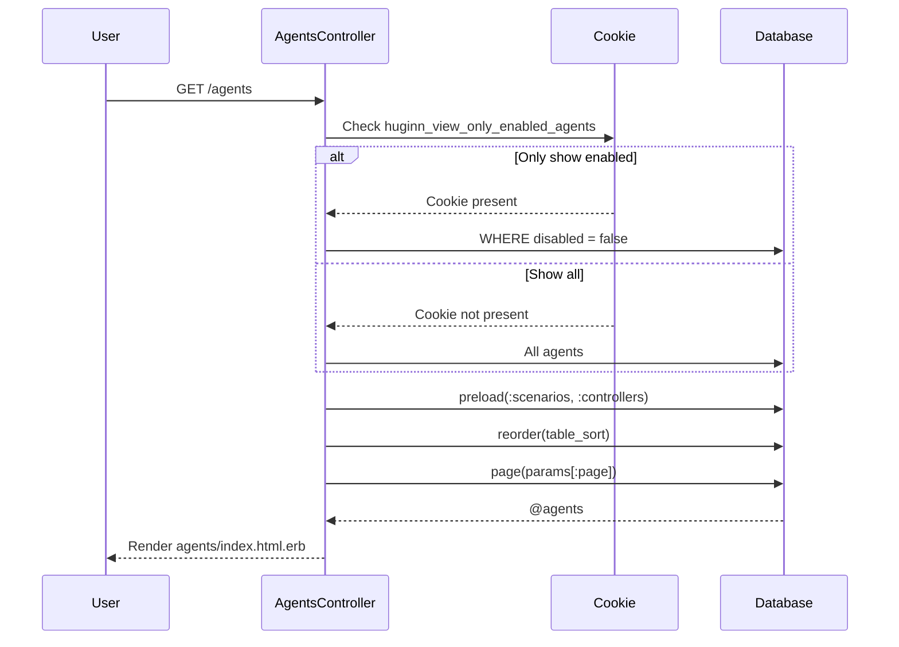

The controller applies sorting via the `SortableTable` concern and supports toggling disabled agent visibility:

- [app/controllers/agents_controller.rb:6-19]() - Index action with filtering
- [app/controllers/agents_controller.rb:21-29]() - Toggle visibility action
- [app/controllers/agents_controller.rb:253-266]() - Cookie management methods

**Sources:** [app/controllers/agents_controller.rb:6-29](), [app/controllers/agents_controller.rb:253-266]()

### Create and Update Actions

Agent creation and updates follow Rails REST conventions with custom validation:

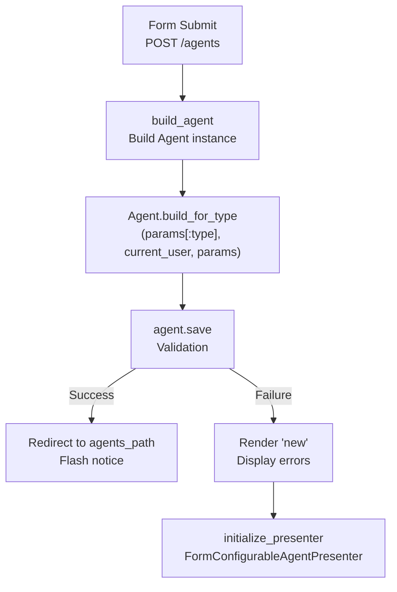

**Key Implementation Details:**

1. **Agent Building** [app/controllers/agents_controller.rb:240-244]():
   - Uses `Agent.build_for_type` to instantiate the correct agent class
   - Strips `:type` from params before passing to constructor
   - Associates with `current_user`

2. **Form Configurable Agents** [app/controllers/agents_controller.rb:246-250]():
   - Wraps agent in `FormConfigurableAgentPresenter` if applicable
   - Provides dynamic form generation capabilities

3. **Security** [app/controllers/agents_controller.rb:231-238]():
   - Implements `redirect_back` with open redirect protection
   - Filters return URLs to prevent external redirects

**Sources:** [app/controllers/agents_controller.rb:156-169](), [app/controllers/agents_controller.rb:171-184](), [app/controllers/agents_controller.rb:240-250]()

### Agent Operations

The controller provides several operations for agent management:

| Action | Method | Purpose | Implementation |
|--------|--------|---------|----------------|
| `run` | POST | Trigger agent execution | Calls `Agent.async_check(id)` to queue `AgentCheckJob` |
| `reemit_events` | POST | Re-emit all events | Enqueues `AgentReemitJob` with optional `delete_old_events` |
| `remove_events` | DELETE | Delete all agent events | Calls `@agent.events.delete_all` |
| `propagate` | POST | Run global event propagation | Calls `Agent.receive!` if `AgentPropagateJob.can_enqueue?` |
| `destroy_memory` | DELETE | Clear agent memory | Updates `@agent.memory` to `{}` |

**Run Action Example:**

[app/controllers/agents_controller.rb:41-49]() - Queues an `AgentCheckJob` for immediate execution:

```ruby
def run
  @agent = current_user.agents.find(params[:id])
  Agent.async_check(@agent.id)
  
  respond_to do |format|
    format.html { redirect_back "Agent run queued for '#{@agent.name}'" }
    format.json { head :ok }
  end
end
```

**Propagate Action:**

[app/controllers/agents_controller.rb:100-111]() - Triggers event propagation across all agents with duplicate job prevention:

```ruby
def propagate
  respond_to do |format|
    if AgentPropagateJob.can_enqueue?
      details = Agent.receive! 
      format.html { redirect_back "Queued propagation calls for #{details[:event_count]} event(s)" }
    else
      format.html { redirect_back "Event propagation is already scheduled to run." }
    end
  end
end
```

**Sources:** [app/controllers/agents_controller.rb:41-49](), [app/controllers/agents_controller.rb:78-98](), [app/controllers/agents_controller.rb:100-111](), [app/controllers/agents_controller.rb:113-121]()

### AJAX Actions

The controller provides several AJAX endpoints for dynamic UI updates:

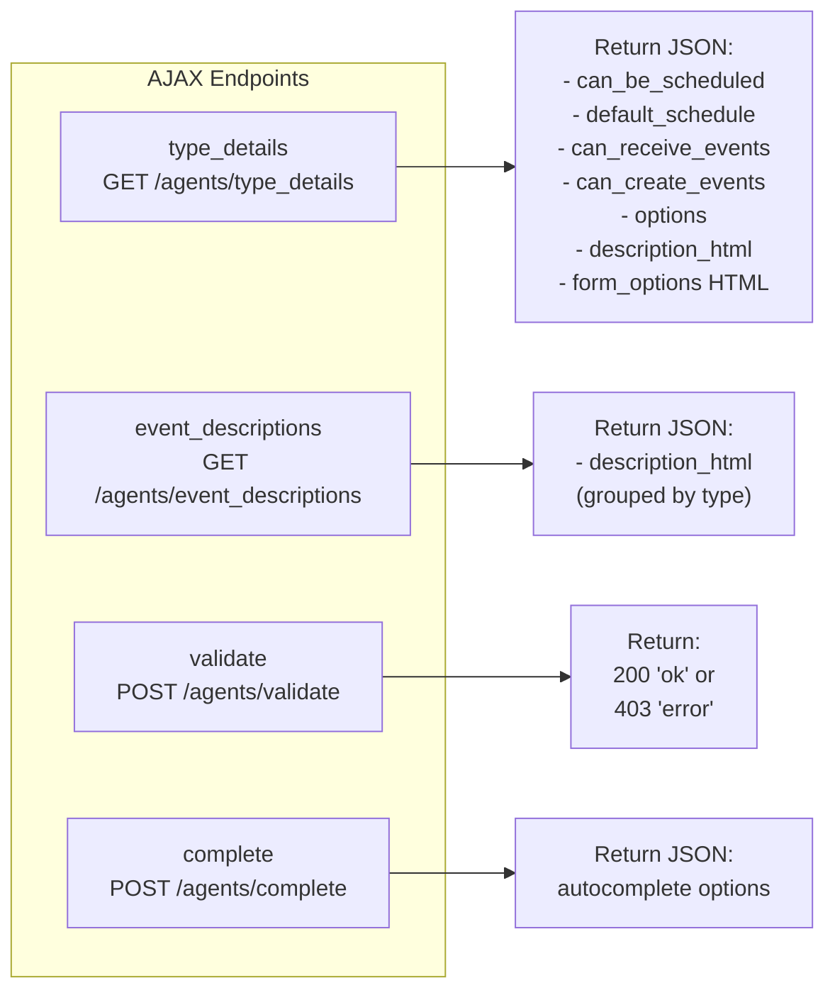

**type_details** [app/controllers/agents_controller.rb:51-67]() - Returns agent type metadata for the agent creation form:

- Builds a temporary agent instance with `Agent.build_for_type`
- Returns capabilities (can_be_scheduled, can_receive_events, etc.)
- Renders HTML partials for OAuth dropdown and form options
- Used when changing agent type in the UI

**validate** [app/controllers/agents_controller.rb:207-215]() - Validates individual agent options:

- Calls `@agent.validate_option(params[:attribute])`
- Returns HTTP 200 for valid, 403 for invalid
- Used for real-time form validation

**Sources:** [app/controllers/agents_controller.rb:51-67](), [app/controllers/agents_controller.rb:69-76](), [app/controllers/agents_controller.rb:207-221]()

## View Layer

The view layer consists of ERB templates organized in the `app/views` directory. Views use helper methods from `ApplicationHelper` and Rails view helpers.

### Navigation Structure

The main navigation is defined in `app/views/layouts/_navigation.html.erb`:

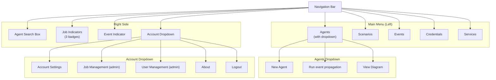

**Job Indicators** [app/views/layouts/_navigation.html.erb:38-52]() - Display real-time job statistics:

- **Pending Jobs Badge**: Shows count of jobs in `pending` state
- **Awaiting Retry Badge**: Shows count of jobs in `awaiting_retry` state  
- **Recent Failures Badge**: Shows count of recent job failures
- Badges are updated via JavaScript polling
- Only visible when user is signed in
- Admin users can click to navigate to jobs management

**Agent Search** [app/views/layouts/_navigation.html.erb:31-36]() - Autocomplete search for agents:

- Input field with ID `agent-navigate`
- Displays loading spinner during search
- Implemented via JavaScript autocomplete

**Sources:** [app/views/layouts/_navigation.html.erb:1-105]()

### Agent Index View

The agents index page displays a table of all agents:

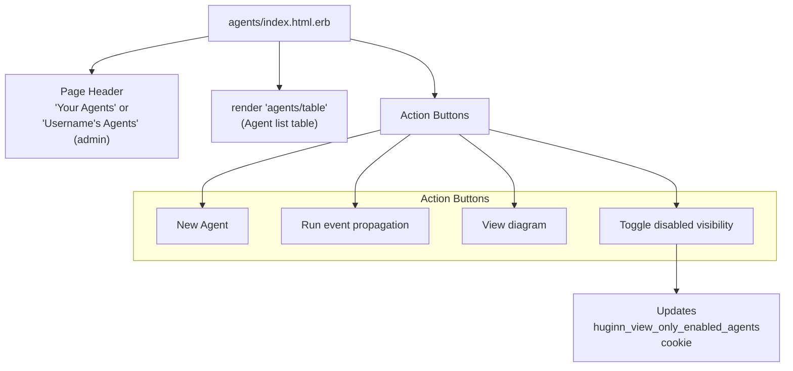

The view includes icon tags from `ApplicationHelper` and links to various agent operations:

[app/views/agents/index.html.erb:14-19]() - Action button group with icon tags and URL helpers

**Sources:** [app/views/agents/index.html.erb:1-23]()

### Agent Action Menu

The action menu partial provides a dropdown menu for individual agent operations:

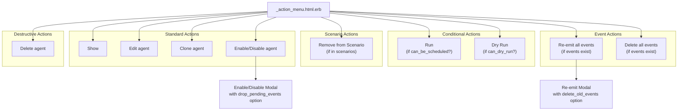

**Enable/Disable Modal** [app/views/agents/_action_menu.html.erb:71-97]():

- Displays confirmation dialog
- For disabled agents that can receive events, shows `drop_pending_events` checkbox
- Checkbox allows preventing accumulated event processing on re-enable
- Submits as hidden field `disabled` with toggled value

**Re-emit Modal** [app/views/agents/_action_menu.html.erb:99-124]():

- Displays confirmation dialog for re-emitting events
- Shows `delete_old_events` checkbox option
- When checked, original events are deleted after re-emission
- Posts to `reemit_events_agent_path`

**Sources:** [app/views/agents/_action_menu.html.erb:1-125]()

## ApplicationHelper

The `ApplicationHelper` module provides utility methods for rendering UI elements consistently throughout the application.

### Icon Rendering

The `icon_tag` method renders Bootstrap Glyphicons and Font Awesome icons:

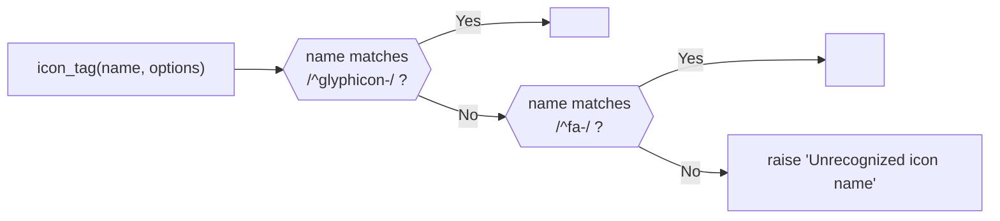

**Implementation** [app/helpers/application_helper.rb:2-13]():

- Accepts icon name and optional CSS classes
- Auto-adds `fa-solid` prefix if not present for Font Awesome icons
- Returns HTML-safe string
- Used extensively throughout views for consistent iconography

**Examples:**
- `icon_tag('glyphicon-refresh')` → Glyphicon refresh icon
- `icon_tag('fa-copy')` → Font Awesome copy icon
- `icon_tag('fa-github', class: 'fa-brands')` → Font Awesome brand icon

**Sources:** [app/helpers/application_helper.rb:2-13]()

### Navigation Links

The `nav_link` method creates navigation items with active state detection:

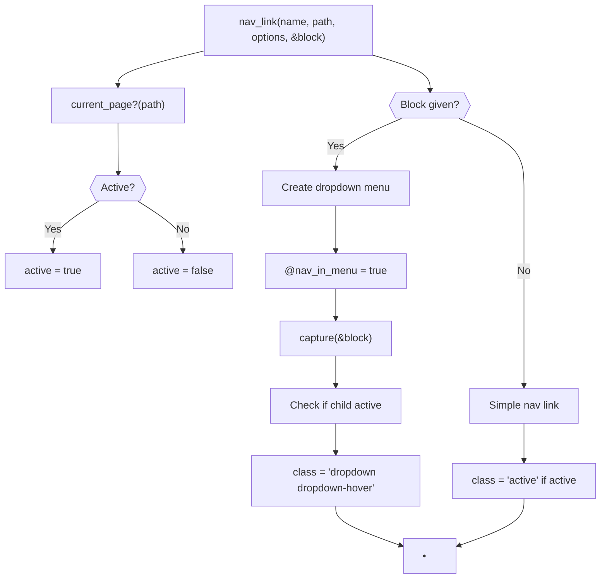

**Implementation** [app/helpers/application_helper.rb:15-36]():

- Detects if current page matches the link path
- Supports nested dropdown menus via block parameter
- Marks parent menu as active if any child is active
- Uses instance variables `@nav_in_menu` and `@nav_link_active` for state tracking

**Usage Pattern:**

```erb
<%= nav_link "Agents", agents_path do %>
  <ul class='dropdown-menu'>
    <%= nav_link "New Agent", new_agent_path %>
  </ul>
<% end %>
```

**Sources:** [app/helpers/application_helper.rb:15-36]()

### Status Helpers

Several helper methods render agent status information:

**yes_no** [app/helpers/application_helper.rb:38-40]() - Renders boolean as labeled badge:
- `true` → `<span class="label label-info">Yes</span>`
- `false` → `<span class="label label-default">No</span>`

**working** [app/helpers/application_helper.rb:42-52]() - Renders agent working status:

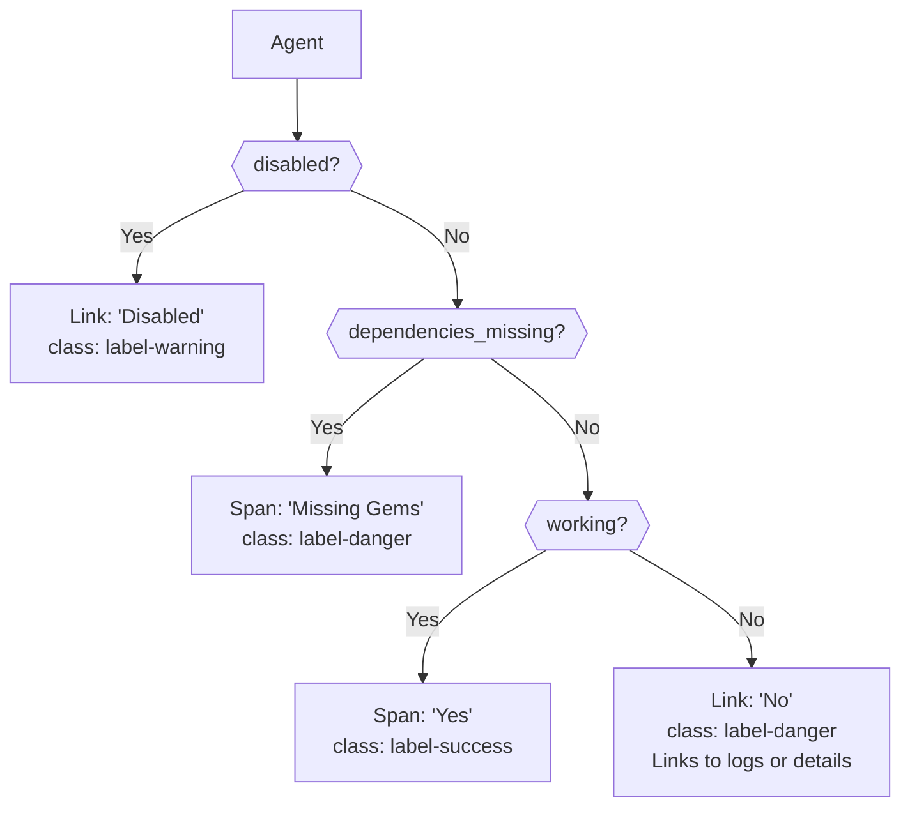

The method checks agent state in priority order and renders appropriate labels with color coding.

**Sources:** [app/helpers/application_helper.rb:38-52]()

### OAuth and Service Helpers

Helper methods for OAuth provider integration:

**omniauth_provider_icon** [app/helpers/application_helper.rb:54-61]() - Returns provider-specific icons:
- Twitter, Tumblr, GitHub, Dropbox, Google → Uses brand-specific Font Awesome icons
- Other providers → Generic lock icon

**omniauth_button** [app/helpers/application_helper.rb:67-72]() - Renders OAuth authentication button:
- Combines provider icon and text
- Links to `user_omniauth_authorize_path(provider)`
- Styled as button with provider-specific CSS class

**service_label** [app/helpers/application_helper.rb:78-84]() - Renders connected service label:
- Shows provider icon and service name
- Returns nil if service is nil
- Styled as badge with provider-specific styling

**Sources:** [app/helpers/application_helper.rb:54-84]()

### Utility Methods

**load_ace_editor!** [app/helpers/application_helper.rb:86-90]() - Lazily loads ACE editor JavaScript:
- Checks if already loaded via `content_for?(:ace_editor_script)`
- Adds JavaScript include tag only once per page
- Used by agent forms that need code editing

**highlighted?** [app/helpers/application_helper.rb:92-111]() - Parses highlight query parameter:
- Supports syntax like `hl=6-8` (range), `hl=1,3-4,9` (list), `hl=8-` (open-ended)
- Used for highlighting specific lines or IDs in lists
- Returns boolean for whether given ID is highlighted

**agent_type_to_human** [app/helpers/application_helper.rb:113-115]() - Formats agent type names:
- Strips `Agents::` namespace prefix
- Converts to humanized, titleized string
- Example: `Agents::WebsiteAgent` → `Website Agent`

**Sources:** [app/helpers/application_helper.rb:86-115]()

## User Workflows

Common user interactions through the web interface follow specific patterns.

### Agent Creation Workflow

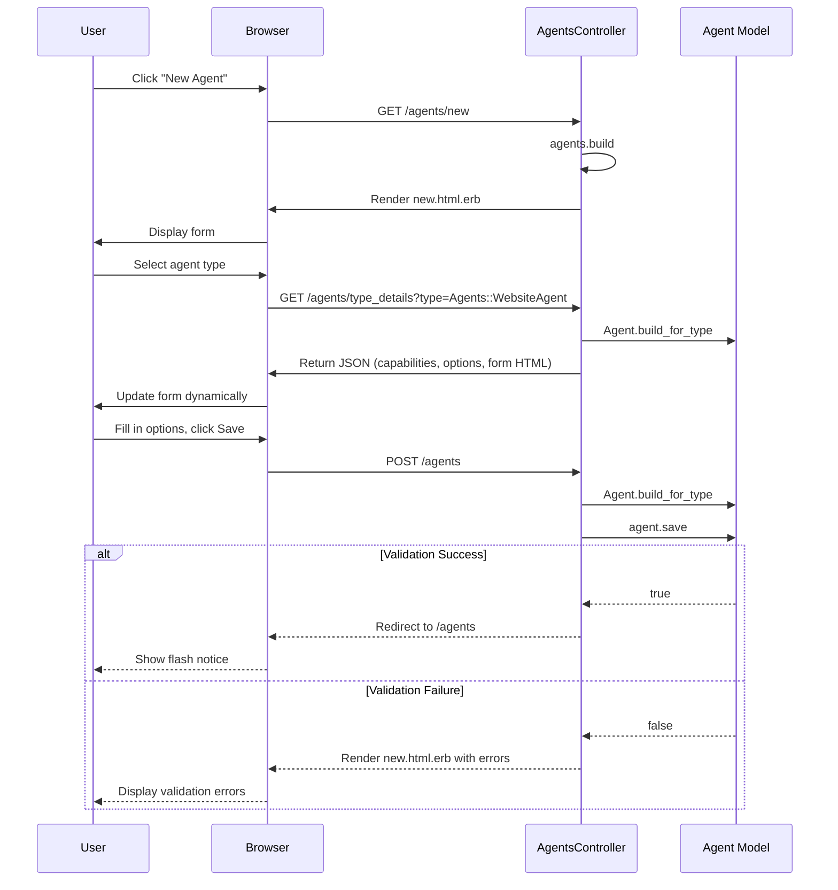

**Key Steps:**

1. User navigates to `/agents/new` [app/controllers/agents_controller.rb:132-149]()
2. Browser renders empty agent form
3. User selects agent type from dropdown
4. AJAX request to `/agents/type_details` returns type-specific form [app/controllers/agents_controller.rb:51-67]()
5. User fills in options and submits form
6. Controller validates and saves agent [app/controllers/agents_controller.rb:156-169]()
7. On success, redirects to agents index; on failure, re-renders form with errors

**Sources:** [app/controllers/agents_controller.rb:132-169]()

### Running an Agent

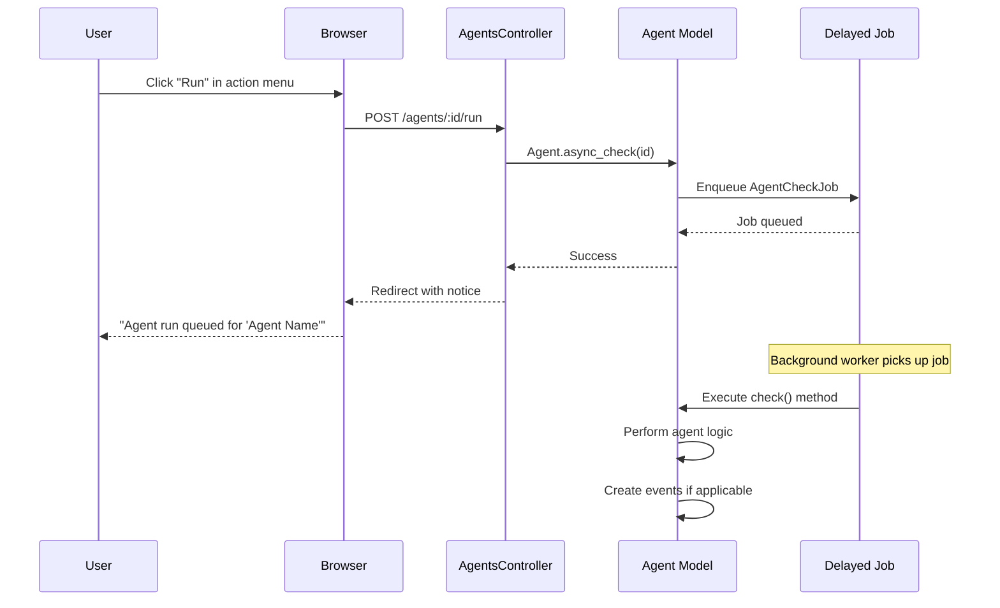

The run action immediately queues a background job rather than executing synchronously, preventing timeout issues for long-running agents.

**Sources:** [app/controllers/agents_controller.rb:41-49]()

### Enabling/Disabling Agents

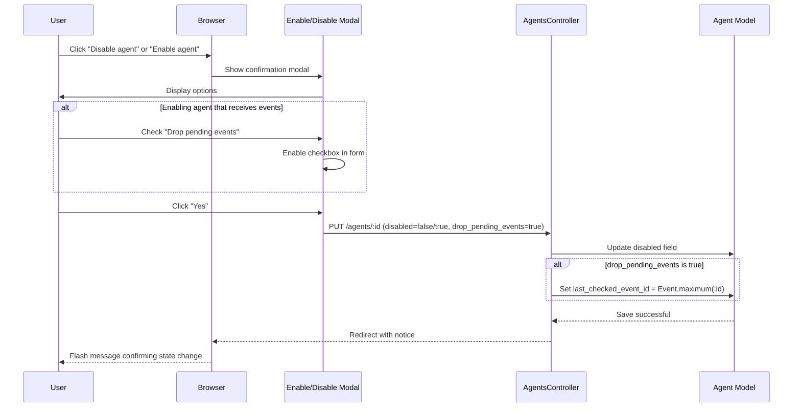

**Drop Pending Events Option** [spec/controllers/agents_controller_spec.rb:358-368]():

When re-enabling a disabled agent that can receive events, the `drop_pending_events` checkbox prevents the agent from processing events that accumulated during its disabled period. This is accomplished by setting `last_checked_event_id` to the current maximum event ID.

**Sources:** [app/views/agents/_action_menu.html.erb:71-97](), [spec/controllers/agents_controller_spec.rb:358-368]()

### Event Propagation

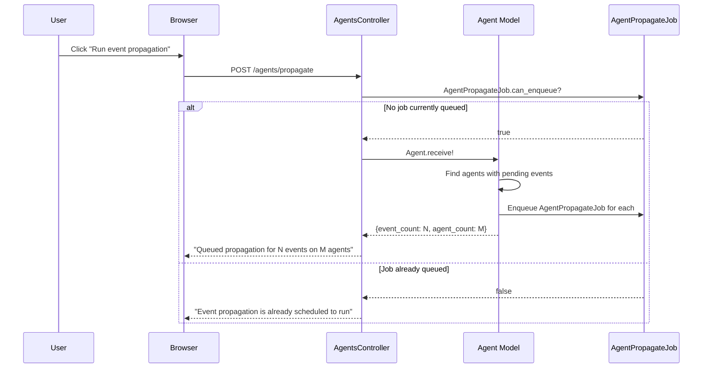

Event propagation is a global operation that processes all pending events through the agent graph. The system prevents duplicate jobs using `AgentPropagateJob.can_enqueue?`.

**Sources:** [app/controllers/agents_controller.rb:100-111](), [spec/controllers/agents_controller_spec.rb:129-144]()

## Security Considerations

The web interface implements several security measures:

### Authentication and Authorization

- All agent operations require user authentication via Devise
- Agents are scoped to `current_user.agents` to prevent cross-user access [app/controllers/agents_controller.rb:9](), [app/controllers/agents_controller.rb:32]()
- Attempting to access another user's agent raises `ActiveRecord::RecordNotFound`

### Open Redirect Protection

The `redirect_back` method sanitizes return URLs to prevent open redirect attacks:

[app/controllers/agents_controller.rb:231-238]() - Filters return paths through `filtered_agent_return_link`:

```ruby
def redirect_back(message, options = {})
  if path = filtered_agent_return_link(options)
    redirect_to path, notice: message
  else
    super agents_path, notice: message
  end
end
```

Return URLs are validated to ensure they point to internal routes (agents, scenarios) rather than external sites.

**Sources:** [spec/controllers/agents_controller_spec.rb:346-355]()

### Parameter Filtering

Strong parameters prevent mass assignment vulnerabilities:

- User ID cannot be modified via `agent_params` [spec/controllers/agents_controller_spec.rb:319-324]()
- Agent type can be set during creation but not during updates [spec/controllers/agents_controller_spec.rb:274-279]()
- Unpermitted parameters raise `ActionController::UnpermittedParameters` exception

**Sources:** [spec/controllers/agents_controller_spec.rb:274-324]()

### CSRF Protection

Rails CSRF protection is enabled by default, requiring authenticity tokens for all state-changing requests (POST, PUT, DELETE).

## Response Formats

Controllers support multiple response formats for different use cases:

### HTML Responses

Default response format for browser requests:
- Renders ERB templates
- Includes flash messages for user feedback
- Handles form validation errors by re-rendering forms

### JSON Responses

Used for API clients and AJAX requests:

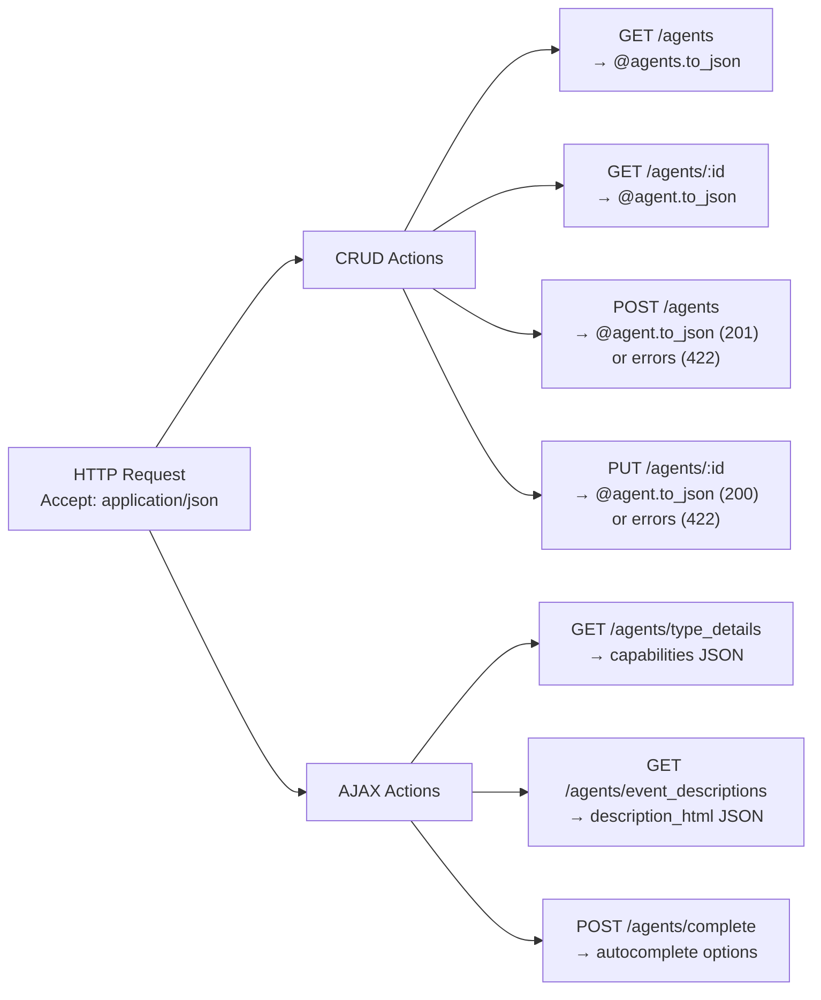

**JSON Response Examples:**

- **Index**: [app/controllers/agents_controller.rb:17]() - `render json: @agents`
- **Create Success**: [app/controllers/agents_controller.rb:162]() - Returns agent JSON with 200 status and Location header
- **Create Failure**: [app/controllers/agents_controller.rb:166]() - Returns validation errors JSON with 422 status
- **Type Details**: [app/controllers/agents_controller.rb:55-66]() - Returns structured JSON with agent capabilities and HTML fragments

**Sources:** [app/controllers/agents_controller.rb:15-18](), [app/controllers/agents_controller.rb:126-129](), [app/controllers/agents_controller.rb:159-167](), [app/controllers/agents_controller.rb:55-66]()

## Testing

The web interface has comprehensive test coverage using RSpec:

### Controller Specs

[spec/controllers/agents_controller_spec.rb:1-482]() provides extensive controller testing:

**Authentication Tests:**
- Verifies actions return only current user's agents
- Tests for `ActiveRecord::RecordNotFound` when accessing other users' agents
- Examples: [spec/controllers/agents_controller_spec.rb:14-18](), [spec/controllers/agents_controller_spec.rb:37-42]()

**Action Tests:**
- Tests each controller action's HTTP response
- Verifies database changes (creation, deletion, updates)
- Tests both HTML and JSON response formats
- Examples: [spec/controllers/agents_controller_spec.rb:232-240](), [spec/controllers/agents_controller_spec.rb:292-298]()

**Validation Tests:**
- Tests invalid agent creation/updates
- Verifies error messages are returned
- Tests form re-rendering with errors
- Example: [spec/controllers/agents_controller_spec.rb:254-261]()

**Security Tests:**
- Tests open redirect protection
- Tests parameter filtering
- Tests cross-user access restrictions
- Examples: [spec/controllers/agents_controller_spec.rb:346-355](), [spec/controllers/agents_controller_spec.rb:319-324]()

### Helper Specs

[spec/helpers/application_helper_spec.rb:1-202]() tests helper methods:

**Icon Tests:**
- Tests `icon_tag` with Glyphicons and Font Awesome
- Verifies HTML structure and CSS classes
- Examples: [spec/helpers/application_helper_spec.rb:4-34]()

**Navigation Tests:**
- Tests `nav_link` active state detection
- Tests nested dropdown menus
- Tests active state propagation to parent
- Examples: [spec/helpers/application_helper_spec.rb:36-93]()

**Status Helpers:**
- Tests `working` method with various agent states
- Tests `yes_no` boolean rendering
- Examples: [spec/helpers/application_helper_spec.rb:95-145]()

**Sources:** [spec/controllers/agents_controller_spec.rb:1-482](), [spec/helpers/application_helper_spec.rb:1-202]()

---

