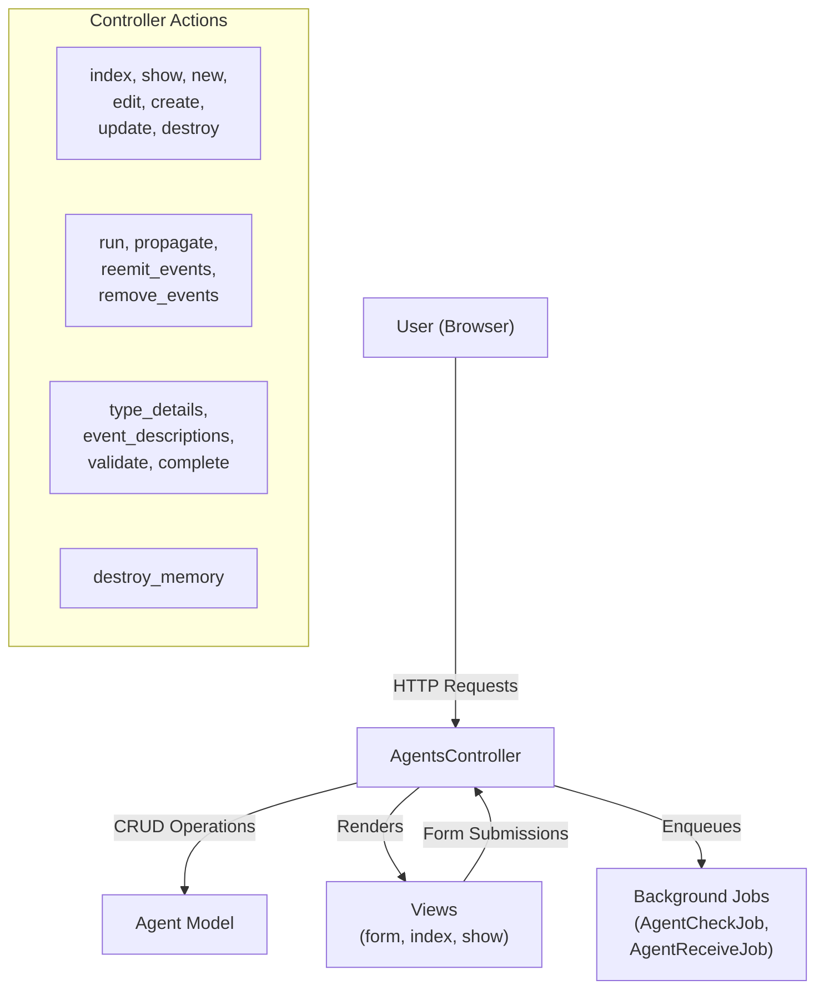
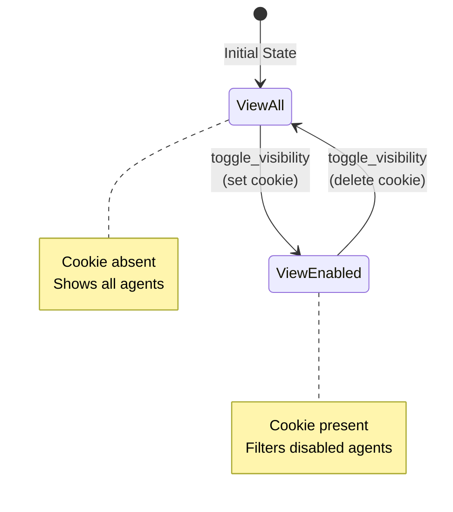
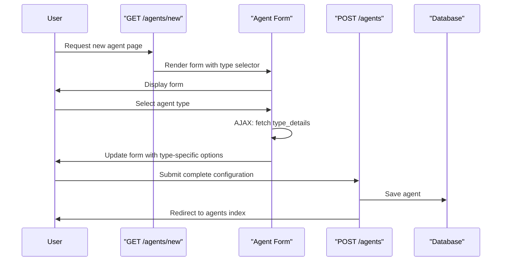
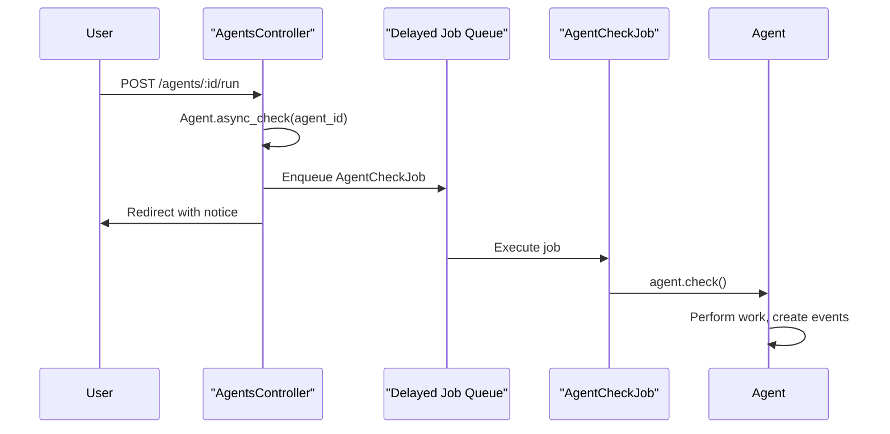
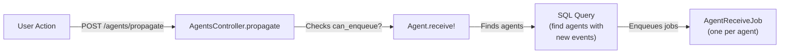
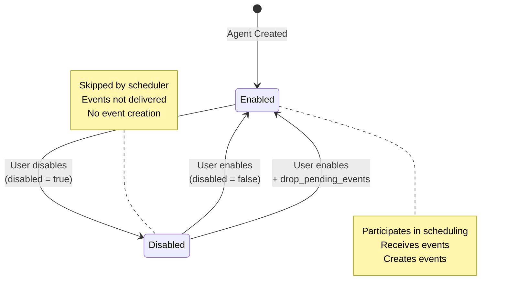
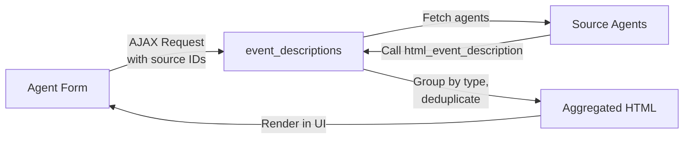
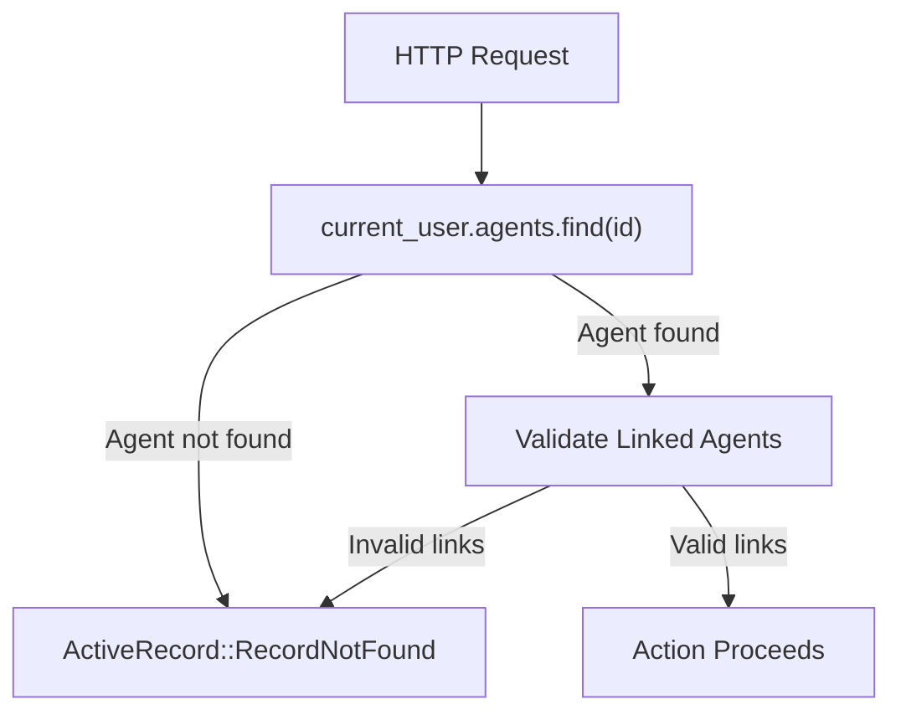
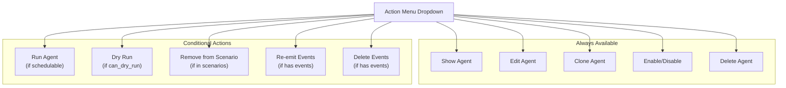

<!-- source: DeepWiki mcp.deepwiki.com · repo huginn/huginn · page 6.1 Agent Management · fetched 2026-10-29 -->

# Agent Management

<details>
<summary>Relevant source files</summary>

The following files were used as context for generating this wiki page:

- [app/controllers/agents_controller.rb](app/controllers/agents_controller.rb)
- [app/models/agent.rb](app/models/agent.rb)
- [app/views/agents/_action_menu.html.erb](app/views/agents/_action_menu.html.erb)
- [app/views/agents/_form.html.erb](app/views/agents/_form.html.erb)
- [config/routes.rb](config/routes.rb)
- [spec/controllers/agents_controller_spec.rb](spec/controllers/agents_controller_spec.rb)
- [spec/fixtures/agents.yml](spec/fixtures/agents.yml)
- [spec/models/agent_spec.rb](spec/models/agent_spec.rb)

</details>


## Purpose and Scope

This document explains how users interact with agents through the web interface, focusing on the `AgentsController` and associated views. It covers agent creation, configuration, lifecycle management, and operational controls available through the UI.

For details about the Agent model itself and its internal architecture, see [Agent System](#3.1). For information about the event-driven architecture and how agents communicate, see [Event-Driven Architecture](#3.2).

---

## AgentsController Overview

The `AgentsController` [app/controllers/agents_controller.rb:1]() serves as the primary interface for all agent management operations. It implements standard RESTful actions plus several custom operations for agent-specific functionality.

### Controller Structure



**Sources:** [app/controllers/agents_controller.rb:1-267]()

---

## Agent Listing and Filtering

### Index Action

The `index` action displays all agents owned by the current user with sorting and pagination capabilities.

| Feature | Implementation | Location |
|---------|---------------|----------|
| Sorting | Sortable by name, created_at, last_check_at, last_event_at, last_receive_at | [app/controllers/agents_controller.rb:7]() |
| Pagination | Uses Kaminari gem | [app/controllers/agents_controller.rb:9]() |
| Filtering | Optional filter for enabled-only agents | [app/controllers/agents_controller.rb:11-13]() |
| Preloading | Eager loads scenarios and controllers | [app/controllers/agents_controller.rb:9]() |

### Visibility Toggle

Users can toggle between viewing all agents or only enabled agents using the `toggle_visibility` action [app/controllers/agents_controller.rb:21-29](). This preference is stored in a cookie `huginn_view_only_enabled_agents` [app/controllers/agents_controller.rb:254-265]().



**Sources:** [app/controllers/agents_controller.rb:21-29](), [app/controllers/agents_controller.rb:253-266](), [spec/controllers/agents_controller_spec.rb:20-27]()

---

## Creating Agents

### Creation Workflow

Agent creation follows a two-step process: type selection followed by configuration.



### New Agent Action

The `new` action [app/controllers/agents_controller.rb:132-149]() handles three scenarios:

1. **Standard Creation**: `GET /agents/new` creates a blank agent
2. **Cloning**: `GET /agents/new?id=123` creates a clone of agent 123 using `Agent.build_clone` [app/models/agent.rb:319-333]()
3. **Scenario Assignment**: `GET /agents/new?scenario_id=5` pre-assigns the agent to scenario 5

### Type Selection and Dynamic Configuration

When a user selects an agent type in the form, JavaScript fetches type-specific configuration via the `type_details` action [app/controllers/agents_controller.rb:51-67]():

| Returned Data | Purpose |
|--------------|---------|
| `can_be_scheduled` | Shows/hides schedule selector |
| `default_schedule` | Pre-fills schedule field |
| `can_receive_events` | Shows/hides source agent selector |
| `can_create_events` | Shows/hides event retention options |
| `can_control_other_agents` | Shows/hides control targets |
| `can_dry_run` | Enables dry run button |
| `options` | Default options hash for the agent type |
| `description_html` | Rendered agent description |
| `form_options` | Type-specific form fields |

### Create Action

The `create` action [app/controllers/agents_controller.rb:156-169]() performs the following steps:

1. Build agent from parameters using `Agent.build_for_type` [app/controllers/agents_controller.rb:240-244]()
2. Validate options using agent-specific `validate_options` [app/models/agent.rb:293-295]()
3. Validate ownership of linked agents (sources, receivers, controllers) [app/models/agent.rb:43-46]()
4. Save agent and create Link records
5. Redirect with success message or re-render form with errors

**Sources:** [app/controllers/agents_controller.rb:132-169](), [app/controllers/agents_controller.rb:51-67](), [app/views/agents/_form.html.erb:1-152](), [spec/controllers/agents_controller_spec.rb:202-271]()

---

## Agent Form Structure

The agent form [app/views/agents/_form.html.erb:1-152]() is dynamically configured based on agent capabilities.

### Form Layout

```mermaid
graph TB
    Form["Agent Form"]
    
    subgraph "Left Column"
        Type["Type Selector<br/>(new agents only)"]
        Name["Name Field"]
        OAuth["OAuth Dropdown"]
        Schedule["Schedule Selector<br/>(conditional)"]
        Controllers["Controller Agents"]
        ControlTargets["Control Targets<br/>(conditional)"]
        KeepEvents["Event Retention<br/>(conditional)"]
        Sources["Source Agents<br/>(conditional)"]
        PropImmediate["Propagate Immediately"]
        Receivers["Receiver Agents"]
        Scenarios["Scenario Assignment"]
        Options["Agent-Specific Options"]
    end
    
    subgraph "Right Column"
        Description["Agent Description<br/>(HTML rendered)"]
        EventDesc["Event Descriptions<br/>(from sources)"]
    end
    
    Form --> Type
    Form --> Name
    Form --> OAuth
    Form --> Schedule
    Form --> Controllers
    Form --> ControlTargets
    Form --> KeepEvents
    Form --> Sources
    Form --> PropImmediate
    Form --> Receivers
    Form --> Scenarios
    Form --> Options
    Form --> Description
    Form --> EventDesc
```



### Conditional Form Fields

The form uses data attributes to show/hide sections based on agent capabilities:

| Field Section | Visibility Condition | Data Attribute |
|--------------|---------------------|----------------|
| Schedule selector | `agent.can_be_scheduled?` | `data-can-be-scheduled` [app/views/agents/_form.html.erb:46]() |
| Control targets | `agent.can_control_other_agents?` | `data-can-control-other-agents` [app/views/agents/_form.html.erb:65]() |
| Event retention | `agent.can_create_events?` | `data-can-create-events` [app/views/agents/_form.html.erb:77]() |
| Source agents | `agent.can_receive_events?` | `data-can-receive-events` [app/views/agents/_form.html.erb:88]() |

### Agent Linking

The form provides multi-select dropdowns for establishing relationships:

- **Sources** [app/views/agents/_form.html.erb:86-101](): Agents that will send events to this agent
- **Receivers** [app/views/agents/_form.html.erb:103-114](): Agents that will receive events from this agent
- **Controllers** [app/views/agents/_form.html.erb:54-63](): Agents that can trigger this agent
- **Control Targets** [app/views/agents/_form.html.erb:65-75](): Agents this agent can control
- **Scenarios** [app/views/agents/_form.html.erb:116-124](): Scenarios this agent belongs to

**Sources:** [app/views/agents/_form.html.erb:1-152](), [app/controllers/agents_controller.rb:246-250]()

---

## Editing Agents

### Edit Action

The `edit` action [app/controllers/agents_controller.rb:151-154]() loads an existing agent and renders the same form used for creation. The form automatically detects it's editing an existing agent and:

1. Hides the type selector (type cannot be changed after creation) [app/views/agents/_form.html.erb:25-31]()
2. Pre-fills all fields with current values
3. Changes the form submission method to `PUT` [app/views/agents/_form.html.erb:15]()

### Update Action

The `update` action [app/controllers/agents_controller.rb:171-184]() validates and saves changes. Key behaviors:

- **Type Immutability**: Attempts to change `type` are rejected with validation error [spec/controllers/agents_controller_spec.rb:274-279]()
- **User ID Protection**: Attempts to change `user_id` raise `ActionController::UnpermittedParameters` [spec/controllers/agents_controller_spec.rb:319-324]()
- **Ownership Validation**: Linked agents must be owned by the current user [spec/controllers/agents_controller_spec.rb:300-310]()

### Drop Pending Events

When re-enabling a disabled agent that can receive events, users can check "Drop pending events" [app/views/agents/_action_menu.html.erb:83-88]() to skip events that accumulated while disabled. This sets the agent's `last_checked_event_id` to the latest event ID [app/models/agent.rb:253-259]().

**Sources:** [app/controllers/agents_controller.rb:151-184](), [app/controllers/agents_controller.rb:171-184](), [spec/controllers/agents_controller_spec.rb:358-368]()

---

## Agent Operations

### Running Agents Manually

The `run` action [app/controllers/agents_controller.rb:41-49]() manually triggers an agent check by enqueuing an `AgentCheckJob`:



This is typically used for:
- Testing agent configuration
- Forcing an immediate check outside the schedule
- Debugging agent behavior

### Dry Run Mode

Agents that support dry run (indicated by `can_dry_run?`) can be tested without side effects. The dry run button in the action menu [app/views/agents/_action_menu.html.erb:8-12]() triggers client-side JavaScript that handles the dry run workflow (implemented in the agent dry runs controller).

**Sources:** [app/controllers/agents_controller.rb:41-49](), [app/views/agents/_action_menu.html.erb:2-12](), [spec/controllers/agents_controller_spec.rb:45-58]()

---

## Event Management

### Event Propagation

The `propagate` action [app/controllers/agents_controller.rb:100-111]() manually triggers event propagation across all agents:



This action:
- Calls `Agent.receive!` [app/models/agent.rb:400-443]() to find all agents with new events
- Enqueues `AgentReceiveJob` for each agent that has received new events
- Prevents duplicate propagation if a job is already queued [app/controllers/agents_controller.rb:102]()

### Re-emitting Events

The `reemit_events` action [app/controllers/agents_controller.rb:78-88]() allows re-emitting all events from an agent:

| Option | Parameter | Effect |
|--------|-----------|--------|
| Re-emit only | (default) | Creates duplicate events, keeps originals |
| Delete old events | `delete_old_events=1` | Deletes original events after re-emission |

This is useful for:
- Replaying events through a modified workflow
- Fixing errors in downstream agents
- Testing event processing logic

### Removing Events

The `remove_events` action [app/controllers/agents_controller.rb:90-98]() deletes all events created by an agent using `agent.events.delete_all` [app/controllers/agents_controller.rb:92]().

**Sources:** [app/controllers/agents_controller.rb:78-111](), [app/views/agents/_action_menu.html.erb:48-69](), [spec/controllers/agents_controller_spec.rb:60-144]()

---

## Agent Lifecycle Controls

### Enable/Disable

Agents can be enabled or disabled through the action menu [app/views/agents/_action_menu.html.erb:28-36](). The enable/disable modal [app/views/agents/_action_menu.html.erb:71-97]() provides:

1. **Confirmation Dialog**: Prevents accidental state changes
2. **Drop Pending Events Option**: For agents that can receive events, optionally skip accumulated events [app/views/agents/_action_menu.html.erb:83-88]()
3. **State Toggle**: Updates the `disabled` attribute via the update action



### Cloning Agents

The clone action is accessed via `GET /agents/new?id=:id` [app/controllers/agents_controller.rb:135-136](). The `Agent.build_clone` method [app/models/agent.rb:319-333]():

- Copies type, options, schedule, keep_events_for, propagate_immediately
- Copies linked agents (sources, receivers, controllers, control_targets)
- Copies scenario memberships
- Generates a unique name by appending "(2)", "(3)", etc.
- Does NOT copy memory or events

### Deleting Agents

The `destroy` action [app/controllers/agents_controller.rb:197-205]() performs cascading deletion:

1. Deletes the agent record
2. Automatically deletes associated records (via ActiveRecord associations):
   - All events created by the agent [app/models/agent.rb:60]()
   - All agent logs [app/models/agent.rb:62]()
   - All links (as source or receiver) [app/models/agent.rb:63-66]()
   - All control links [app/models/agent.rb:70-73]()
   - All scenario memberships [app/models/agent.rb:76]()

### Scenario Management

Agents can be removed from specific scenarios via `leave_scenario` [app/controllers/agents_controller.rb:186-195]() without deleting the agent itself. This only removes the scenario membership.

**Sources:** [app/controllers/agents_controller.rb:186-205](), [app/views/agents/_action_menu.html.erb:28-97](), [spec/controllers/agents_controller_spec.rb:371-412]()

---

## Memory Management

The `destroy_memory` action [app/controllers/agents_controller.rb:113-121]() clears an agent's memory hash:

```ruby
# Route: DELETE /agents/:id/memory
agent.update!(memory: {})
```

Agent memory stores state between runs, such as:
- Last seen IDs (for deduplication)
- Cached API responses
- Counters and flags
- Temporary working data

Clearing memory is useful when:
- An agent is stuck due to corrupted state
- Testing requires a clean slate
- Resetting deduplication logic

**Sources:** [app/controllers/agents_controller.rb:113-121](), [spec/controllers/agents_controller_spec.rb:448-466](), [config/routes.rb:9]()

---

## Advanced Controller Actions

### Event Descriptions

The `event_descriptions` action [app/controllers/agents_controller.rb:69-76]() fetches and aggregates event descriptions from multiple source agents. Used when configuring an agent to show what kind of events it will receive.



### Handle Details Post

The `handle_details_post` action [app/controllers/agents_controller.rb:31-39]() provides a generic endpoint for agents that need custom UI interactions. Agents can implement `handle_details_post` to process custom form submissions from their detail views.

### Form Configurable Helpers

For agents with complex forms, two helper actions support auto-completion and validation:

| Action | Purpose | Implementation |
|--------|---------|---------------|
| `validate` [app/controllers/agents_controller.rb:207-215]() | Validate a single option field | Calls `agent.validate_option(attribute)` |
| `complete` [app/controllers/agents_controller.rb:217-221]() | Provide auto-complete suggestions | Calls `agent.complete_option(attribute)` |

These actions build a temporary agent instance from submitted parameters without saving it [app/controllers/agents_controller.rb:240-244]().

**Sources:** [app/controllers/agents_controller.rb:31-39](), [app/controllers/agents_controller.rb:69-76](), [app/controllers/agents_controller.rb:207-221](), [spec/controllers/agents_controller_spec.rb:414-446]()

---

## Security and Permissions

### Ownership Validation

All controller actions ensure agents can only be accessed by their owners. This is enforced at multiple levels:



The controller uses `current_user.agents` scope [app/controllers/agents_controller.rb:9](), which automatically filters to the current user's agents. Attempting to access another user's agent raises `ActiveRecord::RecordNotFound` [spec/controllers/agents_controller_spec.rb:38-42]().

### Link Ownership Validation

When creating or updating agents, all linked agents must be owned by the current user:

| Relationship | Validation Location |
|--------------|-------------------|
| Sources | [app/models/agent.rb:43]() |
| Receivers | [app/models/agent.rb:44]() |
| Controllers | [app/models/agent.rb:45]() |
| Control Targets | [app/models/agent.rb:46]() |
| Scenarios | [app/models/agent.rb:47]() |

Validation errors are added to the agent model and displayed in the form [spec/controllers/agents_controller_spec.rb:586-644]().

### Parameter Filtering

Strong parameters ensure only permitted attributes can be mass-assigned. The `user_id` attribute is specifically excluded to prevent privilege escalation [spec/controllers/agents_controller_spec.rb:319-324]().

**Sources:** [app/controllers/agents_controller.rb:9](), [app/models/agent.rb:43-47](), [spec/controllers/agents_controller_spec.rb:263-270](), [spec/controllers/agents_controller_spec.rb:319-324]()

---

## Routes Configuration

The agents resource in [config/routes.rb:2-33]() defines all available endpoints:

| HTTP Method | Path | Action | Purpose |
|-------------|------|--------|---------|
| GET | `/agents` | `index` | List all agents |
| GET | `/agents/new` | `new` | New agent form |
| POST | `/agents` | `create` | Create agent |
| GET | `/agents/:id` | `show` | Show agent details |
| GET | `/agents/:id/edit` | `edit` | Edit agent form |
| PUT | `/agents/:id` | `update` | Update agent |
| DELETE | `/agents/:id` | `destroy` | Delete agent |
| POST | `/agents/:id/run` | `run` | Manually run agent |
| POST | `/agents/:id/handle_details_post` | `handle_details_post` | Custom agent UI handler |
| PUT | `/agents/:id/leave_scenario` | `leave_scenario` | Remove from scenario |
| POST | `/agents/:id/reemit_events` | `reemit_events` | Re-emit all events |
| DELETE | `/agents/:id/remove_events` | `remove_events` | Delete all events |
| DELETE | `/agents/:id/memory` | `destroy_memory` | Clear agent memory |
| PUT | `/agents/toggle_visibility` | `toggle_visibility` | Toggle enabled-only filter |
| POST | `/agents/propagate` | `propagate` | Manual event propagation |
| GET | `/agents/type_details` | `type_details` | Fetch agent type metadata |
| GET | `/agents/event_descriptions` | `event_descriptions` | Fetch source event descriptions |
| POST | `/agents/validate` | `validate` | Validate single option |
| POST | `/agents/complete` | `complete` | Auto-complete suggestions |
| DELETE | `/agents/undefined` | `destroy_undefined` | Delete undefined agents |

**Sources:** [config/routes.rb:2-33]()

---

## Action Menu

The action menu partial [app/views/agents/_action_menu.html.erb:1-125]() provides a dropdown menu with contextual actions for each agent:



Each action includes:
- Appropriate icon (Bootstrap Glyphicons or Font Awesome)
- Confirmation modals for destructive operations
- Contextual availability based on agent capabilities

**Sources:** [app/views/agents/_action_menu.html.erb:1-125]()

---

