<!-- source: DeepWiki mcp.deepwiki.com · repo huginn/huginn · page 6.2 UI Components and Helpers · fetched 2026-10-29 -->

# UI Components and Helpers

<details>
<summary>Relevant source files</summary>

The following files were used as context for generating this wiki page:

- [app/controllers/agents_controller.rb](app/controllers/agents_controller.rb)
- [app/helpers/application_helper.rb](app/helpers/application_helper.rb)
- [app/views/agents/_action_menu.html.erb](app/views/agents/_action_menu.html.erb)
- [app/views/agents/index.html.erb](app/views/agents/index.html.erb)
- [app/views/layouts/_navigation.html.erb](app/views/layouts/_navigation.html.erb)
- [config.ru](config.ru)
- [config/routes.rb](config/routes.rb)
- [spec/controllers/agents_controller_spec.rb](spec/controllers/agents_controller_spec.rb)
- [spec/fixtures/agents.yml](spec/fixtures/agents.yml)
- [spec/helpers/application_helper_spec.rb](spec/helpers/application_helper_spec.rb)

</details>


This document covers the UI helper methods, view components, and frontend patterns used throughout Huginn's web interface. These utilities provide consistent rendering of icons, navigation elements, status badges, and interactive components across all pages.

For information about the agent management controllers and actions, see [Agent Management](#6.1). For the overall architecture of the Rails application, see [Rails Application Structure](#7.2).

---

## Overview

Huginn's UI layer is built with Rails ERB templates, Bootstrap 3 styling, and jQuery for interactivity. The `ApplicationHelper` module ([app/helpers/application_helper.rb:1-122]()) provides reusable helper methods for rendering common UI components consistently across views. These helpers integrate with the controller layer to provide interactive elements like modals, dropdown menus, and dynamic status indicators.

**Key Responsibilities:**
- Icon rendering (Glyphicons and FontAwesome)
- Navigation link generation with active state tracking
- Status badge rendering for agents and services
- OAuth provider UI components
- Code editor loading
- Line highlighting in code views

**Sources:** [app/helpers/application_helper.rb:1-122](), [spec/helpers/application_helper_spec.rb:1-201]()

---

## ApplicationHelper Methods

The `ApplicationHelper` module provides the core set of helper methods used throughout the application's views.

### Icon Rendering System

The `icon_tag` method provides unified icon rendering supporting both Glyphicon and FontAwesome icon sets.

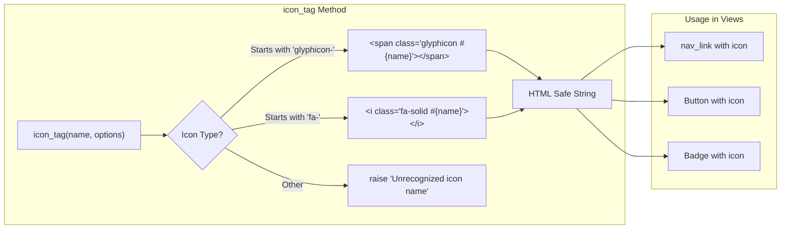

**Implementation Details:**
- [app/helpers/application_helper.rb:2-13]() - Icon tag method supporting Glyphicons and FontAwesome
- Automatically adds `fa-solid` prefix for FontAwesome icons unless `fa-brands` is specified
- Accepts optional CSS classes via `:class` option
- Returns HTML-safe string for direct insertion in views

**Common Icon Patterns:**

| Icon Name | Usage | Example Location |
|-----------|-------|------------------|
| `glyphicon-plus` | Create/Add actions | [app/views/agents/index.html.erb:15]() |
| `glyphicon-refresh` | Run/Reload actions | [app/views/layouts/_navigation.html.erb:18]() |
| `glyphicon-pencil` | Edit actions | [app/views/agents/_action_menu.html.erb:21]() |
| `glyphicon-trash` | Delete actions | [app/views/agents/_action_menu.html.erb:62]() |
| `fa-copy` | Clone actions | [app/views/agents/_action_menu.html.erb:25]() |
| `fa-brands` | Social media icons | [app/helpers/application_helper.rb:56-57]() |

**Sources:** [app/helpers/application_helper.rb:2-13](), [spec/helpers/application_helper_spec.rb:4-34]()

---

### Navigation Link System

The `nav_link` method creates navigation links with automatic active state detection and support for dropdown menus.

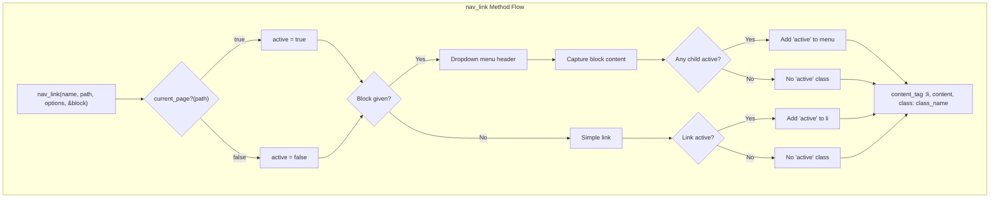

**Key Features:**
- Automatically marks current page as active using `current_page?`
- Supports nested dropdown menus via block syntax
- Parent menu items become active if any child is on current page
- Uses `@nav_in_menu` and `@nav_link_active` instance variables to track menu state

**Example Usage:**

Navigation with dropdown menu:
```erb
<%= nav_link "Agents", agents_path do %>
  <ul class='dropdown-menu' role='menu'>
    <%= nav_link icon_tag('glyphicon-plus') + " New Agent", new_agent_path %>
    <%= nav_link icon_tag('glyphicon-refresh') + " Run event propagation", propagate_agents_path, method: 'post' %>
  </ul>
<% end %>
```

**Sources:** [app/helpers/application_helper.rb:15-36](), [app/views/layouts/_navigation.html.erb:15-21](), [spec/helpers/application_helper_spec.rb:36-92]()

---

### Status and Label Helpers

These helpers render status badges and labels with contextual colors.

#### yes_no Helper

Renders a boolean value as a styled label.

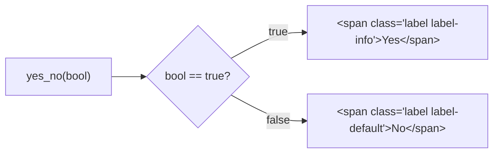

**Sources:** [app/helpers/application_helper.rb:38-40](), [spec/helpers/application_helper_spec.rb:95-111]()

#### working Helper

Renders an agent's working status as a contextual label with appropriate links.

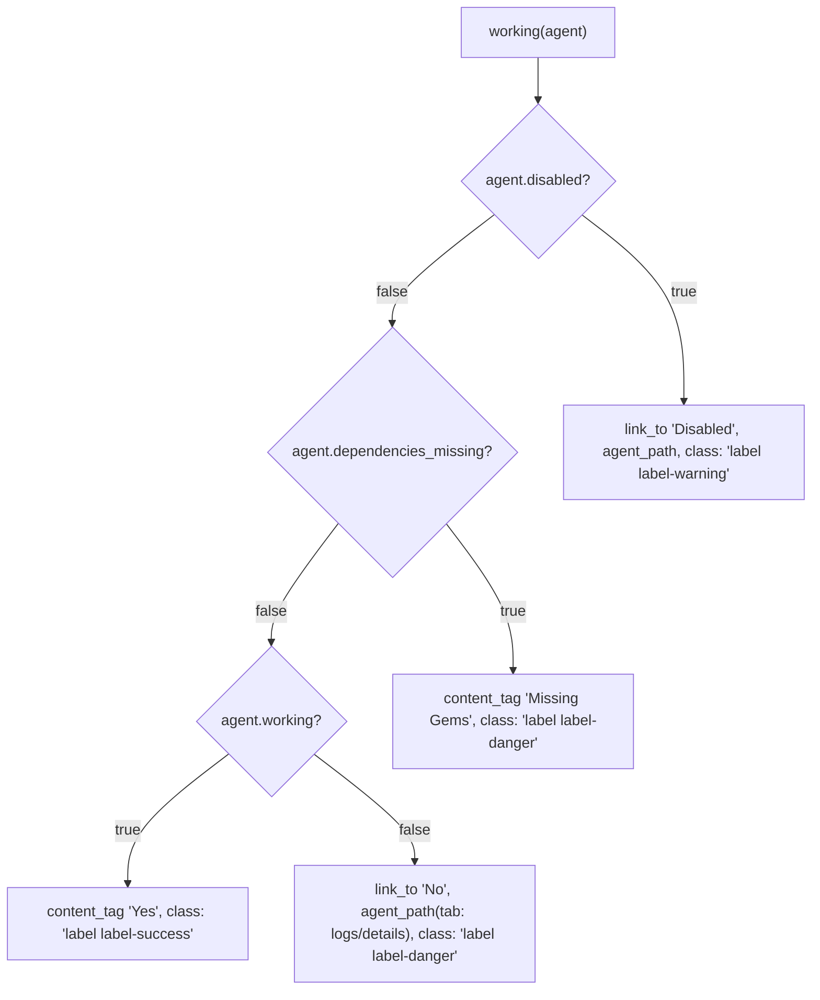

**Status Indicators:**

| Status | CSS Class | Link | Meaning |
|--------|-----------|------|---------|
| Disabled | `label-warning` | Yes (to agent) | Agent is manually disabled |
| Missing Gems | `label-danger` | No | Required dependencies not installed |
| Yes | `label-success` | No | Agent is working properly |
| No | `label-danger` | Yes (to logs/details) | Agent has errors |

**Sources:** [app/helpers/application_helper.rb:42-52](), [spec/helpers/application_helper_spec.rb:113-145]()

---

### OAuth Provider Helpers

These helpers render OAuth provider UI components with consistent styling.

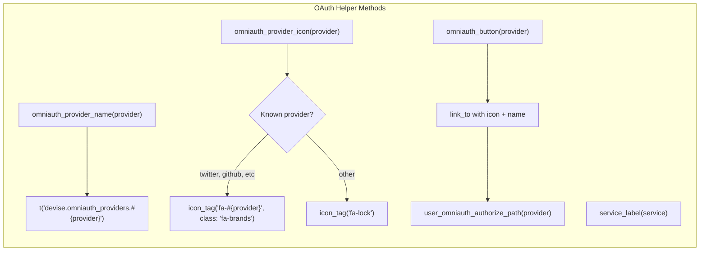

**Supported Providers with Icons:**
- Twitter, Tumblr, GitHub, Dropbox, Google (use branded icons)
- All other providers use generic lock icon

**Service Label Format:**
Combines provider icon with service details: `[Icon] Provider - Service Name`

**Sources:** [app/helpers/application_helper.rb:54-84](), [spec/helpers/application_helper_spec.rb:147-168]()

---

### Utility Helpers

#### load_ace_editor!

Conditionally loads the Ace code editor JavaScript when needed.

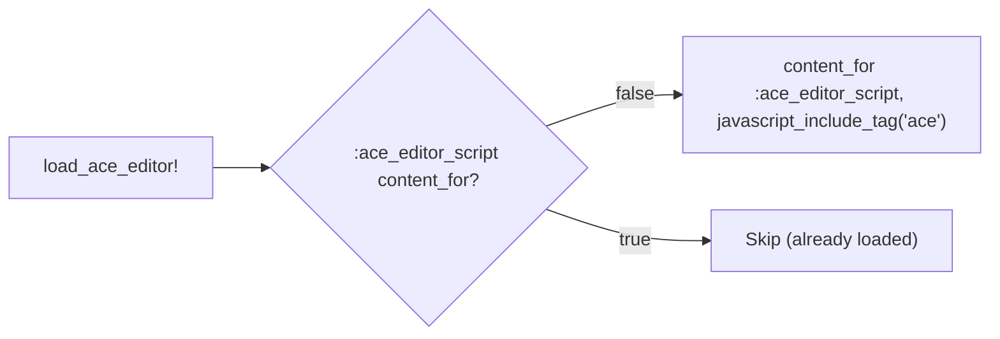

Uses `content_for` to ensure the editor is only loaded once per page.

**Sources:** [app/helpers/application_helper.rb:86-90]()

#### highlighted?

Determines if a given line number should be highlighted based on the `hl` query parameter.

**Supported Formats:**

| Format | Example | Meaning |
|--------|---------|---------|
| Single | `hl=5` | Highlight line 5 |
| Range | `hl=6-8` | Highlight lines 6, 7, 8 |
| Multiple | `hl=1,3-4,9` | Highlight lines 1, 3, 4, 9 |
| Open start | `hl=-2` | Highlight lines 1 through 2 |
| Open end | `hl=8-` | Highlight lines 8 through end |
| All | `hl=-` | Highlight all lines |

**Implementation:** Parses the `hl` parameter into Range objects and checks if the given ID is covered by any range.

**Sources:** [app/helpers/application_helper.rb:92-111](), [spec/helpers/application_helper_spec.rb:170-200]()

#### agent_type_to_human

Converts agent type class names to human-readable format.

```
"Agents::WebsiteAgent" → "Website Agent"
"Agents::TriggerAgent" → "Trigger Agent"
```

**Process:**
1. Remove namespace prefix (`Agents::`)
2. Convert to underscore case
3. Humanize
4. Titleize

**Sources:** [app/helpers/application_helper.rb:113-115]()

---

## View Components and Patterns

### Navigation Bar Structure

The main navigation is defined in a partial and uses the `nav_link` helper extensively.

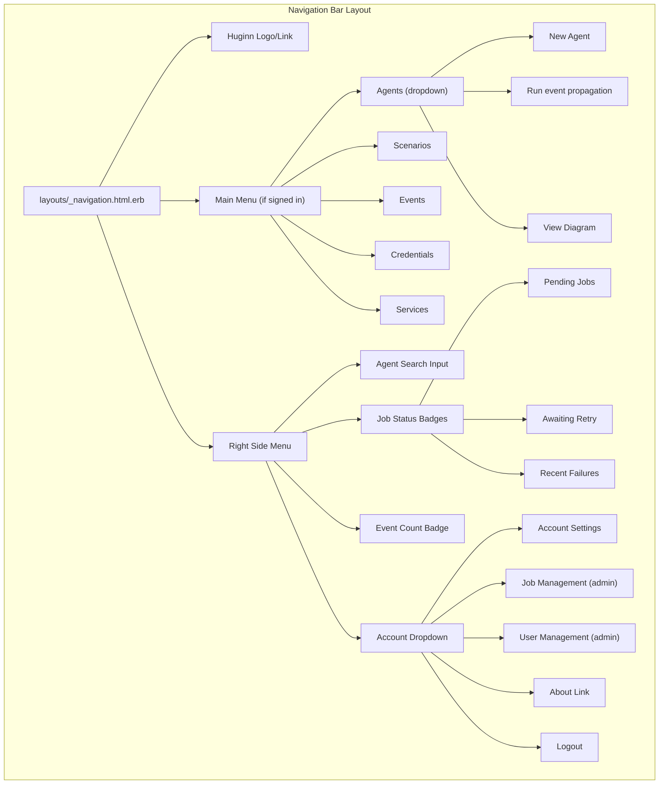

**Dynamic Elements:**

The navigation includes real-time status indicators that update via JavaScript:

| Indicator | Element | Purpose |
|-----------|---------|---------|
| Pending Jobs | `.job-indicator[role='pending']` | Shows queued background jobs |
| Awaiting Retry | `.job-indicator[role='awaiting_retry']` | Shows jobs waiting for retry |
| Recent Failures | `.job-indicator[role='recent_failures']` | Shows recently failed jobs |
| Event Count | `#event-indicator` | Shows system event count |

**Admin-Specific Elements:**
- Job management link (only for admins)
- User management link (only for admins)
- User switching indicator when admin is impersonating

**Sources:** [app/views/layouts/_navigation.html.erb:1-105]()

---

### Agent Action Menu

The action menu provides a dropdown of available operations for each agent.

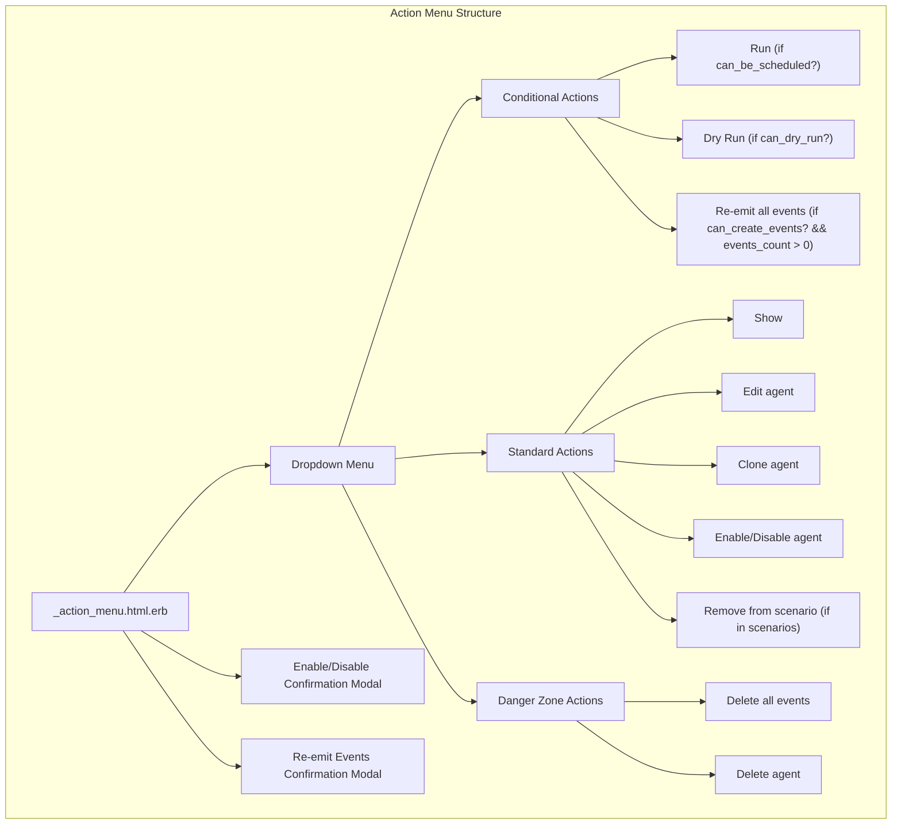

**Action Availability Logic:**

| Action | Condition | Method Called |
|--------|-----------|---------------|
| Run | `agent.can_be_scheduled?` | POST to `run_agent_path` |
| Dry Run | `agent.can_dry_run?` | JavaScript: `Utils.handleDryRunButton` |
| Re-emit Events | `agent.can_create_events? && agent.events_count > 0` | POST to `reemit_events_agent_path` |
| Enable/Disable | Always | PUT to `agent_path` with modal |
| Remove from Scenario | `agent.scenarios.length > 0` | PUT to `leave_scenario_agent_path` |
| Delete All Events | `agent.can_create_events? && agent.events_count > 0` | DELETE to `remove_events_agent_path` |

**Modal Components:**

Two Bootstrap modals are rendered inline with each action menu:

1. **Enable/Disable Confirmation Modal** ([app/views/agents/_action_menu.html.erb:71-97]())
   - Shows agent name
   - For event-receiving agents being enabled, offers `drop_pending_events` checkbox
   - Help tooltip explains pending events behavior

2. **Re-emit Events Confirmation Modal** ([app/views/agents/_action_menu.html.erb:99-124]())
   - Shows agent name
   - Offers `delete_old_events` checkbox
   - Help tooltip explains event deletion behavior

**Sources:** [app/views/agents/_action_menu.html.erb:1-125]()

---

### Agent Index View

The agents index page demonstrates integration of multiple UI components.

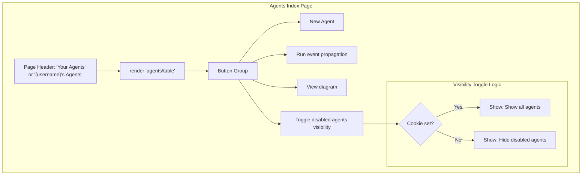

**Visibility Toggle Feature:**

The toggle visibility button uses a cookie to remember user preference:

- Cookie name: `huginn_view_only_enabled_agents`
- Controller action: `toggle_visibility` ([app/controllers/agents_controller.rb:21-29]())
- Index filtering: [app/controllers/agents_controller.rb:11-13]()

**Button Icons and Paths:**

| Button | Icon | Path | Method |
|--------|------|------|--------|
| New Agent | `glyphicon-plus` | `new_agent_path` | GET |
| Run event propagation | `glyphicon-refresh` | `propagate_agents_path` | POST |
| View diagram | `glyphicon-random` | `diagram_path` | GET |
| Toggle visibility | `glyphicon-adjust` | `toggle_visibility_agents_path` | PUT |

**Sources:** [app/views/agents/index.html.erb:1-23](), [app/controllers/agents_controller.rb:6-29]()

---

## Route Definitions for UI Actions

The routing configuration defines all UI-accessible agent actions.

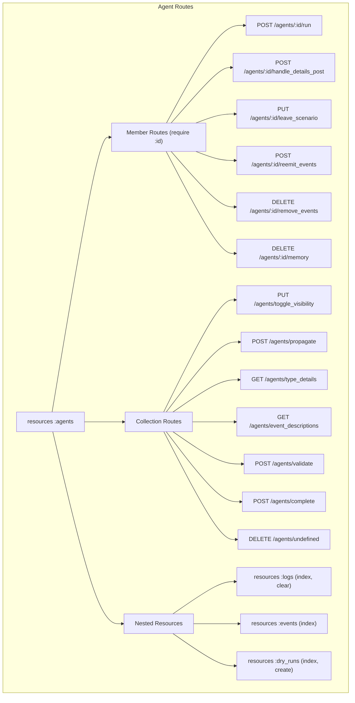

**Route to Controller Action Mapping:**

| Route | HTTP Method | Controller Action | Purpose |
|-------|-------------|-------------------|---------|
| `/agents/:id/run` | POST | `AgentsController#run` | Queue agent check job |
| `/agents/:id/handle_details_post` | POST | `AgentsController#handle_details_post` | Agent-specific detail POST handler |
| `/agents/toggle_visibility` | PUT | `AgentsController#toggle_visibility` | Toggle disabled agent visibility |
| `/agents/propagate` | POST | `AgentsController#propagate` | Trigger event propagation |
| `/agents/type_details` | GET | `AgentsController#type_details` | Get agent type metadata |
| `/agents/event_descriptions` | GET | `AgentsController#event_descriptions` | Get event descriptions for agents |
| `/agents/validate` | POST | `AgentsController#validate` | Validate agent option |
| `/agents/complete` | POST | `AgentsController#complete` | Get autocomplete suggestions |

**Sources:** [config/routes.rb:2-33]()

---

## Controller Integration with Helpers

The `AgentsController` demonstrates helper integration patterns.

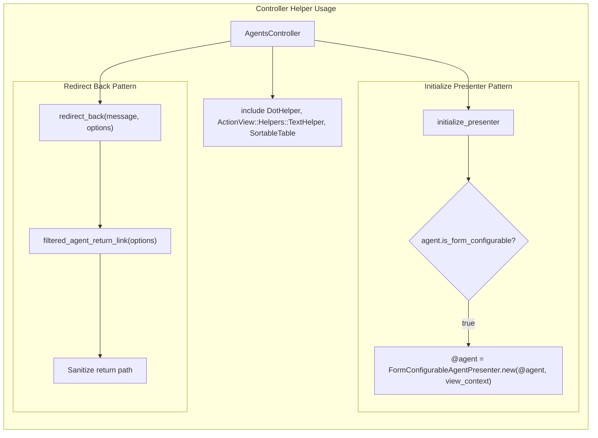

**Key Integration Points:**

1. **Includes** ([app/controllers/agents_controller.rb:2-4]())
   - `DotHelper`: For graph/diagram generation
   - `ActionView::Helpers::TextHelper`: For text formatting
   - `SortableTable`: For table sorting functionality

2. **initialize_presenter** ([app/controllers/agents_controller.rb:246-250]())
   - Called in `new`, `edit`, `create`, `update` actions
   - Wraps form-configurable agents in presenter for enhanced UI
   - Provides `view_context` to presenter for helper access

3. **redirect_back** ([app/controllers/agents_controller.rb:232-238]())
   - Custom redirect with return path support
   - Sanitizes return paths to prevent open redirect attacks
   - Supports returning to agent show page or scenario page

**FormConfigurableAgentPresenter Integration:**

When an agent implements form configurability, the controller wraps it in a presenter that enhances the view rendering with additional UI controls and validation.

**Sources:** [app/controllers/agents_controller.rb:1-267]()

---

## Common UI Patterns

### Table Sorting

The agents index uses the `SortableTable` concern for sortable columns:

```ruby
set_table_sort sorts: %w[name created_at last_check_at last_event_at last_receive_at], 
               default: { created_at: :desc }
```

**Sorting Behavior:**
- Allows sorting by agent attributes
- Maintains sort state across requests
- Provides default sort when none specified

**Sources:** [app/controllers/agents_controller.rb:7]()

### Modal Confirmation Dialogs

Bootstrap modals are used for destructive actions:

**Standard Modal Structure:**
```erb
<div id="confirm-{action}{agent.id}" class="confirm-agent modal fade">
  <div class="modal-dialog modal-sm">
    <div class="modal-content">
      <div class="modal-header"><!-- Title --></div>
      <div class="modal-body"><!-- Confirmation message --></div>
      <div class="modal-footer">
        <!-- Form with options and submit buttons -->
      </div>
    </div>
  </div>
</div>
```

**Triggered via data attributes:**
```erb
<%= link_to '#', 'data-toggle' => 'modal', 'data-target' => "#confirm-{id}" %>
```

**Sources:** [app/views/agents/_action_menu.html.erb:71-124]()

### Help Tooltips

The `hover-help` class provides contextual help:

```erb
<span class="glyphicon glyphicon-question-sign hover-help" 
      data-content="Help text here"></span>
```

Used extensively to explain:
- Drop pending events option
- Delete old events option
- Form field requirements

**Sources:** [app/views/agents/_action_menu.html.erb:87](), [app/views/agents/_action_menu.html.erb:115]()

### AJAX Form Validation

The `validate` and `complete` actions support real-time form validation:

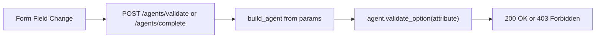

**Validate Action:** Returns status 200 if valid, 403 if invalid
**Complete Action:** Returns JSON array of autocomplete suggestions

**Sources:** [app/controllers/agents_controller.rb:207-221](), [config/routes.rb:17-18]()

---

## Summary

Huginn's UI component system provides:

1. **Consistent icon rendering** via `icon_tag` supporting Glyphicons and FontAwesome
2. **Smart navigation** with `nav_link` and automatic active state detection
3. **Status indicators** via `working`, `yes_no`, and badge helpers
4. **OAuth integration UI** with provider-specific icons and buttons
5. **Reusable action menus** with conditional display logic
6. **Modal confirmations** for destructive operations
7. **Real-time validation** via AJAX endpoints
8. **Helper-controller integration** through `view_context` and presenter pattern

These components work together to provide a cohesive user experience while maintaining code reusability and consistency across all agent management interfaces.

---

