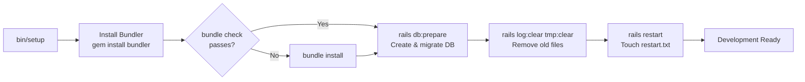
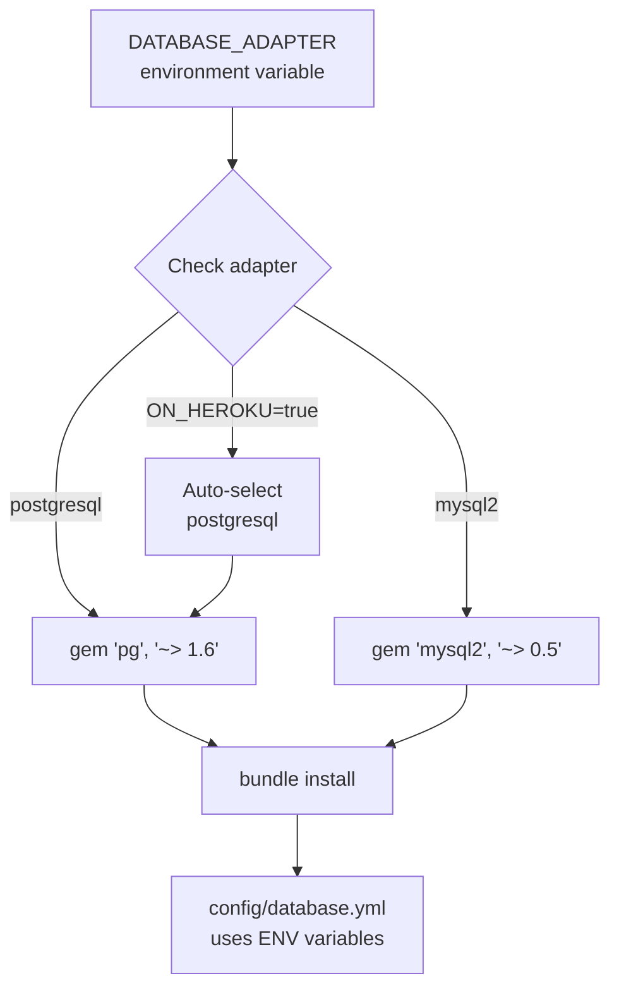
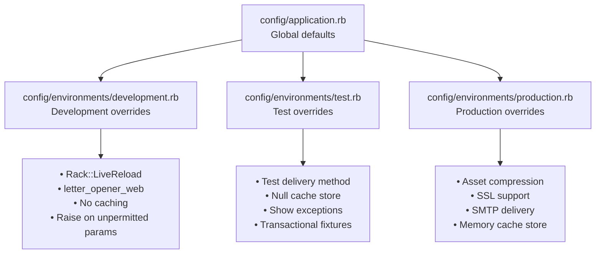
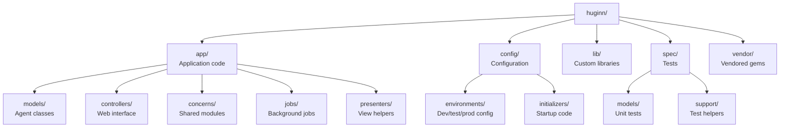
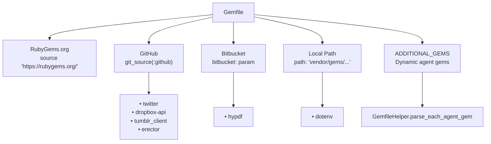
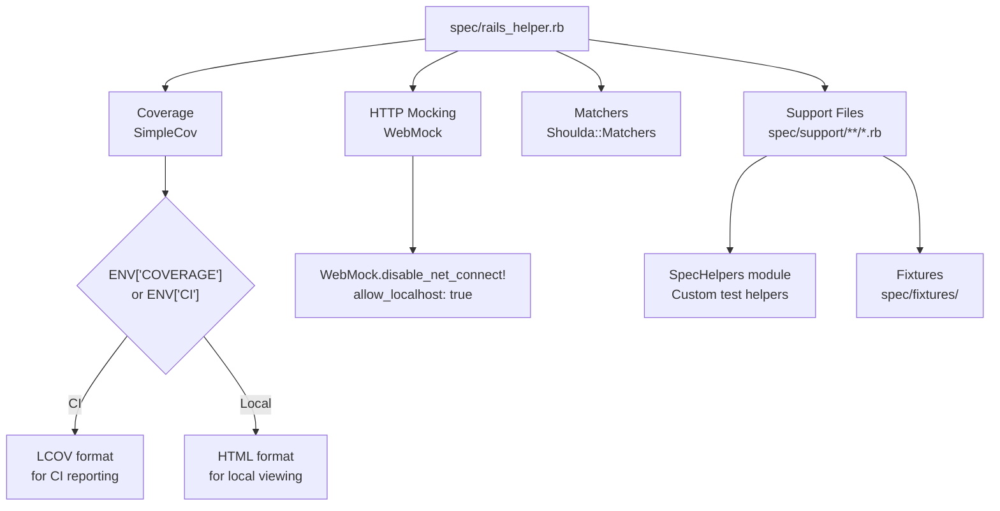
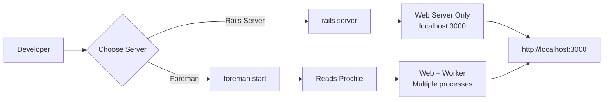
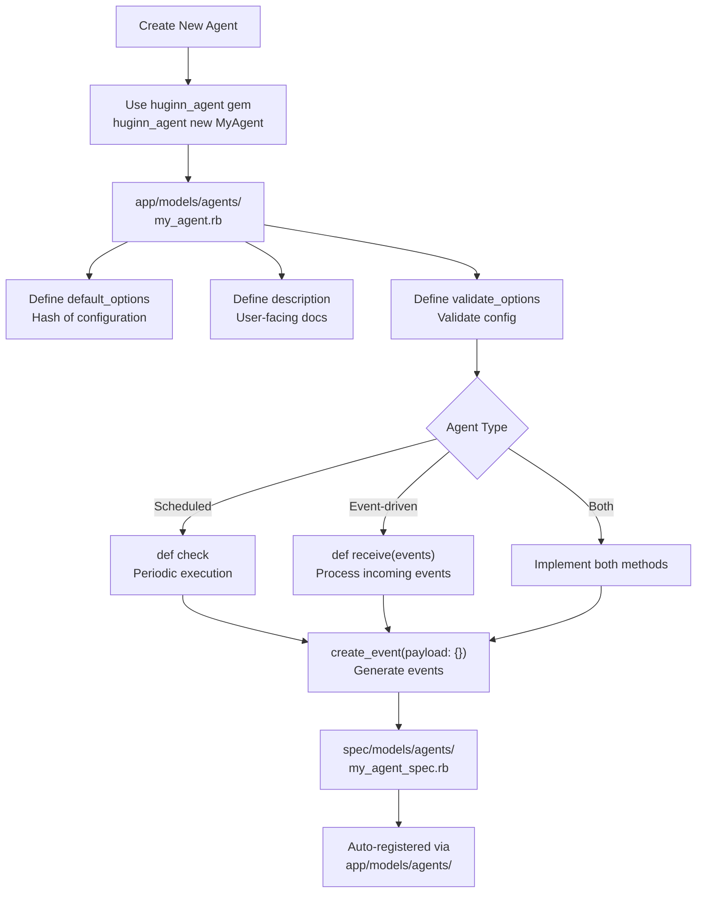
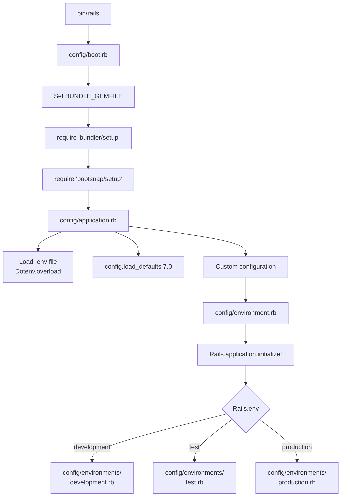

<!-- source: DeepWiki mcp.deepwiki.com · repo huginn/huginn · page 7 Development Guide · fetched 2026-10-29 -->

# Development Guide

<details>
<summary>Relevant source files</summary>

The following files were used as context for generating this wiki page:

- [.env.example](.env.example)
- [Gemfile](Gemfile)
- [Gemfile.lock](Gemfile.lock)
- [bin/setup](bin/setup)
- [config/application.rb](config/application.rb)
- [config/boot.rb](config/boot.rb)
- [config/environment.rb](config/environment.rb)
- [config/environments/development.rb](config/environments/development.rb)
- [config/environments/production.rb](config/environments/production.rb)
- [config/environments/test.rb](config/environments/test.rb)
- [config/initializers/wrap_parameters.rb](config/initializers/wrap_parameters.rb)
- [config/spring.rb](config/spring.rb)
- [spec/rails_helper.rb](spec/rails_helper.rb)

</details>


This guide provides an introduction to developing and extending Huginn. It covers setting up a development environment, understanding the project structure, and key workflows for contributing to the codebase or building custom agents.

For information about deploying Huginn, see [Installation and Deployment](#2). For specific agent implementations, see [Agent Reference](#5).

---

## Purpose and Scope

This section is designed for developers who want to:
- Set up a local development environment for Huginn
- Understand the Rails application structure and conventions
- Create custom agents or modify existing functionality
- Run tests and maintain code quality
- Contribute to the Huginn project

Child pages provide detailed documentation on:
- [Dependency Management](#7.1) - Gemfile structure, gem sources, and external agent gems
- [Rails Application Structure](#7.2) - Configuration files and Rails conventions
- [Testing Infrastructure](#7.3) - RSpec setup, test helpers, and testing strategies

---

## Getting Started

### Prerequisites

Huginn requires the following dependencies:

| Component | Version | Purpose |
|-----------|---------|---------|
| Ruby | >= 3.2.4 | Application runtime |
| Bundler | Latest | Dependency management |
| Database | MySQL 5.7+ or PostgreSQL 9.4+ | Data persistence |
| Node.js | Latest LTS | Asset compilation |

**Sources:** [Gemfile:3](), [Gemfile.lock:982]()

### Initial Setup

The `bin/setup` script automates the development environment setup:



Run the setup script:

```bash
cd /path/to/huginn
bin/setup
```

This script executes the following steps as defined in [bin/setup:11-32]():
1. Installs or updates Bundler
2. Runs `bundle check` or `bundle install`
3. Prepares the database with `db:prepare`
4. Clears logs and temporary files
5. Triggers application restart

**Sources:** [bin/setup:1-34]()

---

## Development Environment Configuration

### Environment Variables

Development configuration is managed through the `.env` file, which is loaded via a vendored `dotenv` gem. Create your local configuration:

```bash
cp .env.example .env
# Edit .env with your settings
```

Key development settings:

| Variable | Default | Purpose |
|----------|---------|---------|
| `RAILS_ENV` | `development` | Rails environment |
| `DOMAIN` | `localhost:3000` | Application domain |
| `DATABASE_ADAPTER` | `mysql2` | Database type (mysql2 or postgresql) |
| `SEND_EMAIL_IN_DEVELOPMENT` | `false` | Use real SMTP vs letter_opener_web |
| `ENABLE_INSECURE_AGENTS` | `false` | Allow ShellCommandAgent |
| `SPRING` | unset | Enable Spring preloader |

**Sources:** [.env.example:1-267](), [Gemfile:10-16]()

### Database Configuration

The Gemfile conditionally loads database adapters based on `DATABASE_ADAPTER`:



The Gemfile uses the `if_true` conditional to only load the required adapter:

[Gemfile:205-211]()

**Sources:** [Gemfile:193-211](), [.env.example:19-28]()

### Rails Environment Configuration

Rails configuration is split across environment-specific files:



Key development-specific settings in [config/environments/development.rb:4-90]():

- **Hot Reloading:** `cache_classes = false` enables code reloading on each request
- **Rack LiveReload:** Middleware at [config/environments/development.rb:13]() auto-refreshes browser
- **Email Preview:** Uses `letter_opener_web` unless `SEND_EMAIL_IN_DEVELOPMENT=true`
- **Error Reporting:** `better_errors` gem provides detailed error pages

**Sources:** [config/application.rb:20-70](), [config/environments/development.rb:1-91](), [config/environments/test.rb:1-74](), [config/environments/production.rb:1-150]()

---

## Project Structure

### Key Directories



Custom autoload paths are configured in [config/application.rb:33]():

```
config.autoload_paths += %W[#{config.root}/lib #{config.root}/app/presenters #{config.root}/app/jobs]
```

This allows classes in these directories to be autoloaded without explicit `require` statements.

**Sources:** [config/application.rb:33]()

### Core Rails Configuration

The application initializer at [config/application.rb:20-70]() sets global defaults:

| Setting | Value | Purpose |
|---------|-------|---------|
| `load_defaults` | `7.0` | Rails 7.0 defaults |
| `time_zone` | `ENV['TIMEZONE']` or Pacific | Default timezone |
| `active_job.queue_adapter` | `:delayed_job` | Background job system |
| `encoding` | `utf8` | Template encoding |

The application requires specific Rails components at [config/application.rb:5-14]():
- `active_record/railtie` - Database ORM
- `action_controller/railtie` - Web request handling
- `action_mailer/railtie` - Email sending
- `sprockets/railtie` - Asset pipeline

Notable exclusions: ActiveStorage and ActionCable are commented out.

**Sources:** [config/application.rb:1-71]()

---

## Dependency Management

### Gemfile Structure

Huginn's Gemfile uses a sophisticated dependency management system with multiple gem sources:



The Gemfile defines a custom `git_source` for GitHub at [Gemfile:6-8]():

```ruby
git_source(:github) do |repo_name|
  "https://github.com/#{repo_name}.git"
end
```

### Custom Gem Loading

Huginn uses a custom `GemfileHelper` to load the vendored dotenv gem at [Gemfile:11-16]():

```ruby
require File.join(File.dirname(__FILE__), 'lib/gemfile_helper.rb')
GemfileHelper.load_dotenv do |dotenv_dir|
  path dotenv_dir do
    gem 'dotenv'
  end
end
```

### Conditional Gem Loading

The `if_true` method enables conditional gem inclusion based on environment variables:

[Gemfile:19-27]()

This allows gems to remain in `Gemfile.lock` even when not actively loaded, by scoping them to an unsupported platform (`:ruby_18`) when the condition is false.

**Usage examples:**
- Database adapters: [Gemfile:205-211]()
- Spring preloader: [Gemfile:154-158]()

### Agent Gem Extensions

External agent gems can be loaded via the `ADDITIONAL_GEMS` environment variable:

[Gemfile:213-215]()

```bash
# .env
ADDITIONAL_GEMS=huginn_nlp_agents(~> 0.2.1),huginn_custom_agent(github: user/repo)
```

The `GemfileHelper.parse_each_agent_gem` method parses this comma-separated list and loads each gem with its specified version constraints or source.

**Sources:** [Gemfile:1-216]()

---

## Testing Infrastructure

### RSpec Configuration

Huginn uses RSpec as its testing framework, configured in [spec/rails_helper.rb:1-85]():



### Test Configuration

Key RSpec settings at [spec/rails_helper.rb:40-82]():

| Setting | Value | Purpose |
|---------|-------|---------|
| `use_transactional_fixtures` | `true` | Wrap tests in DB transactions |
| `infer_spec_type_from_file_location` | `true` | Auto-detect spec types |
| `order` | `'random'` | Randomize test execution order |
| `render_views` | `true` | Render views in controller specs |
| `global_fixtures` | `:all` | Load all fixtures for every test |

### Test Environment

The test environment configuration at [config/environments/test.rb:8-73]() provides:

- **No Caching:** `cache_store = :null_store` disables caching
- **Test Delivery:** `delivery_method = :test` accumulates emails in memory
- **Strict Errors:** `action_on_unpermitted_parameters = :raise` catches parameter issues

### Coverage Reporting

SimpleCov integration at [spec/rails_helper.rb:3-17]():

- Local development: HTML coverage reports
- CI environment: LCOV format for external reporting
- Single report file: `coverage/lcov.info`

**Sources:** [spec/rails_helper.rb:1-85](), [config/environments/test.rb:1-74]()

---

## Development Workflow

### Starting the Development Server



**Development server options:**

1. **Rails server** (web only):
   ```bash
   bundle exec rails server
   ```

2. **Foreman** (web + background worker):
   ```bash
   foreman start
   ```
   Uses the `foreman` gem at [Gemfile:101]() to run multiple processes from the Procfile.

### Live Reloading

The development environment includes live reloading via Guard:

**Development gems at [Gemfile:139-141]():**
- `guard` - File watching framework
- `guard-livereload` - Browser auto-refresh
- `guard-rspec` - Automatic test execution

The Rack LiveReload middleware is inserted at [config/environments/development.rb:13]():

```ruby
config.middleware.insert_after ActionDispatch::Static, Rack::LiveReload
```

### Spring Preloader

Spring speeds up development by keeping Rails loaded in the background. It's conditionally enabled via the `SPRING` environment variable at [Gemfile:154-158]():

```ruby
if_true(ENV['SPRING']) do
  gem 'spring'
  gem 'spring-commands-rspec'
  gem 'spring-watcher-listen'
end
```

Spring watches files configured in [config/spring.rb:1-7]():
- `.ruby-version` - Ruby version changes
- `.rbenv-vars` - Environment variables
- `tmp/restart.txt` - Manual restart trigger
- `tmp/caching-dev.txt` - Cache mode toggle

**Sources:** [Gemfile:154-158](), [config/spring.rb:1-7](), [config/environments/development.rb:13]()

---

## Code Quality Tools

### RuboCop

RuboCop provides static code analysis and style enforcement. Development gems at [Gemfile:150-152]():

```ruby
gem 'rubocop', require: false
gem 'rubocop-performance', require: false
gem 'rubocop-rspec', require: false
```

The `require: false` option means these gems are only loaded when explicitly required, not on application boot.

### Development Debugging

Development-only debugging tools at [Gemfile:137-138]():

- **better_errors:** Enhanced error pages with REPL
- **binding_of_caller:** Allows inspecting stack frames in error pages

These provide interactive debugging in the browser when an exception occurs.

**Sources:** [Gemfile:137-152]()

---

## Extending Huginn with Custom Agents

### Agent Development Workflow



### Agent Development Gems

The `huginn_agent` gem at [Gemfile:106]() provides scaffolding tools:

```bash
# Install the agent generator
gem install huginn_agent

# Create a new agent
huginn_agent new MyCustomAgent
```

### Loading External Agent Gems

External agents can be added via `ADDITIONAL_GEMS` in `.env`:

[.env.example:177-194]()

Examples:
```bash
# From RubyGems
ADDITIONAL_GEMS=huginn_nlp_agents

# With version constraint
ADDITIONAL_GEMS=huginn_nlp_agents(~> 0.2.1)

# From GitHub
ADDITIONAL_GEMS=huginn_nlp_agents(github: kreuzwerker/DKT.huginn_nlp_agents)

# Multiple gems
ADDITIONAL_GEMS=huginn_nlp_agents(~> 0.2.1),huginn_custom_agent
```

The Gemfile processes these at [Gemfile:213-215]() using `GemfileHelper.parse_each_agent_gem`.

**Sources:** [Gemfile:106](), [Gemfile:213-215](), [.env.example:177-194]()

---

## Development Configuration Reference

### Boot Sequence



**Boot sequence files:**

1. [config/boot.rb:1-7]() - Sets up Bundler and Bootsnap
2. [config/application.rb:1-71]() - Defines application class and global config
3. [config/environment.rb:1-6]() - Initializes the Rails application
4. Environment-specific config files apply final overrides

**Sources:** [config/boot.rb:1-7](), [config/application.rb:1-71](), [config/environment.rb:1-6]()

### Important Configuration Values

| Configuration | File | Line | Purpose |
|--------------|------|------|---------|
| Ruby version | Gemfile | 3 | Minimum Ruby version |
| Rails version | Gemfile | 120 | Rails framework version |
| Autoload paths | config/application.rb | 33 | Custom class directories |
| Queue adapter | config/application.rb | 57 | Background job system |
| Time zone | config/application.rb | 40 | Default timezone |
| YAML permitted classes | config/application.rb | 65 | Deserialization security |

**Sources:** [Gemfile:3](), [Gemfile:120](), [config/application.rb:33](), [config/application.rb:57](), [config/application.rb:40](), [config/application.rb:65]()

---

## Development Best Practices

### Environment Isolation

Use separate `.env` files for different purposes:

```bash
.env                # Development settings (gitignored)
.env.example        # Template with documentation
.env.test           # Test-specific overrides
```

The test environment automatically loads `spec/env.test` at [config/application.rb:22]():

```ruby
Dotenv.overload File.expand_path('../spec/env.test', __dir__) if Rails.env.test?
```

### Database Management

Development database tasks:

```bash
# Create database
rails db:create

# Run migrations
rails db:migrate

# Reset database (drop, create, migrate)
rails db:reset

# Load schema without running migrations
rails db:schema:load

# Rollback last migration
rails db:rollback
```

### Asset Development

The development environment uses [config/environments/development.rb:71]():

```ruby
config.assets.debug = true
```

This serves assets individually rather than concatenated for easier debugging.

### Running Tests

```bash
# Run all tests
bundle exec rspec

# Run specific test file
bundle exec rspec spec/models/agents/website_agent_spec.rb

# Run specific test by line number
bundle exec rspec spec/models/agents/website_agent_spec.rb:42

# Run with coverage
COVERAGE=true bundle exec rspec
```

**Sources:** [config/application.rb:22](), [config/environments/development.rb:71](), [spec/rails_helper.rb:1-85]()

---

## Additional Resources

For more detailed information on specific development topics, see:

- [Dependency Management](#7.1) - Detailed Gemfile patterns and gem management
- [Rails Application Structure](#7.2) - Deep dive into configuration and Rails conventions  
- [Testing Infrastructure](#7.3) - Comprehensive testing guide with examples

For deployment and production configuration, see [Installation and Deployment](#2).

For understanding the agent system, see [Agent System](#3.1) and [Agent Reference](#5).

---

