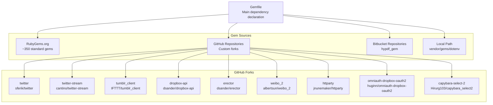
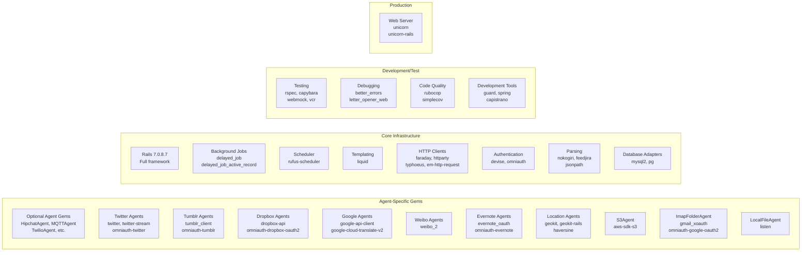
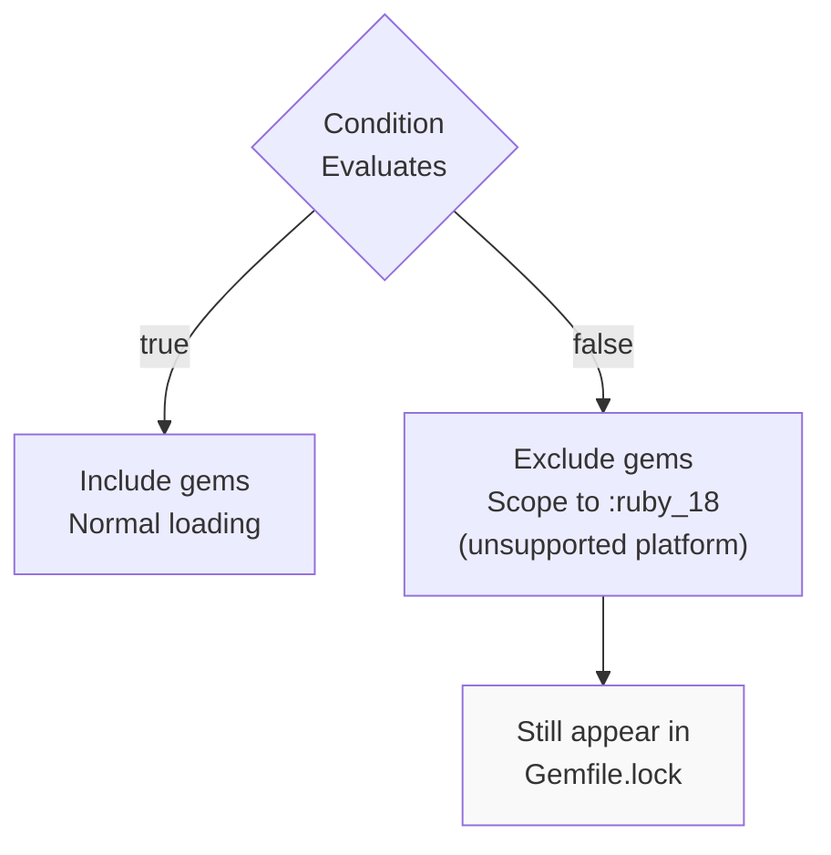
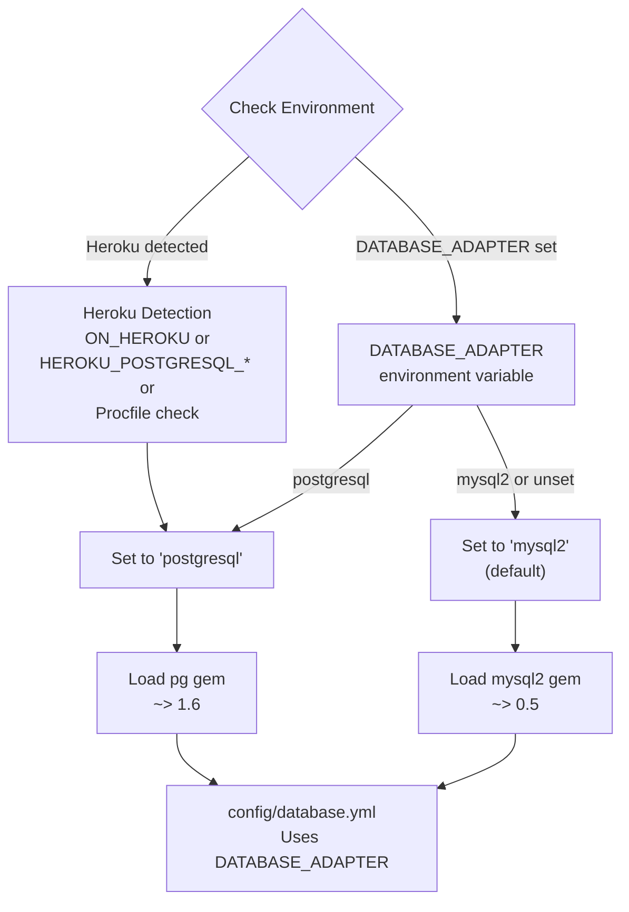
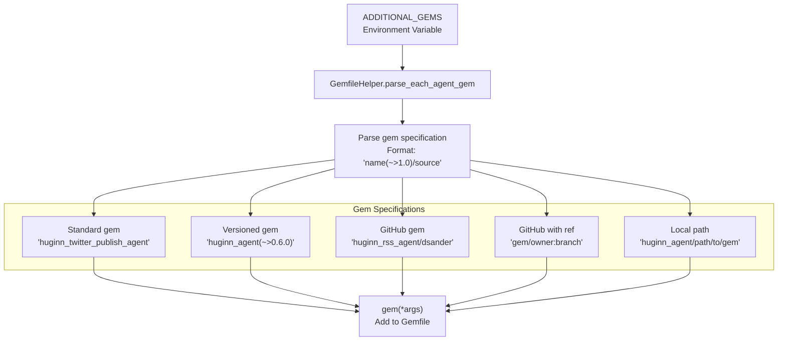
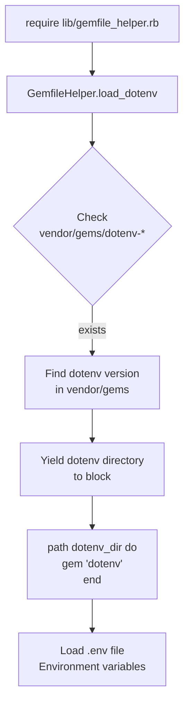
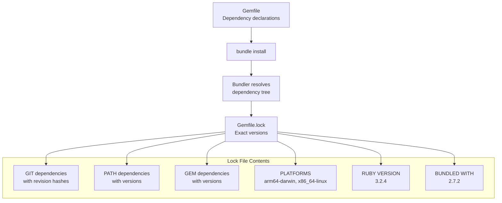
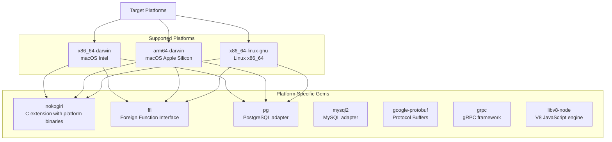
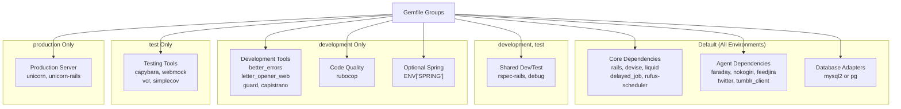
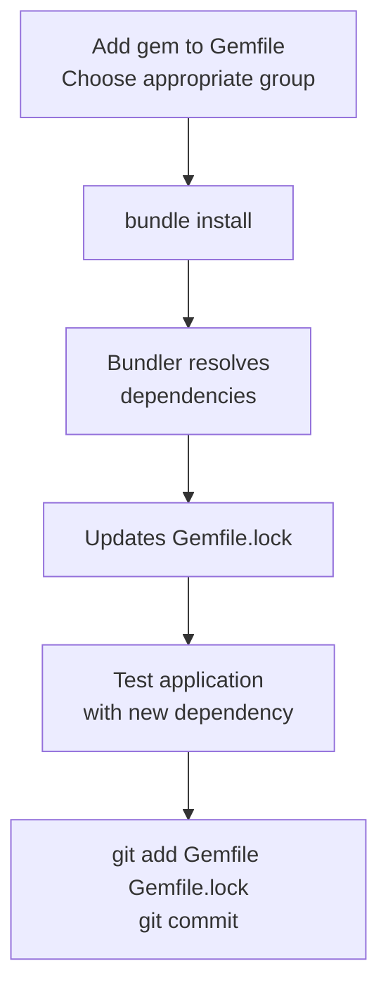

<!-- source: DeepWiki mcp.deepwiki.com · repo huginn/huginn · page 7.1 Dependency Management · fetched 2026-10-29 -->

# Dependency Management

<details>
<summary>Relevant source files</summary>

The following files were used as context for generating this wiki page:

- [.dockerignore](.dockerignore)
- [Gemfile](Gemfile)
- [Gemfile.lock](Gemfile.lock)
- [README.md](README.md)
- [config/database.yml](config/database.yml)
- [spec/rails_helper.rb](spec/rails_helper.rb)

</details>


## Purpose and Scope

This document explains Huginn's dependency management system, including gem sources, conditional loading, external agent gems, and database adapter selection. For information about configuring environment variables that control dependencies, see [Configuration System](#2.3). For details about the Rails application structure and initialization, see [Rails Application Structure](#7.2).

---

## Gem Sources and Repository Types

Huginn uses multiple gem sources beyond the standard RubyGems.org registry to accommodate custom forks, unreleased patches, and vendored dependencies.

### Source Hierarchy



**Sources:** [Gemfile:1-216](), [Gemfile.lock:1-102]()

### Custom Forks and Patches

Huginn maintains custom forks of several gems to include specific patches or features not yet merged upstream:

| Gem | Repository | Reason for Fork |
|-----|------------|-----------------|
| `twitter` | `sferik/twitter` | Compatibility updates |
| `twitter-stream` | `cantino/twitter-stream` (branch: huginn) | Huginn-specific modifications |
| `tumblr_client` | `IFTTT/tumblr_client` | Updated Faraday dependencies |
| `dropbox-api` | `dsander/dropbox-api` (pinned ref) | Hashie version compatibility |
| `erector` | `dsander/erector` (branch: rails6) | Rails 6/7 compatibility |
| `httparty` | `jnunemaker/httparty` | Latest unreleased features |
| `hypdf` | `knu/hypdf_gem` (Bitbucket, branch: uploadio_namespace) | UploadIO namespace fix |
| `weibo_2` | `albertsun/weibo_2` | Maintained fork |

**Sources:** [Gemfile:31-63](), [Gemfile.lock:9-97]()

### Vendored Dependencies

The `dotenv` gem is vendored locally to ensure stability and control over the environment variable loading mechanism:

```ruby
# Loaded via GemfileHelper.load_dotenv
path 'vendor/gems/dotenv-3.1.0' do
  gem 'dotenv'
end
```

**Sources:** [Gemfile:10-16](), [Gemfile.lock:98-101]()

---

## Core Dependency Structure

The [Gemfile:1-216]() is organized into logical sections based on functionality and agent requirements.

### Dependency Categories



**Sources:** [Gemfile:31-182](), [Gemfile.lock:103-856]()

### Optional Agent Dependencies

Lines [Gemfile:29-42]() define optional gems that can be commented out to conserve memory. These are required for specific agent types:

| Gem | Agent | Purpose |
|-----|-------|---------|
| `erector` | `HumanTaskAgent` | HTML generation for MTurk |
| `hipchat` | `HipchatAgent` | HipChat API integration |
| `hypdf` | `PDFInfoAgent` | PDF parsing |
| `mini_racer` | `JavaScriptAgent` | V8 JavaScript execution |
| `mqtt` | `MQTTAgent` | MQTT protocol support |
| `net-ftp`, `net-ftp-list` | `FtpsiteAgent` | FTP site monitoring |
| `pirate_weather_forecast_ruby` | `WeatherAgent` | Weather API integration |
| `rturk` | `HumanTaskAgent` | Amazon Mechanical Turk |
| `slack-notifier` | `SlackAgent` | Slack webhook integration |
| `twilio-ruby` | `TwilioAgent` | Twilio API integration |
| `xmpp4r` | `JabberAgent` | XMPP/Jabber protocol |

**Sources:** [Gemfile:31-42]()

---

## Conditional Loading Mechanism

Huginn implements a conditional gem loading system using the `if_true` helper method to support optional dependencies without forcing them onto all installations.

### The `if_true` Helper



The helper is defined at [Gemfile:18-27]():

```ruby
def if_true(condition, &block)
  if condition
    yield
  else
    # When not including the gems, we still want our Gemfile.lock
    # to include them, so we scope them to an unsupported platform.
    platform :ruby_18, &block
  end
end
```

This ensures that excluded gems still appear in `Gemfile.lock` for reproducibility, but are not installed or loaded at runtime.

**Sources:** [Gemfile:18-27]()

### Usage Examples

#### Spring Development Tool

```ruby
if_true(ENV['SPRING']) do
  gem 'spring'
  gem 'spring-commands-rspec'
  gem 'spring-watcher-listen'
end
```

Spring is only loaded when `SPRING=true` in the environment, allowing developers to opt-in to faster test startup times.

**Sources:** [Gemfile:154-158]()

#### Database Adapter Selection

```ruby
if_true(ENV['DATABASE_ADAPTER'].strip == 'postgresql') do
  gem 'pg', '~> 1.6', '>= 1.6.2'
end

if_true(ENV['DATABASE_ADAPTER'].strip == 'mysql2') do
  gem 'mysql2', '~> 0.5', '>= 0.5.7'
end
```

Only one database adapter is loaded based on the `DATABASE_ADAPTER` environment variable.

**Sources:** [Gemfile:205-211]()

---

## Database Adapter Selection

Huginn supports both MySQL and PostgreSQL databases through conditional adapter loading.

### Adapter Selection Flow



**Sources:** [Gemfile:193-211](), [config/database.yml:1-42]()

### Heroku Detection Logic

Lines [Gemfile:193-203]() implement automatic PostgreSQL selection for Heroku deployments:

```ruby
on_heroku = ENV['ON_HEROKU'] ||
            ENV['HEROKU_POSTGRESQL_ROSE_URL'] ||
            ENV['HEROKU_POSTGRESQL_GOLD_URL'] ||
            File.read(File.join(File.dirname(__FILE__), 'Procfile')) =~ /intended for Heroku/

ENV['DATABASE_ADAPTER'] ||=
  if on_heroku
    'postgresql'
  else
    'mysql2'
  end
```

This automatically configures PostgreSQL when:
- `ON_HEROKU` environment variable is set
- Heroku PostgreSQL addon URLs are detected
- The Procfile contains "intended for Heroku"

**Sources:** [Gemfile:193-203]()

---

## External Agent Gems (ADDITIONAL_GEMS)

Huginn allows loading external agent gems through the `ADDITIONAL_GEMS` environment variable, enabling users to extend functionality without modifying the core codebase.

### Loading Mechanism



**Sources:** [Gemfile:213-215](), [lib/gemfile_helper.rb:1-100]() (inferred)

### Usage in Gemfile

```ruby
GemfileHelper.parse_each_agent_gem(ENV['ADDITIONAL_GEMS']) do |args|
  gem(*args)
end
```

This parses the `ADDITIONAL_GEMS` variable and dynamically adds gem declarations to the Gemfile. Multiple gems can be specified separated by semicolons.

**Sources:** [Gemfile:213-215]()

### Example Specifications

```bash
# Single gem from RubyGems
ADDITIONAL_GEMS="huginn_twitter_publish_agent"

# Multiple gems with versions
ADDITIONAL_GEMS="huginn_twitter_publish_agent(~>1.0);huginn_rss_agent(>=0.5)"

# From GitHub
ADDITIONAL_GEMS="huginn_agent/dsander"

# From GitHub with branch
ADDITIONAL_GEMS="huginn_agent/huginn:feature-branch"

# Local path
ADDITIONAL_GEMS="huginn_agent/path/to/local/gem"
```

**Sources:** Based on GemfileHelper implementation pattern

---

## GemfileHelper Utility

The `GemfileHelper` class provides utilities for loading environment variables and parsing external gem specifications.

### Dotenv Loading



Lines [Gemfile:10-16]() use `GemfileHelper.load_dotenv`:

```ruby
GemfileHelper.load_dotenv do |dotenv_dir|
  path dotenv_dir do
    gem 'dotenv'
  end
end
```

This loads the vendored dotenv gem before processing the rest of the Gemfile, ensuring environment variables (like `DATABASE_ADAPTER` and `ADDITIONAL_GEMS`) are available during gem resolution.

**Sources:** [Gemfile:10-16]()

---

## Bundler and Lock File Management

Huginn uses Bundler to manage dependencies and ensure reproducible builds across environments.

### Version Locking Flow



**Sources:** [Gemfile.lock:1-985]()

### Lock File Structure

The [Gemfile.lock:1-985]() contains:

1. **GIT section** (lines 1-97): Git dependencies with exact revision hashes
2. **PATH section** (lines 98-101): Local path dependencies
3. **GEM section** (lines 103-855): RubyGems dependencies with resolved versions
4. **PLATFORMS section** (lines 857-860): Target platforms
5. **DEPENDENCIES section** (lines 862-979): Direct dependencies from Gemfile
6. **RUBY VERSION** (line 982): Required Ruby version
7. **BUNDLED WITH** (line 985): Bundler version used

**Sources:** [Gemfile.lock:1-985]()

### Git Dependency Locking

Git dependencies are locked to specific commit hashes to ensure consistency:

```
GIT
  remote: https://github.com/sferik/twitter.git
  revision: 5fc9b15371b0936a4b331103b588c860f46170fd
  specs:
    twitter (8.0.0)
      addressable (~> 2.3)
      ...
```

This prevents unexpected changes when the remote repository is updated.

**Sources:** [Gemfile.lock:83-96]()

---

## Platform-Specific Dependencies

Huginn supports multiple platforms with platform-specific gem versions and requirements.

### Platform Detection



**Sources:** [Gemfile.lock:313-315](), [Gemfile.lock:551-556](), [Gemfile.lock:857-860]()

### Native Extension Dependencies

Several gems have platform-specific versions with pre-compiled native extensions:

| Gem | Darwin (Intel) | Darwin (ARM) | Linux | Purpose |
|-----|---------------|--------------|-------|---------|
| `nokogiri` | 1.18.10 | 1.18.10 | 1.18.10 | XML/HTML parsing |
| `ffi` | 1.17.2 | 1.17.2 | 1.17.2 | Foreign function interface |
| `pg` | 1.6.2 | 1.6.2 | 1.6.2 | PostgreSQL adapter |
| `google-protobuf` | 4.32.0 | 4.32.0 | 4.32.0 | Protocol Buffers |
| `grpc` | 1.74.1 | 1.74.1 | 1.74.1 | gRPC framework |
| `libv8-node` | 24.1.0.0 | 24.1.0.0 | 24.1.0.0 | V8 engine for mini_racer |

**Sources:** [Gemfile.lock:313-315](), [Gemfile.lock:367-397](), [Gemfile.lock:481-483](), [Gemfile.lock:551-556](), [Gemfile.lock:602-604]()

### Platform-Conditional Requirements

Lines [Gemfile:184-191]() define platform-specific requirements:

```ruby
require 'rbconfig'
gem 'ffi', '>= 1.17.2'  # Required by typhoeus; 1.9.4 has fixes for *BSD
gem 'tzinfo', '>= 2.0.6'  # Required by rails; 1.2.0 has support for *BSD and Solaris
gem 'tzinfo-data', platforms: %i[windows]  # Windows doesn't have zoneinfo files
gem 'rb-kqueue', '>= 0.2.8', require: /bsd|dragonfly/i === RbConfig::CONFIG['target_os']
```

The `rb-kqueue` gem is conditionally required on BSD systems to enable file watching without polling.

**Sources:** [Gemfile:184-191]()

---

## Dependency Groups

Gemfile uses groups to organize dependencies by usage context, allowing selective loading based on the Rails environment.

### Group Organization



**Sources:** [Gemfile:131-182]()

### Group Definitions

**Development + Test** ([Gemfile:131-134]()):
- `debug` - Debugging support
- `rspec-rails` - RSpec testing framework

**Development Only** ([Gemfile:136-158]()):
- `better_errors`, `binding_of_caller` - Enhanced error pages
- `guard`, `guard-livereload`, `guard-rspec` - Automatic testing
- `letter_opener_web` - Email preview
- `rack-livereload` - Browser auto-refresh
- `web-console` - In-browser debugging
- `capistrano`, `capistrano-bundler`, `capistrano-rails` - Deployment
- `rubocop`, `rubocop-performance`, `rubocop-rspec` - Code linting
- `spring` (optional) - Fast test startup

**Test Only** ([Gemfile:160-176]()):
- `capybara`, `selenium-webdriver` - Browser automation
- `capybara-select-2` - Select2 testing helpers
- `puma` - Test web server
- `rails-controller-testing` - Controller specs
- `rr` - Mocking library (alternative)
- `rspec`, `rspec-collection_matchers`, `rspec-html-matchers`, `rspec-mocks` - Testing
- `shoulda-matchers` - RSpec matchers
- `simplecov`, `simplecov-lcov` - Code coverage
- `vcr`, `webmock` - HTTP mocking

**Production Only** ([Gemfile:179-182]()):
- `unicorn`, `unicorn-rails` - Production web server

**Sources:** [Gemfile:131-182]()

---

## Development Workflow

### Adding New Dependencies



**Standard process:**

1. Add gem to appropriate section in `Gemfile`
2. Run `bundle install` to resolve and install
3. Verify `Gemfile.lock` is updated with exact versions
4. Test the application with the new dependency
5. Commit both `Gemfile` and `Gemfile.lock` together

**Sources:** Based on Bundler workflow

### Updating Dependencies

```bash
# Update a specific gem
bundle update gem_name

# Update all gems
bundle update

# Update gems in a group
bundle update --group development

# Check for outdated gems
bundle outdated
```

### Using ADDITIONAL_GEMS for External Agents

```bash
# In .env file
ADDITIONAL_GEMS="huginn_pushover_agent;huginn_todoist_agent/dsander"

# Then install
bundle install
```

This allows users to extend Huginn without forking the main repository.

**Sources:** [Gemfile:213-215]()

### Docker Dependency Management

In Docker environments, dependencies are handled during image build:

```dockerfile
# Dependencies installed during build
RUN bundle install --without development test
```

The `.dockerignore` file excludes `vendor/bundle` to prevent local gem cache from being copied into the image.

**Sources:** [.dockerignore:9]()

---

## Key Dependency Versions

### Core Framework Versions

| Component | Version | Notes |
|-----------|---------|-------|
| Ruby | ≥3.2.4 | Minimum version |
| Rails | ~>7.0.1 (7.0.8.7) | Rails 7 framework |
| Bundler | 2.7.2 | Locked version |

**Sources:** [Gemfile:3](), [Gemfile:120](), [Gemfile.lock:982](), [Gemfile.lock:985]()

### Critical Dependencies

| Gem | Version | Purpose |
|-----|---------|---------|
| `liquid` | ~>5.6, =5.6.0 | Template engine |
| `rufus-scheduler` | ~>3.9, >=3.9.2 | Job scheduling |
| `delayed_job` | 4.1.13 | Background jobs |
| `devise` | ~>4.9, >=4.9.4 | Authentication |
| `nokogiri` | ≥1.18.10 | HTML/XML parsing |
| `faraday` | 2.14.0 | HTTP client |
| `feedjira` | ~>4.0, >=4.0.1 | RSS/Atom parsing |

**Sources:** [Gemfile:88-122](), [Gemfile.lock:255-310]()

### Database Adapters

| Adapter | Version | Used When |
|---------|---------|-----------|
| `mysql2` | ~>0.5, >=0.5.7 | `DATABASE_ADAPTER=mysql2` (default) |
| `pg` | ~>1.6, >=1.6.2 | `DATABASE_ADAPTER=postgresql` |

**Sources:** [Gemfile:205-211](), [Gemfile.lock:527-528](), [Gemfile.lock:602-604]()

---

## Related Configuration

For environment variable configuration that controls dependency behavior, see [Configuration System](#2.3).

For testing infrastructure that uses development dependencies, see [Testing Infrastructure](#7.3).

For deployment-specific dependency considerations, see [Docker Deployment](#2.1) and [Manual Installation](#2.2).

**Sources:** [Gemfile:1-216](), [Gemfile.lock:1-985](), [config/database.yml:1-42](), [README.md:95-102]()

---

