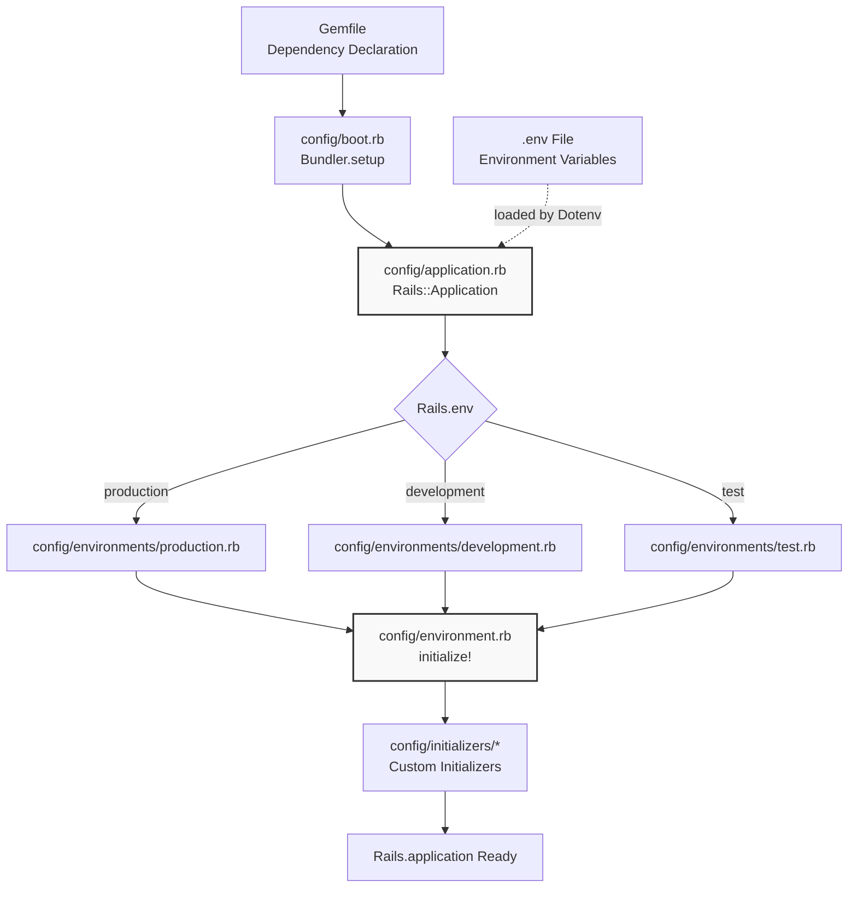
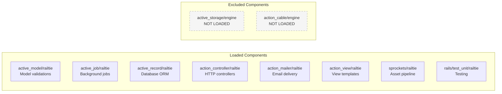
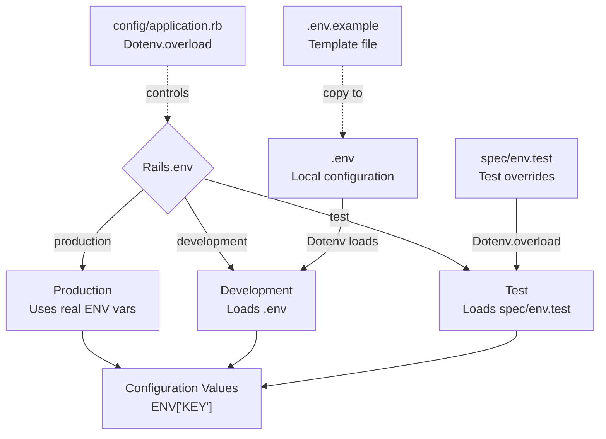
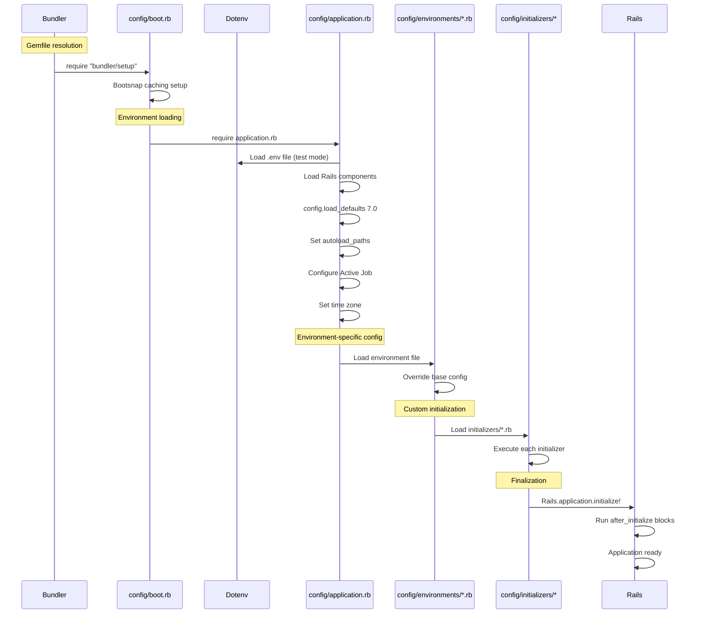
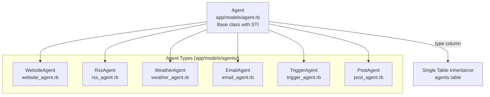

<!-- source: DeepWiki mcp.deepwiki.com · repo huginn/huginn · page 7.2 Rails Application Structure · fetched 2026-10-29 -->

# Rails Application Structure

<details>
<summary>Relevant source files</summary>

The following files were used as context for generating this wiki page:

- [.env.example](.env.example)
- [app/models/agent.rb](app/models/agent.rb)
- [app/views/agents/_form.html.erb](app/views/agents/_form.html.erb)
- [bin/setup](bin/setup)
- [config/application.rb](config/application.rb)
- [config/boot.rb](config/boot.rb)
- [config/environment.rb](config/environment.rb)
- [config/environments/development.rb](config/environments/development.rb)
- [config/environments/production.rb](config/environments/production.rb)
- [config/environments/test.rb](config/environments/test.rb)
- [config/initializers/wrap_parameters.rb](config/initializers/wrap_parameters.rb)
- [config/spring.rb](config/spring.rb)
- [spec/models/agent_spec.rb](spec/models/agent_spec.rb)

</details>


## Purpose and Scope

This document provides an overview of Huginn's Rails application structure, focusing on the configuration system, initialization sequence, and Rails conventions used throughout the codebase. It covers the core configuration files in the `config/` directory, environment-specific settings, and how the Rails framework is configured for Huginn's specific needs.

For information about dependency management and the Gemfile structure, see [Dependency Management](#7.1). For details about testing infrastructure, see [Testing Infrastructure](#7.3).

---

## Configuration File Hierarchy

Huginn follows the standard Rails configuration pattern with environment-specific overrides. The configuration system is layered, with each level overriding or extending the previous one.

### Configuration Loading Sequence



**Sources:** [config/boot.rb:1-7](), [config/application.rb:1-71](), [config/environment.rb:1-6](), [config/environments/production.rb:1-149](), [config/environments/development.rb:1-91](), [config/environments/test.rb:1-74]()

---

## Application Configuration (config/application.rb)

The `config/application.rb` file contains the core Rails application configuration for Huginn. This is where global defaults are set that apply across all environments.

### Key Configuration Areas

| Configuration Area | Setting | Purpose |
|-------------------|---------|----------|
| **Rails Components** | Selectively loaded railties | Only loads needed Rails components (no Action Cable, no Active Storage) |
| **Autoload Paths** | `config.autoload_paths` | Adds custom directories for automatic class loading |
| **Time Zone** | `config.time_zone` | Default timezone from `ENV['TIMEZONE']` or Pacific Time |
| **Active Job** | `config.active_job.queue_adapter = :delayed_job` | Background job processing via Delayed Job |
| **YAML Serialization** | `config.active_record.yaml_column_permitted_classes` | Allowed classes for YAML columns |
| **XML Backend** | `ActiveSupport::XmlMini.backend = 'Nokogiri'` | Uses Nokogiri for XML processing |

### Rails Components Loaded

Huginn selectively loads only the Rails components it needs, excluding unused features to reduce overhead:



**Sources:** [config/application.rb:5-14]()

### Autoload Path Configuration

Huginn extends Rails' autoload paths to include custom directories:

```ruby
# config/application.rb:33
config.autoload_paths += %W[#{config.root}/lib #{config.root}/app/presenters #{config.root}/app/jobs]
```

This allows classes in these directories to be automatically loaded without explicit `require` statements:

- `lib/` - Utility classes and modules
- `app/presenters/` - Presentation layer objects
- `app/jobs/` - Background job definitions (AgentCheckJob, AgentReceiveJob)

**Sources:** [config/application.rb:33]()

### Active Job Configuration

Huginn uses Delayed Job as its background job adapter:

```ruby
# config/application.rb:57
config.active_job.queue_adapter = :delayed_job
```

This enables asynchronous execution of agent checks and event propagation via [app/models/agent.rb:447-449]() (`async_receive`) and [app/models/agent.rb:476-478]() (`async_check`).

**Sources:** [config/application.rb:57](), [app/models/agent.rb:447-478]()

---

## Environment-Specific Configurations

Rails provides three default environments, each with its own configuration file. Huginn customizes each environment for its specific use case.

### Configuration Comparison Table

| Setting | Production | Development | Test |
|---------|-----------|-------------|------|
| **Cache Classes** | `true` | `false` | `false` |
| **Eager Load** | `true` | `false` | `false` / `true` (CI) |
| **Log Level** | `:info` | Debug | Debug |
| **Show Errors** | `false` | `true` | `true` |
| **Asset Compilation** | `false` (precompiled) | On-demand | `true` (CI only) |
| **Cache Store** | `:memory_store` | `:memory_store` / `:null_store` | `:null_store` |
| **Mail Delivery** | SMTP | `letter_opener_web` / SMTP | `:test` |

### Production Environment (config/environments/production.rb)

The production configuration is optimized for performance and security:

**Performance Optimizations:**
- Class caching enabled [config/environments/production.rb:7]()
- Eager loading enabled [config/environments/production.rb:13]()
- Asset compression (Terser for JS, SCSS for CSS) [config/environments/production.rb:43-44]()
- Precompiled assets [config/environments/production.rb:47]()

**Security Features:**
- SSL enforcement via `ENV['FORCE_SSL']` [config/environments/production.rb:65]()
- Secure cookies when SSL enabled
- Limited error reporting [config/environments/production.rb:16]()

**Heroku-Specific Detection:**
Huginn auto-detects Heroku deployment and adjusts logging accordingly:

```ruby
# config/environments/production.rb:32-40
if ENV["RAILS_LOG_TO_STDOUT"].present? ||
    ENV['ON_HEROKU'] ||
    ENV['HEROKU_POSTGRESQL_ROSE_URL'] ||
    ENV['HEROKU_POSTGRESQL_GOLD_URL'] ||
    File.read(File.join(File.dirname(__FILE__), '../../Procfile')) =~ /intended for Heroku/
  logger = ActiveSupport::Logger.new(STDOUT)
  # ... configure stdout logging
end
```

**Sources:** [config/environments/production.rb:1-149]()

### Development Environment (config/environments/development.rb)

Development configuration prioritizes developer experience:

**Developer Experience Features:**
- Code reloading on each request [config/environments/development.rb:15]()
- Live reload middleware [config/environments/development.rb:13]()
- Full error reports [config/environments/development.rb:21]()
- Verbose query logs [config/environments/development.rb:66]()
- Asset debugging enabled [config/environments/development.rb:71]()

**Email Handling:**
Development uses `letter_opener_web` by default to preview emails in-browser without sending them. Set `ENV['SEND_EMAIL_IN_DEVELOPMENT'] = 'true'` to send real emails via SMTP.

**Sources:** [config/environments/development.rb:1-91]()

### Test Environment (config/environments/test.rb)

Test configuration optimizes for fast, isolated test execution:

**Test-Specific Settings:**
- Caching disabled [config/environments/test.rb:26]()
- Exception raising instead of rendering [config/environments/test.rb:29]()
- Test mail delivery (stored in memory) [config/environments/test.rb:42]()
- Unpermitted parameters raise errors [config/environments/test.rb:62]()

**CI Optimizations:**
When `ENV['CI']` is set, the test environment enables eager loading and asset precompilation for CI pipeline performance:

```ruby
# config/environments/test.rb:67-72
if ENV['CI']
  config.eager_load = true
  config.assets.debug = false
  config.assets.compile = true
  config.assets.digest = true
end
```

**Sources:** [config/environments/test.rb:1-74]()

---

## Environment Variables Integration

Huginn uses the `dotenv` gem to load environment variables from `.env` files. This provides a clean separation between code and configuration.

### Environment Variable Loading Flow



**Test Environment Special Case:**

In test mode, Huginn uses `Dotenv.overload` to force-load test-specific environment variables:

```ruby
# config/application.rb:22
Dotenv.overload File.expand_path('../spec/env.test', __dir__) if Rails.env.test?
```

This ensures test configuration always takes precedence over `.env` files.

**Sources:** [config/application.rb:22](), [.env.example:1-267]()

### Key Environment Variables Used in Configuration

| Variable | Used In | Purpose |
|----------|---------|---------|
| `TIMEZONE` | [config/application.rb:40]() | Sets `config.time_zone` |
| `FORCE_SSL` | [config/environments/production.rb:65]() | Enforces HTTPS |
| `DOMAIN` | [config/environments/production.rb:89]() | Sets `action_mailer.default_url_options` |
| `ASSET_HOST` | [config/environments/production.rb:82-84]() | CDN configuration |
| `SMTP_DELIVERY_METHOD` | [config/environments/production.rb:96]() | Email delivery method |
| `RAILS_LOG_TO_STDOUT` | [config/environments/production.rb:32]() | Logging destination |
| `SEND_EMAIL_IN_DEVELOPMENT` | [config/environments/development.rb:79]() | Dev email behavior |

**Sources:** [config/application.rb:40](), [config/environments/production.rb:65-96](), [config/environments/development.rb:79-83]()

---

## Application Initialization Sequence

Understanding how Huginn initializes helps developers know when their code will be loaded and executed.

### Detailed Initialization Flow



**Key Initialization Points:**

1. **Bundler Setup** [config/boot.rb:3]() - Loads all gems from Gemfile
2. **Bootsnap Caching** [config/boot.rb:4]() - Speeds up boot time by caching expensive operations
3. **Dotenv Loading** [config/application.rb:22]() - Loads environment variables (test mode only)
4. **Rails Defaults** [config/application.rb:25]() - Loads Rails 7.0 defaults
5. **Custom Configuration** [config/application.rb:33-69]() - Huginn-specific settings
6. **Environment Override** - Loads production/development/test config
7. **Initializers** - Runs files in `config/initializers/`
8. **After Initialize** [config/application.rb:64-66]() - Sets permitted YAML classes

**Sources:** [config/boot.rb:1-7](), [config/application.rb:1-71](), [config/environment.rb:1-6]()

---

## Rails Conventions in Huginn

Huginn follows Rails conventions with some notable customizations for its agent-based architecture.

### Model Layer Conventions

**Agent Model Hierarchy:**

The core `Agent` model [app/models/agent.rb:6]() uses Single Table Inheritance (STI) to support multiple agent types:



**Concerns Pattern:**

Huginn uses Rails concerns extensively for shared behavior:

- `LiquidInterpolatable` [app/models/agent.rb:12]() - Template interpolation
- `WorkingHelpers` [app/models/agent.rb:11]() - Status checking
- `JsonSerializedField` [app/models/agent.rb:9]() - JSON column handling
- `HasGuid` [app/models/agent.rb:13]() - GUID generation
- `DryRunnable` [app/models/agent.rb:14]() - Dry run support

**Sources:** [app/models/agent.rb:6-19]()

### Controller Layer Conventions

**RESTful Resource Routes:**

Agents follow standard RESTful conventions in `AgentsController`:

| HTTP Method | Path | Action | Purpose |
|------------|------|--------|---------|
| GET | `/agents` | `index` | List all agents |
| GET | `/agents/new` | `new` | New agent form |
| POST | `/agents` | `create` | Create agent |
| GET | `/agents/:id` | `show` | Display agent |
| GET | `/agents/:id/edit` | `edit` | Edit agent form |
| PUT/PATCH | `/agents/:id` | `update` | Update agent |
| DELETE | `/agents/:id` | `destroy` | Delete agent |

**Custom Actions:**

Beyond RESTful routes, Huginn adds agent-specific actions like `run`, `dry_run`, `toggle_disabled`, etc.

**Sources:** Based on standard Rails conventions and [app/views/agents/_form.html.erb:12-16]()

### View Layer Conventions

**Template Organization:**

Views follow Rails conventions with some Huginn-specific patterns:

- `app/views/agents/_form.html.erb` - Shared form partial
- `app/views/agents/_options.html.erb` - Agent-specific options (dynamically loaded)
- Form helpers extensively use `form_for` [app/views/agents/_form.html.erb:12]()
- Select2 for enhanced dropdowns [app/views/agents/_form.html.erb:61]()

**ACE Editor Integration:**

Agent options editing uses the ACE editor for JSON/code input:

```ruby
# app/views/agents/_form.html.erb:1
<% load_ace_editor! %>
```

This provides syntax highlighting and validation for agent configuration.

**Sources:** [app/views/agents/_form.html.erb:1-152]()

---

## Custom Rails Configuration Summary

### Differences from Standard Rails

Huginn makes the following notable deviations from standard Rails applications:

| Area | Standard Rails | Huginn |
|------|---------------|--------|
| **Storage** | Active Storage enabled | Active Storage disabled [config/application.rb:8]() |
| **WebSockets** | Action Cable included | Action Cable excluded [config/application.rb:12]() |
| **Background Jobs** | Various adapters | Delayed Job only [config/application.rb:57]() |
| **XML Parsing** | REXML (default) | Nokogiri [config/application.rb:68]() |
| **Autoload Paths** | app/* only | Includes lib/, presenters/, jobs/ [config/application.rb:33]() |
| **Sanitization** | Restrictive | Expanded tag/attribute whitelist [config/application.rb:59-62]() |

### Critical Configuration Files

The following files are essential to Huginn's operation:

1. **config/boot.rb** - Bundler setup and Bootsnap initialization
2. **config/application.rb** - Core application configuration
3. **config/environment.rb** - Initializes the Rails application
4. **config/environments/{production,development,test}.rb** - Environment-specific overrides
5. **config/initializers/** - Custom initialization code (not shown but referenced)
6. **.env** - Environment variables (created from .env.example)

**Sources:** [config/boot.rb:1-7](), [config/application.rb:1-71](), [config/environment.rb:1-6](), [config/environments/production.rb:1-149](), [config/environments/development.rb:1-91](), [config/environments/test.rb:1-74]()

---

