<!-- source: DeepWiki mcp.deepwiki.com · repo huginn/huginn · page 7.3 Testing Infrastructure · fetched 2026-10-29 -->

# Testing Infrastructure

<details>
<summary>Relevant source files</summary>

The following files were used as context for generating this wiki page:

- [Gemfile](Gemfile)
- [Gemfile.lock](Gemfile.lock)
- [app/concerns/web_request_concern.rb](app/concerns/web_request_concern.rb)
- [app/models/agents/website_agent.rb](app/models/agents/website_agent.rb)
- [lib/utils.rb](lib/utils.rb)
- [lib/utils/html_transformer.rb](lib/utils/html_transformer.rb)
- [spec/data_fixtures/urlTest.html](spec/data_fixtures/urlTest.html)
- [spec/lib/utils_spec.rb](spec/lib/utils_spec.rb)
- [spec/models/agents/website_agent_spec.rb](spec/models/agents/website_agent_spec.rb)
- [spec/rails_helper.rb](spec/rails_helper.rb)
- [spec/support/shared_examples/web_request_concern.rb](spec/support/shared_examples/web_request_concern.rb)

</details>


## Purpose and Scope

This document describes the testing infrastructure for Huginn, including the RSpec test framework configuration, test organization patterns, HTTP mocking strategies, shared examples, and code coverage reporting. For information about the Rails application structure itself, see [Rails Application Structure](#7.2). For dependency management of testing gems, see [Dependency Management](#7.1).

---

## Testing Stack Overview

Huginn uses RSpec as its primary testing framework with several supporting libraries for different testing needs:

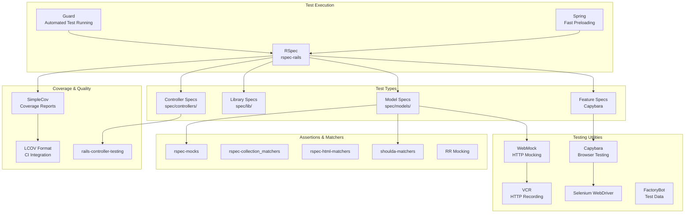

**Sources:** [Gemfile:131-177](), [Gemfile.lock:689-849]()

---

## RSpec Configuration

The main RSpec configuration is in `rails_helper.rb`, which sets up the test environment and integrates various testing tools:

### Environment and Dependencies

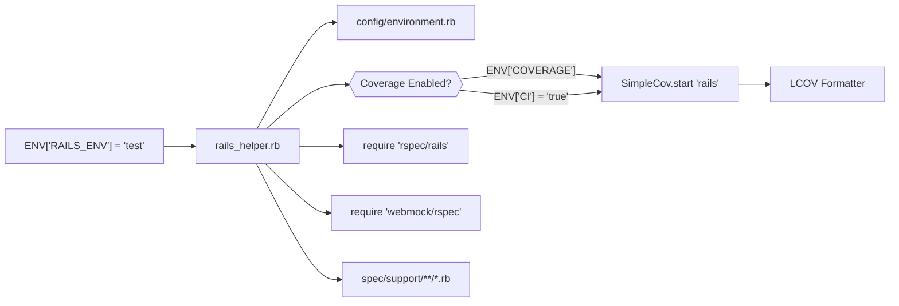

**Sources:** [spec/rails_helper.rb:1-28]()

### Core Configuration Options

| Configuration | Value | Purpose |
|--------------|-------|---------|
| `use_transactional_fixtures` | `true` | Wraps each test in a database transaction for isolation |
| `infer_spec_type_from_file_location!` | enabled | Automatically determines spec type from file path |
| `infer_base_class_for_anonymous_controllers` | `false` | Explicit controller base class required |
| `fixture_path` | `"#{Rails.root}/spec/fixtures"` | Location of test fixtures |
| `global_fixtures` | `:all` | All fixtures loaded for every test |
| `order` | `'random'` | Tests run in random order to detect dependencies |
| `render_views` | enabled | Controller specs render views |

**Sources:** [spec/rails_helper.rb:40-76]()

### Network Isolation

```ruby
WebMock.disable_net_connect!(allow_localhost: true)
```

This configuration prevents tests from making real HTTP requests, ensuring tests are isolated and fast. Only localhost connections are allowed (for Selenium tests).

**Sources:** [spec/rails_helper.rb:24]()

### Test Helper Modules

The configuration includes several helper modules for common testing patterns:

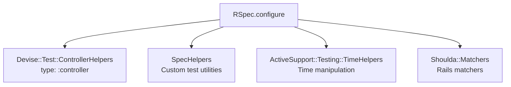

**Sources:** [spec/rails_helper.rb:33-38](), [spec/rails_helper.rb:79-82]()

---

## Test Organization

Tests are organized following Rails conventions with additional custom structure:

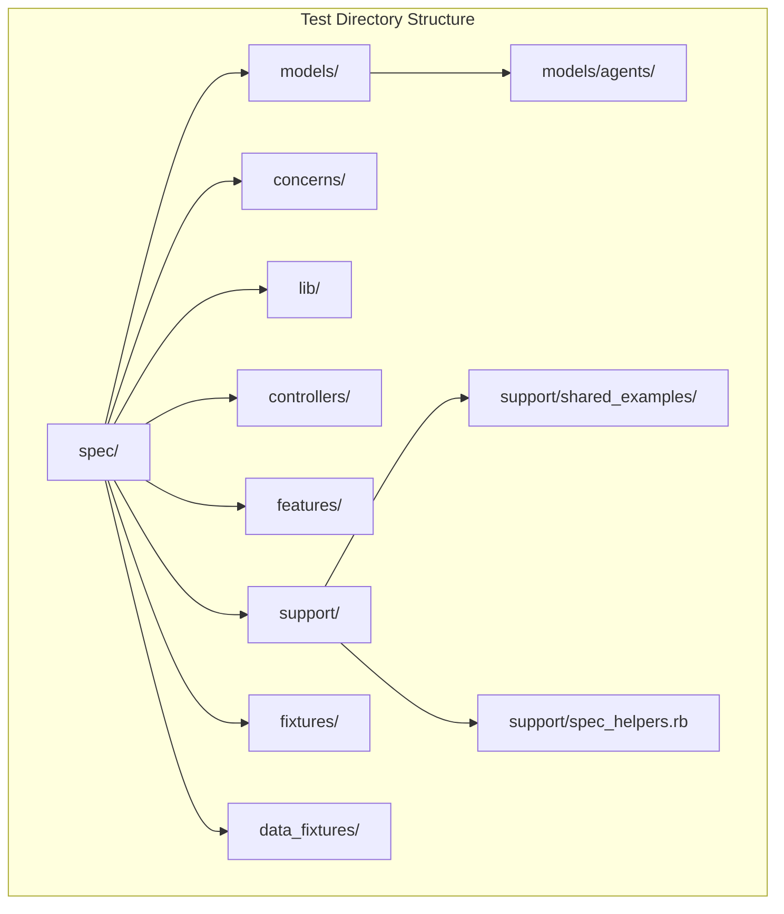

### Test File Naming Conventions

- Model specs: `spec/models/agent_spec.rb` for `app/models/agent.rb`
- Agent specs: `spec/models/agents/website_agent_spec.rb` for `app/models/agents/website_agent.rb`
- Concern specs: `spec/concerns/web_request_concern_spec.rb`
- Library specs: `spec/lib/utils_spec.rb` for `lib/utils.rb`
- Controller specs: `spec/controllers/agents_controller_spec.rb`

**Sources:** [spec/models/agents/website_agent_spec.rb:1-3](), [spec/lib/utils_spec.rb:1-2]()

---

## Shared Examples and Helpers

Huginn uses RSpec shared examples to test common behavior across multiple agent types:

### WebRequestConcern Shared Examples

The `WebRequestConcern` shared example tests HTTP request functionality used by many agents:

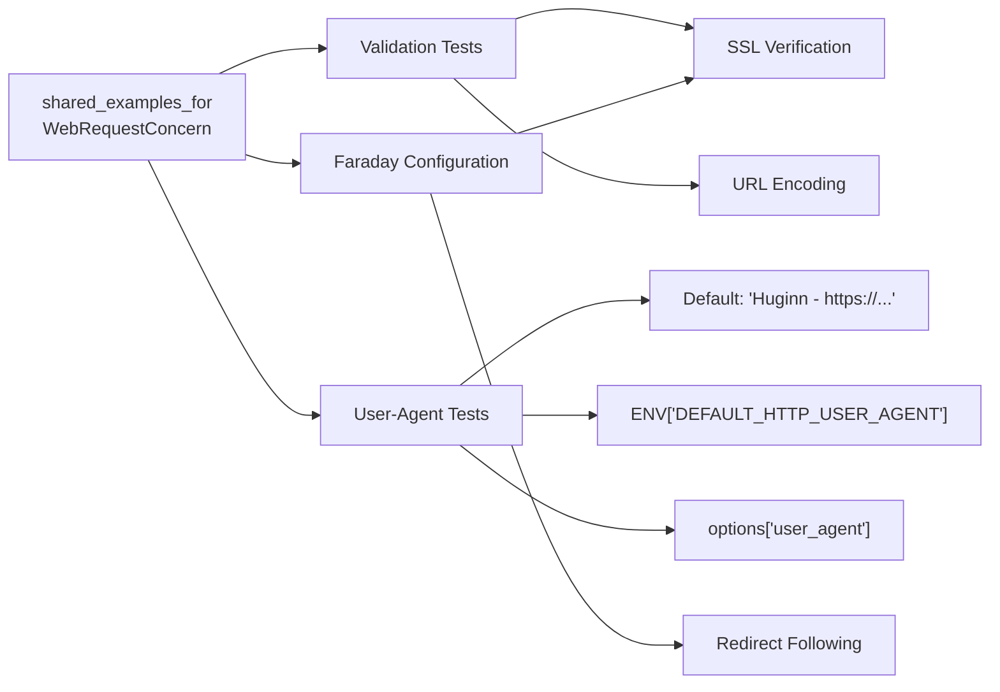

Usage in agent specs:

```ruby
it_behaves_like WebRequestConcern
```

**Sources:** [spec/support/shared_examples/web_request_concern.rb:1-189](), [spec/models/agents/website_agent_spec.rb:32]()

### Tested Validations

| Validation | Valid Values | Invalid Values |
|-----------|-------------|----------------|
| `user_agent` | `nil`, `""`, `"foo"` | `["foo"]`, `1` |
| `headers` | `""`, `{}`, `{'foo' => 'bar'}` | `"blah"` |
| `basic_auth` | `"foo:bar"`, `["foo", "bar"]`, `nil` | `"blah"`, `["blah"]` |
| `disable_ssl_verification` | `nil`, `true`, `false`, `"true"`, `"false"` | `"blah"`, `51` |

**Sources:** [spec/support/shared_examples/web_request_concern.rb:10-87]()

### DoNotEncoder Testing

Tests for the custom parameter encoder that preserves special characters in URLs:

```ruby
WebRequestConcern::DoNotEncoder.encode('GetRss?CategoryNr=39207' => 'test')
# => 'GetRss?CategoryNr=39207=test'
```

**Sources:** [spec/support/shared_examples/web_request_concern.rb:172-188]()

---

## HTTP Testing with WebMock

WebMock is used to stub HTTP requests in tests, preventing external network calls and ensuring deterministic test behavior:

### Basic HTTP Stubbing Pattern

```ruby
stub_request(:any, /xkcd/).to_return(
  body: File.read(Rails.root.join("spec/data_fixtures/xkcd.html")),
  status: 200,
  headers: {
    'X-Status-Message' => 'OK'
  }
)
```

**Sources:** [spec/models/agents/website_agent_spec.rb:6-10]()

### Common Stubbing Scenarios

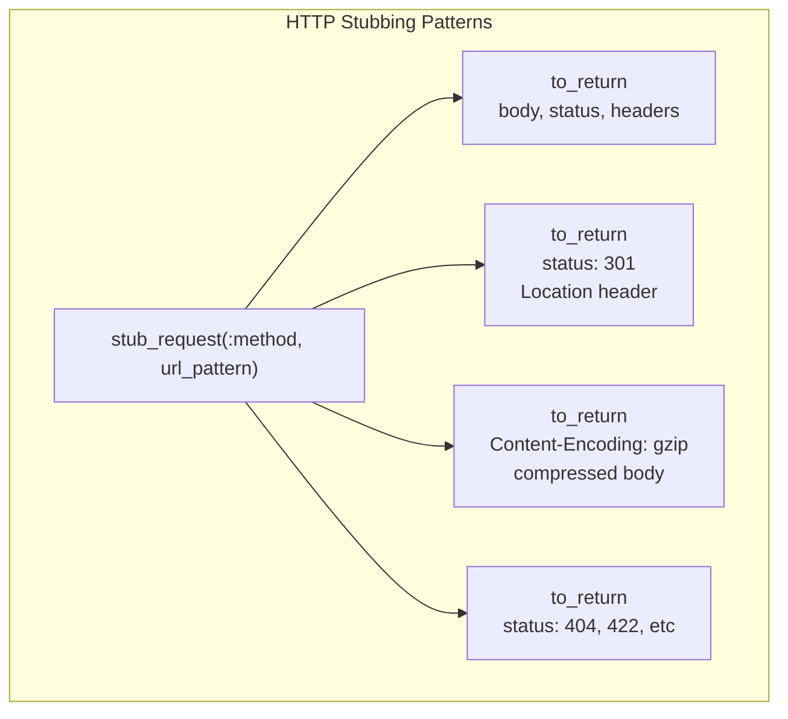

### Redirect Testing

```ruby
stub_request(:any, /xkcd\.com\/index$/).to_return(
  status: 301,
  headers: {
    'Location' => 'http://xkcd.com/'
  }
)
```

**Sources:** [spec/models/agents/website_agent_spec.rb:11-14]()

### Gzip Response Testing

```ruby
json = { 'response' => { 'version' => 2 } }
zipped = ActiveSupport::Gzip.compress(json.to_json)
stub_request(:any, /gzip/).to_return(
  body: zipped,
  headers: { 'Content-Encoding' => 'gzip' },
  status: 200
)
```

**Sources:** [spec/models/agents/website_agent_spec.rb:257-265]()

### VCR for Complex HTTP Scenarios

The `vcr` gem records and replays HTTP interactions for complex scenarios:

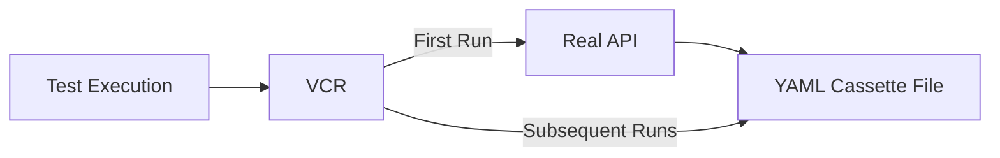

**Sources:** [Gemfile:174]()

---

## Agent Testing Patterns

### WebsiteAgent Test Structure

The WebsiteAgent spec demonstrates comprehensive testing patterns used throughout the codebase:

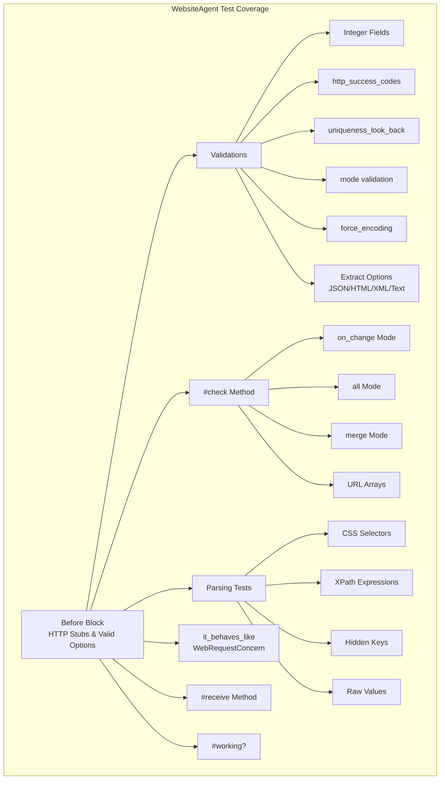

**Sources:** [spec/models/agents/website_agent_spec.rb:4-31]()

### Validation Testing Pattern

```ruby
describe "validations" do
  before do
    expect(@checker).to be_valid
  end

  it "should validate the integer fields" do
    @checker.options['expected_update_period_in_days'] = "2"
    expect(@checker).to be_valid

    @checker.options['expected_update_period_in_days'] = "nonsense"
    expect(@checker).not_to be_valid
  end
end
```

**Sources:** [spec/models/agents/website_agent_spec.rb:34-46]()

### Encoding Testing Strategy

The WebsiteAgent spec includes extensive encoding tests covering multiple scenarios:

| Scenario | Test Coverage |
|---------|--------------|
| JSON with no charset | Assumes UTF-8 |
| HTML with charset in header | Detects from Content-Type |
| HTML with charset in meta tag | Detects from `<meta charset>` |
| XML with charset in header | Detects from Content-Type |
| XML with encoding declaration | Detects from `<?xml encoding>` |
| XML with BOM | Detects from Byte Order Mark |
| `force_encoding` option | Overrides all detection |

**Sources:** [spec/models/agents/website_agent_spec.rb:346-636]()

---

## Utility Testing Examples

### Utils Spec Structure

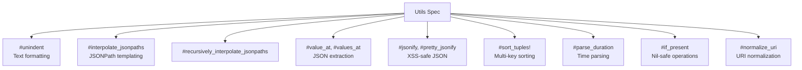

**Sources:** [spec/lib/utils_spec.rb:3-207]()

### JSONPath Testing Pattern

```ruby
it "interpolates jsonpath expressions between matching <>'s" do
  payload = { there: { world: "WORLD" }, works: "should work" }
  result = Utils.interpolate_jsonpaths(
    "hello <$.there.world> this <escape works>",
    payload
  )
  expect(result).to eq("hello WORLD this should+work")
end
```

**Sources:** [spec/lib/utils_spec.rb:30-35]()

### URI Normalization Testing

Tests ensure proper handling of internationalized domain names, malformed URIs, and special characters:

```ruby
uri = Utils.normalize_uri("http://\u{3042}/\u{3042}?a[]=%2F&b=\u{3042}#100%")
expect(uri.to_s).to eq "http://xn--l8j/%E3%81%82?a[]=%2F&b=%E3%81%82#100%25"
```

**Sources:** [spec/lib/utils_spec.rb:200-206]()

---

## Coverage Reporting

SimpleCov provides code coverage metrics for the test suite:

### Coverage Configuration

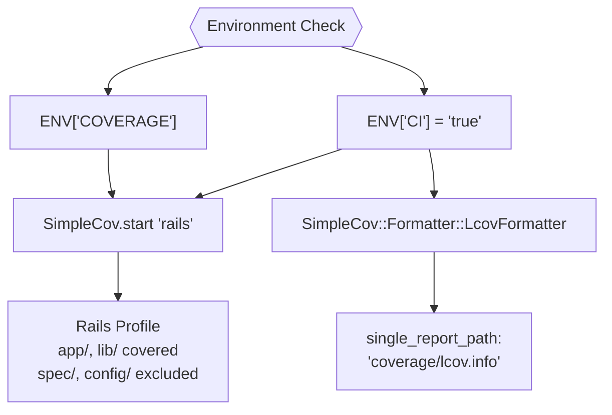

**Sources:** [spec/rails_helper.rb:3-16]()

### Coverage Output Formats

| Environment | Format | Output Location | Purpose |
|------------|--------|----------------|---------|
| Development | HTML | `coverage/index.html` | Local development review |
| CI (`ENV['CI']='true'`) | LCOV | `coverage/lcov.info` | Integration with CI services |

### Excluded Files

SimpleCov automatically excludes:
- `version.rb` - Version constant file
- `initializer.rb` - Application initializers
- `spec/` directory - Test files themselves
- `config/` directory - Configuration files

**Sources:** [spec/rails_helper.rb:15]()

---

## Running Tests

### Command Line Execution

| Command | Purpose |
|---------|---------|
| `bundle exec rspec` | Run all tests |
| `bundle exec rspec spec/models` | Run all model tests |
| `bundle exec rspec spec/models/agents/website_agent_spec.rb` | Run specific file |
| `bundle exec rspec spec/models/agents/website_agent_spec.rb:149` | Run specific line |
| `COVERAGE=true bundle exec rspec` | Run with coverage |
| `bundle exec rspec --tag focus` | Run only tests tagged with `:focus` |

### Guard for Automated Testing

Guard watches for file changes and automatically runs relevant tests:

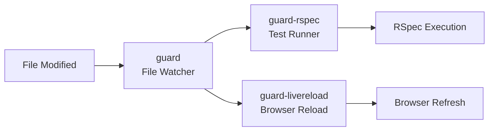

**Sources:** [Gemfile:139-141]()

### Spring for Fast Test Startup

Spring preloads the Rails application to speed up test execution:

```ruby
if_true(ENV['SPRING']) do
  gem 'spring'
  gem 'spring-commands-rspec'
  gem 'spring-watcher-listen'
end
```

Usage: `spring rspec spec/models/agent_spec.rb`

**Sources:** [Gemfile:154-158]()

---

## Writing New Tests

### Basic Test Structure

```ruby
require 'rails_helper'

describe Agents::MyNewAgent do
  before do
    @valid_options = {
      'expected_update_period_in_days' => '2',
      # ... agent-specific options
    }
    @agent = Agents::MyNewAgent.new(
      name: "My Agent",
      options: @valid_options
    )
    @agent.user = users(:bob)
    @agent.save!
  end
  
  it_behaves_like WebRequestConcern  # If agent makes HTTP requests
  
  describe "validations" do
    # Test option validations
  end
  
  describe "#check" do
    # Test scheduled execution
  end
  
  describe "#receive" do
    # Test event processing
  end
end
```

### Fixture Data Location

Test data files are stored in:
- `spec/fixtures/` - Rails fixtures (YAML)
- `spec/data_fixtures/` - Static test files (HTML, JSON, XML)

**Sources:** [spec/models/agents/website_agent_spec.rb:6](), [spec/data_fixtures/urlTest.html:1-19]()

### Time Manipulation in Tests

Use ActiveSupport::Testing::TimeHelpers for time-dependent tests:

```ruby
include ActiveSupport::Testing::TimeHelpers

it "checks time-dependent behavior" do
  travel(-2.seconds) do
    # Code executed as if time was 2 seconds ago
  end
end
```

**Sources:** [spec/rails_helper.rb:81](), [spec/models/agents/website_agent_spec.rb:150-151]()

### Database Transaction Behavior

Each test runs in a database transaction that is rolled back after the test completes, ensuring test isolation. This is controlled by:

```ruby
config.use_transactional_fixtures = true
```

To access data across transaction boundaries (rare), use `use_transactional_fixtures = false` for specific tests.

**Sources:** [spec/rails_helper.rb:49]()

---

## Test Execution Persistence

RSpec stores test execution history to track flaky tests and provide run statistics:

```ruby
config.example_status_persistence_file_path = './spec/examples.txt'
```

This file records which tests passed, failed, or are pending, enabling features like:
- `--only-failures` - Re-run only failed tests
- `--next-failure` - Run tests until the next failure

**Sources:** [spec/rails_helper.rb:77]()

---

