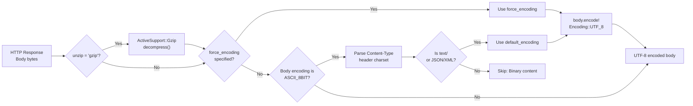
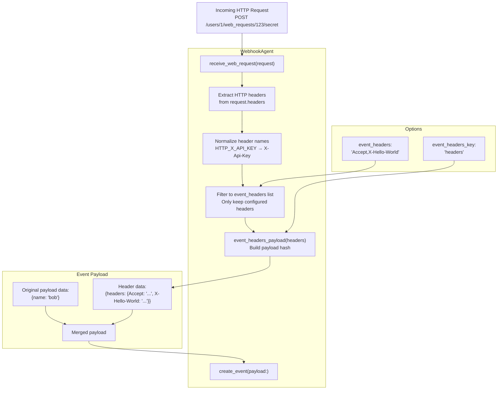
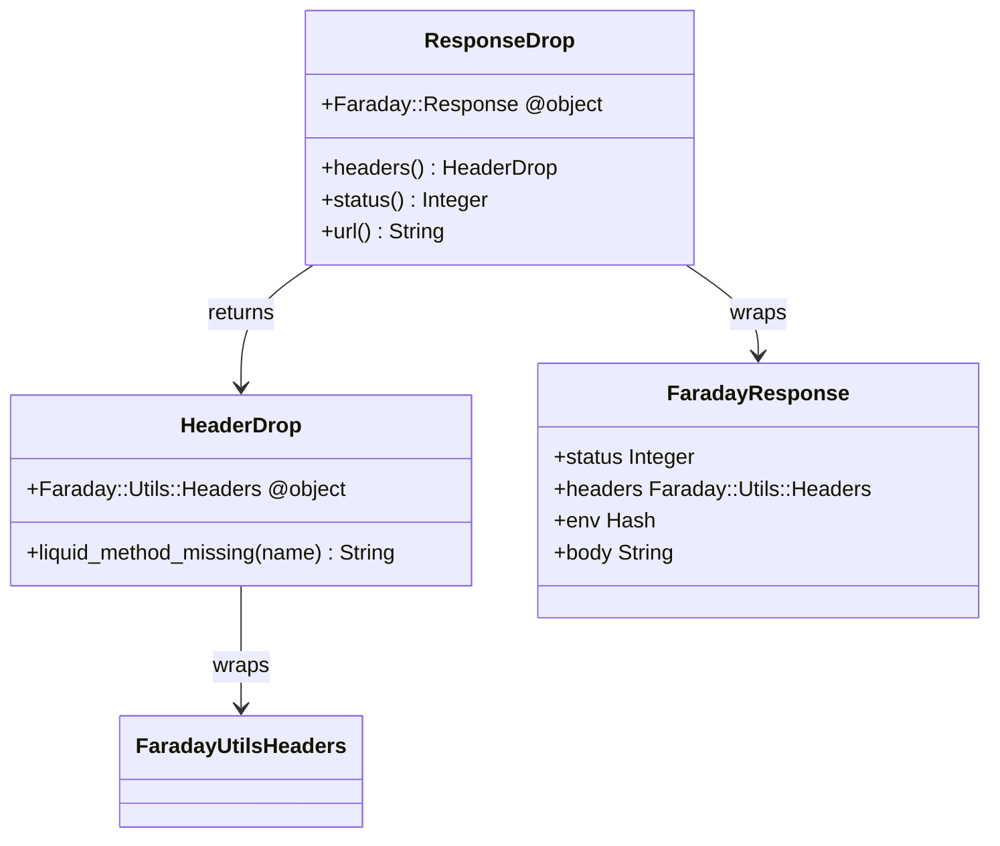
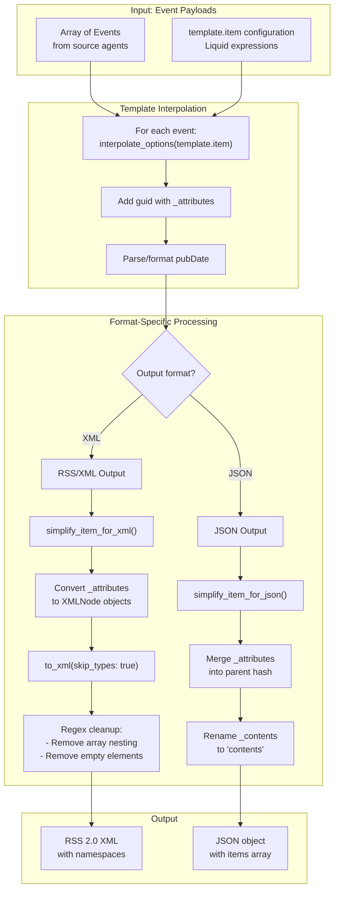
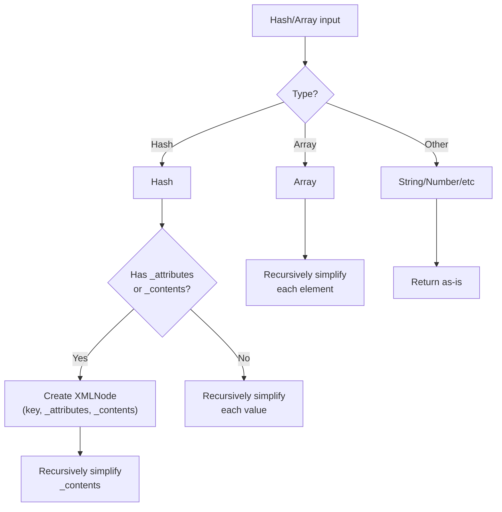
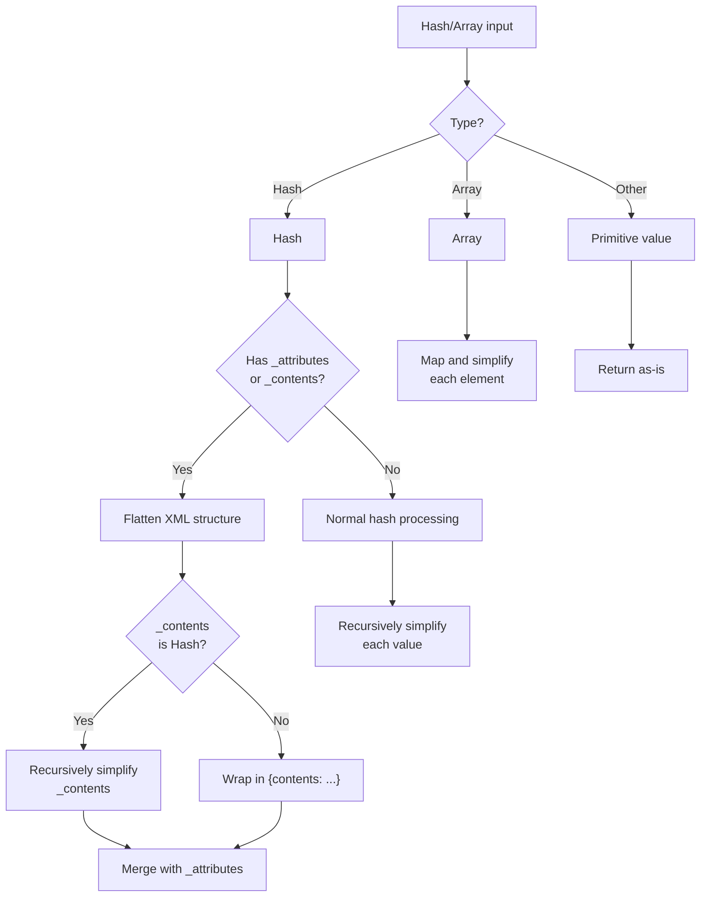

<!-- source: DeepWiki mcp.deepwiki.com · repo huginn/huginn · page 8 Advanced Topics · fetched 2026-10-29 -->

# Advanced Topics

<details>
<summary>Relevant source files</summary>

The following files were used as context for generating this wiki page:

- [app/concerns/web_request_concern.rb](app/concerns/web_request_concern.rb)
- [app/controllers/web_requests_controller.rb](app/controllers/web_requests_controller.rb)
- [app/models/agents/data_output_agent.rb](app/models/agents/data_output_agent.rb)
- [app/models/agents/webhook_agent.rb](app/models/agents/webhook_agent.rb)
- [app/models/agents/website_agent.rb](app/models/agents/website_agent.rb)
- [db/migrate/20160423163416_add_xml_namespace_option_to_data_output_agents.rb](db/migrate/20160423163416_add_xml_namespace_option_to_data_output_agents.rb)
- [db/migrate/20160607055850_change_events_order_to_events_list_order.rb](db/migrate/20160607055850_change_events_order_to_events_list_order.rb)
- [db/migrate/20170419073748_set_rss_content_type.rb](db/migrate/20170419073748_set_rss_content_type.rb)
- [lib/utils.rb](lib/utils.rb)
- [lib/utils/html_transformer.rb](lib/utils/html_transformer.rb)
- [spec/controllers/web_requests_controller_spec.rb](spec/controllers/web_requests_controller_spec.rb)
- [spec/data_fixtures/urlTest.html](spec/data_fixtures/urlTest.html)
- [spec/lib/utils_spec.rb](spec/lib/utils_spec.rb)
- [spec/models/agents/data_output_agent_spec.rb](spec/models/agents/data_output_agent_spec.rb)
- [spec/models/agents/webhook_agent_spec.rb](spec/models/agents/webhook_agent_spec.rb)
- [spec/models/agents/website_agent_spec.rb](spec/models/agents/website_agent_spec.rb)
- [spec/routing/webhooks_controller_spec.rb](spec/routing/webhooks_controller_spec.rb)
- [spec/support/shared_examples/web_request_concern.rb](spec/support/shared_examples/web_request_concern.rb)

</details>


This document covers advanced technical systems in Huginn for developers and power users who need to extend or deeply customize the platform. These topics focus on the internal mechanisms that power web request handling, HTTP header processing, and data transformation.

For general agent usage patterns, see [Agent Reference](#5). For basic Liquid templating, see [Liquid Templating System](#4). For development setup and contributing, see [Development Guide](#7).

## Overview

The advanced topics covered in this document include:

1. **WebRequestConcern** - The HTTP client infrastructure used by agents to make external requests, including Faraday configuration, SSL verification, authentication, character encoding, and custom parameter encoding.

2. **Event Headers and Response Processing** - How agents capture and normalize HTTP headers from incoming requests and responses, including the EventHeadersConcern module and ResponseDrop classes.

3. **XML and JSON Transformation** - The sophisticated data transformation system used by DataOutputAgent to convert event payloads into RSS/XML and JSON formats, including the XMLNode abstraction and simplification logic.

These systems form the foundation for any agent that interacts with external HTTP services or exposes data to external consumers.

---

## WebRequestConcern

WebRequestConcern is a shared module that provides HTTP client functionality to agents that need to make outbound web requests. It encapsulates Faraday configuration, SSL settings, authentication, encoding detection, and various HTTP client behaviors.

### Architecture

```mermaid
graph TB
    subgraph "Agents Using WebRequestConcern"
        WebsiteAgent["WebsiteAgent<br/>(scraping)"]
        PostAgent["PostAgent<br/>(HTTP POST)"]
        DataOutputAgent["DataOutputAgent<br/>(RSS feeds)"]
        WebhookAgent["WebhookAgent<br/>(reCAPTCHA)"]
    end
    
    subgraph "WebRequestConcern Module"
        ValidateOptions["validate_web_request_options!<br/>Validates configuration"]
        FaradayFactory["faraday()<br/>Returns configured client"]
        UserAgent["user_agent()<br/>Returns User-Agent string"]
        BasicAuth["basic_auth_credentials()<br/>Parses auth config"]
        Headers["headers()<br/>Returns header hash"]
        Encoding["default_encoding()<br/>Returns Encoding::UTF_8"]
    end
    
    subgraph "Faraday Configuration"
        SSLConfig["SSL Verification<br/>ssl.verify = !disable_ssl_verification"]
        MiddlewareStack["Middleware Stack"]
        CharEncoding["CharacterEncoding<br/>Custom middleware"]
        FollowRedirects["FollowRedirects<br/>faraday/follow_redirects"]
        Gzip["Request Gzip<br/>Compression"]
        MultipartJSON["Multipart + URL Encoded<br/>Request encoding"]
        Backend["HTTP Backend<br/>Typhoeus/NetHTTP/HTTPClient"]
    end
    
    subgraph "Options"
        UserAgentOpt["user_agent"]
        DisableSSL["disable_ssl_verification"]
        HeadersOpt["headers"]
        BasicAuthOpt["basic_auth"]
        ProxyOpt["proxy"]
        ForceEncodingOpt["force_encoding"]
        UnzipOpt["unzip"]
        DisableRedirect["disable_redirect_follow"]
        DisableURLEncode["disable_url_encoding"]
        BackendOpt["backend"]
    end
    
    WebsiteAgent --> FaradayFactory
    PostAgent --> FaradayFactory
    DataOutputAgent --> FaradayFactory
    WebhookAgent --> FaradayFactory
    
    FaradayFactory --> SSLConfig
    FaradayFactory --> MiddlewareStack
    
    MiddlewareStack --> CharEncoding
    MiddlewareStack --> FollowRedirects
    MiddlewareStack --> Gzip
    MiddlewareStack --> MultipartJSON
    MiddlewareStack --> Backend
    
    ValidateOptions --> UserAgentOpt
    ValidateOptions --> DisableSSL
    ValidateOptions --> HeadersOpt
    ValidateOptions --> BasicAuthOpt
    
    FaradayFactory --> UserAgent
    FaradayFactory --> BasicAuth
    FaradayFactory --> Headers
    FaradayFactory --> Encoding
    
    UserAgentOpt --> UserAgent
    DisableSSL --> SSLConfig
    HeadersOpt --> Headers
    BasicAuthOpt --> BasicAuth
    ProxyOpt --> FaradayFactory
    ForceEncodingOpt --> CharEncoding
    UnzipOpt --> CharEncoding
    DisableRedirect --> FollowRedirects
    DisableURLEncode --> FaradayFactory
    BackendOpt --> Backend
```



**Sources**: [app/concerns/web_request_concern.rb:1-206]()

### Core Components

#### Faraday Client Factory

The `faraday()` method constructs a configured Faraday HTTP client with a specific middleware stack:

| Middleware Layer | Purpose | Configuration |
|-----------------|---------|---------------|
| `:json` response parser | Parse JSON responses | Only if `parse_body?` returns true |
| `CharacterEncoding` | Handle character encoding detection | Uses `force_encoding`, `default_encoding`, `unzip` options |
| Custom headers | Add request headers | From `headers` option |
| User-Agent header | Set User-Agent | From `user_agent` option or ENV default |
| Proxy | Configure HTTP proxy | From `proxy` option |
| `:follow_redirects` | Follow HTTP redirects | Disabled if `disable_redirect_follow` is true |
| `:multipart` | Handle multipart form data | Always enabled |
| `:url_encoded` | Encode URL parameters | Uses `DoNotEncoder` if `disable_url_encoding` is true |
| `:authorization` | HTTP Basic Auth | Configured if `basic_auth` credentials provided |
| `:gzip` | Request gzip compression | Always enabled |
| Backend adapter | HTTP backend | Typhoeus (default), NetHTTP, HTTPClient, or EM-HTTP |

The timeout is set to `Delayed::Worker.max_run_time - 2` seconds to prevent job timeouts.

**Sources**: [app/concerns/web_request_concern.rb:115-167]()

#### CharacterEncoding Middleware

The `CharacterEncoding` class is a custom Faraday middleware that handles character encoding detection and conversion:



The middleware implements these encoding detection rules:

1. If `force_encoding` option is set, use it unconditionally
2. If response body is already not ASCII-8BIT, skip conversion
3. Extract charset from Content-Type header (e.g., `text/html; charset=UTF-8`)
4. For text, JSON, or XML content types with no charset, use `default_encoding` (UTF-8 by default)
5. For binary content types, skip conversion to preserve bytes
6. Convert detected encoding to UTF-8 with replacement characters for invalid bytes

**Sources**: [app/concerns/web_request_concern.rb:16-61]()

#### DoNotEncoder

The `DoNotEncoder` class provides custom URL parameter encoding that preserves special characters:

```ruby
# Standard Faraday encoding:
{ 'GetRss?CategoryNr=39207' => 'test' }
# => "GetRss%3FCategoryNr%3D39207=test"

# DoNotEncoder:
{ 'GetRss?CategoryNr=39207' => 'test' }
# => "GetRss?CategoryNr=39207=test"
```

This is useful when interacting with APIs that expect pre-encoded query strings or have unusual parameter formats.

**Sources**: [app/concerns/web_request_concern.rb:4-14](), [spec/support/shared_examples/web_request_concern.rb:172-188]()

### Configuration Options

#### User-Agent

User-Agent can be configured at three levels (in order of precedence):

1. Agent's `user_agent` option (per-agent)
2. `DEFAULT_HTTP_USER_AGENT` environment variable (global)
3. Default: `"Huginn - https://github.com/huginn/huginn"`

**Sources**: [app/concerns/web_request_concern.rb:196-203]()

#### SSL Verification

SSL certificate verification is enabled by default and can be disabled per-agent:

```ruby
# In agent options:
{
  "disable_ssl_verification" => true  # or "true" as string
}
```

This sets `faraday.ssl.verify` to `false`. Disabling SSL verification should only be used for testing or with self-signed certificates.

**Sources**: [app/concerns/web_request_concern.rb:116-119](), [spec/support/shared_examples/web_request_concern.rb:66-87]()

#### Basic Authentication

Basic auth credentials can be specified in two formats:

```ruby
# Format 1: Colon-separated string
{ "basic_auth" => "username:password" }

# Format 2: Array
{ "basic_auth" => ["username", "password"] }
```

The `basic_auth_credentials()` method parses both formats and configures Faraday's `:authorization` request middleware.

**Sources**: [app/concerns/web_request_concern.rb:173-183](), [spec/support/shared_examples/web_request_concern.rb:46-64]()

#### Headers

Custom HTTP headers are specified as a hash:

```ruby
{
  "headers" => {
    "X-API-Key" => "secret123",
    "Accept" => "application/vnd.api+json"
  }
}
```

Headers are applied to all requests made by the agent's Faraday client.

**Sources**: [app/concerns/web_request_concern.rb:169-171]()

#### Backend Selection

The HTTP backend adapter can be selected via the `backend` option or `FARADAY_HTTP_BACKEND` environment variable:

| Backend | Library | Use Case |
|---------|---------|----------|
| `typhoeus` | Typhoeus/libcurl | Default, high performance |
| `net_http` | Ruby stdlib Net::HTTP | No external dependencies |
| `httpclient` | HTTPClient gem | Advanced features |
| `em_http` | EM-HTTP-Request | EventMachine integration |

**Sources**: [app/concerns/web_request_concern.rb:185-194]()

### Validation

The `validate_web_request_options!` method validates all web request configuration:

| Option | Validation Rule |
|--------|----------------|
| `user_agent` | Must be a string (or absent) |
| `proxy` | Must be a string (or absent) |
| `disable_ssl_verification` | Must be boolean-like (or absent) |
| `headers` | Must be a hash (or absent) |
| `basic_auth` | Must be "user:pass" string or [user, pass] array |
| `force_encoding` | Must be a valid encoding name recognized by Ruby |

Invalid configurations add errors to the agent preventing it from being saved.

**Sources**: [app/concerns/web_request_concern.rb:67-102]()

### Usage Example in WebsiteAgent

WebsiteAgent demonstrates typical WebRequestConcern usage:

```ruby
# WebsiteAgent includes WebRequestConcern
include WebRequestConcern

# Calls validate_web_request_options! during validation
def validate_options
  # ... other validations
  validate_web_request_options!
end

# Uses faraday client to fetch URLs
def check_url(url, existing_payload = {})
  uri = Utils.normalize_uri(url)
  response = faraday.get(uri)  # Uses configured Faraday client
  
  # Access response properties
  status = response.status
  headers = response.headers
  body = response.body  # Already decoded per CharacterEncoding middleware
  
  handle_data(body, response.env[:url], existing_payload)
end
```

The agent can override `default_encoding()` to customize encoding behavior:

```ruby
def default_encoding
  case extraction_type
  when 'html', 'xml'
    # Let Nokogiri detect encoding from meta tags
    nil
  else
    super  # Use UTF-8
  end
end
```

**Sources**: [app/models/agents/website_agent.rb:6](), [app/models/agents/website_agent.rb:267](), [app/models/agents/website_agent.rb:410-428](), [app/models/agents/website_agent.rb:430-438]()

---

## Event Headers and Response Processing

Huginn provides sophisticated systems for capturing and processing HTTP headers from both incoming webhook requests and outgoing HTTP responses. These systems enable agents to access metadata about requests and enrich event payloads with header information.

### EventHeadersConcern

EventHeadersConcern is a module that allows agents to capture specific HTTP headers from incoming requests and include them in created events.



**Sources**: [app/models/agents/webhook_agent.rb:3](), [app/models/agents/webhook_agent.rb:59-119]()

#### Header Normalization

HTTP headers arrive in the Rack environment with the `HTTP_` prefix and underscores. The normalization process converts them to standard hyphenated format:

| Rack Environment Variable | Normalized Header Name |
|--------------------------|------------------------|
| `HTTP_ACCEPT` | `Accept` |
| `HTTP_CONTENT_TYPE` | `Content-Type` |
| `HTTP_X_API_KEY` | `X-Api-Key` |
| `HTTP_X_HELLO_WORLD` | `X-Hello-World` |

The normalization algorithm:
1. Strip `HTTP_` prefix
2. Replace underscores with hyphens
3. Capitalize each segment after split on hyphen

**Sources**: [app/models/agents/webhook_agent.rb:71-76]()

#### Configuration

EventHeadersConcern is configured with two options:

```ruby
{
  # Comma-separated list of headers to capture
  "event_headers" => "Accept,X-Api-Key,User-Agent",
  
  # Key name for headers in event payload (default: "headers")
  "event_headers_key" => "http_headers"
}
```

Headers not listed in `event_headers` are discarded. The comparison is case-insensitive.

**Sources**: [app/models/agents/webhook_agent.rb:27-28](), [app/models/agents/webhook_agent.rb:54]()

#### Usage Example

WebhookAgent demonstrates EventHeadersConcern usage:

```ruby
def receive_web_request(request)
  # Extract all headers from Rack environment
  headers = request.headers.each_with_object({}) { |(name, value), hash|
    case name
    when /\AHTTP_([A-Z0-9_]+)\z/
      # Normalize: HTTP_X_API_KEY -> X-Api-Key
      hash[$1.tr('_', '-').gsub(/[^-]+/, &:capitalize)] = value
    end
  }
  
  # Create event with headers merged into payload
  [payload_for(params)].flatten.each do |payload|
    create_event(payload: payload.merge(event_headers_payload(headers)))
  end
end
```

This produces events like:

```json
{
  "name": "bob",
  "age": 30,
  "headers": {
    "Accept": "application/json",
    "X-Api-Key": "secret123",
    "User-Agent": "Mozilla/5.0"
  }
}
```

**Sources**: [app/models/agents/webhook_agent.rb:71-76](), [app/models/agents/webhook_agent.rb:117-119]()

### Response Processing

Agents that make HTTP requests need to access response metadata like status codes, headers, and final URLs (after redirects). Huginn provides two "Drop" classes for Liquid templating with response data.

#### ResponseDrop

`ResponseDrop` wraps a Faraday response object for use in Liquid templates:



**Sources**: [app/models/agents/website_agent.rb:782-796](), [app/models/agents/website_agent.rb:823-827]()

The `ResponseDrop` class provides three methods for Liquid templates:

| Method | Returns | Description |
|--------|---------|-------------|
| `status` | Integer | HTTP status code (e.g., 200, 404) |
| `url` | String | Final URL after following redirects |
| `headers` | HeaderDrop | Response headers |

#### HeaderDrop

`HeaderDrop` wraps Faraday's header collection and provides case-insensitive, underscore-tolerant access:

```liquid
{{ _response_.headers.Content-Type }}
{{ _response_.headers.content_type }}
{{ _response_.headers.CONTENT_TYPE }}
```

All three expressions above return the same value. The `liquid_method_missing` method converts underscores to hyphens:

```ruby
def liquid_method_missing(name)
  @object[name.tr('_', '-')]
end
```

**Sources**: [app/models/agents/website_agent.rb:823-827]()

#### Usage in WebsiteAgent Templates

WebsiteAgent makes `_response_` available in the interpolation context during data extraction:

```ruby
def check_url(url, existing_payload = {})
  uri = Utils.normalize_uri(url)
  response = faraday.get(uri)
  
  interpolation_context.stack {
    interpolation_context['_url_'] = uri.to_s
    interpolation_context['_response_'] = ResponseDrop.new(response)
    handle_data(response.body, response.env[:url], existing_payload)
  }
end
```

This enables templates like:

```json
{
  "template": {
    "url": "{{ url | to_uri: _response_.url }}",
    "status": "{{ _response_.status }}",
    "content_type": "{{ _response_.headers.Content-Type }}",
    "last_modified": "{{ _response_.headers.Last-Modified | date: '%FT%T' }}"
  }
}
```

The `_response_.url` is particularly useful for resolving relative URLs extracted from HTML:

```liquid
{{ link_href | to_uri: _response_.url }}
```

This converts relative paths like `/products/123` to absolute URLs like `https://example.com/products/123`.

**Sources**: [app/models/agents/website_agent.rb:421-425](), [app/models/agents/website_agent.rb:186-197]()

#### ResponseFromEventDrop

For agents processing `data_from_event` instead of fetching URLs, `ResponseFromEventDrop` constructs a response-like object from event payload:

```ruby
class ResponseFromEventDrop < LiquidDroppable::Drop
  def headers
    headers = begin
      Faraday::Utils::Headers.from(@object.payload[:headers])
    rescue
      {}
    end
    HeaderDrop.new(headers)
  end
  
  def status
    Integer(@object.payload[:status])
  rescue
    nil
  end
  
  def url
    @object.payload[:url]
  end
end
```

This allows consistent `_response_` access whether data comes from HTTP or from events:

```ruby
def handle_event_data(data, event, existing_payload)
  interpolation_context.stack {
    interpolation_context['_response_'] = ResponseFromEventDrop.new(event)
    handle_data(data, event.payload['url'].presence, existing_payload)
  }
end
```

**Sources**: [app/models/agents/website_agent.rb:798-820](), [app/models/agents/website_agent.rb:516-523]()

### Response Status Code Handling

WebsiteAgent provides the `http_success_codes` option to treat non-200 status codes as successful:

```ruby
{
  "http_success_codes" => [404, 422]
}
```

The `consider_response_successful?` method checks both `response.success?` and the custom status codes:

```ruby
def consider_response_successful?(response)
  response.success? || begin
    consider_success = options["http_success_codes"]
    consider_success.present? && 
      (consider_success.include?(response.status.to_s) || 
       consider_success.include?(response.status))
  end
end
```

This enables scraping from error pages or APIs that use non-standard success codes.

**Sources**: [app/models/agents/website_agent.rb:509-514](), [app/models/agents/website_agent.rb:270-284]()

---

## XML and JSON Transformation

DataOutputAgent transforms event payloads into RSS/XML and JSON formats for external consumption. This system includes sophisticated support for XML attributes, nested structures, and format-specific simplification.

### Architecture Overview



**Sources**: [app/models/agents/data_output_agent.rb:256-326]()

### XMLNode Class

The `XMLNode` class represents an XML element with attributes and contents for use with ActiveSupport's XmlMini serializer:

```ruby
class XMLNode
  def initialize(tag_name, attributes, contents)
    @tag_name = tag_name
    @attributes = attributes
    @contents = contents
  end
  
  def to_xml(options)
    if @contents.is_a?(Hash)
      options[:builder].tag! @tag_name, @attributes do
        @contents.each { |key, value|
          ActiveSupport::XmlMini.to_tag(key, value, options.merge(skip_instruct: true))
        }
      end
    else
      options[:builder].tag! @tag_name, @attributes, @contents
    end
  end
end
```

This allows creating RSS elements like:

```xml
<enclosure url="http://example.com/audio.mp3" length="12345" type="audio/mpeg"/>
<guid isPermaLink="false">12345</guid>
```

**Sources**: [app/models/agents/data_output_agent.rb:341-359]()

### Template Structure

DataOutputAgent templates use a special `_attributes` and `_contents` structure to specify XML attributes:

```ruby
{
  "template" => {
    "item" => {
      # Simple element
      "title" => "{{ title }}",
      
      # Element with attributes only
      "enclosure" => {
        "_attributes" => {
          "url" => "{{ media_url }}",
          "length" => "12345",
          "type" => "audio/mpeg"
        }
      },
      
      # Element with attributes and text content
      "link" => {
        "_attributes" => {
          "rel" => "alternate"
        },
        "_contents" => "{{ url }}"
      },
      
      # Element with attributes and nested content
      "media:content" => {
        "_attributes" => {
          "url" => "{{ image_url }}",
          "type" => "image/jpeg"
        },
        "_contents" => {
          "media:title" => "{{ image_title }}"
        }
      }
    }
  }
}
```

**Sources**: [app/models/agents/data_output_agent.rb:35-50]()

### XML Simplification

The `simplify_item_for_xml()` method recursively converts the template structure into XMLNode objects:



**Sources**: [app/models/agents/data_output_agent.rb:361-380]()

The recursive algorithm:

1. If value is a Hash:
   - If it has `_attributes` or `_contents` keys → Create `XMLNode` with recursively simplified contents
   - Otherwise → Recursively simplify each value in the hash
2. If value is an Array → Recursively simplify each element
3. Otherwise → Return value as-is

Example transformation:

```ruby
# Input:
{
  "enclosure" => {
    "_attributes" => { "url" => "http://example.com/audio.mp3", "type" => "audio/mpeg" },
    "_contents" => nil
  }
}

# After simplify_item_for_xml:
{
  "enclosure" => XMLNode.new("enclosure", 
                             { "url" => "http://example.com/audio.mp3", "type" => "audio/mpeg" },
                             nil)
}

# After to_xml:
"<enclosure url=\"http://example.com/audio.mp3\" type=\"audio/mpeg\"/>"
```

**Sources**: [app/models/agents/data_output_agent.rb:361-380]()

### items_to_xml Processing

After simplification, the `items_to_xml()` method converts the structure to XML and applies cleanup:

```ruby
def items_to_xml(items)
  simplify_item_for_xml(items)
    .to_xml(skip_types: true, root: "items", skip_instruct: true, indent: 1)
    .gsub(/REGEX1/, '') { ... }  # Delete redundant array nesting
    .gsub(/REGEX2/, '')          # Delete empty elements
    .gsub(/^<\/?items>\n/, '')   # Remove <items> wrapper
end
```

The regex cleanup removes artifacts from ActiveSupport's XML serialization:

**Cleanup 1: Remove redundant array element nesting**

When arrays are serialized, XmlMini creates duplicate parent tags:

```xml
<category>
  <category>Category 1</category>
  <category>Category 2</category>
</category>
```

The regex collapses this to:

```xml
<category>Category 1</category>
<category>Category 2</category>
```

**Cleanup 2: Remove empty elements**

Empty XMLNode objects generate self-closing tags that should be omitted:

```xml
<enclosure/>
```

These are removed entirely.

**Sources**: [app/models/agents/data_output_agent.rb:411-425]()

### JSON Simplification

The `simplify_item_for_json()` method flattens the XML-oriented structure for JSON output:



**Sources**: [app/models/agents/data_output_agent.rb:382-409]()

The JSON simplification merges `_attributes` into the parent object and renames `_contents` to `contents` for non-hash content:

```ruby
# Input (XML-oriented structure):
{
  "guid" => {
    "_attributes" => { "isPermaLink" => "false" },
    "_contents" => "12345"
  },
  "enclosure" => {
    "_attributes" => {
      "url" => "http://example.com/audio.mp3",
      "type" => "audio/mpeg"
    }
  }
}

# Output (flattened for JSON):
{
  "guid" => {
    "isPermaLink" => "false",
    "contents" => "12345"
  },
  "enclosure" => {
    "url" => "http://example.com/audio.mp3",
    "type" => "audio/mpeg"
  }
}
```

**Sources**: [app/models/agents/data_output_agent.rb:382-409]()

### RSS/XML Output

The complete RSS feed generation combines channel metadata with transformed items:

```ruby
def receive_web_request(params, method, format)
  source_events = sort_events(latest_events, 'events_list_order')
  
  interpolate_with('events' => source_events) do
    items = source_events.map do |event|
      interpolated = interpolate_options(options['template']['item'], event)
      interpolated['guid'] = {
        '_attributes' => { 'isPermaLink' => 'false' },
        '_contents' => interpolated['guid'].presence || event.id
      }
      # ... format pubDate ...
      interpolated
    end
    
    items = items_to_xml(items)
    
    return [<<~XML, 200, rss_content_type]
      <?xml version="1.0" encoding="UTF-8" ?>
      <rss version="2.0" #{xml_namespace}>
      <channel>
       <title>#{feed_title}</title>
       <description>#{feed_description}</description>
       <link>#{feed_link}</link>
       <!-- ... hub links ... -->
      #{items}
      </channel>
      </rss>
    XML
  end
end
```

The XML namespace string is built from enabled namespace options:

```ruby
def xml_namespace
  namespaces = ['xmlns:atom="http://www.w3.org/2005/Atom"']
  
  if boolify(interpolated['ns_dc'])
    namespaces << 'xmlns:dc="http://purl.org/dc/elements/1.1/"'
  end
  if boolify(interpolated['ns_media'])
    namespaces << 'xmlns:media="http://search.yahoo.com/mrss/"'
  end
  if boolify(interpolated['ns_itunes'])
    namespaces << 'xmlns:itunes="http://www.itunes.com/dtds/podcast-1.0.dtd"'
  end
  
  namespaces.join(' ')
end
```

This enables RSS extensions like Dublin Core metadata, Yahoo Media RSS, and iTunes podcast tags.

**Sources**: [app/models/agents/data_output_agent.rb:256-326](), [app/models/agents/data_output_agent.rb:183-196]()

### JSON Output

JSON output is much simpler since no XML-specific transformations are needed:

```ruby
if format =~ /json/
  content = {
    'title' => feed_title,
    'description' => feed_description,
    'pubDate' => now,
    'items' => simplify_item_for_json(items)
  }
  
  return [content, 200, "application/json", interpolated['response_headers'].presence]
end
```

The simplified JSON structure is more compact and natural for JSON consumers:

```json
{
  "title": "My Feed",
  "description": "Recent items",
  "pubDate": "2024-01-15T10:30:00Z",
  "items": [
    {
      "title": "Item 1",
      "link": "http://example.com/1",
      "guid": {
        "isPermaLink": "false",
        "contents": "123"
      },
      "enclosure": {
        "url": "http://example.com/audio.mp3",
        "type": "audio/mpeg"
      }
    }
  ]
}
```

**Sources**: [app/models/agents/data_output_agent.rb:288-296]()

### PubSubHubbub Integration

DataOutputAgent can push feed updates to PubSubHubbub hubs:

```ruby
def receive(incoming_events)
  url = feed_url(secret: interpolated['secrets'].first, format: :xml)
  
  # Reload new events and update cache
  latest_events(true)
  
  push_hubs.each do |hub|
    push_to_hub(hub, url)
  end
end

def push_to_hub(hub, url)
  hub_uri = URI.parse(hub)
  
  faraday.post hub_uri, {
    'hub.mode' => 'publish',
    'hub.url' => url
  }
end
```

The `push_hubs` option accepts an array of hub URLs like:
- `https://pubsubhubbub.superfeedr.com/`
- `https://pubsubhubbub.appspot.com/`

When an event is received, the agent POSTs a publish notification to each hub with the feed URL. Subscribers to these hubs receive near-instant notifications of feed updates.

**Sources**: [app/models/agents/data_output_agent.rb:328-337](), [app/models/agents/data_output_agent.rb:427-452]()

---

