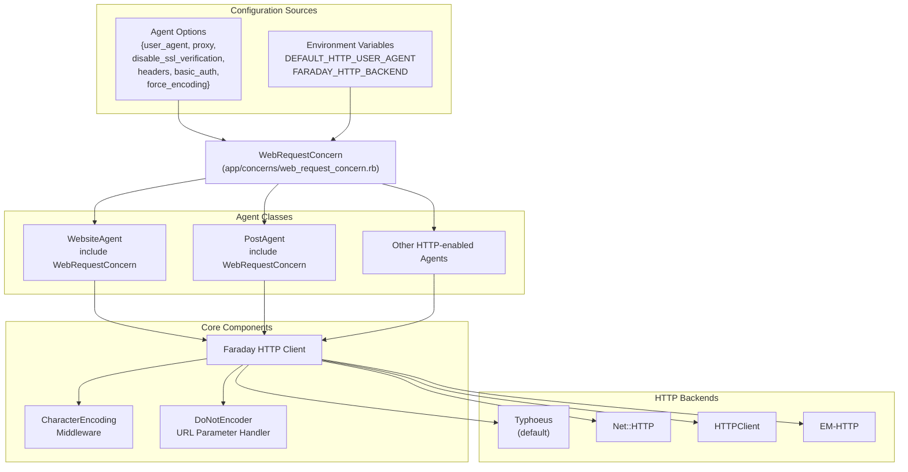
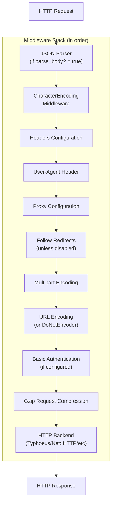
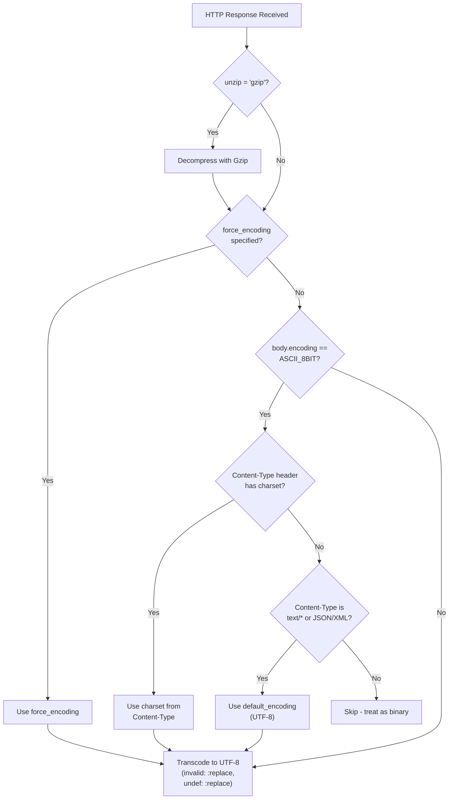
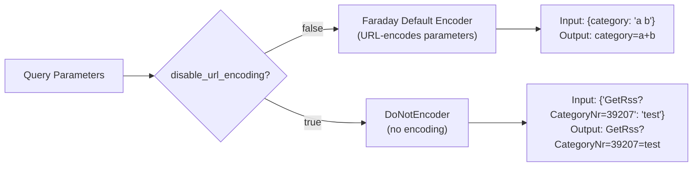
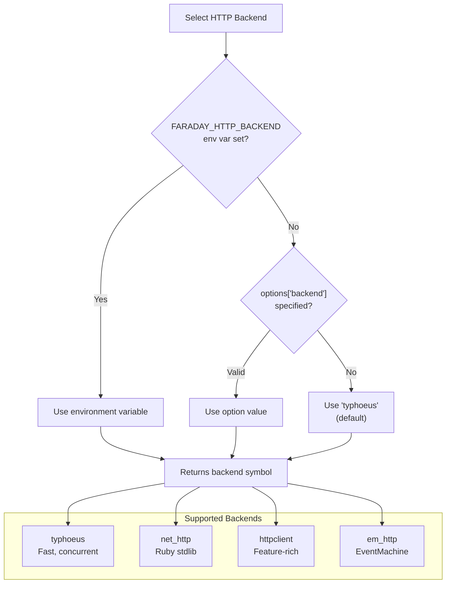
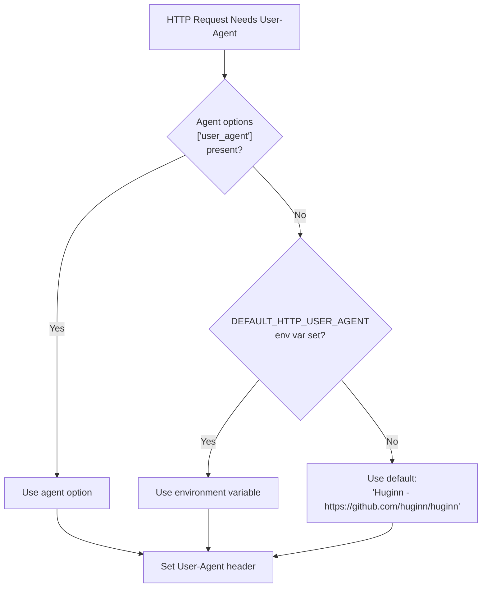

<!-- source: DeepWiki mcp.deepwiki.com · repo huginn/huginn · page 8.1 WebRequestConcern · fetched 2026-10-29 -->

# WebRequestConcern

<details>
<summary>Relevant source files</summary>

The following files were used as context for generating this wiki page:

- [app/concerns/event_headers_concern.rb](app/concerns/event_headers_concern.rb)
- [app/concerns/web_request_concern.rb](app/concerns/web_request_concern.rb)
- [app/models/agents/post_agent.rb](app/models/agents/post_agent.rb)
- [app/models/agents/website_agent.rb](app/models/agents/website_agent.rb)
- [db/migrate/20160405072512_post_agent_set_event_header_style.rb](db/migrate/20160405072512_post_agent_set_event_header_style.rb)
- [lib/utils.rb](lib/utils.rb)
- [lib/utils/html_transformer.rb](lib/utils/html_transformer.rb)
- [spec/data_fixtures/urlTest.html](spec/data_fixtures/urlTest.html)
- [spec/lib/utils_spec.rb](spec/lib/utils_spec.rb)
- [spec/models/agents/post_agent_spec.rb](spec/models/agents/post_agent_spec.rb)
- [spec/models/agents/website_agent_spec.rb](spec/models/agents/website_agent_spec.rb)
- [spec/support/shared_examples/web_request_concern.rb](spec/support/shared_examples/web_request_concern.rb)

</details>


## Purpose and Scope

WebRequestConcern is a Ruby module that provides HTTP request handling capabilities to Huginn agents. It encapsulates Faraday HTTP client configuration, including SSL settings, authentication, encoding, compression, and various HTTP-specific features. This module is included by agents that need to make outbound HTTP requests, such as WebsiteAgent and PostAgent.

For information about how agents use this concern to scrape websites, see [WebsiteAgent](#5.1). For information about how agents use this to send HTTP requests, see [PostAgent](#5.3).

## Architecture Overview

WebRequestConcern integrates into the agent system as a reusable concern that configures Faraday HTTP clients with a consistent set of features across all agents.

**Diagram: WebRequestConcern Integration**



**Sources:** [app/concerns/web_request_concern.rb:1-206](), [app/models/agents/website_agent.rb:6](), [app/models/agents/post_agent.rb:4]()

## Configuration Options

WebRequestConcern supports a comprehensive set of configuration options through agent options. These are validated by the `validate_web_request_options!` method.

| Option | Type | Description | Default | Validation |
|--------|------|-------------|---------|------------|
| `user_agent` | String | Custom User-Agent header | `"Huginn - https://github.com/huginn/huginn"` | Must be a string |
| `proxy` | String | HTTP proxy URL | None | Must be a string |
| `disable_ssl_verification` | Boolean/String | Disable SSL certificate verification | `false` | Must be boolean or `"true"`/`"false"` |
| `headers` | Hash | Additional HTTP headers | `{}` | Must be a hash |
| `basic_auth` | String/Array | HTTP Basic Authentication | None | `"username:password"` or `["username", "password"]` |
| `force_encoding` | String | Force character encoding | None | Must be valid encoding name |
| `disable_url_encoding` | Boolean | Disable automatic URL encoding | `false` | Must be boolean |
| `disable_redirect_follow` | Boolean | Disable automatic redirect following | `false` | Must be boolean |
| `backend` | String | HTTP backend library | `"typhoeus"` | Must be one of: `typhoeus`, `net_http`, `httpclient`, `em_http` |
| `unzip` | String | Decompress response | None | Set to `"gzip"` to decompress |

**Sources:** [app/concerns/web_request_concern.rb:67-102](), [app/concerns/web_request_concern.rb:115-167]()

## Faraday Connection Builder

The `faraday` method constructs a memoized Faraday HTTP client with a specific middleware stack. This is the core method that agents use to make HTTP requests.

**Diagram: Faraday Middleware Stack**



**Sources:** [app/concerns/web_request_concern.rb:115-167]()

### Key Middleware Configuration

**1. SSL Verification**

```ruby
faraday_options = {
  ssl: {
    verify: !boolify(options['disable_ssl_verification'])
  }
}
```

SSL verification is enabled by default and can be disabled by setting `disable_ssl_verification` to `true`.

**Sources:** [app/concerns/web_request_concern.rb:116-120]()

**2. Timeout Configuration**

```ruby
builder.options.timeout = (Delayed::Worker.max_run_time.seconds - 2).to_i
```

Request timeout is automatically set to 2 seconds less than the worker timeout to prevent job timeout issues.

**Sources:** [app/concerns/web_request_concern.rb:150]()

**3. Redirect Following**

```ruby
unless boolify(interpolated['disable_redirect_follow'])
  require 'faraday/follow_redirects'
  builder.response :follow_redirects
end
```

Automatic redirect following is enabled by default using the `faraday-follow_redirects` gem.

**Sources:** [app/concerns/web_request_concern.rb:138-141]()

## Character Encoding System

The `CharacterEncoding` middleware handles character encoding detection and conversion for HTTP responses. This is critical for properly processing non-ASCII content.

**Diagram: Encoding Detection Flow**



**Sources:** [app/concerns/web_request_concern.rb:16-61]()

### Encoding Priority

The encoding is determined in the following priority order:

1. **`force_encoding` option** - Explicitly specified encoding overrides all detection
2. **Content-Type header charset** - e.g., `Content-Type: text/html; charset=iso-8859-1`
3. **Default encoding** - From `default_encoding` method (typically UTF-8)
4. **Binary content** - If Content-Type is not text/JSON/XML, skip encoding conversion

**Code Reference:**

[app/concerns/web_request_concern.rb:36-57]() contains the encoding detection logic:

```ruby
case
when @force_encoding
  encoding = @force_encoding
when body.encoding == Encoding::ASCII_8BIT
  case env[:response_headers][:content_type]
  when /;\s*charset\s*=\s*([^()<>@,;:\\"\/\[\]?={}\s]+)/i
    encoding = begin
      Encoding.find($1)
    rescue StandardError
      @default_encoding
    end
  when /\A\s*(?:text\/[^\s;]+|application\/(?:[^\s;]+\+)?(?:xml|json))\s*(?:;|\z)/i
    encoding = @default_encoding
  else
    # Never try to transcode a binary content
    next
  end
  next if encoding.nil?
end
body.encode!(Encoding::UTF_8, encoding, invalid: :replace, undef: :replace)
```

**Sources:** [app/concerns/web_request_concern.rb:16-61](), [app/concerns/web_request_concern.rb:104-109]()

### Gzip Decompression

The middleware also handles gzip decompression in two scenarios:

1. **Automatic**: When response has `Content-Encoding: gzip` header
2. **Manual**: When agent option `unzip` is set to `"gzip"`

[app/concerns/web_request_concern.rb:28-34]():

```ruby
if @unzip == 'gzip'
  begin
    body.replace(ActiveSupport::Gzip.decompress(body))
  rescue Zlib::GzipFile::Error => e
    log e.message
  end
end
```

**Sources:** [app/concerns/web_request_concern.rb:28-34](), [app/concerns/web_request_concern.rb:127-130]()

## Authentication

### Basic Authentication

The `basic_auth_credentials` method parses basic authentication credentials from three formats:

**Supported Formats:**

| Format | Example | Description |
|--------|---------|-------------|
| String with colon | `"username:password"` | Colon-separated credentials |
| Array | `["username", "password"]` | Two-element array |
| Empty/nil | `""` or `nil` | No authentication |

**Code Reference:**

[app/concerns/web_request_concern.rb:173-183]():

```ruby
def basic_auth_credentials(value = interpolated['basic_auth'])
  case value
  when nil, ''
    return nil
  when Array
    return value if value.size == 2
  when /:/
    return value.split(/:/, 2)
  end
  raise ArgumentError.new("bad value for basic_auth: #{value.inspect}")
end
```

The credentials are then applied to the Faraday connection:

[app/concerns/web_request_concern.rb:152-154]():

```ruby
if userinfo = basic_auth_credentials
  builder.request :authorization, :basic, *userinfo
end
```

**Sources:** [app/concerns/web_request_concern.rb:173-183](), [app/concerns/web_request_concern.rb:152-154]()

## DoNotEncoder - Custom URL Encoding

The `DoNotEncoder` class provides an alternative to Faraday's default URL parameter encoding, allowing parameters to pass through without encoding. This is useful for APIs that require pre-encoded parameters or special query string formats.

**Diagram: URL Encoding Behavior**



**Sources:** [app/concerns/web_request_concern.rb:4-14](), [app/concerns/web_request_concern.rb:146-148]()

### DoNotEncoder Implementation

[app/concerns/web_request_concern.rb:4-14]():

```ruby
module DoNotEncoder
  def self.encode(params)
    params.map do |key, value|
      value.nil? ? "#{key}" : "#{key}=#{value}"
    end.join('&')
  end

  def self.decode(val)
    [val]
  end
end
```

**Usage:**

When `disable_url_encoding` is set to true:

[app/concerns/web_request_concern.rb:146-148]():

```ruby
if boolify(interpolated['disable_url_encoding'])
  builder.options.params_encoder = DoNotEncoder
end
```

**Sources:** [app/concerns/web_request_concern.rb:4-14](), [spec/support/shared_examples/web_request_concern.rb:172-188]()

## Backend Selection

WebRequestConcern supports multiple HTTP backend libraries through Faraday's adapter system. The backend is selected via the `faraday_backend` method.

**Diagram: Backend Selection Logic**



**Sources:** [app/concerns/web_request_concern.rb:185-194]()

### Backend Configuration

[app/concerns/web_request_concern.rb:185-194]():

```ruby
def faraday_backend
  ENV.fetch('FARADAY_HTTP_BACKEND') {
    case interpolated['backend']
    in 'typhoeus' | 'net_http' | 'httpclient' | 'em_http' => backend
      backend
    else
      'typhoeus'
    end
  }.to_sym
end
```

### Backend-Specific Configuration

Typhoeus requires special configuration to disable automatic encoding handling:

[app/concerns/web_request_concern.rb:158-165]():

```ruby
case backend = faraday_backend
when :typhoeus
  require "faraday/#{backend}"
  builder.adapter backend, accept_encoding: nil
when :httpclient, :em_http
  require "faraday/#{backend}"
  builder.adapter backend
end
```

**Sources:** [app/concerns/web_request_concern.rb:158-165](), [app/concerns/web_request_concern.rb:185-194]()

## User-Agent Configuration

User-Agent headers can be configured at three levels with the following precedence:

**Diagram: User-Agent Precedence**



**Sources:** [app/concerns/web_request_concern.rb:196-204]()

### User-Agent Methods

[app/concerns/web_request_concern.rb:196-198]():

```ruby
def user_agent
  interpolated['user_agent'].presence || self.class.default_user_agent
end
```

[app/concerns/web_request_concern.rb:200-204]():

```ruby
module ClassMethods
  def default_user_agent
    ENV.fetch('DEFAULT_HTTP_USER_AGENT', "Huginn - https://github.com/huginn/huginn")
  end
end
```

**Sources:** [app/concerns/web_request_concern.rb:196-204](), [app/concerns/web_request_concern.rb:134]()

## Validation System

The `validate_web_request_options!` method validates all configuration options when an agent is saved. This ensures that invalid configurations are caught early.

**Validation Rules:**

| Option | Validation Rule |
|--------|----------------|
| `user_agent` | Must be a string (if present) |
| `proxy` | Must be a string (if present) |
| `disable_ssl_verification` | Must be boolean or `"true"`/`"false"` (if present) |
| `headers` | Must be a hash (if present) |
| `basic_auth` | Must be `"user:pass"` or `["user", "pass"]` format |
| `force_encoding` | Must be a valid encoding name recognized by Ruby |

**Code Reference:**

[app/concerns/web_request_concern.rb:67-102]() implements the validation logic:

```ruby
def validate_web_request_options!
  if options['user_agent'].present?
    errors.add(:base, "user_agent must be a string") unless options['user_agent'].is_a?(String)
  end

  if options['proxy'].present?
    errors.add(:base, "proxy must be a string") unless options['proxy'].is_a?(String)
  end

  if options['disable_ssl_verification'].present? && boolify(options['disable_ssl_verification']).nil?
    errors.add(:base, "if provided, disable_ssl_verification must be true or false")
  end

  unless headers(options['headers']).is_a?(Hash)
    errors.add(:base, "if provided, headers must be a hash")
  end

  begin
    basic_auth_credentials(options['basic_auth'])
  rescue ArgumentError => e
    errors.add(:base, e.message)
  end

  if (encoding = options['force_encoding']).present?
    case encoding
    when String
      begin
        Encoding.find(encoding)
      rescue ArgumentError
        errors.add(:base, "Unknown encoding: #{encoding.inspect}")
      end
    else
      errors.add(:base, "force_encoding must be a string")
    end
  end
end
```

**Sources:** [app/concerns/web_request_concern.rb:67-102]()

## Usage Patterns

### Including the Concern

Agents include WebRequestConcern to gain HTTP capabilities:

```ruby
module Agents
  class WebsiteAgent < Agent
    include WebRequestConcern
    # ...
  end
end
```

**Sources:** [app/models/agents/website_agent.rb:6](), [app/models/agents/post_agent.rb:4]()

### Calling Validation

Agents call `validate_web_request_options!` in their `validate_options` method:

```ruby
def validate_options
  # ... other validations ...
  validate_web_request_options!
end
```

**Sources:** [app/models/agents/website_agent.rb:267](), [app/models/agents/post_agent.rb:155]()

### Making HTTP Requests

Agents use the `faraday` method to make HTTP requests:

**GET Request Example:**

[app/models/agents/website_agent.rb:417]():

```ruby
response = faraday.get(uri)
```

**POST Request Example:**

[app/models/agents/post_agent.rb:216-218]():

```ruby
response = faraday.run_request(method.to_sym, url, body, headers) { |request|
  request.params.update(params) if params
}
```

**Sources:** [app/models/agents/website_agent.rb:417](), [app/models/agents/post_agent.rb:216-218]()

## Testing

WebRequestConcern provides shared examples for testing agents that include it:

[spec/support/shared_examples/web_request_concern.rb:3]():

```ruby
shared_examples_for WebRequestConcern do
  # Test validations, User-Agent, SSL, URL encoding, etc.
end
```

Agents use this in their specs:

[spec/models/agents/website_agent_spec.rb:32]():

```ruby
it_behaves_like WebRequestConcern
```

**Test Coverage Includes:**

- Validation of all configuration options
- SSL verification behavior
- User-Agent precedence
- Basic authentication parsing
- URL encoding/DoNotEncoder behavior
- Redirect following
- Backend configuration

**Sources:** [spec/support/shared_examples/web_request_concern.rb:1-190](), [spec/models/agents/website_agent_spec.rb:32](), [spec/models/agents/post_agent_spec.rb:70]()

---

