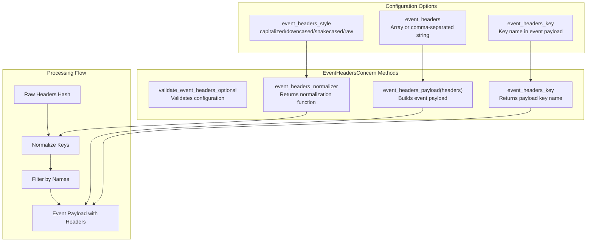
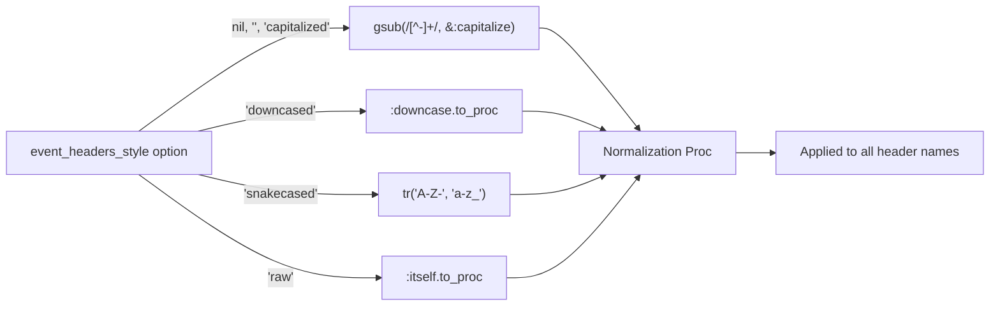
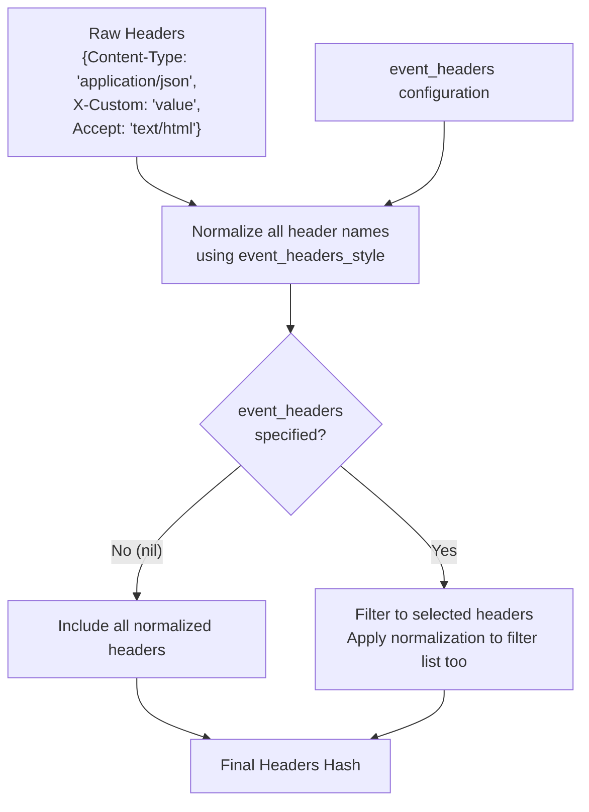
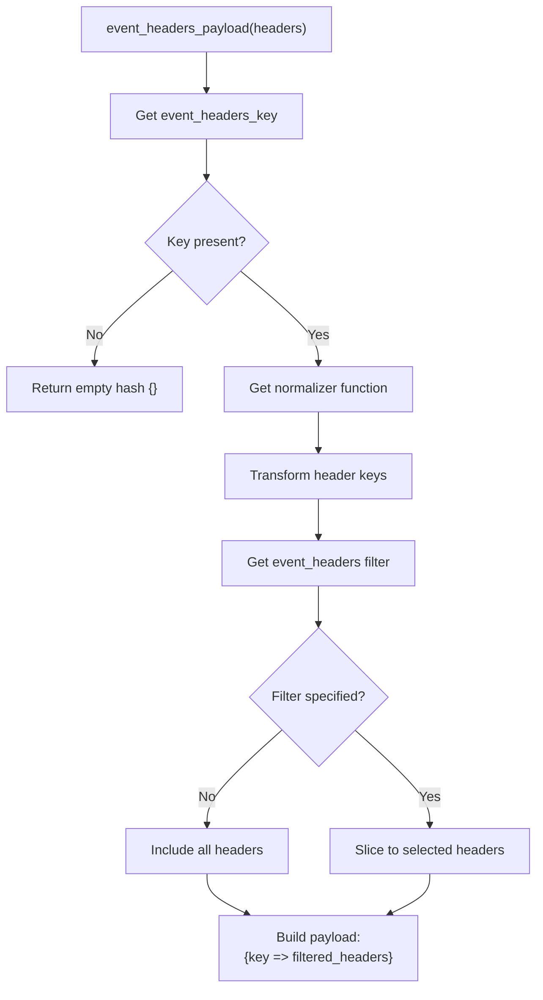
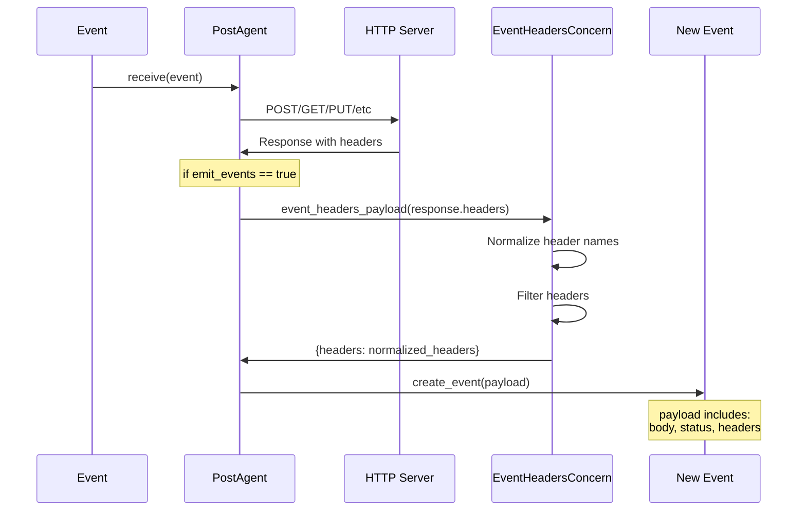
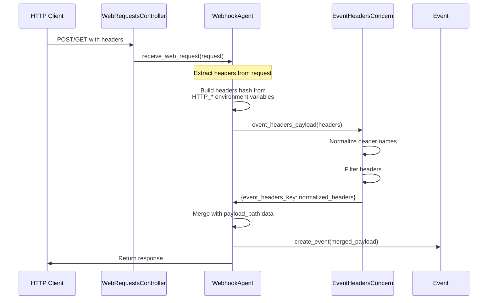
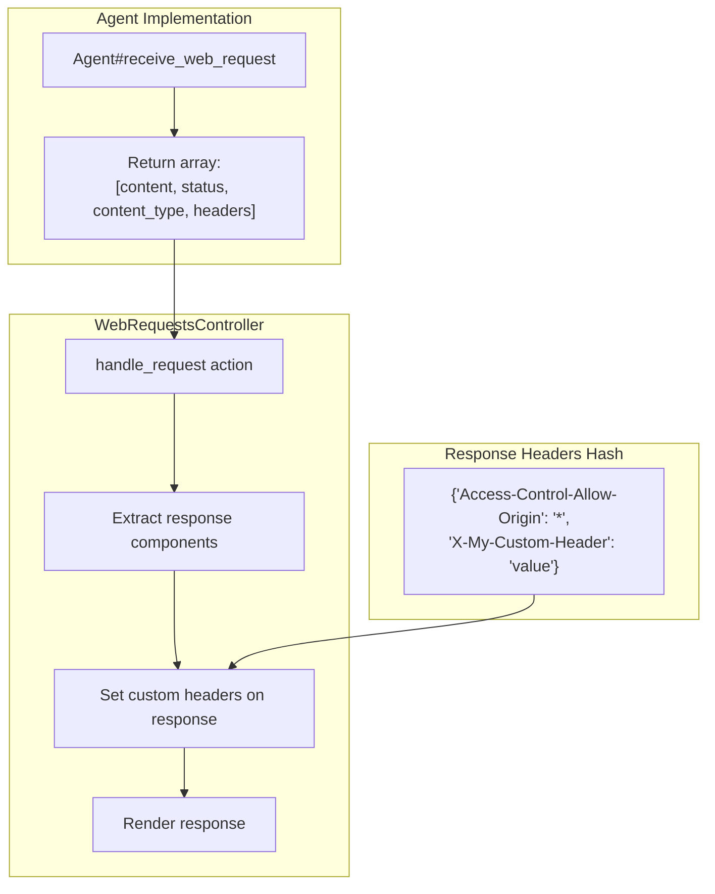
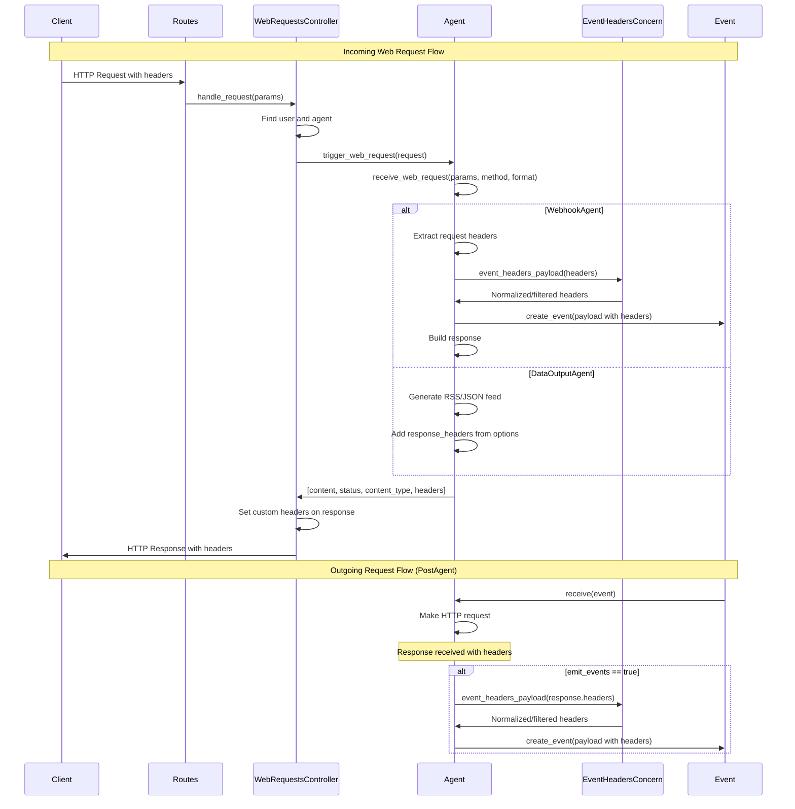

<!-- source: DeepWiki mcp.deepwiki.com · repo huginn/huginn · page 8.2 Event Headers and Response Processing · fetched 2026-10-29 -->

# Event Headers and Response Processing

<details>
<summary>Relevant source files</summary>

The following files were used as context for generating this wiki page:

- [app/concerns/event_headers_concern.rb](app/concerns/event_headers_concern.rb)
- [app/controllers/web_requests_controller.rb](app/controllers/web_requests_controller.rb)
- [app/models/agents/data_output_agent.rb](app/models/agents/data_output_agent.rb)
- [app/models/agents/post_agent.rb](app/models/agents/post_agent.rb)
- [app/models/agents/webhook_agent.rb](app/models/agents/webhook_agent.rb)
- [db/migrate/20160405072512_post_agent_set_event_header_style.rb](db/migrate/20160405072512_post_agent_set_event_header_style.rb)
- [db/migrate/20160423163416_add_xml_namespace_option_to_data_output_agents.rb](db/migrate/20160423163416_add_xml_namespace_option_to_data_output_agents.rb)
- [db/migrate/20160607055850_change_events_order_to_events_list_order.rb](db/migrate/20160607055850_change_events_order_to_events_list_order.rb)
- [db/migrate/20170419073748_set_rss_content_type.rb](db/migrate/20170419073748_set_rss_content_type.rb)
- [spec/controllers/web_requests_controller_spec.rb](spec/controllers/web_requests_controller_spec.rb)
- [spec/models/agents/data_output_agent_spec.rb](spec/models/agents/data_output_agent_spec.rb)
- [spec/models/agents/post_agent_spec.rb](spec/models/agents/post_agent_spec.rb)
- [spec/models/agents/webhook_agent_spec.rb](spec/models/agents/webhook_agent_spec.rb)
- [spec/routing/webhooks_controller_spec.rb](spec/routing/webhooks_controller_spec.rb)

</details>


## Purpose and Scope

This document explains how Huginn agents handle HTTP headers when receiving web requests and emitting response events. It covers the `EventHeadersConcern` module, which provides header normalization and filtering capabilities, and how agents like `PostAgent`, `WebhookAgent`, and `DataOutputAgent` use these features to process and propagate HTTP headers.

For information about making HTTP requests and handling authentication, see [WebRequestConcern](#8.1). For details on webhook reception and data output, see [DataOutputAgent and WebhookAgent](#5.4).

## EventHeadersConcern Overview

The `EventHeadersConcern` module provides a standardized way for agents to include HTTP headers in event payloads. It offers three main capabilities:

1. **Header Normalization** - Transform header names into consistent formats
2. **Header Filtering** - Select specific headers to include
3. **Payload Construction** - Build event payloads with normalized, filtered headers



**Sources:** [app/concerns/event_headers_concern.rb:1-61]()

## Header Normalization Styles

Header names can be normalized into four different styles using the `event_headers_style` option:

| Style | Description | Example Input | Example Output |
|-------|-------------|---------------|----------------|
| `capitalized` | Capitalizes each word (default) | `content-type` | `Content-Type` |
| `downcased` | Converts to lowercase | `Content-Type` | `content-type` |
| `snakecased` | Converts to snake_case | `Content-Type` | `content_type` |
| `raw` | Leaves headers unmodified | `content-type` | `content-type` |

The normalization is implemented using Ruby procs returned by `event_headers_normalizer`:



**Sources:** [app/concerns/event_headers_concern.rb:14-27]()

## Header Filtering

The `event_headers` option allows agents to select specific headers to include in event payloads. This can be configured as:

- **Array of strings**: `["Content-Type", "X-Custom-Header"]`
- **Comma-separated string**: `"Content-Type,X-Custom-Header"`
- **Nil/omitted**: All headers are included

The filtering process:



**Sources:** [app/concerns/event_headers_concern.rb:38-60]()

## Event Payload Construction

The `event_headers_payload` method constructs the final event payload with headers:



**Sources:** [app/concerns/event_headers_concern.rb:38-60]()

## PostAgent Response Headers

`PostAgent` uses `EventHeadersConcern` to include HTTP response headers when emitting events after making requests. This is controlled by the `emit_events` option.



The event payload structure when `emit_events` is true:

```json
{
  "status": 200,
  "body": "response body content",
  "headers": {
    "Content-Type": "application/json",
    "X-Custom-Header": "value"
  }
}
```

When `output_mode` is set to `merge`, the original event payload is merged with the response data.

**Sources:** [app/models/agents/post_agent.rb:1-236](), [app/models/agents/post_agent.rb:220-229](), [spec/models/agents/post_agent_spec.rb:312-340]()

## PostAgent Configuration Example

Configuration options for response header handling:

| Option | Type | Description | Default |
|--------|------|-------------|---------|
| `emit_events` | Boolean | Whether to emit events with response data | `false` |
| `parse_body` | Boolean | Parse JSON response bodies | `true` |
| `event_headers` | Array/String | Specific headers to include | All headers |
| `event_headers_style` | String | Normalization style | `capitalized` |
| `output_mode` | String | `clean` or `merge` with original event | `clean` |

Example configuration:

```json
{
  "post_url": "https://api.example.com/endpoint",
  "emit_events": "true",
  "event_headers": "Content-Type,X-RateLimit-Remaining",
  "event_headers_style": "snakecased",
  "output_mode": "merge"
}
```

This would emit events with response headers like:

```json
{
  "original_event_key": "original_value",
  "status": 200,
  "body": {"result": "data"},
  "headers": {
    "content_type": "application/json",
    "x_ratelimit_remaining": "99"
  }
}
```

**Sources:** [app/models/agents/post_agent.rb:73-89](), [app/models/agents/post_agent.rb:15-71]()

## WebhookAgent Request Headers

`WebhookAgent` uses `EventHeadersConcern` to include HTTP request headers when creating events from incoming webhooks.



The header extraction process in WebhookAgent:

1. Request headers are extracted from the Rack environment
2. Only headers starting with `HTTP_` are processed
3. The `HTTP_` prefix is removed and underscores converted to hyphens
4. Each word is capitalized (e.g., `HTTP_X_HELLO_WORLD` → `X-Hello-World`)
5. Headers are then passed through `EventHeadersConcern` for normalization

**Sources:** [app/models/agents/webhook_agent.rb:1-160](), [app/models/agents/webhook_agent.rb:70-76](), [app/models/agents/webhook_agent.rb:117-119]()

## WebhookAgent Configuration Example

Configuration options for request header handling:

| Option | Type | Description | Default |
|--------|------|-------------|---------|
| `event_headers` | String | Comma-separated list of headers | Empty (no headers) |
| `event_headers_key` | String | Key name for headers in event payload | `headers` |
| `payload_path` | String | JSONPath to extract from request body | `.` |

Example configuration:

```json
{
  "secret": "my-secret-token",
  "event_headers": "Accept,X-Hello-World",
  "event_headers_key": "request_headers",
  "payload_path": "data"
}
```

For an incoming request:
```
POST /users/1/web_requests/5/my-secret-token
Accept: application/json
X-Hello-World: greeting
Content-Type: application/json

{"data": {"message": "hello"}}
```

The created event payload would be:
```json
{
  "message": "hello",
  "request_headers": {
    "Accept": "application/json",
    "X-Hello-World": "greeting"
  }
}
```

**Sources:** [app/models/agents/webhook_agent.rb:48-57](), [spec/models/agents/webhook_agent_spec.rb:13-31]()

## Custom Response Headers

Agents that implement `receive_web_request` can return custom response headers. This is used by `WebhookAgent` and `DataOutputAgent` to set headers like `Access-Control-Allow-Origin` for CORS support.



The return value format for `receive_web_request`:

```ruby
[content, status_code, content_type, response_headers]
```

Where:
- `content` - String or Hash to return
- `status_code` - HTTP status code (default: 200)
- `content_type` - MIME type (optional)
- `response_headers` - Hash of custom headers (optional)

**Sources:** [app/controllers/web_requests_controller.rb:1-70](), [app/controllers/web_requests_controller.rb:30-36]()

## DataOutputAgent Response Headers

`DataOutputAgent` uses the `response_headers` option to set custom HTTP headers on RSS/JSON feed responses:

```mermaid
graph LR
    subgraph "DataOutputAgent Configuration"
        opt["response_headers option<br/>{'Access-Control-Allow-Origin': '*'}"]
    end
    
    subgraph "receive_web_request Method"
        generate["Generate RSS/JSON content"]
        interpolate["Interpolate response_headers"]
        return_val["Return [content, 200, content_type,<br/>interpolated response_headers]"]
    end
    
    subgraph "WebRequestsController"
        set["Set each header on response object"]
        send["Send response to client"]
    end
    
    opt --> interpolate
    generate --> return_val
    interpolate --> return_val
    return_val --> set
    set --> send
```

Example configuration:

```json
{
  "secrets": ["feed-secret"],
  "response_headers": {
    "Access-Control-Allow-Origin": "*",
    "Cache-Control": "max-age=3600"
  },
  "template": {
    "title": "My Feed",
    "item": {"title": "{{title}}"}
  }
}
```

This allows feeds to be consumed by JavaScript applications running on different domains.

**Sources:** [app/models/agents/data_output_agent.rb:256-326](), [app/models/agents/data_output_agent.rb:32-33](), [spec/models/agents/data_output_agent_spec.rb:268-279]()

## Complete Request/Response Flow

The following diagram shows the complete flow of headers through the web request system:



**Sources:** [app/controllers/web_requests_controller.rb:25-55](), [app/models/agents/webhook_agent.rb:59-134](), [app/models/agents/post_agent.rb:162-229](), [app/models/agents/data_output_agent.rb:256-326]()

## Validation

Agents using `EventHeadersConcern` must call `validate_event_headers_options!` during option validation. This method:

1. Attempts to call `event_headers_payload({})` with an empty hash
2. Catches `ArgumentError` for invalid option values
3. Catches `Liquid::Error` for invalid Liquid templates
4. Adds appropriate error messages to the agent

```mermaid
graph TB
    validate["validate_options method"]
    call["validate_event_headers_options!"]
    
    test["event_headers_payload({})"]
    
    catch_arg["Catch ArgumentError"]
    catch_liquid["Catch Liquid::Error"]
    
    error_arg["errors.add(:base, e.message)"]
    error_liquid["errors.add(:base, 'Liquid error...')"]
    
    valid["Validation passes"]
    
    validate --> call
    call --> test
    
    test -->|"ArgumentError"| catch_arg
    test -->|"Liquid::Error"| catch_liquid
    test -->|"No error"| valid
    
    catch_arg --> error_arg
    catch_liquid --> error_liquid
```

This ensures that configuration errors are caught before the agent is saved, preventing runtime errors during event processing.

**Sources:** [app/concerns/event_headers_concern.rb:6-12](), [app/models/agents/post_agent.rb:133](), [app/models/agents/webhook_agent.rb:153]()

## Migration History

Several database migrations have updated header-related behavior:

| Migration | Purpose | Date |
|-----------|---------|------|
| `PostAgentSetEventHeaderStyle` | Set `event_headers_style` to `raw` for existing PostAgents with `emit_events` enabled | 2016-04-05 |

This migration ensured backward compatibility when the header normalization feature was added. Existing PostAgents that were already emitting events continued to use raw header names to avoid breaking downstream agents.

**Sources:** [db/migrate/20160405072512_post_agent_set_event_header_style.rb:1-12]()

---

