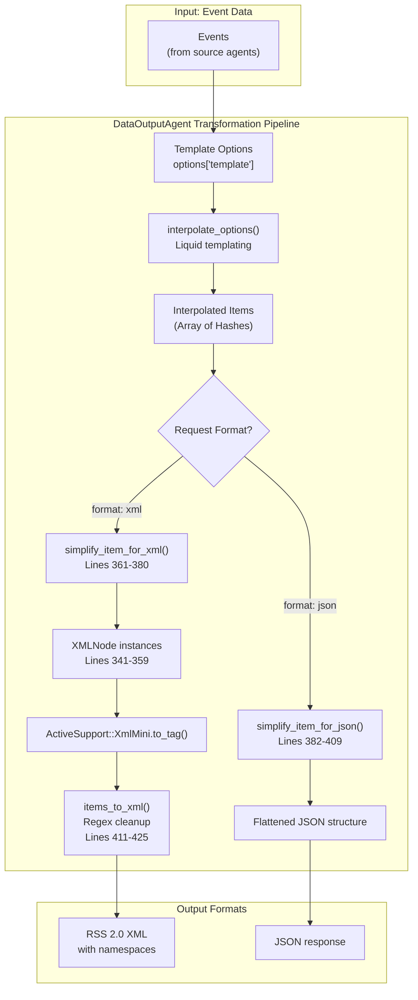
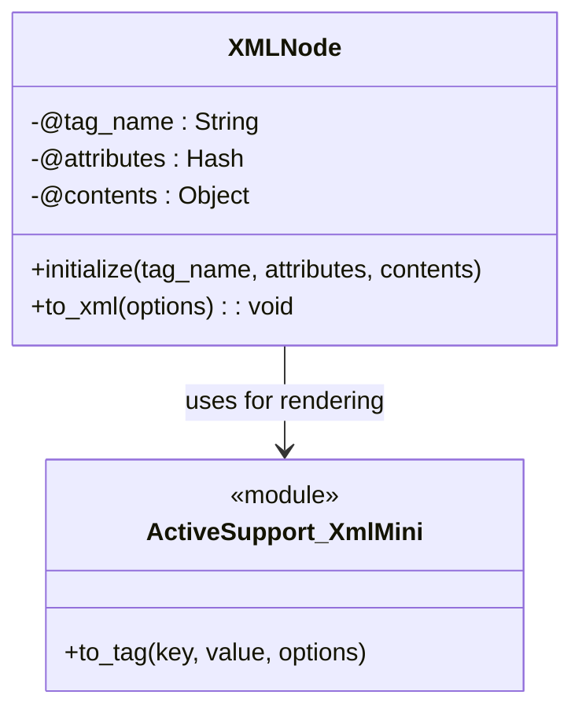
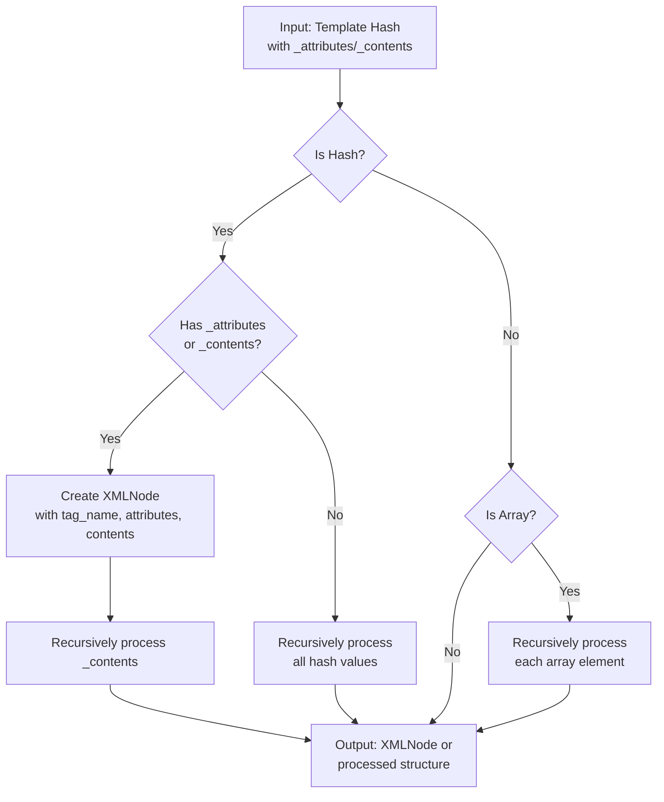
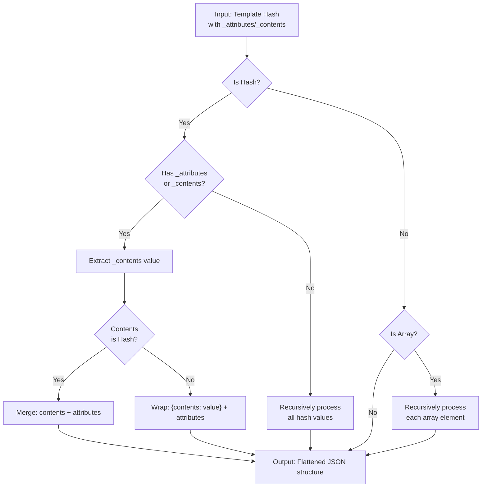
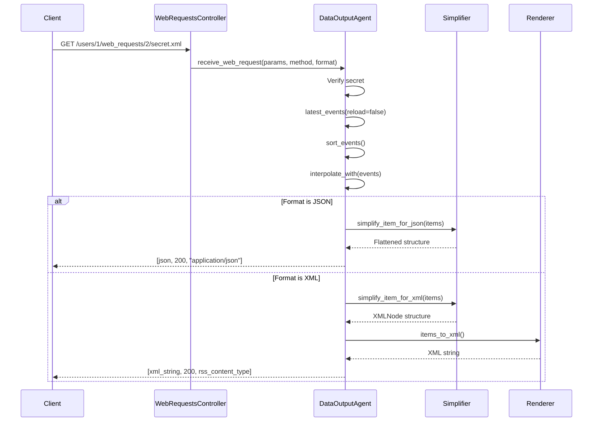
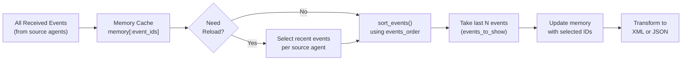

<!-- source: DeepWiki mcp.deepwiki.com · repo huginn/huginn · page 8.3 XML and JSON Transformation · fetched 2026-10-29 -->

# XML and JSON Transformation

<details>
<summary>Relevant source files</summary>

The following files were used as context for generating this wiki page:

- [CHANGES.md](CHANGES.md)
- [VERSION](VERSION)
- [app/controllers/web_requests_controller.rb](app/controllers/web_requests_controller.rb)
- [app/models/agents/data_output_agent.rb](app/models/agents/data_output_agent.rb)
- [app/models/agents/rss_agent.rb](app/models/agents/rss_agent.rb)
- [app/models/agents/webhook_agent.rb](app/models/agents/webhook_agent.rb)
- [db/migrate/20160423163416_add_xml_namespace_option_to_data_output_agents.rb](db/migrate/20160423163416_add_xml_namespace_option_to_data_output_agents.rb)
- [db/migrate/20160607055850_change_events_order_to_events_list_order.rb](db/migrate/20160607055850_change_events_order_to_events_list_order.rb)
- [db/migrate/20170419073748_set_rss_content_type.rb](db/migrate/20170419073748_set_rss_content_type.rb)
- [lib/feedjira_extension.rb](lib/feedjira_extension.rb)
- [spec/controllers/web_requests_controller_spec.rb](spec/controllers/web_requests_controller_spec.rb)
- [spec/data_fixtures/iso-8859-1.rss](spec/data_fixtures/iso-8859-1.rss)
- [spec/data_fixtures/onethingwell.rss](spec/data_fixtures/onethingwell.rss)
- [spec/data_fixtures/podcast.rss](spec/data_fixtures/podcast.rss)
- [spec/data_fixtures/youtube.xml](spec/data_fixtures/youtube.xml)
- [spec/models/agents/data_output_agent_spec.rb](spec/models/agents/data_output_agent_spec.rb)
- [spec/models/agents/rss_agent_spec.rb](spec/models/agents/rss_agent_spec.rb)
- [spec/models/agents/webhook_agent_spec.rb](spec/models/agents/webhook_agent_spec.rb)
- [spec/routing/webhooks_controller_spec.rb](spec/routing/webhooks_controller_spec.rb)

</details>


This document describes the XML and JSON transformation system used by Huginn to convert structured event data into RSS/XML feeds or JSON outputs. This system is primarily implemented in `DataOutputAgent`, which exposes events through web-accessible feeds.

For information about event templating and Liquid interpolation, see [Template Interpolation](#4.1). For details on the agents that consume these feeds, see [RssAgent](#5.2) and [WebhookAgent](#5.4).

## Purpose and Scope

The transformation system solves the problem of converting Huginn's internal event data into standardized output formats (RSS 2.0, Atom, JSON) suitable for external consumption. The system handles:

- Converting Liquid-templated event data into XML/JSON structures
- Supporting RSS elements with attributes (e.g., `<enclosure>`, `<guid>`)
- Generating compliant RSS 2.0 feeds with multiple namespaces (Atom, iTunes, Media RSS, Dublin Core)
- Transforming the same data structure into both XML and JSON outputs

## System Architecture



**Sources:** [app/models/agents/data_output_agent.rb:267-326](), [app/models/agents/data_output_agent.rb:341-425]()

## Template Data Format

The transformation system uses a special hash structure to represent XML elements with attributes. This format is defined in the agent's `template` option and interpolated with event data.

### Special Keys

| Key | Purpose | Used In |
|-----|---------|---------|
| `_attributes` | XML element attributes | XML only |
| `_contents` | Element text or nested elements | XML and JSON |

### Template Example

```ruby
{
  "enclosure" => {
    "_attributes" => {
      "url" => "{{media_url}}",
      "type" => "audio/mpeg",
      "length" => "1234567"
    }
  },
  "category" => ["Category 1", "Category 2"],
  "guid" => {
    "_attributes" => { "isPermaLink" => "false" },
    "_contents" => "{{id}}"
  }
}
```

**Sources:** [app/models/agents/data_output_agent.rb:35-50](), [spec/models/agents/data_output_agent_spec.rb:519-557]()

## XMLNode Internal Representation

The `XMLNode` class provides an intermediate representation for XML elements that need both attributes and content.



The `XMLNode#to_xml` method delegates to `ActiveSupport::XmlMini.to_tag` for actual XML generation, enabling proper nesting and encoding.

**Sources:** [app/models/agents/data_output_agent.rb:341-359]()

## Transformation Pipeline Details

### XML Transformation Process

The `simplify_item_for_xml` method recursively processes template data:



**Implementation:** The method creates `XMLNode` instances when it encounters the special keys:

```ruby
# Lines 362-374
if item.is_a?(Hash)
  item.each.with_object({}) do |(key, value), memo|
    memo[key] =
      if value.is_a?(Hash)
        if value.key?('_attributes') || value.key?('_contents')
          XMLNode.new(key, value['_attributes'], 
                     simplify_item_for_xml(value['_contents']))
        else
          simplify_item_for_xml(value)
        end
      else
        value
      end
  end
```

**Sources:** [app/models/agents/data_output_agent.rb:361-380]()

### JSON Transformation Process

The `simplify_item_for_json` method flattens the XML-oriented structure into JSON-friendly format:



**Implementation:** The method merges attributes and contents at the same level:

```ruby
# Lines 385-396
if value.is_a?(Hash)
  if value.key?('_attributes') || value.key?('_contents')
    contents =
      if value['_contents'] && value['_contents'].is_a?(Hash)
        simplify_item_for_json(value['_contents'])
      elsif value['_contents']
        { "contents" => value['_contents'] }
      else
        {}
      end
    memo[key] = contents.merge(value['_attributes'] || {})
```

**Sources:** [app/models/agents/data_output_agent.rb:382-409]()

## XML Generation and Post-Processing

After simplification, `items_to_xml` converts the structure to XML and applies cleanup:

### Generation Steps

1. **Convert to XML:** Uses `ActiveSupport::XmlMini#to_xml` on the simplified structure
2. **Remove redundant nesting:** Removes wrapper elements around array items
3. **Remove empty elements:** Deletes self-closing tags with no attributes
4. **Remove wrapper tags:** Strips the outer `<items>` container

### Regex Post-Processing

```ruby
# Lines 414-424
.gsub(%r{
  (?<indent> ^\ + ) < (?<tagname> [^> ]+ ) > \n
  (?<children>
    (?: \k<indent> \  < \k<tagname> (?:\ [^>]*)? > [^<>]*? </ \k<tagname> > \n )+
  )
  \k<indent> </ \k<tagname> > \n
}mx) { $~[:children].gsub(/^ /, '') }  # delete redundant array wrappers

.gsub(%r{
  (?<indent> ^\ + ) < [^> ]+ /> \n
}mx, '')  # delete empty elements
```

This regex removes array container elements that Rails' XML serializer creates, making the output cleaner.

**Sources:** [app/models/agents/data_output_agent.rb:411-425]()

## Complete Transformation Example

### Input Template and Event Data

```ruby
# Template
{
  "item" => {
    "title" => "{{title}}",
    "link" => "{{url}}",
    "enclosure" => {
      "_attributes" => {
        "url" => "{{media_url}}",
        "type" => "audio/mpeg",
        "length" => "{{file_size}}"
      }
    },
    "category" => "{{ categories | as_object }}"
  }
}

# Event Payload
{
  "title" => "Episode 1",
  "url" => "http://example.com/ep1",
  "media_url" => "http://example.com/ep1.mp3",
  "file_size" => "8727310",
  "categories" => ["Tech", "Podcasts"]
}
```

### XML Output

```xml
<item>
  <title>Episode 1</title>
  <link>http://example.com/ep1</link>
  <enclosure url="http://example.com/ep1.mp3" type="audio/mpeg" length="8727310"/>
  <category>Tech</category>
  <category>Podcasts</category>
</item>
```

### JSON Output

```json
{
  "title": "Episode 1",
  "link": "http://example.com/ep1",
  "enclosure": {
    "url": "http://example.com/ep1.mp3",
    "type": "audio/mpeg",
    "length": "8727310"
  },
  "category": ["Tech", "Podcasts"]
}
```

**Sources:** [spec/models/agents/data_output_agent_spec.rb:517-601]()

## Namespace Support

DataOutputAgent supports multiple XML namespaces for RSS feeds:

### Available Namespaces

| Option | Namespace | Purpose |
|--------|-----------|---------|
| `ns_media` | `xmlns:media="http://search.yahoo.com/mrss/"` | Yahoo Media RSS elements |
| `ns_itunes` | `xmlns:itunes="http://www.itunes.com/dtds/podcast-1.0.dtd"` | iTunes podcast tags |
| `ns_dc` | `xmlns:dc="http://purl.org/dc/elements/1.1/"` | Dublin Core metadata |
| (always included) | `xmlns:atom="http://www.w3.org/2005/Atom"` | Atom elements in RSS |

### Namespace Configuration

```ruby
def xml_namespace
  namespaces = ['xmlns:atom="http://www.w3.org/2005/Atom"']
  
  if boolify(interpolated['ns_dc'])
    namespaces << 'xmlns:dc="http://purl.org/dc/elements/1.1/"'
  end
  if boolify(interpolated['ns_media'])
    namespaces << 'xmlns:media="http://search.yahoo.com/mrss/"'
  end
  if boolify(interpolated['ns_itunes'])
    namespaces << 'xmlns:itunes="http://www.itunes.com/dtds/podcast-1.0.dtd"'
  end
  namespaces.join(' ')
end
```

**Sources:** [app/models/agents/data_output_agent.rb:183-196](), [app/models/agents/data_output_agent.rb:28-30]()

## Web Request Handling

The transformation system is invoked through the `receive_web_request` method:



**Sources:** [app/models/agents/data_output_agent.rb:256-326](), [app/controllers/web_requests_controller.rb:20-55]()

## Event Ordering and Selection

Before transformation, DataOutputAgent applies ordering to select which events to output:



The default ordering is by event creation time, but can be customized with `events_order` and `events_list_order` options.

**Sources:** [app/models/agents/data_output_agent.rb:211-254](), [app/models/agents/data_output_agent.rb:202-209]()

## Testing and Validation

The transformation system includes extensive test coverage:

### Key Test Scenarios

1. **XML with attributes:** Tests `enclosure`, `guid` elements with attributes
2. **Nested structures:** Tests complex nesting with `_attributes` and `_contents`
3. **Array handling:** Tests multiple `category` elements
4. **JSON flattening:** Verifies attributes merge with contents
5. **Namespace handling:** Tests media, iTunes, DC namespaces
6. **Empty element removal:** Verifies cleanup of self-closing tags

### Test Data Structure

```ruby
# From spec/models/agents/data_output_agent_spec.rb:519-557
agent.options['template']['item']['nested'] = {
  "_attributes" => {
    "key" => "value"
  },
  "_contents" => {
    "title" => "some title"
  }
}
```

**Sources:** [spec/models/agents/data_output_agent_spec.rb:517-601](), [spec/models/agents/data_output_agent_spec.rb:153-201]()

## Related Systems

### RssAgent Feed Parsing

While DataOutputAgent transforms internal events to RSS, `RssAgent` performs the inverse operation using Feedjira. The parsing extensions in `lib/feedjira_extension.rb` define how RSS/Atom feeds are converted into Huginn events.

**Sources:** [app/models/agents/rss_agent.rb:1-336](), [lib/feedjira_extension.rb:1-330]()

### WebhookAgent Reception

`WebhookAgent` receives external data and can create events that DataOutputAgent later transforms and outputs, creating a complete data flow cycle.

**Sources:** [app/models/agents/webhook_agent.rb:1-160]()