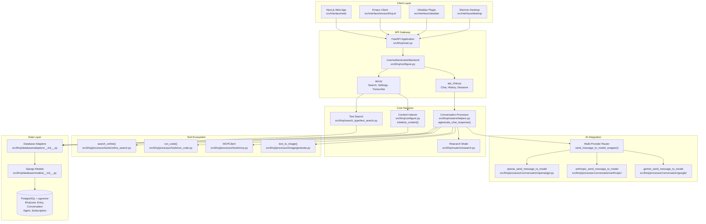
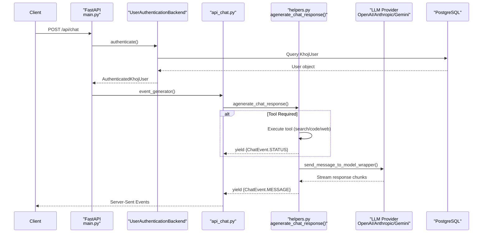

<!-- source: DeepWiki mcp.deepwiki.com · repo khoj-ai/khoj · page 1 Overview · fetched 2026-10-29 -->

# Overview

Relevant source files

The following files were used as context for generating this wiki page:

- [README.md](README.md)
- [documentation/docs/advanced/gcp-vertex.md](documentation/docs/advanced/gcp-vertex.md)
- [documentation/package.json](documentation/package.json)
- [documentation/yarn.lock](documentation/yarn.lock)
- [pyproject.toml](pyproject.toml)
- [src/interface/desktop/yarn.lock](src/interface/desktop/yarn.lock)
- [src/interface/obsidian/README.md](src/interface/obsidian/README.md)
- [src/interface/obsidian/yarn.lock](src/interface/obsidian/yarn.lock)
- [src/interface/web/bun.lock](src/interface/web/bun.lock)
- [src/interface/web/tsconfig.json](src/interface/web/tsconfig.json)
- [src/khoj/app/settings.py](src/khoj/app/settings.py)
- [src/khoj/main.py](src/khoj/main.py)
- [src/khoj/utils/cli.py](src/khoj/utils/cli.py)
- [src/khoj/utils/state.py](src/khoj/utils/state.py)
- [uv.lock](uv.lock)

Khoj is an open-source personal AI assistant system designed as a "second brain" that combines semantic search over personal documents with conversational AI capabilities. The system enables users to chat with their notes, search their knowledge base, generate images and diagrams, execute code, browse the web, and automate tasks through multiple client interfaces (web, desktop, Emacs, Obsidian).

For detailed information about specific subsystems, see:
- Backend infrastructure and API design: [System Architecture](#1.1)
- Chat and AI capabilities: [Feature Overview](#1.2)
- Document indexing and search: [Content Processing and Search](#4)
- Client applications: [User Interfaces](#5)
- Deployment and operations: [Deployment and Operations](#6)

## System Architecture

Khoj implements a client-server architecture with a FastAPI/Django backend, PostgreSQL database with vector search capabilities, and multiple frontend clients. The system integrates with various LLM providers (OpenAI, Anthropic, Google Gemini) and supports extensible tooling through MCP (Model Context Protocol).

### High-Level Component Structure

**Sources**: [src/khoj/main.py:61-198](), [src/khoj/app/settings.py:72-83](), [src/khoj/app/settings.py:178-189](), [pyproject.toml:38-98]()

### Request Processing Flow

**Sources**: [src/khoj/main.py:61-67](), [src/khoj/main.py:185-195](), [src/khoj/app/settings.py:192-192]()

## Core Components

### Backend Application

The backend is built on **FastAPI** with **Django ORM** for database management. The main application entry point is `src/khoj/main.py`, which initializes the server, configures middleware, and registers API routers. It also handles the initialization of the database via Django management commands [src/khoj/main.py:51-54]().

| Component | File Path | Purpose |
|-----------|-----------|---------|
| Application Bootstrap | `src/khoj/main.py` | FastAPI app initialization, middleware setup, and DB migration |
| Settings | `src/khoj/app/settings.py` | Django configuration, database settings, and app definitions |
| State Management | `src/khoj/utils/state.py` | Global application state (models, clients, schedulers) |
| CLI Interface | `src/khoj/utils/cli.py` | Command-line argument parsing and server configuration |

**Sources**: [src/khoj/main.py:26-67](), [src/khoj/app/settings.py:1-210](), [src/khoj/utils/state.py:1-41](), [src/khoj/utils/cli.py:9-53]()

### Feature Overview

Khoj provides a comprehensive suite of AI-powered features designed to augment human intelligence. For details, see [Feature Overview](#1.2).

*   **Chat & Agents**: Interact with multiple LLMs (OpenAI, Anthropic, Gemini) [pyproject.toml:45-90](). Create custom agents with specific personas and tools [README.md:49-49]().
*   **Semantic Search**: Advanced search over local documents including PDF, Markdown, Org-mode, and Word [README.md:47-47]().
*   **Tool Integrations**: Built-in capabilities for web search, code execution via E2B, and image generation [pyproject.toml:95-96]().
*   **Automations**: Scheduled research tasks and personal newsletters delivered to inbox [README.md:50-50]().
*   **Computer Operator**: Experimental agents capable of browser and computer automation [README.md:37-37]().

**Sources**: [README.md:42-55](), [pyproject.toml:38-98]()

### User Interfaces

Khoj is accessible through a variety of interfaces to fit into any workflow. For details, see [User Interfaces](#5).

*   **Web Interface**: A modern Next.js application [src/interface/web/bun.lock:51-51]().
*   **Desktop App**: Electron-based application for local use [src/interface/desktop/yarn.lock:5-19]().
*   **Obsidian Plugin**: Integrates Khoj directly into your vault [src/interface/obsidian/README.md:1-4]().
*   **Emacs**: Native integration via `khoj.el`.

**Sources**: [README.md:48-48](), [src/interface/obsidian/README.md:1-4](), [src/interface/web/bun.lock:1-61]()

## Deployment and Operations

Khoj is designed to be flexible, supporting both cloud-scale enterprise deployments and private, on-device usage. It utilizes Docker for containerization and includes a comprehensive CI/CD pipeline for testing and benchmarking. For details, see [Deployment and Operations](#6).

**Sources**: [README.md:67-73](), [pyproject.toml:109-133](), [src/khoj/main.py:153-182]()

---

